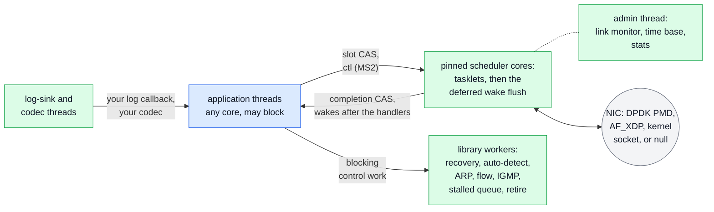
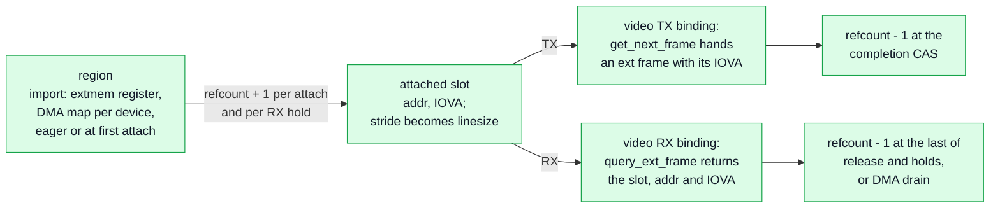
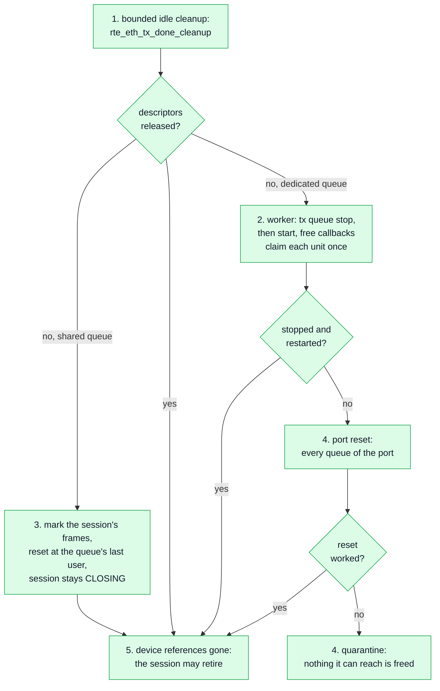

# Engine: how the unified API sits on today's engines

| | |
|---|---|
| Status | Maintained. Today's engines under the core: the pinned-core rules, where each part starts in `lib/`, the engine changes and the known defects. Nothing here is implemented yet |

This document says where each part of the unified API starts in `lib/`, which existing
function it calls or replaces, and what has to change in today's engines first; the core, its
bindings and its seams are [core.md](core.md). Public names
are those of the headers in `sketch/include/mtl/experimental/`, which are normative. Internal
names (the core, the bindings, `lib/src/st2110/core/`, `lib/src/unified/`) are indicative.

**Citations.** Every `path:line` is at `a6fc9093`, whose code is `main` @ `2fe5599f`. Paths
without a directory are under `lib/src/`; session files are in `lib/src/st2110/`, pipeline files
in `lib/src/st2110/pipeline/`. Citations marked **[verified at HEAD]** were re-read against that
commit. **[inferred]** means the effect follows from the code but was not run.

**Start here.** Implementers come here with one of three tasks:

| Task | Start at |
|---|---|
| starting an MS1 task in `lib/`: the file, function and line, and what to change | §2 (its head lists the tasks), then §2.1–§2.6; the task table is [implementation-plan.md](implementation-plan.md) §5.2.1 |
| looking up an ID (E8, MF7, SF-45, H-K-14) | the key below, then §6 (the changes) or §7 (the defects) |
| checking a tasklet rule: what a context may and must never do | §1.2, §1.4 |

**IDs used here.** The IDs below are defined in this file unless the third column says otherwise;
the others (D-n, OI-n, G-n, the tasks) are listed in [README.md](README.md) §3.

| ID | Means | Defined in |
|---|---|---|
| H1–H10 | today's pinned-core hazards | §1.1 |
| E1–E17 (E5a, E5b), R1, R2, MF1–MF10, EK1–EK21, PE1–PE9 | the engine changes: E-changes, recovery, memory fixes, pod fixes, packet-unit fixes | §6 |
| ACC, BRIDGE-TIME, CLOCK, DSCP, FPS, RELOCK, RTCP-SR, RXHDR, TPARSER, TROFFSET, TRUNCATE, UDW, WAKE | the named rows: the engine items of the bindings | §6 |
| SF-01…SF-88, SP-01…SP-10, SC-01…SC-08 | library defects (SP: probable), consumer findings | §7.1 |
| DD-01…DD-21 | documentation drift | §7.2 |
| H-K-1…H-K-28 | pod hazards | §7.3 |
| S0, S1, S4–S8, SP-PKT | spikes | §6.1 |
| ST1–ST9, SR1–SR3, SR6 | the S1 thresholds and decision rules | §6.1 |
| E1a–E1d (task E1) | the MS1 engine-fix tasks, written and reviewed as the series E1; the E1 of §6 is the media-time change | [implementation-plan.md](implementation-plan.md) §5.2.1 |
| E2, E3, E4, K1, K2, T3, T5, T8, F4, P2, A7, A8, A10, J8 in §1 | core.md step labels, not engine changes | [core.md](core.md) §4.2; [wait-protocol.md](wait-protocol.md) §3, §4, §7 |
| R6, R8 | contract rules; R1 and R2 are also engine items (§6), and R1 an MS1 task | [contract.md](contract.md) §1 |

## 1. The pinned-core rules

The rule: MTL runs tasklets on pinned cores; everything called from the API runs
outside them and never blocks them. The header states it as R6: no application code ever runs on
an MTL tasklet.

### 1.1 What today's code does

| # | Today | Evidence |
|---|---|---|
| H1 | almost every user callback (`get_next_frame`, `notify_*`, `query_ext_frame`, `uframe_pg_callback`, `notify_detected`) runs on the tasklet with the session spinlock held; `get_next_frame` is polled every iteration while idle | `st_tx_video_session.c:2699`, `st_rx_video_session.c:3644` **[verified at HEAD]**; `st_video_transmitter.c:674` |
| H2 | a same-session stats getter called from a callback spins forever on the non-recursive spinlock | `st_tx_video_session.c:4782`, `st20_pipeline_tx.c:1320` (SF-13) |
| H3 | BLOCK_GET: the tasklet does `pthread_mutex_lock` + `pthread_cond_signal` on every frame event; the application holds that mutex while scanning, so the pinned core can sleep in `FUTEX_WAIT` | `st20_pipeline_tx.c:41-46` in `tx_st20p_notify_frame_available` **[verified at HEAD]**; `:782-798`; same in every `st*p` (SF-15), RX scanning under it since `1a89339c4` (`st20_pipeline_rx.c:865-877`) |
| H4 | TX-hang recovery runs on the transmitter: queue re-acquire under a pthread mutex, mempool re-create, busy flush, INFO logs | `st_video_transmitter.c:681` → `st_tx_video_session.c:4250-4351` **[verified at HEAD]**; audio `st_tx_audio_session.c:2741-2752` |
| H5 | RX auto-detect allocates on the tasklet (legacy only from MS3) | `rv_init_sw` `st_rx_video_session.c:2668`, `rx_st20p_notify_detected` `st20_pipeline_rx.c:343-395` |
| H6 | `update_destination` and `update_source` hold the session spinlock across ARP, flow and IGMP work ([§2.17](#217-updates-on-a-running-session-today)); the unified path fixes it in G1 (MS3) | [§2.17](#217-updates-on-a-running-session-today) (SF-14) |
| H7 | `ptp_get_time_fn`, PHC reads and the log printer (`localtime_r`) run on the hot path | `dev/mt_dev.c:1681-1686`, `mt_ptp.c:393-403`, `mt_log.h:24-39` |
| H8 | TX `notify_frame_done` fires on the transmitter, the builder, the application thread or a plugin thread; migration moves sessions between lcores | [legacy-internals.md](legacy-internals.md) (which context runs which callback) |
| H9 | the admin CPU-busy scan takes the blocking session spinlock of every video session each cycle, so tasklets skip that session; TSQ `tx_mutex` and the SRSS list lock spin inside tasklets | `mt_admin.c:29-33` **[verified at HEAD]**; `datapath/mt_shared_queue.c:642`, `datapath/mt_shared_rss.c:66-71` |
| H10 | `USE_MULTI_THREADS` RX: with the packet ring full the tasklet and the packet lcore process one session at once | `st_rx_video_session.c:3006-3012` (SP-03, **[inferred]** race) |

Severity: H1 design, H2 fatal, H3 high, H4 high (error path), H5 medium, H6 high, H7 medium, H9
medium, H10 medium. Four more tasklet hazards are listed in
[legacy-internals.md](legacy-internals.md): pcap file I/O on the tasklet (debug only), blocking
spinlocks in tasklet start hooks, the builder `pending` overwrite (SF-08 here, fixed on main,
`fb13bf68a`) and samples that teach mutex + condvar in callbacks. One busy-wait is deliberate and
bounded (`f64db786a`): with DMA copies pending, a packet whose RTP timestamp is newer than every
slot and than the last failed flush makes the RX tasklet poll the DMA engine for up to
`ST_RX_VIDEO_DMA_FLUSH_TIMEOUT_NS` (20 µs) before it drops the packet (`rv_dma_flush`,
`st_rx_video_session.c:1571-1590`, called at `:1229`; not with a packet lcore). That is once per
frame for a well-formed stream, but up to once per packet for a stream whose timestamp changes on
every packet (SF-93). No load of implementation-plan.md §8.4 runs RX DMA; the core and the
bindings add no such wait (§2.5, D-251).

The scheduler itself is sound and stays as it is, with one addition: one loop per scheduler that
sums handler returns and may sleep (`sch_tasklet_func`, `mt_sch.c:153-240`); register and
unregister run under a pthread mutex with an ack handshake (`mt_sch.c:871-964`). The addition is
the wake flush between the handler loop and the sleep check ([wait-protocol.md](wait-protocol.md) §4).

### 1.2 Execution contexts

The picture shows the contexts and what crosses between them. Arrows into the tasklet world are
lock-free hand-offs: a CAS on the slot, and from MS2 the `ctl` word that the `tick` hook
acknowledges in `ack` ([core.md](core.md) §5). Arrows out of it are wait-free stores: the completion CAS, a release
store of PUBLISHED and one RMW of the event word; for an armed target the object's `fired` lanes
and a bit in the loop's bitmap, which the scheduler loop turns into a bounded number of wakes per
iteration after its handlers ([wait-protocol.md](wait-protocol.md) §4, D-142). An armed completion is E2, E4 and a CAS on lines the
arming thread writes: wait-free, except the queue push's CAS (MS2a; lock-free, its retries bounded
by concurrent pushes and two consumer transitions per call). The
only threads that run application code are the log-sink thread and codec threads; no tasklet
does (R6). The table after the picture says what each context may and must never do.

The tasklets are the TX builders and transmitters, RX, the bindings' callbacks and the `tick`
hook (MS2).

| Context | Pinned | May run | Must never |
|---|---|---|---|
| **TK** tasklet (lcore, thread-mode scheduler, null-only loop) | yes | packet build, pacing, RX reassembly, mempool get/put, lock-free ring ops, release stores, fences, the event word's RMWs (§1.2), log-ring lines (from MS2a, below) | block, sleep, take an application-holdable lock, allocate, call the log sink, run application code, make a syscall in a handler (except §1.3; wake flush: [wait-protocol.md](wait-protocol.md) §4) |
| **WK** library workers | no | recovery rebuilds, auto-detect re-init, ARP/flow/IGMP for updates (MS5; in MS3-MS4 the update's ARP, rules and joins run in the CP call), stalled-queue stop/start, deferred-close retire, pcap writes, conversion when not in the caller | spin on tasklet-owned state |
| **AD** admin, stat, CNI, EAL alarm and log-sink threads | no | periodic work, PTP servo, time-base publication, NIC counters, link monitor, handing log lines to the sink (§1.8) | take a lock a tasklet takes |
| **APP** application threads | application's choice | every public call; DPC work (conversion, the RX fill, copies) | — |

Tasklet log lines go into the per-scheduler log ring from MS2a; in MS1 they go through the legacy
macros, at `dbg` and `err` only. "Never allocate" is precise: no `malloc`/`calloc`/`rte_malloc*` and no mempool, ring or heap
creation or destruction on a tasklet. Mempool get/put and ring enqueue/dequeue are allowed:
tasklets already take one mbuf per packet and one per frame at TX start
(`st_tx_video_session.c:4369`).

### 1.3 Syscalls on tasklets, per backend

| Backend | Syscalls on the tasklet | Status |
|---|---|---|
| DPDK PMD | none inside a handler; after its handler loop the scheduler wakes a bounded number of marked objects and queues per iteration, one futex wake or one `write()` each ([wait-protocol.md](wait-protocol.md) §4, D-142) | promise (G-39, the deferred wake excepted); the writes are counted per scheduler and reported |
| kernel socket | `sendto`/`sendmsg` in `mt_tx_socket_burst` (`datapath/mt_dp_socket.c:426-450`) | reported per backend; G-39 scoped out |
| native AF_XDP | `send()` kick (`dev/mt_af_xdp.c:522-526`) | same |
| built-in PTP time reads | `rte_eth_timesync_read_time` per `mt_get_ptp_time` | replaced by the published time base (§3, MS6) |
| clock reads on a clocksource without a vDSO (`hpet`, `acpi_pm`) | one `clock_gettime` syscall per TX frame and per RX unit | detected at open, reported as bit 2 of `*.backend_syscalls_on_tasklet` with a warning (§2.12); removed by the published time base (§3, MS6) |

### 1.4 How the new core keeps the rules

| Rule | Mechanism | Section |
|---|---|---|
| arrows into the tasklet world are lock-free hand-offs | commands in the session's `ctl` word, acknowledged in its `ack` word by the per-visit `tick` (MS2); flush and discard of queued units are control-plane CASes on the slot table; the CP applies commands itself on a detached session | [core.md](core.md) §5 |
| arrows out of the tasklet world are wait-free stores | a completion is the claim CAS, the result in its descriptor, a release store of PUBLISHED and one RMW of the event word; an event updates pending state; `mt_wake()` sets `fired` lanes and a bit in the loop's bitmap, a bounded number of wakes per iteration (D-142); an armed completion adds E4 and the push's CAS (MS2a, §1.2) | [core.md](core.md) §4, §6 |
| heavy per-unit work never runs on a tasklet | conversion, RX copies into application memory, the fill of missing data run in the caller (DPC) or on a worker. One exception, library code only: `rx.convert_per_packet` (`MTL_OPT_RX_CONVERT_PER_PACKET`) converts each packet on the RX tasklet as it lands, as `ST20P_RX_FLAG_PKT_CONVERT` does today (§2.4) | §2, [core.md](core.md) §3 |
| results cannot be lost or overflow | acquire reserves the result's descriptor (the `resv` counter) before the unit exists, and the completer writes the result in place; the tasklet allocates no entry | [core.md](core.md) §4 |
| no user code or driver read for time | one published, slewed time base per CPU socket (MS6) | §3 |
| no log I/O on tasklets | tasklets write already formatted, length-capped lines into a per-scheduler log ring that drops when full; a library thread hands them to the sink | §1.8 |
| no lock shared with tasklets on read paths | per-scheduler counter blocks summed by the reader; gauges by scan; seqlocked groups; the admin scan reads tasklet-written busy counters | §1.8 |
| events never block their producer | per-source pending state for tasklets, small rings per producer class for library threads | [core.md](core.md) §4.6 |

**Call classes in the engine.** Each public function carries one of `MTL_API_CP`, `MTL_API_DP`,
`MTL_API_DPC`, `MTL_API_WT`, `MTL_API_AS` (the contract is in [contract.md](contract.md)). For the
engine this means: DP and DPC calls never wait for a tasklet and return `-MTL_EAGAIN` instead; a
tasklet never waits for an application thread (an empty submission means idle, a full results
ring cannot happen, [core.md](core.md) §4). A DP call arms nothing and makes a syscall only as a producer (R6): one
wake when it makes a target ready for a sleeper, a futex wake or a queue's `write()` (MS2a)
([wait-protocol.md](wait-protocol.md) §3). Every syscall is raw, so no DP call is a cancellation point. Seqlock readers (`mtl_time_now`, and with it the
inline `mtl_time_convert`, `mtl_stat_read`, health) are DP, not AS: a signal handler that interrupts the writer's own
thread mid-update would retry forever.

**Inline notify** (`mtl_session_set_inline_notify`, `mtl_events.h`, `MTL_LATER`). v1 runs no
application code on a completing context (D-04); the function is added only if W0 busy polling
cannot close the latency gap for slice producers, zero-hop forwarders and the MXL bridge. If it
is added, it runs on the completing context without any session lock held (so it cannot
self-deadlock, H2), must be wait-free and bounded, may call only the inline-safe subset (the DP
calls with timeout 0, which then only trylock the reaper lock and never arm, and
the AS calls), has a
measured budget with counters, and is disabled with `MTL_EVENT_OVERFLOW` when it overruns
repeatedly.

**Library loops.** No public function is called from a tasklet or a library loop (the scheduler
loop, the loop thread of a null-only instance, the RX packet lcore of `USE_MULTI_THREADS`, the TAP
lcore), and none runs application code
(R6). Busy polling belongs to application threads: they may poll the DP calls and the WT calls
with timeout 0 (W0). Each library loop sets a thread-local `mt_in_busy_loop` that backs a
debug-build assert on every public entry; it is not a public error. AS calls are allowed on any
thread: a signal can be delivered to a pinned lcore thread too, and an AS call is atomics, the futex
call and `write()` on never-freed words, with no in-flight count: a session's interrupt makes at
most one futex wake, a queue's at most one `write()`, and the instance interrupt walks the session
table ([wait-protocol.md](wait-protocol.md) §5). User schedulers and
tasklets (`mtl_sch_*`) are cut ([coverage.md](coverage.md)), so neither H2 nor the 1 s sleep of
a self-unregistering tasklet (`mt_sch.c:883-899`) can be reached from the API.

**Debug enforcement** (MS3). Every entry point except the AS ones sets a thread-local "current
class"; AS entries touch no TLS and skip the `mt_in_busy_loop` assert. `mt_rte_zmalloc*`,
`mt_pthread_mutex_lock`, `mt_sleep_ms`, `info()` and `warn()` assert that the class is not DP,
DPC or AS and that the thread is not a tasklet or library loop. A WT call with timeout 0 runs as DP. A
signal-safety test raises a signal inside every CP call with `malloc` and `pthread_mutex_lock`
interposers armed, and calls every AS function from the handler.

### 1.5 Thread mode and sleep

- `MTL_INSTANCE_TASKLET_THREAD`: today `sch_start` creates a plain pthread
  (`mt_sch.c:283-285`, `sch_tasklet_thread` at `:250-255`) that is never registered with EAL;
  `rte_thread_register` appears nowhere in `lib/src` **[verified at HEAD]** (SF-49). Such a
  thread has `LCORE_ID_ANY` and no mempool cache. The fix calls `rte_thread_register` in the
  scheduler thread at start and pins each scheduler thread to one CPU (MS1, task E1d). The wake is
  the same in this mode: the scheduler thread flushes after its handler loop, a bounded number
  of objects per iteration ([wait-protocol.md](wait-protocol.md) §4).
- **Threads that are not schedulers** run on `instance.main_lcore` (`MTL_OPT_MAIN_LCORE`, D-92).
  Today every one inherits the affinity of the thread that called `mtl_init`; each is pinned at
  its creation site: admin (`mt_admin.c:384`), stat (`mt_stat.c:156`), CNI (`mt_cni.c:415`),
  kernel-socket TX and RX (`datapath/mt_dp_socket.c:293`, `:632`) and TSC calibration
  (`mt_main.c:200`) **[verified at HEAD]**; the workers, the log-sink thread and the loop thread
  of a null-only instance are new and are created pinned (part of EK7).
- `MTL_INSTANCE_TASKLET_SLEEP`: the idle path already enters the kernel
  (`rte_eal_alarm_set` + `cond_timedwait` with a 1 s safety net, `mt_sch.c:84-94`
  **[verified at HEAD]**). The wake flush runs before the sleep check (`mt_sch.c:209-211`) and returns 1
  while an object stays marked, so a scheduler never sleeps on a pending wake ([wait-protocol.md](wait-protocol.md) §4), and posting a command calls `sch_sleep_wakeup`
  (`mt_sch.c:50-54` **[verified at HEAD]**) from the CP thread.

### 1.6 Mempools and application threads

| Case | Rule |
|---|---|
| frame pools (all essences) | keep today's atomic release: RX release is an atomic decrement (`rv_put_frame`, `st_rx_video_session.c:227-237` **[verified at HEAD]**), not a mempool operation |
| application threads and MP/MC mempools | an application thread never gets from or puts to a mempool a tasklet also uses: a preempted thread mid-dequeue makes the tasklet spin in the ring tail update (`mt_util.c:516-545`, default `ring_mp_mc`, **[inferred]** from DPDK). `st20_tx_get_mbuf` (`st_tx_video_session.c:4650`) is such a path and stays legacy-only |
| packet units (`MTL_UNIT_PACKETS`) | a tasklet-refilled allocation ring per consumer plus a return ring the tasklet drains |
| non-EAL threads | have no mempool cache; one more reason for the rules above |

Why the rules hold: an `rte_ring` consumer never waits on a producer; only peers on the same side
wait in `__rte_ring_update_tail`. So a tasklet that dequeues a ring filled by application threads
(the return rings of packet units) is safe, but an application thread that gets from or puts to an
MP/MC mempool the tasklet also uses makes the tasklet a same-side peer of a thread that can be
preempted. RTS/HTS ring modes only bound that window; they do not remove it. In thread mode
without `rte_thread_register`, two scheduler threads that share a port pool also contend on its
MP ring tail, because neither has a mempool cache (§1.5).

Other hazards on the way: the handle guard's `lc_refcnt` RMW shares a cache line with
tasklet-read fields (`st20_pipeline_tx.h:35-42`), so the core's in-flight counter sits on its own
line; slot tables live on the scheduler's NUMA node and `mtl_session_info.sched_index` names the
scheduler. An application thread that polls from the other socket pays cross-socket latency on
every call, so polling threads should run on the scheduler's node: the `sched.lcore` and
`info.numa` stats keys give it.

### 1.7 Backends and what they grant

The capability keys (`caps.backend`, `caps.pacing_classes`, `caps.tx_multi_seg`,
`caps.hw_rx_timestamp`, …), `tx.path`, the per-backend scope of G-39 and the expected pacing class
per test come from this table. Driver table: `dev/mt_dev.c:14-107` **[verified at HEAD]**.

| Backend (`enum mtl_backend`) | Pacing classes | Path and steering | Notes |
|---|---|---|---|
| `MTL_BACKEND_DPDK_PMD` (E810/E830 PF or VF) | `HW_RATE` (TM shaper: ice PF, iavf VF), `HW_LAUNCH` (E830 PF, built-in PTP), `SW`, `SW_NARROW`, `BEST_EFFORT` | zero copy when the NIC has multi-segment TX; flow director, else shared RSS (ixgbe: `MT_FLOW_NONE`) | CNI inside MTL; the only backend with TX hang recovery; no secondary processes (`--in-memory`, `dev/mt_dev.c:344`) |
| `MTL_BACKEND_AF_XDP` (native) | `HW_RATE` through sysfs `tx_maxrate` on ice (`dev/mt_af_xdp.c:96`), else `SW` | always copies into UMEM; XDP program and per-queue XSK from MtlManager, or from a node daemon's XSK map (EK19) | — |
| `MTL_BACKEND_KERNEL_SOCKET` | `SW` only | single segment; a socket per flow, no flow steering | |
| `MTL_BACKEND_KERNEL_SOCKET`, continued | | | still needs hugepages; only the destination comes from the packet header (since `8224aba52`), TOS and TTL are socket options and the source port is the kernel's (SF-92), so a `dscp` or `ttl` update on TX and every update on RX swap the queue ([§2.17](#217-updates-on-a-running-session-today); MS5, a running update is `-MTL_ENOTSUP` there before) |
| `MTL_BACKEND_NULL` | none | no NIC; units complete at their launch instant on the instance clock; loopback RX by flow | the null binding and the null-only instance ([core.md](core.md) §2.4, D-111), MS1 |
| Windows | DPDK PMD only | — | no MtlManager, AF_XDP or kernel socket |

**DSCP** (D-134). The TX header templates today are IPv4 only, TTL 64, TOS 0, DF set (video
`st_tx_video_session.c:961-964`) **[verified at HEAD]**, and the builders copy the template into
every packet (`:1079`, `:1124`, `:1230`); no `ops` field carries a TOS. `mtl_flow.dscp` (and
`ttl`) reach the wire through these templates: the video TX binding passes them at create (MS1,
task B1), the other bindings with their essence (MS4): audio `st_tx_audio_session.c:165`, ANC and
fastmeta (an ST40 session in fast metadata mode) `st_tx_ancillary_session.c:234` (TOS lines). Each
engine gains the field in its `ops` or a setter in `st_engine_core.h` (§2.11). The kernel-socket
backend sends from an `AF_INET`/`SOCK_DGRAM` socket (`datapath/mt_dp_socket.c:217`) and hands
`sendto` only the UDP payload (`:67-80`), so the template's TOS and TTL never reach the wire there:
on the queues a unified binding creates, that backend sets `IP_TOS`, `IP_TTL` and, for a multicast
destination, `IP_MULTICAST_TTL` (whose default 1 is what legacy kernel-socket multicast leaves with,
SF-92) on every socket of the queue, one per thread (D-249) **[verified at HEAD]**.

Constraints the capability model must make visible, all silent today:

- a shared TX queue forces software pacing for the whole port (§2.9);
- ST 2110-22 downgrades a rate-limited port to software pacing for its sessions (§2.9);
- `mtl_dma_map` needs IOVA-VA mode;
- HW RX timestamps need the PMD's RX timestamp offload (`dev/mt_dev.c:2504-2522`), with the iavf
  descriptor-count workaround of `99b96c16` (`dev/mt_dev.c:1048-1057`); `include/mtl_api.h:371`
  still says "PF on E810" (to confirm);
- legacy `ALLOW_DOWN_PORTS` prunes a 2022-7 session to one leg at create (`tv_ops_prune_down_ports`
  `st_tx_video_session.c:4025`, audio `st_tx_audio_session.c:2598`, RX `rv_ops_prune_down_ports`
  `st_rx_video_session.c:4331`).

Backend facts beyond this table (CNI per backend, DPDK AF_XDP and AF_PACKET) are in
[legacy-internals.md](legacy-internals.md).

### 1.8 Stats, traces and logs

| Part | Construction |
|---|---|
| counters | per scheduler (D-128): each scheduler writes its own block of a session's counters, on its own cache line; a completion on another scheduler (a shared TX queue's last mbuf freed by another session's tasklet, [core.md](core.md) §4.3) writes that scheduler's block; application and library threads have their own; relaxed stores, summed by the reader, never reset by the library; blocks: below the table |
| gauges | not sums of writer blocks, which are no consistent cut: the reader scans the slot state words once, which also gives `queue.queued_media_ns`; per-writer `entries{state}` and `exits{state}` counters make G-43 an identity; the wait words by plain loads (`wait.*` per object, `wq.*` per queue, MS2a) |
| seqlocks | only for grouped values of one writer: histogram buckets, window buckets, the PTP offset and path-delay pair |
| windowed maxima (`{window=1s\|60s}`) | a ring of 60 one-second buckets written by the value's single writer; the reader takes the current bucket or the maximum of the valid ones |
| port counters | polled by a library thread and cached (`MTL_STAT_CACHED`, `port.sampled_tai_ns`): `rte_eth_stats_get` on a VF can be a PF mailbox round trip |
| USDT probes | keep today's providers; add probes for admission decisions (unit, margin, policy), late and drop, recovery begin and end, time state, link, back-pressure, migration, command posted and acked, each with the session handle ID, unit `seq`, media index and RTP; the core's probes (below the table) |
| logs | tasklets write already formatted, length-capped lines (session name prefixed) into a lock-free per-scheduler ring, checked before formatting (below the table); a library thread hands the lines to the sink (D-129). No per-site codes. Today tasklets log at every level (`st20_pipeline_tx.c:199`, `st_tx_video_session.c:134`, `st_video_transmitter.c:38`, `st_rx_video_session.c:957`) |

**Counter blocks.** A session allocates the blocks of its home scheduler, of the application
threads and of the library threads at create; a foreign scheduler's block is allocated on the
control plane when a shared TX queue gains a session of that scheduler (for every session already
on the queue, and for the new one), before that session starts, never on a tasklet. A block is the
essence's counter set rounded to 64 B (about 0.8 KB for video, est.); a session keeps a table of
18 block pointers. A queue's stats blocks are allocated at `mtl_queue_create`.

**The core's probes.** From C1w a provider `core` with probes at E3 (`wake_mark(obj, lanes)`), K1
(`wake_now(obj, lanes, syscalls)`), T8 (`wait_sleep(obj, lanes)`), T3 and T5
(`wait_return(obj, r)`) and F4 (`flush_carry(sched, left)`) ([wait-protocol.md](wait-protocol.md) §3, §4), and from C1q1 (MS2a) at
K2, P2, A7, A8, A10 and J8 ([wait-protocol.md](wait-protocol.md) §7).

**The log check.** Before formatting, the macro checks the process-wide threshold (one load), a
token bucket of its call site (10 lines a second, burst 10; relaxed atomics on the site's static
state, refilled from one `rte_rdtsc()`) and reserves a ring entry, then formats in place into that
entry; a line the bucket or a full ring refuses is counted in the scheduler's drop counter and
costs no formatting.

**State dump** (debug builds). `mtl_debug_inject(obj, MTL_FAULT_DUMP_STATE)` logs, at `err`
level through the normal log path, every field of the object's register ([core.md](core.md) §4.1, §4.8, wait-protocol.md §2) with its
name: the entry, line A, the in-flight line, and for a session its slot words, ring indices and
the marks of its object in every loop's bitmap; for a queue its `qword` and line B. It changes no
state and takes no lock a tasklet takes; the words are plain loads, so the dump is a snapshot per
word, not a consistent cut.

The core's own counters follow these rules from MS1; the stats registry over them comes in MS3;
the engine counters in `tv_*`/`rv_*` and in the other essences' sessions are converted by MS4. The
registry rules are [contract.md §11](contract.md), the log rules contract.md §10.3.

## 2. ST20 first: where to start in `lib/`

The MS1 tasks of [implementation-plan.md](implementation-plan.md) §5.2.1 that touch `lib/` start at
these files. The core and the bindings are new files; the engine diffs of MS1 stay under about
1 k lines, and st20p itself changes only by bugfixes until its re-base in MS2. The core's own
tasks, C0, C1a, C1w, C1b and C2, start at the files of [core.md](core.md) §8.

- **A1, the instance.** The null-only instance and its EAL rule ([core.md](core.md) §2.4), the bridge from a legacy
  instance, errors and reasons, options, and the port table of [core.md](core.md) §2.4 (null ports taken out before
  `mtl_init`; one binding set per session).

- **E1a–E1d, engine fixes** (the series E1; detail §2.2, §2.3, §2.5, §5). S0's data is needed
  before the merge, not before the writing:
  - E1a: MF1's claim on main's `tv_frame_free_cb` (`st_tx_video_session.c:121-160`), which already
    decrements (`:152`) before the notify (`:154-155`, `8c9d48f3e`) but claims nothing: a `refcnt`
    CAS 1 → 2 there and in legacy recovery's frame loop (SF-39, §2.2);
  - E1a: MF7, the builder takes one reference on the frame's `sh_info` when it starts the frame (where
    it takes `refcnt`, `:1979`) and drops it after the last attach, so the count cannot reach 0
    mid-frame when the NIC has freed every packet built so far before the next attach (a starved
    builder; from MS2 rows waiting for lines); recovery and teardown drop it when they abandon a
    frame in build (§5; `tv_uinit_hw`'s flush, `:2739-2745`);
  - E1a: the recovery verdict (§5), with one `sh_info` per frame; the alternating pair comes with
    REPEAT (§2.2, D-248);
  - E1b: idle descriptor cleanup, on dedicated queues and, by trylock, on shared queues (D-213),
    the "Idle cleanup" paragraph of [§2.3](#23-transmitter-st_video_transmitterc);
  - E1c: incomplete delivery always on: the RX binding sets `ST20_RX_FLAG_RECEIVE_INCOMPLETE_FRAME`
    (`include/st20_api.h:204`), so the silent recycle at `st_rx_video_session.c:992-998` is never
    reached for core sessions (the engine also requires the flag with `query_ext_frame`,
    `:4419-4423`);
  - E1c: the RX hook never refuses: `rv_frame_notify` puts a refused frame back at `:954-960` (SF-45),
    so the RX binding's `notify_frame_ready` always returns 0;
  - E1d: `rte_thread_register` for thread-mode schedulers (SF-49, §1.5), the ST30P and ST40P
    user-timestamp fixes, and the legacy teardown order (OI-3, §4).
- **B1, the video TX binding** (detail §2.1–§2.3, §2.12). `lib/src/st2110/core/bind_video_tx.c`:
  - the template is `tx_st20p_create_transport` (`st20_pipeline_tx.c:421-496`: ops at `:427-488`,
    `st20_tx_create` at `:490`);
  - `get_next_frame` is called at `st_tx_video_session.c:1939` (today `tx_st20p_next_frame`,
    `st20_pipeline_tx.c:183-247`); `notify_frame_done` by `tv_notify_meta_done`
    (`st_tx_video_session.c:93-114`; today `tx_st20p_frame_done`, `st20_pipeline_tx.c:249-299`),
    which names the unit from the binding's own record of the frame, written at its pick, and
    reads that record and main's `done_*` copy only before its publish (§2.2);
  - at `get_next_frame` the binding calls `st_core_tx_pick` with the video grid it built at create
    from `st20_tx_get_pacing_params` ([core.md](core.md) §3.2), and drives the engine with `ST20_TX_FLAG_USER_PACING |
    ST20_TX_FLAG_RTP_TIMESTAMP_EPOCH` (`include/st20_api.h:56`, `:100`) and `required_tai = N·T`
    (§2.12); this replaces the pipeline's drop-when-late (`st20_pipeline_tx.c:117-181`); one or
    two legs, interlace, DSCP (§1.7), `sc.ssrc` and `sc.payload_type` into `ops.ssrc` and
    `ops.payload_type` (one RTP identity for both legs, read at `st_tx_video_session.c:981-984`);
  - the sender type goes into `ops.pacing`; the engine has only the gapped schedule today (N, and W
    with the gapped TRS, SF-34), reads `ST21_PACING_LINEAR` nowhere (SF-72) and applies the gapped
    schedule to every raster (SF-73). MS1 passes the requested sender type as the legacy pipeline
    does and reports no type; from MS2a (C-GRANT) the binding grants it (contract.md §3.6, D-143),
    caps VRX0 through `ops.start_vrx` for the W bound and for interlaced and PsF N (TLINE/2), and
    flags SD interlaced N until E5b. A present `video.start_vrx` or `video.disable_bulk` is never
    overwritten: the binding checks it against the cap below and refuses a value the cap breaks
    with `-MTL_EINVAL`, `OPTION_RANGE` ([core.md](core.md) §2.6). In detail:
    - MS1 sets `MTL_INFO_NON_COMPLIANT` for NL, off-format N and interlaced or PsF N (the base
      rule without W);
    - the interlaced cap with its floor: with k = ceil(TLINE / (2 × TRS)), `ops.start_vrx` =
      VRX_N − 3 − k if that is at least 1; else the binding sets `ST20_TX_FLAG_DISABLE_BULK` and
      `ops.start_vrx` = VRX_N − 1 − k; if that is still below 1, `-MTL_ENOTSUP`
      (`NOT_IMPLEMENTED`); `start_vrx` is never 0, which the engine reads as unset;
    - on a wrapper the core and the bindings read `mt_get_ptp_time(impl, MTL_PORT_P)`;
  - TX library pools are the engine's own framebuffers in MS1 (OI-59 (b)); conversion runs in the
    caller (OI-60), and with `MTL_SUBMIT_SRC_PLANES` submit reads the caller's planes during the
    call as the conversion or copy source;
  - `notify_event` (`ST_EVENT_FATAL_ERROR` at `:4259`, `ST_EVENT_RECOVERY_ERROR` at `:4347`, VSYNC at
    `:327`) gives ERROR and the epoch tick; `notify_frame_late` (`:699-700`) never fires for core
    sessions, because the engine calls it only when it picks the slot itself;
  - the session name goes into `ops.name`, so the engine's own lines carry it; the create and stat
    lines of D-110 come from the shell's `compat_log.c` ([core.md](core.md) §1); the UB tests drive the real engine
    through a harness like `tests/unit/session/st20_tx_harness.c`.
- **B2, the video RX binding** (detail §2.4, §2.5, §2.14). `lib/src/st2110/core/bind_video_rx.c`:
  - the template is `rx_st20p_create_transport` (`st20_pipeline_rx.c:492-630`: ops at
    `:501-599`, `st20_rx_create` at `:601`);
  - one RX path from MS1 (D-126): `query_ext_frame` (`st_rx_video_session.c:1300`) hands the engine
    a core-allocated slot for every unit; `notify_frame_ready` is called by `rv_notify_frame_ready`
    (`st_rx_video_session.c:725-732`; today `rx_st20p_frame_ready`, `st20_pipeline_rx.c:171-298`)
    and publishes the slot in `pub_seq` order ([core.md](core.md) §4.4); `notify_detected` at
    `st_rx_video_session.c:2908`; `notify_event` for VSYNC at `:3616`;
  - a slot that reaches FREE returns its engine frame with the tasklet-callable put of
    `st_engine_core.h` (§2.11) over `rv_put_frame` (`:227-237`); the public `st20_rx_put_framebuff`
    (`:4824-4838`) takes the handle guard and looks the frame up by `addr`;
  - incomplete policy, one or two legs (§2.14);
  - per-packet conversion is the `uframe_pg_callback` install of `st20_pipeline_rx.c:525-538`;
  - its create line comes from `compat_log.c` ([core.md](core.md) §1).

MS2 adds, in the same binding files: rows through `query_frame_lines_ready` (TX) and
`notify_slice_ready` (RX) (§2.13); attached memory, `MTL_SESSION_RX_BY_INDEX` and
`MTL_SESSION_RX_LATEST` through the same `query_ext_frame` (OI-59 (a)); the `tick` hook, one per
session in the TX builder and the RX handler ([core.md](core.md) §5); and, last, the st20p re-base onto the core.

### 2.1 st20p TX, `st20_pipeline_tx.c`

st20p stays as it is in MS1 apart from bugfixes. Its callbacks are the template of the video TX
binding, and at MS2 it becomes a wrapper on the core. The third column says where each piece of
logic lives in the core design.

| Function | Today | In the core and the video TX binding |
|---|---|---|
| `tx_st20p_frame_done` `:249-299` | stores FREE (`:272`) **before** `notify_frame_done` (`:288`) **[verified at HEAD]**, so `get_frame` can hand the slot out before its result exists | the binding's `notify_frame_done` is the completion CAS out of ENGINE; the result is in its descriptor before PUBLISHED, so the slot is reused only after it ([core.md](core.md) §4.2, §4.4); at MS2 the legacy notify fires once (R2) |
| `tx_st20p_convert_put_frame` `:355-399`; internal convert in `st20p_tx_put_ext_frame` `:1001-1009` | converting paths fire `notify_frame_done` at conversion, never at transport done (`:388-393`, `:1004-1008`) | conversion is the XFORM state (D-100), which ends in QUEUED, never in a result; a unit's result exists only at transport done on every path. An early storage release is a later opt-in |
| `st20p_tx_get_frame` `:765-831` | numbers frames at `get_frame` (`:817` **[verified at HEAD]**); BLOCK_GET waits under `block_wake_mutex` (`:782-798`) | `mtl_tx_acquire`: a CAS FREE (or PUBLISHED) → APP with the next generation, plus the reservation ([core.md](core.md) §4.4); the wait is the armed wait on `MTL_WAIT_ACQUIRE` ([wait-protocol.md](wait-protocol.md) §3); `seq` at submit. At MS2, `st20p_tx_get_frame` is acquire seen as `st_frame` |
| `tx_st20p_newest_available` `:64-79` | returns the **oldest** CONVERTED by `seq_number` **[verified at HEAD]** (the intended FIFO, misnamed, SF-44): acquire A, B, submit B, A sends A, B | the binding's `get_next_frame` takes the descriptor at the pick cursor, so pick-up is by submit `seq` (G-08); the misnamed function goes with the MS2 re-base |
| `tx_st20p_next_frame` `:183-247` | the transport's `get_next_frame`; copies the frame's time into the meta only with USER_PACING or USER_TIMESTAMP (`:233-236`) | the binding's `get_next_frame`: `st_core_tx_pick` (QUEUED → ENGINE, the launch decision), then `st20_tx_frame_meta` with `tfmt` TAI and `timestamp = N·T` (§2.12); media time and launch apart inside `tv_*` is E1 (MS3) |
| `st20p_tx_put_frame` `:834`, `st20p_tx_put_ext_frame` `:938` | state store, optional inline conversion in the caller | `mtl_tx_submit`: the descriptor at `seq` in one line, then APP → QUEUED (+ X for a transform, [core.md](core.md) §4.4); conversion in the caller (DPC, OI-60); `MTL_SUBMIT_SRC_PLANES`: the caller's planes are the conversion or copy source, read during the call |
| `st20p_tx_put_frame_abort` `:911-936` | IN_USER only | `mtl_release` of an APP slot (CAS to FREE, `resv` decremented); a QUEUED slot leaves by a control-plane CAS QUEUED → PUBLISHED with `MTL_TX_FLUSHED` (stop FLUSH, discard), with no engine call (D-103) |
| `tx_st20p_if_frame_late` `:117-181` | DROP_WHEN_LATE needs USER_PACING; one-frame grace; reads PTP time on the tasklet (`:135`) | replaced by the launch decision ([core.md](core.md) §3.2, MS1): a TAI unit whose index is too late is `MTL_TX_DROPPED` with `TOO_LATE` at pick-up, with no grace period; admission reporting with `margin_ns` is E3 (MS3) |
| `tx_st20p_notify_frame_available` `:36-47` | mutex + cond on the tasklet (`:41-46`, H3); `tx_st20p_block_wake` `:29-34` is now only the destroy wake, a broadcast (`be5087525`) | not in the core: one `mt_wake()` ([core.md](core.md) §6); legacy st20p gets it with the MS2 re-base (SF-15) |
| `tx_st20p_framebuffs_flush` `:730-761` | sleeps up to ~1 s per held frame at free (H-K-15) | not on the close path; close uses §4 |
| `st20p_tx_get_session_stats` `:1309` | blocking spinlock (`:1320`, H2) | per-writer counters |

### 2.2 st20 TX session builder, `st_tx_video_session.c`

| Function | Today | Change |
|---|---|---|
| `tvs_tasklet_handler` `:2690-2728` | `try_get` of the session spinlock (`:2699`); `pending` summed per session (`:2710-2715`) **[verified at HEAD]** (SF-08, `fb13bf68a`) | TX's one `tick` per session visit (MS2, before the `s->active` check at `:2701`): one relaxed load of `ctl`, immediate commands applied, `ack` stored, idle cleanup ([core.md](core.md) §5) |
| `tv_tasklet_frame` `:1880-2163` | calls `get_next_frame` every iteration while idle (`:1939`); claims a frame and returns without building it on `refcnt != 0` or oversize user meta (`:1953-1970`) **[verified at HEAD]** | the binding's `get_next_frame` takes the descriptor at the pick cursor and never hands out a frame these checks refuse (MF1; user meta size checked at submit; SF-38) |
| `calc_frame_count_since_epoch` `:654-707` | "late" measured at the epoch boundary; a frame picked after its start goes out at once, counted nowhere; USER_PACING rounds `required_tai` to the nearest frame (`:661`) and the window check only counts (`:637-652`) | the binding decides N and passes `required_tai = N·T`, which maps back to N (§2.12, MS1); admission reporting (E3, MS3) |
| `tv_sync_pacing` `:709-765` | reads PTP once per frame (`:712`), paces on TSC | media time and launch separate (E1, MS3); exact math (E2, MS1 task X or MS3); published time base (E9, MS6) |
| `tv_update_rtp_time_stamp` `:779` | default video RTP is the scheduled time of packet 0, not the media time | RTP from media time only (E1, MS3; legacy opt-in) |
| `tv_pacing_required_tai` `:1791-1824` | EXACT silently falls back to default pacing outside [now + RL warm-up lead, now + 1 s] (`:1813-1822`) **[verified at HEAD]** | the binding checks the window before it hands the frame over (§2.12), so the fallback is never reached for core sessions; the result reports what happened |
| no-chain done `:2147-2151` | `tv_frame_free_cb` called right after build **[verified at HEAD]**: "done" before anything is sent; same for ST22 `:2672-2676` | "last packet handed" (MS2, `st_engine_core.h`, §2.11): the transmitter completes the frame when its last packet is handed to the NIC; until then a no-chain result means "built" |
| `tv_frame_free_cb` `:121-160` | checks `refcnt == 1` (`:132-136`), copies the meta into `done_tv_meta`/`done_st22_meta` (`:139-143`), moves an ext frame's `addr` to `done_addr` and clears `addr/iova` (`:145-149`), decrements (`:152`), then notifies with the copy (`:154-155`) **[verified at HEAD]** (SF-05, `8c9d48f3e`); no claim; one `sh_info`, `fcb_opaque` = the frame (`:252-254`) | |
| `tv_frame_free_cb`, continued | | MF1's claim (MS1, E1a; the order is on main): a `refcnt` CAS 1 → 2 for the `refcnt != 1` read, minus 2 for the decrement, the same CAS in legacy recovery's frame loop (SF-39); core sessions: the binding's completion CAS on the unit its record of the frame names; the alternating `sh_info` come with REPEAT (below the table, §5) |
| `st20_tx_queue_fatal_error` `:4250-4351` | recovery on the transmitter; reports in-flight frames COMPLETE; zeroes `sh_info` (`:4309-4320`) **[verified at HEAD]** | the recovery verdict (MS1, task E1a, §5): `MTL_TX_DROPPED` with reason `RECOVERY` recorded in the slot, only software-held references dropped, `sh_info` untouched, published by the last PMD reference; recovery on a worker (R1, MS6) |
| `tv_uinit_hw` `:2729-2757` | pad bursts through `mt_txq_flush` run `tv_frame_free_cb` on the destroying application thread (`:2739-2745`) | replaced by the bounded cleanup and queue reset of §4 (MS3) |
| `tv_mgr_detach` `:3816-3834` | detach is the session spinlock, not a handshake **[verified at HEAD]** | MS1 detaches core sessions this way (through `st20_tx_free`); from MS2 it is the ack-timeout fallback ([core.md](core.md) §5) |
| `tv_init_hdr` `:920-1006` | resolves the destination MAC at create (`:943`): `arp_get_result` sleeps in 500 ms steps up to the ARP timeout, 60 s by default (`mt_arp.c:171-199`) **[verified at HEAD]**, hence GStreamer's `async-session-create`; TOS 0 (`st_tx_video_session.c:962`) | |
| `tv_init_hdr`, continued | | a worker resolves; the leg is `MTL_FLOW_WAITING_NEIGHBOUR` meanwhile (D-62, G-90); flow rules at start; DSCP into the TOS (§1.7) |
| `tv_mgr_update_dst` `:3862-3881` | the update path: [§2.17](#217-updates-on-a-running-session-today) | [§2.17](#217-updates-on-a-running-session-today) |
| `tv_pkts_capable_chain` `:2891-2913`; no-chain decision `:3431-3439` | silent copy mode when `total_pkts × (frames_cnt − 1) < nb_tx_desc` (`:2905`, a warn log); `nb_tx_desc` = 512 (`MT_DEV_TX_DESC`, `dev/mt_dev.c:1039`) **[verified at HEAD]** | report `MTL_TXR_COPIED`, `mtl_session_info.direct`; `MTL_SESSION_REQUIRE_DIRECT` fails create; `min_count_direct` in `mtl_buffer_requirements` |
| frame arrays `:4092`; linesize `:3351-3357`, copy-chain mempool `:2999-3013` | `ST20_FB_MAX_COUNT` = 8; linesize fixed at create | E11 (MS2); MF9 (MS2, §6) |
| `tv_init_pacing` `:511-628` | TR offset from a fixed table (`:522-534`); only `start_vrx` and WIDE are capped by the TR offset (`:571`, `:604-614`); gapped TRS on every raster (`:519`, `:535`, SF-73); SD constants by height (`:524-533`, SF-74); NL runs as N (`:611`, SF-72) **[verified at HEAD]** | `sc.video.troffset_us` with the VRX cap of §2.13 (MS2); NL, linear (E5a, MS5); HEIGHT (E5b, MS6) |
| linesize and chain build | the engine already strides (below the table) | a plane with `stride ≥ row_bytes` (a sub-rectangle, a woven field) is direct: `plane[0].stride` becomes the engine linesize through MF9 (G-84) |
| `st20_tx_get_session_stats` `:4782` | blocking spinlock (H2) | per-writer counters |

**Main's copy and the binding** (MS1, D-248). Main's `tv_frame_free_cb` releases the frame before
it notifies and hands the notify a per-frame copy, `done_tv_meta`/`done_st22_meta` and an ext
frame's `done_addr` (`st_header.h:136`, `:152-153`; `st20_tx_get_framebuffer` falls back to it,
`st_tx_video_session.c:4617`), which serves one completion of a frame at a time (`8c9d48f3e`).
Until REPEAT that is enough for core sessions. The builder takes a frame only at `refcnt` 0
(`st_tx_video_session.c:1955-1956`), which only its free callback restores once recovery records a
verdict (§5). The binding hands a frame out only for a QUEUED slot, which leaves ENGINE in the
binding's own notify. So no frame is picked again before the binding has published its last use
([design/models/tx_completion.py](design/models/tx_completion.py)). The binding names the unit from
its own record of the frame, written at its pick (MS1: the frame is the slot, OI-59 (b)), never from
the frame's live state, and reads the record and the copy only before its publish.
From MS2b, where one engine frame can carry different slots (`mtl_tx_send_slot`, attached
memory), the binding hands a frame out again only after its notify of the frame's previous use
has returned, since `refcnt` 0 comes before that notify.

**REPEAT on the builder** (T-REP, MS4a1, core sessions; D-240, D-248). A repeat sends a frame
again while an earlier use is on the wire, the first reuse of a frame before its old mbufs are
freed. So T-REP gives each engine frame two `sh_info` that alternate per use, with the use
generation in `fcb_opaque` (§5 step 4). Each carries a use record (meta, address, IOVA,
generation, `busy`), whose meta and address replace main's copy for core sessions. It changes
three rows of the table:

- `tv_tasklet_frame` refuses only a busy use (`:1953-1960`); the pick fills that use's meta and
  address, not `frame->tv_meta` (`:1962`); `refcnt` counts busy uses (`:1980`); the chain
  builders (`:1315`, `:1726`) attach the current use's `sh_info`.
- The no-chain done (`:2147-2151`) completes the current use.
- `tv_frame_free_cb` takes the use from `fcb_opaque`, checks the address against `use->addr`,
  notifies with `&use->meta`, clears `use->addr` only, and has no `refcnt != 1` early return
  (`:132-136`); legacy keeps main's code by an ops flag.
- `busy` is atomic: the free callback's release store is its last access to the record, and the
  builder's acquire load precedes any write to it, since the callback runs on the transmitter,
  on a TSQ's foreign scheduler, in E1b's idle cleanup and in recovery.
- The pins are [core.md](core.md) §3.1's (D-212): a repeat use is a CAS that adds one to the
  slot word's `holds` while the pin bit is set, and its free callback drops it.

**Linesize and chain build today** **[verified at HEAD]**. `st20_tx_ops.linesize` is a session
parameter (`include/st20_api.h:1215-1219`, RX `:1562-1565`); the session takes the larger of it and
the row bytes and rejects any other non-zero value, equal included
(`st_tx_video_session.c:3351-3357`, RX `st_rx_video_session.c:3471-3479`), so a packed plane passes
0. The chain builder offsets each packet by `line1_number × st20_linesize`
(`st_tx_video_session.c:1242`, `:1287-1289`) and attaches the slot at that offset (`:1310-1315`); it
copies into `mbuf_mempool_copy_chain` only a packet that crosses row padding (`:1291-1305`) and, in
PA mode, one that crosses a page (`:1306-1309`); the copy builder does the same (`:1137`,
`:1179-1192`). The pipelines forward `transport_linesize` (`st20_pipeline_tx.c:459`,
`st20_pipeline_rx.c:562`). The split-forward sample relies on it:
`ops_tx.width = ctx.width / 2` with the full-width linesize and one offset per quadrant
(`app/sample/fwd/rx_st20_tx_st20_split_fwd.c:263-265`, `:284-287`). `pkts_copied_partial` is 0
with GPM_SL, 0 with BPM (1200 B packets) when `row_bytes` is a multiple of 1200 (1920 px 4:2:2
10-bit = 4800 B), and about one packet per padded line with GPM.

### 2.3 Transmitter, `st_video_transmitter.c`

| Function | Today | Change |
|---|---|---|
| `video_trs_tasklet_handler` `:665` | calls `st20_tx_queue_fatal_error` on the tasklet when `tx_queue_recovery_pending` (`:676-682` **[verified at HEAD]**) | raise a flag; the worker recovers (R1, MS6). The per-session loop (`:673-686`) also runs the idle cleanup (below the table) |
| `video_trs_rl_target_reached` `:180-199` | accepts a target up to `NS_PER_S` ahead and returns to the scheduler while it waits (`:188-191`) | the builder's `tick` (MS2) runs on the same scheduler during that wait (§2.8) and applies an immediate command, so stop does not wait up to 1 s |
| `video_trs_burst` `:66`; RL, TSC, launch-time tasklets `:354`, `:373`, `:480` | chain: done only when a later burst recycles descriptors (≈ `nb_tx_desc` packets later), never while idle; RL warms up `warm_pkts × TRS` early (`:226-233`), TSC holds a bulk to its target (`:443-461`) | idle cleanup (below); "last packet handed" (MS2); enqueue times (E4, MS3); lead: §2.12 |
| TSN | a launch time in the past is not checked (`:531-538`) | admission rejects it (E3, MS3) |
| RL queue rate set, `dev/mt_dev.c:768-772` (also `:700`) | each rate set commits the port's whole TM hierarchy under `inf->resetting` **[verified at HEAD]**; an external user reports that this disturbs other live sessions on the port (#1620) **[inferred]** | measure in S0: a create must not disturb its siblings; twins run next to their legacy originals on one VF |

**Idle cleanup.** With frames in flight and the build ring empty, the transmitter calls
`mt_txq_done_cleanup` (`datapath/mt_queue.c:225-228` → `rte_eth_tx_done_cleanup`) at most about
once per TRS × 64 (a starting value; S6 measures), and only while the builder's frame state is
`ST21_TX_STAT_WAIT_FRAME` (`st_tx_video_session.c:1930`): the cleanup exists for the last frame
before an idle gap, and a frame being built keeps its own reference (MF7). It runs on dedicated
and on shared queues (D-213). On a TSQ, today's `mt_tsq_done_cleanup` takes `tsq_lock`, a pthread
mutex (`datapath/mt_shared_queue.c:394-396`, `:625-633`), which does not serialise it against
`mt_tsq_burst`'s `tx_mutex` spinlock (`:642-648`), and the queue-fatal recovery already calls it
on the tasklet (`st_tx_video_session.c:4280`, `st_tx_audio_session.c:2733`) **[verified at HEAD]**.
E1b rewrites it: it takes `tx_mutex` by trylock on the idle path and by lock on the recovery path,
never `tsq_lock`; it frees at most `tx_rs_thresh` descriptors per visit, so it holds the lock no
longer than a burst's own free; it is skipped on an AF_XDP queue (`tsq_queue->xdp`), which
completes at the copy. A failed trylock retries at the next rate-limited idle visit, which gives
liveness (another session's bursts recycle nothing until the queue passes `tx_free_thresh`).
G-147 tests it. ice and iavf clean descriptors only when `nb_tx_free < tx_free_thresh` **[inferred]**, hence the ≈ 512-packet
delay: ≈ 1.9 ms at 1080p59.94 (TRS ≈ 3.7 µs), ≈ 0.5 ms at 2160p, ≈ 4.3 ms at 720p59.94. Without it the
result of the last submitted frame never arrives (G-03 fails on the default ST20 path, and on
every TSQ) and stop(DRAIN) cannot finish; today only teardown (`tv_uinit_hw`) and recovery flush. MS1 runs it
for core sessions from the per-session loop of `video_trs_tasklet_handler`
(`st_video_transmitter.c:673-686`) (task E1b); from MS2 the builder's `tick` runs it and the
transmitter calls nothing of the core ([core.md](core.md) §5).

### 2.4 st20p RX, `st20_pipeline_rx.c`

As for TX: st20p RX is the template of the video RX binding and becomes a wrapper on the core in
MS2.

| Function | Today | In the core and the video RX binding |
|---|---|---|
| `rx_st20p_frame_ready` `:171-298` | the transport's `notify_frame_ready`, on the tasklet; may convert per frame there | the binding's `notify_frame_ready` is the completion CAS ENGINE → PUBLISHED with the frame meta as the unit's detail and the next `pub_seq` ([core.md](core.md) §4.4); it never refuses (SF-45) and never copies or converts (D2); conversion runs in the caller's `mtl_rx_dequeue` (DPC, OI-60) |
| `st20p_rx_get_frame` `:843-956`, `st20p_rx_put_frame` `:958` | CAS claims; internal converter in the caller | `mtl_rx_dequeue` is a CAS PUBLISHED → APP with the next generation, in `pub_seq` order; `mtl_release` stores FREE and returns the engine frame (`rv_put_frame`), or HELD while TX units hold it (MS2), and the last hold returns the frame (MF10) |
| `rx_st20p_create_transport` `:492-632` | derive and `query_ext_frame` require `ST20_RX_FLAG_RECEIVE_INCOMPLETE_FRAME` (`:591-596`) | the binding sets the flag on every session and applies `MTL_OPT_RX_INCOMPLETE` (DELIVER or DISCARD) itself; with DISCARD it returns the frame at once and counts the unit (MS1, task E1c) |
| `rx_st20p_query_ext_frame` `:300-331` | user callback on the tasklet | the binding implements it from MS1 (one RX path, D-126): it hands the engine a core-allocated slot for every unit, any FREE one in MS1; MS2 adds attached pools and `RX_LATEST`, MS2b by index (`RX_BY_INDEX`); no user code runs there; per-unit provide is `mtl_rx_provide` (`mtl_mem.h`), exported in MS2 |
| `rx_st20p_notify_detected` `:343-395` | logs and allocates on the tasklet (H5) | the binding's `notify_detected` records the format and returns; the re-init runs on a worker (MS6, with recovery) |
| `ST20P_RX_FLAG_PKT_CONVERT` `:525-538` | installs `uframe_pg_callback = rx_st20p_packet_convert` with `uframe_size`: library code per packet on the tasklet, 4:2:2 10-bit to four formats; it disables DMA (`st_rx_video_session.c:2676-2677`) **[verified at HEAD]** | the binding installs it for `MTL_OPT_RX_CONVERT_PER_PACKET` (MS1); only the public `uframe_pg_callback` is cut |
| `rx_st20p_notify_frame_available` `:37-48` | mutex + cond on the tasklet (`:42-47`, H3), no token since `1a89339c4`; `rx_st20p_block_wake` `:29-35` serves only `wake_block` and destroy, a broadcast (`23c524700`) | as TX: one `mt_wake()` |

**The RX binding's `query_ext_frame`** (the `rx_st20p_query_ext_frame` row) also does:

- MS1: core slots are allocated one per slot (`round_up(unit_bytes + 64, 64)`, 64 B aligned, the
  tail reserved), and dequeue writes the 64 B tail.
- MS2b:
  - the binding pops a provided destination instead of a core slot, and pushes a dropped unit's
    destination back to the front;
  - at the stop, discard and detach acknowledgements it waits for the unit's DMA to drain, then
    hands back and increments `provide_gen`.

### 2.5 RX slot reassembly, `st_rx_video_session.c`

| Function | Today | Change |
|---|---|---|
| `rvs_pkt_rx_tasklet_handler` `:3634-3663` | visits every session each iteration with `try_get` (`:3644` **[verified at HEAD]**) | RX's one `tick` per session visit, with or without packets (MS2): `ctl`/`ack` and the due-time check ([core.md](core.md) §5) |
| `rv_slot_by_tmstamp` `:1188-1340` | a newer timestamp evicts the older slot (`:1241-1248`); with DMA in flight after `rv_dma_flush` the new frame's packets drop (`:1229-1235` **[verified at HEAD]**, SF-46); `query_ext_frame` `:1300-1325` | the DMA-busy drop as `rx.pkts_rejected{cause=dma_busy}` and per unit (MS1); first arrival per leg (E8: MS1; due time MS2); relock (`:1203-1225`): §2.14 |
| `rv_get_frame` `:210-225` | scans for a free frame | runs before `query_ext_frame` (`:1272`, `:1286-1300`): for core sessions the engine frame only carries the core slot, and frames ≥ pool_count + slot_max (E11) keep the scan from failing. `MTL_SESSION_RX_BY_INDEX` (MS2b): slot = `media_index mod pool_count`; a leased or held target drops the unit (next unit's `missed_before`) |
| `rv_put_frame` `:227-237` | atomic decrement **[verified at HEAD]** | unchanged: HELD and the last-reference CAS to FREE are core states, and the binding calls this put, through `st_engine_core.h` (§2.11), only when the slot reaches FREE or when it returns a frame at once (DISCARD, `RX_LATEST` reclaim) (MF10, MS2) |
| `rv_handle_frame_pkt` `:1671-1968`; `rv_slot_full_frame` `:1370-1377` (called at `:1962`) | a frame completes only when full (`:1954-1962` **[verified at HEAD]**) or evicted | RX deadline: the `tick` force-completes at the due time (E8, MS2) |
| `rv_frame_notify` `:857-1000` | a refused `notify_frame_ready` puts a counted frame back (`:954-960` **[verified at HEAD]**, SF-45); without the incomplete flag an incomplete frame is recycled silently (`:992-998` **[verified at HEAD]**, SF-18) | the binding's `notify_frame_ready` never fails: PUBLISHED, or under `MTL_RX_DISCARD` returned and counted (MF4) |
| `rv_dma_dequeue` `:1542-1566` | completes frames on the RX tasklet, also from `rv_dma_flush` | a completing context: `mt_wake()` from the tasklet; the core's DMA waits (E8's force-complete, the stop, discard and detach acknowledgements, the FLOWS switch) take this once-per-visit dequeue and never call `rv_dma_flush` (§1.1, D-251) |
| `rv_pkt_lcore_func` `:2574-2586` | packet lcore fires callbacks; races the tasklet (`:3006-3012`, SP-03) | a completing context and a library loop: it marks `fired` and, after its handler, wakes its one session ([wait-protocol.md](wait-protocol.md) §4, B3); the race is fixed or the mode stays legacy-only |
| packet lcore choice `:2747-2773` | above 40 Gb/s without DMA, or with `USE_MULTI_THREADS`, a second lcore runs `rv_handle_frame_pkt` (not with header split); slices and `num_port > 1` are then `-EINVAL` **[verified at HEAD]**: UHD 2022-7 RX above 40 Gb/s without DMA fails create | `rx.threads` = 2 needs one leg and frame units, else `-MTL_ENOTSUP`; auto stays 1 for them (use `MTL_OPT_DMA`) |
| `rv_handle_detect_pkt` `:2833`, `rv_init_sw` `:2668` | auto-detect re-init allocates on the tasklet (H5) | worker (MS6); unified sessions: none, sized for the maximum at create (E14, MS3) |
| `rv_update_src` `:4064-4122` | the update path: [§2.17](#217-updates-on-a-running-session-today) | [§2.17](#217-updates-on-a-running-session-today) |
| recycled frames | not re-zeroed: lost packets show the previous frame | the fill of missing ranges (MS2a) is [contract.md §9.8](contract.md#98-rx-placement); the engine gives it the packet bitmap of the next row (MS2) |
| packet bitmap `slot->frame_bitmap` | per reassembly slot (`ST_VIDEO_RX_REC_NUM_OFO` = 2, `st_header.h:38`, `:617`), cleared when the slot takes a new timestamp (`st_rx_video_session.c:1333-1334`); the frame is delivered with counts only (the miss loop is `#if 0`, `:982-988`) **[verified at HEAD]** | the core keeps a copy per unit (below the table, MS2) |
| validation `:444-461`, DMA gate `:2676-2680`, arrays `:4398` | `buf_len` checked since `7aa23c45c`; DMA offload skipped for GPU frames since `20028d26e` | MF6, MF5, E11 |

**Streaming stores** (`1147e8b30`, `3c36f593d`). Under `ST_RX_VIDEO_NT_STORE` (meson
`enable_rx_video_nt_store`, on by default) `rv_frame_memcpy` writes whole lines of the frame with
non-temporal stores, unless the session has a packet lcore (`st_rx_video_session.c:1628-1662`);
`rv_frame_notify`, `rv_st22_frame_notify` and `rv_slice_notify` fence them (`_mm_sfence()`,
`:863-866`, `:1009-1012`, `:1116-1119`) before the hand-over. A release store does not order
streaming stores, and a fence orders only the stores of the core that runs it. So every other
engine-side hand-over of an RX unit or its buffer, a force-complete at the due time or at DRAIN
(E8), an `st_engine_core.h` accessor that publishes, and the acknowledgement of a hand-back that
returns the destination of a unit in assembly ([contract.md](contract.md) §9.12), either goes
through one of those notifies or runs `_mm_sfence()` on the session's RX tasklet before its store
(D-250). A hand-back the CP makes on a detached session relies, as a migration does today, on the
locked unlock of the session spinlock at the tasklet's last visit (`:1636-1642`).

**RX missing ranges** (the bitmap MS2, the fill MS2a). The header promises filled gaps in library
pools (video: the format's black; audio, cvideo and fastmeta: zero; ANC units are never
filled), but today no per-unit packet bitmap survives slot reuse. The RX binding, on the tasklet, copies the reassembly
slot's bitmap into the core slot only when an incomplete unit of a library pool with the fill on
completes (about 540 B at 1080p, OI-26 (a); [contract.md](contract.md) §9.8), and `mtl_rx_dequeue`
fills from that copy; there is no per-range query call. `notify_frame_ready` does not pass the
bitmap (`st_rx_video_session.c:725-732`), so the binding gets it through `st_engine_core.h`
(§2.11), a small engine change.

### 2.6 Scheduler, admin, device, time

| File | Today | Change |
|---|---|---|
| `mt_sch.c` `sch_tasklet_func` `:153-240` | sums handler returns; no heartbeat | the wake flush between the handler loop (`:190-208`) and the sleep check (`:209-211`) ([wait-protocol.md](wait-protocol.md) §4, MS1, task C1w); set `mt_in_busy_loop`; per-scheduler `loop_seq` and `last_loop`, also advanced on wake-ups (EK11) |
| `mt_sch.c` unregister `:871-921` | polls 1 ms × 1000, returns `-EIO` with the tasklet still registered (`:882-899` **[verified at HEAD]**); callers free anyway (SF-56) | on timeout, never free; quarantine; health `DEVICE_FAULT` (EK2) |
| `mt_sch.c` `sch_stop` `:314-319` | waits forever for `stopped` | bounded (EK1) |
| `mt_sch.c` lcore table `:503-618`, `:683-697` | SysV shm, `flock(/tmp/kahawai_lcore.lock)`, `kill(pid, 0)` | affinity only, or OFD locks keyed by CPU (EK6) |
| `mt_admin.c` `:29-33`, migration `:101-141` | blocking spinlock scan (H9); migration rewrites `s->sch` under both manager mutexes | tasklet-written busy counters; the slot table and completion protocol do not depend on the lcore, so migration needs only the `ctl`/`ack` handshake (MS2) |
| `dev/mt_dev.c` time function `:1675-1692`, chosen at `:2362-2372` | default `CLOCK_REALTIME` (`mt_main.h:1862`); a user callback or PHC read per pacing computation; `CLOCK_TAI` appears nowhere in `lib/src` **[verified at HEAD]** | MS1: the instance installs its clock as the engine's time function (§2.12); published time base (E9, §3, MS6) |
| `dev/mt_dev.c` `:1838-1877`, `:1918-1947` | pad flush with a 1 ms busy retry per pad; a fatal queue is only marked **[verified at HEAD]** | stalled-queue path (§4, MS3) |
| `mt_queue.c:174`; `st_tx_audio_session.c:2120-2123`; `st_tx_ancillary_session.c:1778-1779` | where today's code places each essence's TX queue (video and cvideo; audio; ANC and fastmeta, one ST40 session) | the defaults by essence of `session.tx_queue` ([contract.md](contract.md) §12.8) |
| `mt_ptp.c` | `locked`/`connected` never cleared (`:540-552`, SF-20); UTC → PHC switch mid-run (`:1062-1067`, SF-21); phc2sys steers the node clock (`:163-240`, SF-58) | E9, EK10 |

The EK rows of this table land in MS3, E9 in MS6 (§6).

### 2.7 Order of work for ST20

1. **Before MS1 code:** task P0 (the tooling), PR #1770 (merged on main: the rows MS1 needed, SF-05's
   order, SF-08, SF-09 and SF-23, are there; MF1's claim is task E1a's), task T1 (PR
   #1610's st20p parity tests on main's harness) and spike S0 (the baseline: RxTxApp
   `--tasklet_time`, RL and TSC, average and maximum).
2. **MS1, in task order:** H1b (the header move, the API shell inside libmtl with its version
   node, the run options) and E1a–E1d (S0's data before their merge), C0 (checkpoint 1), C1a, C1w and C1b,
   A1, then C2 as the U-tier substrate on `null:1`; B1 and B2 on top of E1a and E1c, with UB tests that drive
   the real engine through the bindings; A2a and A2c, the I1 and R1 rewrites, P1 (with the CI
   entries and the samples); A2b, B3 and X as stretch, committed in MS2a. The task table, the gates
   and the calendar are [implementation-plan.md](implementation-plan.md) §5.
3. **MS2:** rows through `query_frame_lines_ready` with the TRUNCATE code and `sc.video.troffset_us`,
   and `notify_slice_ready` (§2.13); attached memory, by-index and latest RX (OI-59 (a)) with MF2,
   MF9 and E11 (MF3 is on main, `bb008e076`); the `tick` with `ctl`/`ack` and the RX due time (E8); the packet bitmap and
   "last packet handed" accessors (§2.11); the check whether S1 calls for the notifier ([wait-protocol.md](wait-protocol.md) §4, D-165); the st20p
   re-base onto the core last.
4. **MS3:** E1, E2 (unless task X landed it in MS2a), E3 reporting, E4; the stalled-queue close
   (S8, SF-50), which also completes attached memory after a recovery (§5); EK1, EK2, EK6 and EK7
   first among the pod fixes.
5. **Side fixes the core relies on**, with their milestones: MF1's claim, SF-45, SF-49, SF-41 and
   the status half of SF-12 (the recovery verdict) (MS1, tasks E1a, E1c and E1d); SF-38 (closed by the TX binding,
   §2.2); SF-39 (legacy sessions: MF1's claim, E1a; core sessions: the recovery verdict, which publishes nothing, and the completion CAS, [core.md](core.md) §4.2); SF-69 with PE6 (MS1: the RX reorder counter
   the MS1 stats expose); SP-01 (MS1: ordering in the bridge; MS3: the fix); SF-12's worker (R1,
   MS6); SF-56 (EK2, MS3); SF-14 (G1: MS3 video, MS4 the others). SF-05 (the order only), SF-08, SF-16 and SF-36 are fixed on main (`8c9d48f3e`, `fb13bf68a`, `0d05bbd40`, `8224aba52`).

### 2.8 Placement and quota today

`MTL_QUERY_CHECK_CAPACITY` runs this placement without reserving (G-89); `CAPACITY_SCHED_QUOTA`,
`sched.quota_used_1080p_x100`, `mtl_session_info.sched_index` and the ported migration (`MTL_OPT_MIGRATE`)
all sit on it. **[verified at HEAD]** unless marked.

| Rule | Today | Evidence |
|---|---|---|
| quota per scheduler | `ST_QUOTA_TX1080P_PER_SCH` (12) × the bandwidth of one 1080p59 4:2:2 10-bit stream, unless the user sets `data_quota_mbs_per_sch`; per-type limits: RTP TX 8, RX 12, RX without DMA 8 | `dev/mt_dev.c:2016-2022`, `st_header.h:22-30` |
| placement | `mt_sch_get_by_socket` takes the first active, not busy scheduler of the type on the NIC's socket with free quota, else requests a new one, started at once if the instance is started | `mt_sch.c:1123-1183` (start `:1169-1177`) |
| types | DEFAULT, RX_VIDEO_ONLY, APP (created by the user), SYSTEM | `mt_main.h:483-490` |
| quota 0 | ANC, fastmeta and `main_sch` ask for no quota and fit any scheduler, so CNI and PTP share a video scheduler unless `MTL_OPT_SYS_LCORE` = `MTL_SYS_DEDICATED` | `mt_sch.c:428-431`; `dev/mt_dev.c:2029-2032` |
| one manager per scheduler | one manager per essence and direction; a video TX session's builder and transmitter run on one scheduler, which is why the SP/SC `packet_ring` is safe | [legacy-internals.md](legacy-internals.md) |
| sleep | with `TASKLET_SLEEP` a scheduler sleeps for the smallest `advice_sleep_us` of its tasklets (video: `trs × 128`); below 200 µs it calls `nanosleep(0)` instead | `mt_sch.c:68-94`, `st_tx_video_session.c:3499-3500`, `mt_main.c:489` |
| busy | a scheduler is busy when it may not sleep or its sleep-ratio score exceeds 70 | `mt_sch.h:40-45` |
| migration | the admin thread runs every 6 s and moves at most one session per period; locks: target manager mutex, source manager mutex, then the session | `mt_admin.c:379`, `:341`, `:101-139` |

### 2.9 Pacing ways today and every downgrade

Today the pacing way is chosen per port at `mtl_init` and copied into each session at create
(`st_tx_video_session.c:3445-3453`); a session cannot ask for one. Six of the sites below
downgrade silently, all to TSC: a shared TX queue, a failed per-session RL training, 2022-7 legs
with different ways, ST 2110-22, audio, and a failed runtime queue rate set. Unified names:
RL = `MTL_PACING_HW_RATE`, TSN = `MTL_PACING_HW_LAUNCH`, TSC = `MTL_PACING_SW` (bulk 4),
TSC_NARROW = `MTL_PACING_SW_NARROW` (bulk 1), PTP = `MTL_PACING_PTP`, BE = `MTL_PACING_BEST_EFFORT`
(only packet 0 of a frame is timed). Every downgrade below raises `MTL_STATUS_PACING_DOWNGRADED`
and `MTL_EVENT_PACING_CHANGED` for core sessions, and fails create with `PACING_UNAVAILABLE`
when `MTL_OPT_PACING` is set with `MTL_OPT_PACING_REQ` = `MTL_REQ_REQUIRE`. **[verified at HEAD]**

| Site | Today | Log |
|---|---|---|
| AUTO at init | RL if the driver's `rl_type` is `MT_RL_TYPE_TM`, else TSC (`dev/mt_dev.c:1497-1508`) | info |
| AUTO, RL init fails | TSC (`dev/mt_dev.c:1525-1529`, `:1541-1547`) | warn |
| explicit RL on a port without TM | `-EINVAL` at init (`dev/mt_dev.c:1510-1513`) | err |
| shared TX queue | TSC for the whole port, even over an explicit RL or TSN (`dev/mt_dev.c:1491-1495`) | info only |
| TSN | needs the launch-time offload and the built-in PTP disciplining the PHC; `-EINVAL` at init otherwise (`dev/mt_dev.c:1549-1563`) | err |
| per-session RL training fails | that leg goes TSC (`st_tx_video_session.c:552-560`) | none |
| the two legs differ | both legs TSC (`st_tx_video_session.c:562-569`) | warn |
| ST 2110-22 | TSC (`st_tx_video_session.c:3449-3452`) | none |
| a queue rate set fails at runtime | the whole port flips to TSC while running sessions keep "RL" (`dev/mt_dev.c:1727-1732`) | err |
| audio (per session) | TSC unless RL is possible: AUTO tries RL only for packet times below 0.5 ms, an explicit RL only below 2 ms, and only when every port of the session paces with RL (`st_tx_audio_session.c:2078-2099`) | info, or none |

The pacing mechanisms today are in [legacy-internals.md](legacy-internals.md); the
timing rules are in [timing.md](timing.md).

### 2.10 Instance lifecycle today

`mtl_instance_open` and `mtl_instance_close` are built over these facts **[verified at HEAD]**:

- Ports start inside `mtl_init` (`mt_dev_create`, `dev/mt_dev.c:2057-2079`); `mtl_start` and
  `mtl_stop` only start and stop the schedulers (`mt_dev_start` → `mt_sch_start_all`,
  `:2195-2211`). Sessions may be created before start; a scheduler created later starts on
  demand (`mt_sch.c:1169-1177`).
- `static bool eal_initted` rejects a second EAL init with `-EIO` (`dev/mt_dev.c:324`, `:499-502`),
  and `mtl_uninit` ends in `rte_eal_cleanup()` (`:2254`). So the unified instance keeps EAL alive across
  the last close and never runs that cleanup before process exit; this is what makes re-open
  after close (contract.md) and the 1000 open/close cycles on `null:1` possible.
- Today's uninit order is in §4. A null-only instance does not call `mtl_init` at all ([core.md](core.md) §2.4).
- Runtime `mtl_port_open` (no milestone and no header symbol yet) needs a port parameter struct (name,
  backend, IP, netmask, gateway, queue counts, port flags) and must bring up per port what
  `mtl_init` brings up today: the EAL device (PCI probe, or `rte_eal_hotplug_add` for a vdev,
  `dev/mt_dev.c:1636`), `rte_eth_dev_configure` and queue setup (`:1023`; queues are configured
  once, so counts cannot grow later), mempools, the flow manager, the CNI and PTP tasklets on
  `main_sch`, and the ARP and multicast tables.

### 2.11 The engine accessor header `st_engine_core.h`

Every engine entry point the bindings use besides the callbacks of [core.md](core.md) §2.3 is declared in one internal
header, `lib/src/st2110/st_engine_core.h` (D-125; path indicative). A binding includes nothing else
from the engines, so a refactor of the engine internals touches this header and its UB tests only.

| Entry point | Used for | Today | Milestone |
|---|---|---|---|
| RX frame put callable from the tasklet | DISCARD returns a frame inside `notify_frame_ready`; `RX_LATEST` reclaim; the release of a FREE slot | `rv_put_frame` is static (`st_rx_video_session.c:227-237`); the public `st20_rx_put_framebuff` takes the handle guard and looks the frame up by `addr` (`:4824-4838`) | MS1 |
| the recovery verdict | set once at create; recovery calls it with the index of every frame in flight, and the binding records DROPPED/`RECOVERY` by a CAS on the slot word of the unit its record of that frame names (ENGINE with that generation), while the free callback keeps publication (§5) | recovery completes and zeroes on its own (`st_tx_video_session.c:4309-4320`) | MS1 |
| per-leg arrival time | `mtl_rx_detail`, then the due time (E8) | one `timestamp_first_pkt` per slot, from the leg of the first packet (`st_rx_video_session.c:1328-1329`) | MS1 (detail), MS2 (due time) |
| TX TOS per leg | `mtl_flow.dscp` and `ttl` (§1.7), unless the engine ops gain the fields | TOS 0 in every TX template (`st_tx_video_session.c:962`) | MS1 (video), MS4 |
| the packet bitmap of a completed unit | the fill (§2.5) | `slot->frame_bitmap`, cleared when the slot takes a new timestamp (`st_rx_video_session.c:1333-1334`) | MS2 |
| "last packet handed" | no-chain completion (§2.2) | done at build (`st_tx_video_session.c:2147-2151`, ST22 `:2672-2676`) | MS2 |
| engine frame count ≥ pool_count + slot_max | RX_LATEST and BY_INDEX: every core slot plus the reassembly slots need a carrier frame (§2.5) | `ST20_FB_MAX_COUNT` = 8 (`include/st20_api.h:24`), arrays at `st_rx_video_session.c:4398` | E11, MS2 |
| an RTP sequence seed | a MEDIA or POOL update, a changed set of legs or a port change, which re-create the engine session (§2.17) | no `ops` field | OI-62's open choice (a seed, or no re-create on update), decided by MS3; a seed lands in MS5 ([implementation-plan.md](implementation-plan.md) §6.4); until then the sequence restarts at 0 (`info.seq_restarted`) |
| `st40_tx_set_unit_source` (at create): the wire-record layout, D, TD, internal bits (launch offsets, RTP from meta, keep-alive carrier, burst 16) | the engine sends any unit size without `struct st40_frame` (20 entries, ABI), encoding or a per-frame allocation | `st40_frame` (`st_tx_ancillary_session.c:639`, `:1041`), allocating per frame (`:172`), encoding on the tasklet (`:661-673`) | MS4a2 |
| `st40_rx_set_unit_sink`: once at create, installs the per-unit destination callback the ST40 RX engine lacks (a core slot per new timestamp) and the out counts | RX copies payloads into the core slot's wire area, no decode, no `udw_buf`; in its fast metadata mode (E12, D-247) fastmeta frame RX, a newer timestamp ending the unit | | |
| `st40_rx_set_unit_sink`, continued | | the engine's own slots and UDW buffers (`st_rx_ancillary_session.c:911-937`), decode on the tasklet (`:111-422`) | MS4a2 |

The pacing parameters a binding needs (TR offset, TRS, VRX) come from the public
`st20_tx_get_pacing_params` (`st_tx_video_session.c:4752`), read once at create.

### 2.12 The TX launch on the engine, the pick-up lead and the clock

**The engine lands on the core's N** (MS1, D-131, D-173). At `get_next_frame` the video TX binding
gets N from `st_core_tx_pick` ([core.md](core.md) §3.2) and hands the engine a frame that already names it: the session is created with `ST20_TX_FLAG_USER_PACING |
ST20_TX_FLAG_RTP_TIMESTAMP_EPOCH`, and each frame carries `tfmt` TAI, `timestamp = required_tai =
N·T` (in ns) and, when interlaced, `second_field = N & 1`. Why the engine then lands on N exactly
**[verified at HEAD]**:

- `tv_pacing_required_tai` passes a TAI timestamp through unchanged under USER_PACING
  (`st_tx_video_session.c:1791-1824`);
- `calc_frame_count_since_epoch` takes `(required_tai + T/2) / T` (`:661`), so any value within half
  a frame of N·T gives N, whatever the rounding of the engine's `long double frame_time`
  (`st_header.h:163`); its window check only counts (`st_tx_video_session.c:637-652`), and
  `notify_frame_late` fires only on the default path (`:698-700`), so it never fires for core
  sessions;
- `tv_sync_pacing` starts the frame at `transmission_start_time(N)` = epoch + TR offset − VRX × TRS
  (`:63-70`, `:735`); the interlace parity correction (`:727-730`) is a no-op because N's parity is
  the field's, and RTP_TIMESTAMP_EPOCH skips the media-clock rounding of the start (`:741-747`);
- `tv_update_rtp_time_stamp` makes the RTP timestamp `tai_from_frame_count(N)` (`:807-808`): the
  epoch RTP with today's rounding (G-20 in MS1; `floor` with E2).

The engine itself never refuses a late slot: a start in the past is sent at once
(`time_to_tx_ns = 0`, `:748-749`), and nothing stops two frames on one epoch (SP-10). So the
core's admission decides every outcome before the engine sees the unit; the rules are
[timing.md](timing.md) §6.2.

`ST20_TX_FLAG_EXACT_USER_PACING` is a session flag, not a per-frame one (`include/st20_api.h:94`,
read from `s->ops.flags` at `st_tx_video_session.c:663`, `:721`, `:1797`, `:1813`): with it set the
engine starts every frame at `required_tai` and skips the parity correction (`:720-736`). So a
session that admits `MTL_SUBMIT_EXACT` (task B3, MS1 stretch) is created with the flag, and for
every unit that is not EXACT the binding passes the first-packet time of N itself (epoch + TR
offset − VRX × TRS, from `st20_tx_get_pacing_params`) instead of N·T; the RTP still maps to N
because TR offset − VRX × TRS < T/2.

**The pick-up lead** (D-218) is how long before the first-packet time of N the binding must take
the unit. The builder asks for the next frame only between frames and polls `get_next_frame` every
iteration while it waits (`st_tx_video_session.c:1929-1942`); the launch index is fixed in that call
(`:1987-1997`). The first bulk then only has to reach the transmitter in time: RL starts its
warm-up `warm_pkts × TRS` before the target (`st_video_transmitter.c:226-233`; `warm_pkts` is 80 %
of the packets in the TR offset, at most 128, `st_tx_video_session.c:571-580`), and TSC holds a
bulk until its target (`st_video_transmitter.c:443-461`) **[verified at HEAD]**. So the lead is
max(RL warm-up lead, one bulk build time + S0's p99.99 scheduler iteration (P0's histogram, the
largest over the TSC loads)) plus any asynchronous
stage (D-220): about 0.5 ms with RL (128 × 3.7 µs at 1080p59.94) and about 20 µs with TSC. The 512-entry
builder ring (`ST_TX_VIDEO_SESSIONS_RING_SIZE`, `st_header.h:35`, set at
`st_tx_video_session.c:3426`), 512 × TRS ≈ 1.9 ms at 1080p59.94, is how far the builder may run
ahead once it has the frame, not the lead; it stays an information key. The lead's formula and
numbers are [timing.md §6.1](timing.md#61-the-pick-up-deadline-and-the-submit-lead), and the launch delay that
uses it is [timing.md §5.2](timing.md#52-min_tx_delay_ns-and-the-launch-rule).

**The clock in MS1** (D-132). AUTO is `CLOCK_TAI` when it is valid, else SYSTEM_TAI (the system
clock plus the TAI−UTC offset), both vDSO reads; a PHC, one syscall per read, comes in MS6 with the
published time base (E9, §3). An instance the unified API opens installs that clock as the engine's
time function (`ptp_get_time_fn`, chosen at `dev/mt_dev.c:2365-2368`, called at `:1681-1686`), so
the binding's index math and the engine's `mt_get_ptp_time` (`st_tx_video_session.c:712`, `:1814`)
read one clock; from MS3, under AUTO, it is one function over an atomic source that moves up
without a step ([timing.md](timing.md) §2.7). Today's default is `CLOCK_REALTIME` (`dev/mt_dev.c:2369-2372` → `mt_main.h:1862`),
37 s behind TAI.

Open checks the clocksource (`/sys/devices/system/clocksource/clocksource0/current_clocksource`):
`tsc`, `kvm-clock`, `hyperv_clocksource_tsc_page` and `arch_sys_counter` are read in the vDSO; any
other (`hpet`, `acpi_pm`, a guest without a stable TSC) turns every clock read into a syscall of
about 0.5–2 µs, once per TX frame and once per RX unit on the tasklet. Open then warns once and
sets bit 2 of `caps.backend_syscalls_on_tasklet` and of every session's
`info.backend_syscalls_on_tasklet`; G-39 does not hold on that host. It never refuses, and builds
no TSC extrapolation: the published time base (E9, MS6) removes the reads.

### 2.13 Rows (MS2)

`MTL_UNIT_ROWS` on video (D-101) runs on today's slice path, `ST20_TYPE_SLICE_LEVEL` with
`query_frame_lines_ready` (`st_tx_video_session.c:2022-2050`) and `notify_slice_ready` on RX:

- **Deadline.** The unit's pick-up deadline is that of its row 0, `mtl_tx_row_deadline(k, 0)`.
- **TRUNCATE.** Today `query_frame_lines_ready` can only say "not yet": a negative return or too few
  lines makes the builder return and ask again on the next iteration (`:2035-2048`), so a producer
  that stops mid-frame stalls the session. The engine gains a return code that ends the frame after
  the rows already handed over (about 30 lines), used by `tx.rows_late` = `MTL_ROWS_TRUNCATE`.
- **Interlace.** Interlaced rows are kept: the engine slices each field (`height >> 1`, `:2031`).
- **TR offset.** `sc.video.troffset_us` (whole µs; 0 = TRODEFAULT) is a new engine item: the TR offset comes
  from a fixed table today (`:522-534`). The knob comes with the cap VRX0 ≤ floor(TROFFSET / TRS)
  for every sender type, because today only `start_vrx` and WIDE are capped by the packets in the
  TR offset (`:571`, `:604-614`) and the narrow VRX (`:582-596`) is not, so a short TR offset would
  put the first packet before the epoch (`transmission_start_time`, `:63-70`).
- Rows reach gateway latency with MS3's INDEX and TAI modes and `mtl_tx_get_next`.

### 2.14 ST 2022-7 RX: relock and skew

Today **[verified at HEAD]**: with two legs the video RX tracks `slot_max` = 2 timestamps
(`ST_RX_VIDEO_REDUNDANT_SLOT_NUM`, `st_rx_video_session.h:18`; cap `ST_VIDEO_RX_REC_NUM_OFO` = 2,
`st_header.h:38`, checked at `st_rx_video_session.c:715-718`). A packet whose timestamp is not newer
than every tracked one is dropped as past unless every leg's `redundant_error_cnt` has reached
`ST_SESSION_REDUNDANT_ERROR_THRESHOLD` = 20 (`st_header.h:75`), in which case the session relocks
onto it (`st_rx_video_session.c:1214-1224`). The counter counts a leg's packets that land on an
already delivered frame and is reset by any other packet of that leg, including a past one
(`:1738-1744`), so the relock is a packet-count rule blind to the skew, and a backward RTP step is
not relocked at all (SF-71; a FLOWS switch of every enabled leg is covered by G1's slot reset,
MS3). Audio and ANC RX use the same rule
(`st_rx_audio_session.c:452`, `:591`; `st_rx_ancillary_session.c:597`), and so does an ST40 RX
session in fast metadata mode.

The design (D-133):

- **Relock** only when the stale value lags the newest by more than `rx.skew_budget_ns` worth of
  media-clock ticks, or when every enabled leg is stale.
- **Out-of-order slots.** A receiver that evicts its oldest slot at a new timestamp tolerates a
  path differential PD < (n − RACTIVE) × TFRAME with n slots: the lagging leg's last packet of
  frame N arrives about RACTIVE × TFRAME + PD after the leading leg's first, and the slot is lost
  once the leading leg starts frame N + n. The core asks for n = ceil(skew_budget / TFRAME) + 1,
  never fewer than the ceil(skew_budget / TFRAME + RACTIVE) a video stream needs. With the 10 ms
  default (ST 2022-7 class A) that is 2 up to 60 fps, today's cap; at 119.88 fps it is 3, so
  either the engine cap grows or the session reports `info.tolerated_skew_ns` = (n − RACTIVE) ×
  TFRAME for the n slots it has (two slots: 17.4 ms at 59.94p, 20.8 ms at 50p, 8.7 ms at 119.88p)
  and warns **[inferred from the code]**
  ([standards.md §12](standards.md#12-st-2022-7-seamless-protection)).
- **The default pool.** Those n units can be in ENGINE at once (a loss on the leading leg keeps a
  unit open for the late leg while the next one starts), so a two-leg video receiver's default
  `pool_count` is n + 2 (contract.md §3.2): the units in reception, one published unit and one
  application lease never exhaust it.
- **One RTP identity per session.** `sc.ssrc` and `sc.payload_type` (0: one random SSRC per
  session, the essence's default PT) go into the engine ops once for both legs; on RX a non-zero
  `ssrc` is the engine's existing filter (`include/st20_api.h:1506-1508`).

### 2.15 Rate sites

Every engine use of the rate (grep of `lib/src` at the base commit) and what task C-FPS changes for
a rational rate:

| Use | Sites | Change for a rational |
|---|---|---|
| lookup at create | `st_tx_video_session.c:3334`; `st_rx_video_session.c:2795`, `:3453`; `st_tx_ancillary_session.c:1821` (ANC and fastmeta); `st_rx_timing_parser.c:296` | internal `st20_tx_create_timed(mt, ops, const struct st_fps_timing*)` and `st20_rx_create_timed()`; the legacy `st20_tx_create`/`st20_rx_create` call them with the table timing; ANC/fastmeta the same in MS4a |
| pacing, frame time, TRS, TRO, VRX, RL rate, RTP | `st_tx_video_session.c:89-90, 461, 516-544, 746, 797-814, 1439, 1513, 3382-3384`; `st_rx_video_session.c:2801, 3465-3466`; `st_tx_ancillary_session.c:276-281, 440-478` (ANC and fastmeta); `st_rx_timing_parser.c:301, 345` | none: they read `s->fps_tm` already |
| bandwidth and quota | `st_tx_video_session.c:4446, 4905, 4917`; `st_rx_video_session.c:2740, 3154, 4602, 5004, 5014`; helpers `st_fmt.c:1036, 1062, 1078` | internal `_tm` variants of the three helpers taking `const struct st_fps_timing*`; the public helpers call them |
| logs and USDT periods | `st_tx_video_session.c:620, 2011, 2530`; `st_rx_video_session.c:922, 1036, 2953, 3603` | `(double)fps_tm.mul / fps_tm.den`; period `max(1, …)` (0 today below 0.2 fps: a modulo by zero) |
| legacy callback meta | `st_tx_video_session.c:828, 848`; `st_rx_video_session.c:882, 1295, 2714, 2728`; `st_tx_ancillary_session.c:488` (ANC and fastmeta) | `ops.fps` = the table enum when the rate has one, else `ST_FPS_MAX`; the bindings never read it |
| session copies | `st_tx_video_session.c:4998`; `st_rx_video_session.c:5086` (ST22 → ST20 ops) | carry the timing with the copy |
| detection | `st_rx_video_session.c:122-165, 2895-2903` | not used by core sessions (detect off); timing.md §11.9 in MS3 |
| JPEG XS box | `st_tx_video_session.c:878-883` | the cvideo raster check (contract.md §3.4), MS4b |
| legacy pipelines | `st20_pipeline_tx.c:454, 628, 896, 1023, 1108`; `st20_pipeline_rx.c:559, 749, 945`; `st22_pipeline_*`; `st40_pipeline_tx.c:334, 678`; `experimental/st20_redundant_combined_rx.c:170` | none: legacy only; st20p on the core (MS2b) maps its enum with `mtl_raster_from_legacy` |
| RL static pad table | `st_fmt.c:1502` (keyed on `ops->fps`) | with `ST_FPS_MAX` it misses harmlessly and RL trains instead; no change |

Size of C-FPS (video TX and RX only): ≈ 200 lines of code (two entries 40, ~30 site edits 60, three
helper variants 40, guards 15, the binding's rational → timing 20, `st_fps_from_rational` 15) and
≈ 200 lines of U/UB tests (`frame_time`, TRS, VRX, RL bps and wire bandwidth per rate against the
oracle; G-99 legacy wire identical). Independent of E2 and E5: a non-table rate is as exact as
59.94 is today (double `frame_time`, E2 fixes both).

### 2.16 Regions and DMA today

How import works (contract.md has the rules `MIXED_BACKING`, `REGION_BUDGET`, `UNALIGNED`):

- **Backing detection** (CP, at import): find the VMA of `[va, va + length)` in `/proc/self/maps`;
  for a file-backed VMA `statfs` on the path gives `HUGETLBFS_MAGIC` → `MTL_BACKING_HUGETLBFS`,
  `TMPFS_MAGIC` (memfd included) → `MTL_BACKING_SHMEM`, anything else → `MTL_BACKING_FILE` (copy
  only). EAL hugepage memory is recognised with `rte_mem_virt2memseg` and needs no mapping; other
  memory is `rte_extmem_register` plus `rte_dev_dma_map` per device. NUMA of imported pages comes
  from a `move_pages` query, one page per huge page.
- **The budget.** Each extmem registration takes one of `RTE_MAX_MEMSEG_LISTS` = 128 memseg lists,
  shared with EAL's own (DPDK `lib/eal/common/malloc_heap.c:1188-1197` returns `ENOSPC`), and MTL's
  map table has `MT_MAP_MAX_ITEMS` = 256 entries (`mt_main.h:62`); the `caps.max_regions` key is
  the lower of the two. The MXL POC hit the limit at about 116 regions and had to coalesce grains
  (`ecosystem/MTL_with_MXL/poc/src/sender/mxl_bridge.c:213-218`). Per-buffer imports also cost one
  VFIO `MAP_DMA` ioctl per device (milliseconds, CP). So "one region per pool arena" is a rule,
  not advice.
- **IOVA of an imported non-hugepage region:** IOVA = VA where the IOMMU allows it (OI-41), else
  MTL's invented range from `0x10000` (`mt_dma.c:21`), made collision-safe.

An imported region reaches the engines through attached slots (MS2 for video), as the picture
shows. The region is registered and DMA-mapped once; each attached slot is validated once against
the requirements, and its stride becomes the engine's `linesize`. The video TX binding hands the
slot to the engine as an ext frame with its IOVA, and the video RX binding returns it from
`query_ext_frame`. Each attach and each RX hold takes a reference on the region, which drops at
the completion CAS (TX) or at the last of release and holds, or the DMA drain (RX). The bindings
are [core.md](core.md) §3; the memory changes MF1–MF10 are in §6.

The teardown order (sessions before regions before the memory) is
[contract.md §9.10](contract.md#910-teardown-order).

Today's memory and DMA facts that video memory (MS2) and `MTL_OPT_DMA` build on:

| Fact | Evidence |
|---|---|
| `mtl_dma_map` invents IOVAs from `0x10000` (the comment said 1M until `bb008e076`, SF-06), keeps at most `MT_MAP_MAX_ITEMS` = 256 entries, and maps port P only; port R and the DMA engines work only because DPDK's VFIO default container is shared (SF-07, MF2) | `mt_dma.c:21`, `mt_main.h:62`, `mt_main.c:864-865`; DPDK `drivers/bus/pci/pci_common.c:478-493` |
| RX DMA copies a payload only above `ST_RX_VIDEO_DMA_MIN_SIZE` = 1024 B, with the DMA ring not full and the payload not crossing a page; otherwise the CPU copies | `st_rx_video_session.h:10`, `st_rx_video_session.c:1908-1931` **[verified at HEAD]** |
| PA mode: internal frames get page tables (`tv_frame_create_page_table`, RX `rv_frame_create_page_table`), external frames never | `st_tx_video_session.c:179`, `st_rx_video_session.c:355` |
| st20p derive TX ignores the ext frame `linesize` and passes `addr[0]`, `iova[0]`, `size` | `st20_pipeline_tx.c:967-979` **[verified at HEAD]** |
| st20p derive RX maps `addr[0]`, `iova[0]`, `size` and drops `opaque` | `st20_pipeline_rx.c:584-588` **[verified at HEAD]** |
| the engines take one contiguous plane with one line size (`ops->linesize`), which a direct slot's stride becomes; multi-plane application formats are reached only through conversion, where per-plane layouts are fine because the converters use `addr[p]` and `linesize[p]` | `st_rx_video_session.c:3471-3476`, `st_convert.c:48-62` |
| plugins get transport frames with IOVA 0 | [legacy-internals.md](legacy-internals.md) (copies) |

The region rules are [contract.md §9.2](contract.md#92-regions) and
[deployment.md §1.1](deployment.md#11-imported-memory-and-the-iommu); the memory modes today are in
[legacy-internals.md](legacy-internals.md).

### 2.17 Updates on a running session today

What today's engines do when a running session changes its destination or source, and what the
engine changes for core sessions. The update rules are [contract.md §4.7](contract.md#47-update);
the command mechanism is [core.md](core.md) §5.

| Path | Today | Evidence | Change |
|---|---|---|---|
| TX destination, `tv_mgr_update_dst` (`st_tx_video_session.c:3862-3881`) | `update_destination` holds the session spinlock across `tv_update_dst` and its ARP wait of up to 60 s (H6, SF-14) **[verified at HEAD]** | `st_tx_video_session.c:3867-3874`, `mt_arp.c:171-199` | MS3 (G1a, D-236): the CP builds the changed legs' templates, ARP in the call; the builder swaps them at `WAIT_FRAME` (D-103) |
| RX source, `rv_update_src` | `update_source` holds the spinlock across flow and IGMP work (H6, SF-14) | `st_rx_video_session.c:4064-4122` | boundary command (MS3, G1b, D-236): a key-changed leg adds its new rule beside the old one, a key-same leg moves its source list; joins before leaves (in the CP call until MS5); every changed leg switches at one instant ([core.md](core.md) §5.4) |
| kernel-socket backend | every packet, GSO or single, goes to its header's destination, so `update_destination` redirects it (SF-36, fixed on main, `8224aba52`); the queue's `send_addr` is only a cache | `datapath/mt_dp_socket.c:75`, `:124-127`, `:152-153` | |
| kernel-socket backend, continued | | | TX: a change of `ip` or `udp_port` is G1a's template swap; a change of `dscp` or `ttl`, socket options here (§1.7), swaps the queue. RX: the socket binds the port and joins on its own fd (`datapath/mt_dp_socket.c:511-531`), so the queue is re-created. Both MS5 ([core.md](core.md) §5.4, D-249); before it a running update is `-MTL_ENOTSUP` |
| RTCP | `update_destination` leaves the RTCP TX header stale, and the TX session's NACK queue on the old port (SF-37); the RX session's NACK header follows its own port, rebuilt by `rv_update_src` | `st_tx_video_session.c:1040-1042`, `:1055-1059`; `st_rx_video_session.c:3271-3272`, `:4072`, `:4097-4098` | [core.md](core.md) §5, MS5: the header and both NACK flows |
| RTP sequence | no `ops` field carries an RTP sequence seed | — | OI-62's open choice: a seed in `st_engine_core.h` (§2.11), so that a MEDIA or POOL update, a changed set of legs or a port change, which re-create the engine session, keep the sequence, or no re-create on update; FLOWS keeps it in place (D-236) |
| UDP port | `tv_update_dst` overwrote the destination UDP port with the source port; fixed on main, `fc331c22e`: without `udp_src_port` the source port follows the new destination port (not a §7 row) | `st_tx_video_session.c:3845-3849` | a prerequisite of G1a, fixed on main (`fc331c22e`; `St20TxUpdateDestinationTest.*`) |

The TX builders copy the header template into every packet (`st_tx_video_session.c:1079`, `:1124`,
`:1230`).

## 3. The published time base

Today `tv_sync_pacing` reads PTP once per frame and paces the frame on TSC
(`st_tx_video_session.c:709-765`, read at `:712` **[verified at HEAD]**); with built-in PTP the
read is a PHC register (`ptp_from_eth`, `mt_ptp.c:401-403`), and a user `ptp_get_time_fn` runs on
every internal read (`dev/mt_dev.c:1681-1686`). The replacement (E9, MS6), per instance and per
CPU socket, one seqlocked record with one writer:

| Field | Meaning |
|---|---|
| `seq` | the seqlock sequence |
| `tsc_base` | the TSC value the record starts at |
| `tai_base_ns` | the TAI time at `tsc_base` |
| `ratio` | TAI ns per TSC tick, 32.32 fixed point |
| `monotonic_base_ns` | the `CLOCK_MONOTONIC` base (conversions, below) |
| `realtime_base_ns` | the `CLOCK_REALTIME` base (conversions, below) |
| `state` | the time base's state (`enum mtl_time_state`) |
| `accuracy_ns` | its accuracy, in ns |

| Property | Rule |
|---|---|
| refresh | every ≤ 100 ms by the PTP servo context or the admin thread (the application for a user time source, `mtl_time_set_reference` with `MTL_TIMEREF_USER_PAIR`), never on a tasklet |
| ratio | a servo: least-squares fit over the last 16 PHC/TSC cross-timestamps, each a PHC read bracketed by two TSC reads, rejected when the bracket is too wide. Today `impl->tsc_hz` is a one-shot calibration (`mt_main.c:116`, `:578`); 1 ppm is 1 µs per second |
| publication | slewed, never stepped: a new record starts on the previous line at the switch instant and meets the new estimate within one refresh; the only steps are declared ones (`MTL_EVENT_TIME_STEP`) |
| per socket | TSC is not guaranteed synchronous across sockets; one record per socket from cross-timestamps taken on that socket; each tasklet reads its own |
| reader | wait-free: `tai = tai_base_ns + (tsc − tsc_base) × ratio`; a seqlock retry only while the writer updates |
| conversions | the monotonic and realtime bases serve `mtl_time_convert` and the monotonic and realtime outputs of `mtl_time_now` |

Spike S7 bounds the frame-start error of this base against a direct PHC read, under RL and TSC
pacing and across a refresh; the bound becomes a performance gate. Time source rules (AUTO, PTP,
free run, R5) are in [timing.md](timing.md); the two that shape the engine, the AUTO choice and
what `MTL_TIME_SOURCE_PTP_BUILTIN` disciplines on a VF (EK10), are
[timing.md §2.2](timing.md#22-time-sources).

`mtl_time_now` must not wrap today's `mtl_ptp_read_time`: that calls `mt_wait_tsc_stable`
(`mt_main.c:1107`, `mt_main.h:1828-1830`), which joins the TSC calibration thread, about 1 s
after init **[verified at HEAD]**, and it keeps a 10 ms cache updated without synchronisation
(SF-29).

## 4. Close and ERROR on a stalled queue

`rte_eth_tx_done_cleanup` frees only descriptors the NIC has completed. With the link down or an
RL queue stalled nothing completes. Today `mt_dpdk_flush_tx_queue` pushes pads to force
completion (`dev/mt_dev.c:1860-1877`, each pad a 1 ms busy retry, `:1838-1858`) and
`mt_dev_tx_queue_fatal_error` only sets `fatal_error` (`:1918-1947` **[verified at HEAD]**); there
is no `rte_eth_dev_tx_queue_stop` anywhere in `lib/` **[verified at HEAD]** (SF-50). So after a
bounded wait, application memory could still be referenced by live descriptors.

The stalled-queue path (MS3, after spike S8), used by close, ERROR entry, link loss and shutdown.
Until it lands, core sessions close through today's teardown (`st20_tx_free`, `st20_rx_free`)
behind the core's deferred close. The picture shows the escalation; the steps below it give each
stage exactly.

1. Bounded idle cleanup (`rte_eth_tx_done_cleanup`, rate-limited) for up to
   `max(2 × completion latency, 10 ms)`.
2. **Dedicated queue** (every RL queue, the video default): a worker calls
   `rte_eth_dev_tx_queue_stop` then `rte_eth_dev_tx_queue_start`. The PMD releases every mbuf in
   the ring; their external-buffer free callbacks run on the worker, which claims each unit with
   the [core.md](core.md) §4.2 CAS, so a unit is reported once, as `MTL_TX_FAILED` or `MTL_TX_FLUSHED/CLOSE`.
   Whether iavf and ice release chained external mbufs on queue stop is spike S8 **[inferred]**.
3. **Shared queue** (TSQ): the session's frames are marked; the queue resets only when its last
   user is gone; until then the session stays CLOSING and its memory referenced
   (`mtl_mem_close` retires the region only at its last reference).
4. If the queue cannot be stopped or restarted, the port escalates to port-reset handling, which
   resets every queue of the port. If that fails the queue is **quarantined**: nothing it can
   reach is freed, the instance close returns `-MTL_EIO` with `MTL_REASON_QUEUE_QUARANTINED`, and a
   later open of that port in the process returns `-MTL_EBUSY`.
5. The session reaches RETIRED, and a repeated `mtl_close` returns 0, only after the device
   references are gone.

Today's stop path has unbounded waits that this replaces (the bounded ones, such as the TX pad
flush, are in [legacy-internals.md](legacy-internals.md)): `sch_stop` (`mt_sch.c:314-317`),
`rte_eal_wait_lcore` (`:319`), `mt_handle_drain` (`mt_handle_guard.h:130`), the lcore `flock`
(`mt_sch.c:515`), the manager `recv` (`mt_instance.c:24`), and the st20p frame flush of about 1 s
per held frame (`st20_pipeline_tx.c:730-761`). `mtl_uninit` with live sessions may self-deadlock
(SP-01).

Today's `mtl_uninit` order is `_mt_stop` → `mt_main_free` → `mt_dev_if_uinit` → `mt_stat_uinit` →
`mt_instance_uinit` → `mt_rte_free` → `mt_dev_uinit`, which ends in `rte_eal_cleanup`
(`mt_main.c:628-664`, `dev/mt_dev.c:2254`) **[verified at HEAD]**. `_mt_stop` is `mt_dev_stop` →
`mt_sch_stop_all`; `mt_main_free` (`mt_main.c:210-234`) joins the TSC calibration thread, then frees
PTP, DHCP, config, plugins, admin, CNI, ARP, mcast, map, DMA and queues, `mt_dev_free` and the
flows; `mt_dev_if_uinit` (`dev/mt_dev.c:2260`) frees the mempools and closes the ports, so a clean
uninit releases them before `mt_dev_uinit` runs `rte_eal_cleanup` (`:2251-2258`). `_mt_stop` skips application
schedulers (`mt_sch.c:1215-1216`), and `mt_sch_mrg_uinit` releases the lcores before it frees the
active schedulers (`mt_sch.c:1017-1025`), so an application scheduler's lcore is marked free
while it still polls (effect **[inferred]**). The unified close order of [core.md](core.md) §7 replaces it, and the
legacy `mtl_uninit` order is fixed too, as a bugfix (OI-3, MS1 task E1d).

## 5. Recovery

| Trigger | Today | New |
|---|---|---|
| TX video queue hang (no good burst for 1 s) | `st20_tx_queue_fatal_error` on the transmitter: drain rings, swap the queue, complete held frames as COMPLETE, re-create mempools; one `ST_EVENT_RECOVERY_ERROR` without frame IDs | MS1: the recovery verdict (below); MS6: a flag, and a worker quiesces the session (the tasklet skips it, the worker locks, swaps, releases); `MTL_EVENT_RECOVERY` (R1) |
| TX audio queue hang | per manager, every session's mempool re-created, no event (`st_tx_audio_session.c:2717-2775`); blocking spinlocks on the tasklet (`:2741`) | same worker path (MS6) |
| TX ANC / fastmeta hang | no detection (no `fatal_error` in `st_tx_ancillary_session.c`, which serves both) | detection is open: an item of the fault matrix (MS6) |
| AF_XDP, kernel socket TX hang | `ST_EVENT_FATAL_ERROR`, session stays "active" (`st_tx_video_session.c:4257-4260`) | the binding's `notify_event` turns it into ERROR with a reason |
| link down at runtime | not detected (no `rte_eth_dev_callback_register`, no LSC poll); TX loops in recovery, RX goes silent | link monitor (MS5): LSC interrupt or `rte_eth_link_get_nowait` every 100 ms on the admin thread; netlink on socket and AF_XDP backends; a down leg is skipped (`pkts_skipped`), its queue reset through §4; `MTL_EVENT_LEG_STATE`, `MTL_EVENT_RX_SIGNAL` |
| VF reset, device removal | not handled; `inf->resetting` only brackets `rte_tm_hierarchy_commit` (`dev/mt_dev.c:768-772`) | RMV, RESET and RECOVERY ethdev callbacks posted to the admin worker (EK14, MS3); `MTL_EVENT_PORT_RESET`, `MTL_EVENT_PORT_REMOVED`; a removed port fails calls with `-MTL_ENODEV` and still lets close succeed |
| PTP loss | `locked`/`connected` never cleared (SF-20); `instance_in_reset` never set (SF-19) | lock state that clears, `MTL_EVENT_TIME_STATE` (E9, MS6) |
| MtlManager death | no reconnect; `recv` has no timeout; `send` uses `MSG_NOSIGNAL` since `d65ecb135` (`mt_instance.c:15-32`) | `MSG_NOSIGNAL`, timeouts, `MTL_EVENT_MANAGER_LOST`, reconnect with re-registration (EK4, EK5: MS3; reconnect MS5) |
| RX auto-detect | `rv_init_sw` on the tasklet (called at `st_rx_video_session.c:2944`, defined at `:2668`) | worker (MS6), with the same quiesce handshake as TX recovery; RX queue overflow while the worker re-allocates for the detected format is accepted (the packets of that transition are lost and counted); unified sessions: none, sized for the maximum at create (E14, MS3) |

**The recovery verdict** (MS1, task E1a, D-123). Until R1 moves it to a worker, recovery stays on
the transmitter, but it no longer completes frames itself. Today it calls `tv_notify_frame_done`
for every frame with `refcnt` set, decrements `refcnt` and zeroes `sh_info`
(`st_tx_video_session.c:4309-4320`), while the old queue, put without a stop (`:4282-4284`), and
the other leg, only padded (`:4303-4307`), may still hold chain mbufs of those frames
**[verified at HEAD]**. For core sessions:

1. Recovery records the verdict, `MTL_TX_DROPPED` with reason `RECOVERY`, in the slot of every
   in-flight unit through `st_engine_core.h` (§2.11), and publishes nothing. It does so first,
   before any drop of step 2 and before the other legs' pad flush (`:4303-4307`), since each of
   them can be the last reference; today's frame loop runs after them (`:4309`).
2. It drops only the references software holds: the session rings and the transmitter's in-flight
   packets (`mt_ring_dequeue_clean`, `:4269-4272`; `st_tx_video_transmitter_state_cleanup`,
   `:4275`), as today, and the builder's own reference (MF7) when it restarts a frame in build at
   `WAIT_FRAME` (`:4344-4345`); it writes neither `refcnt` nor `sh_info`.
3. Publication stays with the last PMD reference: the free callback that drops the count to 0
   completes the unit through the completion CAS ([core.md](core.md) §4.2) with the recorded verdict. If step 2
   dropped the last reference, that is the moment.
4. Until REPEAT no frame is reused before its old mbufs are freed: the builder takes a frame only
   at `refcnt` 0, which only the free callback restores, so one `sh_info` per frame serves MS1–MS3
   (D-248). REPEAT (T-REP, MS4a1, §2.2) sends a frame again while an earlier use is on the wire;
   from then each engine frame has two `sh_info` that alternate per use, and `fcb_opaque` carries
   the use generation: a free callback of use k that arrives after use k + 1 began completes use
   k's unit only, never use k + 1. A frame whose other `sh_info` still counts references is not
   reused.
5. Mbufs in the descriptors of the hung queue are released only by a queue stop and start (§4, S8,
   MS3); until then a unit with mbufs there stays in ENGINE, over a library pool as over attached
   memory, and its memory referenced.

Legacy sessions keep today's completion by recovery, claimed by MF1's CAS before the notify
(SF-39); their `sh_info` reset stays (SF-41).

Recovery runs the hang threshold of 1 s, so the worker hop adds nothing that matters.
Today's TX video recovery also swaps the queue under a pthread mutex (`dev/mt_dev.c:1929`) and
counts the in-flight frames in `stat_frames_sent`; a failed recovery sets `s->active = false`, counts
`stat_unrecoverable_error` and posts `ST_EVENT_FATAL_ERROR` (`st_tx_video_session.c:4295-4297`,
`:4328-4330`, `:4337-4339`); the application must free the session.

## 6. The engine change list

Bugfixes are on by default for legacy users. Wire-visible changes are off on the legacy API
behind a new opt-in flag (names indicative) and on in the unified API. Every E-change carries a
G-99 test: flag off, wire identical to the baseline; flag on, the oracle passes. Every milestone
and every E-change passes the **legacy gate**: legacy KahawaiTest (mandatory level, `--pacing_way`
default and `tsc`) and the acceptance smoke suite, plus a pcap diff for wire-visible changes.

MF1–MF10 are the memory fixes; rows named by a word (ACC, BRIDGE-TIME, CLOCK, DSCP, FPS, RELOCK,
REPEAT, RTCP-SR, RXHDR, TPARSER, TROFFSET, TRUNCATE, UDW, WAKE) are the engine items of the bindings. The Risk column rates the E-changes
only; the other rows are fixes or binding items. **When** is the milestone of
[implementation-plan.md](implementation-plan.md) §1.2 that needs the item (E3: reporting MS3, the
rest MS6; E8: arrival MS1, due time MS2, `media_index` inverse MS2b for video, the rest MS6); "unnecessary"
marks an item the core and the bindings make redundant, with the reason below the table. The item
stays listed so that nobody adds it again. **fixed on main** (`<commit>`; `<test>`) in **When**
marks an item that `main` did after the baseline, and **fixed on main in part** names the part, with
the milestone of the rest after it, as in §7's legend; the test named pins it. **Change** stays
whole, so the row still says what the core relies on; a task card that names the row drops only a
condition that is now settled, and the line estimates stay.

| ID | Change | Why | Files | Legacy default | Risk | When |
|---|---|---|---|---|---|---|
| E1 | media time and launch carried separately into `tv_*`; RTP from media time | metadata loss (PR #1610); ST 2110-10 RTP | `st_tx_video_session.c` `tv_sync_pacing` `:709`, `tv_update_rtp_time_stamp` `:779`; `st20_pipeline_tx.c:233-236` | plumbing on; RTP off (`ST20_TX_FLAG_RTP_FROM_MEDIA_TIME`) | medium: default video RTP is wire-visible | MS3 for ST20; the other essences with E6, E7, E13 |
| E2 | exact rational epoch math, `floor` for RTP; the T0 formula; the RX inverse; one implementation for the engines and the core | double `frame_time` and round-to-nearest: ±1 tick at 1001 rates | `st_fmt.c:943-993`, epoch helpers | off (`*_TX_FLAG_EXACT_RTP`) | low; unit-testable; ±1 tick at 1001 rates, so legacy keeps its rounding without the flag (D-24) | MS1 stretch (task X), else MS3 |
| E3 | admission reporting at pick-up: `DROPPED`/`LATE`, reasons, `margin_ns`, skipped indices; `DUPLICATE_INDEX`, REBASE (the launch decision, hysteresis included, is the binding's from MS1, [core.md](core.md) §3.2; bounded SEND_LATE is Phase 7) | "late" measured at the epoch boundary; silent fallback | `calc_frame_count_since_epoch` `:654-707`; `tx_st20p_if_frame_late` | reporting on | medium | MS3, MS6 |
| E4 | enqueue and HW observed times per unit and leg; TX self-check counters | results carry `sent_tai_ns` | transmitters | on | low | MS3 |
| E5a | linear TRS for NL and W on the frame path and for 2022-6 on the RTP path, one implementation in `tv_init_pacing` (detail below the table) | ST 2110-21:2022 §6.4, §7.1.3-7.1.4; ST 2022-8 §6 (SF-34, SF-72, SF-73) | `st_tx_video_session.c` `tv_init_pacing` `:511-544`, `:3201` | off (`ST20_TX_FLAG_LINEAR_SCHEDULE`) | medium: a wire change, per sender type | MS5 (with PE7) |
| E5b | TLINE/2 for the second field and PsF; pre-fill cap; SD constants from HEIGHT; the RX parser's linear and NL verdicts; removes the TLINE cap and the SD flag | ST 2110-21:2022 §6.3.3 (SF-74) | `st_tx_video_session.c` `tv_init_pacing` `:524-533`; `st_rx_timing_parser.c:317-332` | off (same flag) | medium | MS6 |
| E6 | audio RTP from the sample index; integer `samples_per_packet`; launch offset; carry buffer; gap fill and overlap trim | RTP contiguity; SF-35 | `st_tx_audio_session.c` | off (`ST30_TX_FLAG_RTP_FROM_SAMPLE_INDEX`) | medium | MS4 |
| E7 | ANC TX for unit sources: wire records with launch offsets, TFST added at send, ≤ 16 RTP packets per call, the carrier, RTP from the meta; the transmitter bound; SF-87, SF-88 (detail below the table) | SF-80, SF-87, SF-88, head-of-line in the shared ring | `st_tx_ancillary_session.c:146-185`, `:603-789`, `:950-1246`; `st_ancillary_transmitter.c:73-90` | below the table | medium | MS4a2 |
| E8 | RX per-leg arrival times (TSC per burst, [core.md](core.md) §3.3); exact `media_index` inverse; due time (TSC, the loop's sample) and force-complete; stale units per unit (the relock is RELOCK); RTP offset and SENDER mode (Phase 7) | RX stalls at stop; per-leg skew | `st_rx_*` | on | medium: the due-time check is new code in every RX `tick` | arrival MS1; due time MS2; inverse MS2b; rest MS6 |
| E9 | explicit time sources (PHC, FREERUN), lock state that clears, step events, published time base; the built-in client's ST 2059-2 gaps (BMCA, announce timeout, `time.ptp_domain`, one-step masters, the Sync interval, the UTC offset) | H7; SF-20, SF-21, SF-82 | `mt_ptp.c`, `dev/mt_dev.c:1675-1692` | on (publication gated by S7) | medium | MS6 (MS1 has CLOCK) |
| E10 | ST22 `rate_mode`: CBR (constant bytes and packets per frame) or VBR_MAX; synchronous oversize check (`-MTL_ENOSPC`) | ST 2110-22 requires CBR | `st_tx_video_session.c:2484-2502`, `:767-774` | VBR_MAX unchanged (`ST22_TX_FLAG_CBR`); unified CBR | medium | MS4b (with cvideo) |
| E11 | dynamic ST20/ST22 frame arrays; RX frames ≥ pool_count + slot_max | `ST20_FB_MAX_COUNT` = `ST22_FB_MAX_COUNT` = 8, the ST22 cap at TX `st_tx_video_session.c:4208` and RX `st_rx_video_session.c:4535` (other essences below) | `include/st20_api.h:24`, `:29`; `st_tx_video_session.c:4092`; `st_rx_video_session.c:4398` | legacy ops keep the limit (ABI constant) | medium | ST20 MS2; ST22 MS4 |
| E12 | ANC RX for unit sinks: payloads into the slot's wire area, records indexed by sequence distance, a bitmap per in-flight record, the two-leg gap wait, the drops, the fast metadata mode (D-247) (detail below the table) | 255+ ANC packets per unit; 2022-7 at any unit size | `st_rx_ancillary_session.c:111-422`, `:544-564`, `:911-937`; `st_header.h:1134-1158`, `:1207` | | | |
| E12, continued | | | | legacy unchanged (20 entries) | low | MS4a2 |
| E13 | fastmeta rate from the video or explicit, launch offset, index parity | RTP from media time | `st_tx_ancillary_session.c:276-306` (fast metadata mode shares the ANC pacing) | off (today's ST40 epoch RTP) | low | MS6 |
| E14 | RX detection for unified sessions: sized for the maximum at create, O(1) per packet on the main leg, the rate of timing.md §11.9, contract.md §3.5's published-format check, no allocation (below the table) | the legacy detector (SF-84), H5 | `rv_handle_detect_pkt` `:2833-2962`, `rv_detector_*` `:42-185`, `rv_init_sw` | off: an ops flag the unified binding sets (D-24) | medium | MS3 |
| E15 | the RFC 4175 ↔ V210 kernels (scalar and AVX-512) convert a partial last 6-pixel group, so the row loop (`st_convert.c:151-157`, `:353-358`) writes rows of ((w + 47) / 48) × 128 B at any width | V210 at widths that are not a multiple of 48 has no row layout (below the table) | `st_convert.c` | the legacy contiguous layout stays for legacy ops | low | MS2a |
| E16 | withdrawn (D-247): fastmeta frame RX is the fast metadata mode of E12's sink (N3, MS4a2); a sink that appends at arrival and publishes at the next timestamp loses and reorders packets on two legs (`design/models/fastmeta_rx.py`) | — | — | — | — | — |
| E17 | the TX mbuf pools of audio, ANC and fastmeta without a per-lcore cache (`cache_size` 0) | 1 MB of cache table per cached pool (below the table) | `st_tx_audio_session.c:1835`, `:1862`; `st_tx_ancillary_session.c:1590`, `:1616` (also the fast metadata mode) | on (memory only, no wire change) | low; MS4a1's audio load measures it | |
| E17, continued | | | | | | MS4 (MS4a1 audio; MS4a2 the ST40 pools, ANC and fast metadata) |
| R1 | the recovery verdict: in-flight units `DROPPED/RECOVERY`, published by the last PMD reference (§5); then recovery on a worker | H4; SF-12, SF-41 | `st_tx_video_session.c:4250-4351`, `:252-254`; `st_video_transmitter.c:681`; `st_tx_audio_session.c:2717-2775` | on | — | verdict MS1 (E1a); attached memory MS3 (S8); worker MS6 |
| R2 | exactly-once `notify_frame_done` for legacy callbacks: core sessions by the completion CAS, the legacy pipelines when they become wrappers on the core | SF-05, SF-38, SF-39 | `st20_pipeline_tx.c`, `st_tx_video_session.c` | on | — | MS1 for core sessions; legacy st20p in MS2b, MS4 for the other pipelines (their re-base) |
| MF1 | `tv_frame_free_cb`: the claim, a `refcnt` CAS 1 → 2 there and in legacy recovery (core sessions: the completion CAS); the decrement and clear before the notify are on main | re-arming from the callback fails or loses its address; double report with recovery | `st_tx_video_session.c:121-158`; `st20_pipeline_tx.c:266-278` | on | — | the claim MS1 (task E1a); the order on main |
| MF2 | map regions into every device they are used with | `mtl_dma_map` maps port P only (SF-07) | `mt_main.c:864-865` | on (replaced by regions) | — | MS2 (video memory) |
| MF3 | `mt_map_add` overlap check | misses an enclosing range (SF-06) | `mt_dma.c:37-41` | on | — | fixed on main (`bb008e076`; `MtMapAddTest.*`) |
| MF4 | stop silent recycle of RX ext frames; report | SF-18 | `st_rx_video_session.c:993-997` | on | — | legacy: open, no task of the run (the PR #1770 part did not land on main; SF-18); core sessions: unnecessary (below the table) |
| MF5 | reject DMA offload for regions not mapped into the DMA engine | DMA to IOVA 0 (SP-05) | `st_rx_video_session.c:2676-2680` | on | — | |
| MF5, continued | | | | | | fixed on main in part: no DMA offload for GPU frames (`20028d26e`; `St20RxDmaOffloadTest.*`) and, with DMA, a queried ext frame of IOVA 0 or `MTL_BAD_IOVA` refused (`7aa23c45c`; `St20RxExtFrameTest.QueriedExtFrameWithoutIovaRejectedWithDma`); MS2 for regions |
| MF6 | validate `buf_len` of RX dedicated ext frames | unchecked (SF-17) | `st_rx_video_session.c:456-461` | on | — | fixed on main in part: legacy dedicated ext frames (`7aa23c45c`; `St20RxExtFrameTest.DedicatedExtFrame*`); MS2 for ext frames |
| MF7 | a builder reference on `sh_info` from frame start to last attach; idle cleanup only in `WAIT_FRAME` (§2.3) | the count starts at 0 (`st_tx_video_session.c:254`), rises per attach (`:1315`, `:1726`): freeing all packets built so far completes the frame mid-build **[inferred]** | `st_tx_video_session.c:1980`, `:1312-1315`; `st_video_transmitter.c:673-686` | on | — | MS1 (tasks E1a, E1b) |
| MF7, continued | the builder reference is dropped also when recovery or teardown abandons the frame (§5; `tv_uinit_hw`'s flush, `st_tx_video_session.c:2739-2745`) | | `st_tx_video_session.c:4344-4345`, `:2739-2745` | | | |
| MF8 | held slot state, once-only completion hook, flush reclaim in the pipelines | [core.md](core.md) §3 | `st*_pipeline_tx.c` | on (via R2) | — | unnecessary (below the table) |
| MF9 | entry points to set the transport linesize and RX `ext_frames[]` after create, before start | both fixed at create; copy-chain mempool sized from the linesize | `st_tx_video_session.c:3351-3357`, `:2999-3013`; `st_rx_video_session.c:3471-3479`, `:444-455` | internal | — | MS2, TX and RX linesize only (below the table) |
| MF10 | RX hold count and HELD state, last-reference CAS to FREE | `unit.hold` | `rv_put_frame` `st_rx_video_session.c:227-236` | internal | — | unnecessary in the engine (below the table); core MS2 |
| EK1 | bound every stop-path wait; on timeout report, quarantine, skip the free | H-K-13, H-K-15 | `mt_sch.c:314-319`, `:515`; `mt_handle_guard.h:130`; `mt_instance.c:24`; `st20_pipeline_tx.c:730-761` | on (first) | — | MS3 (MS1 bounds what it can, D-103) |
| EK2 | an unregister timeout is never followed by a free: `-EIO`, quarantine, health `DEVICE_FAULT` | H-K-14, SF-56 | `mt_sch.c:883-899` and callers (`st_tx_video_session.c:3921-3933`) | on (first) | — | MS3 |
| EK3 | kernel-socket ARP: check abort and timeout before the `continue` | H-K-22, SF-64 | `mt_socket.c:323-328` | on | — | MS3 |
| EK4 | manager I/O: `MSG_NOSIGNAL`, `SO_RCVTIMEO`, short reads, manager-lost detection | H-K-8 | `mt_instance.c:15-32` | on | — | fixed on main in part: `MSG_NOSIGNAL` (`d65ecb135`; `MtInstanceManagerGoneTest.*`); the rest MS3; reconnect MS5 |
| EK5 | MtlManager: SIGTERM, SIGPIPE, `SO_PEERCRED`, `0660` with the group the operator names (else `0666`), a single-instance lock held until after the exit-time unlink (D-252), own-rule deletion, per-client filters, attached XDP mode, `tx_maxrate` reset, netns-independent port names, reconcile on restart | H-K-4…7, H-K-19, H-K-24, H-K-25 | | | | |
| EK5, continued | | | `manager/mtl_manager.cpp`, `manager/mtl_interface.hpp`, `manager/mtl_instance.hpp` | on | — | fixed on main in part: SIGTERM (`b10015803`), the socket removed at exit and on error returns (`2453c05d8`, `dfd4d296f`), the socket `0666` for `0777` (`04138ad2c`), the run directory without others' write (`173c36cba`); `test_manager_runtime_files.py` (smoke); the rest MS3 |
| EK6 | replace the SysV lcore table and `kill(pid, 0)` with affinity-only or OFD locks keyed by CPU | H-K-9, H-K-10, H-K-26, SF-57 | `mt_sch.c:503-618`, `:683-697`, `:742-758`, `:1292-1317` | on (first) | — | MS3 |
| EK7 | validate CPUs against `sched_getaffinity` before EAL; no injected `main_lcore = 0`; never `rte_panic` on configuration; pin every thread that is not a scheduler to `instance.main_lcore` at its creation (§1.5) | H-K-11, SF-61; D-92 | `dev/mt_dev.c:430-441`; the creation sites of §1.5 | on (first) | — | MS3 |
| EK8 | detect no-IOMMU and PA mode; require the opt-in; log the modes | H-K-1, SF-67 | `dev/mt_dev.c` | warns only; unified refuses unless `instance.allow_noiommu` | — | MS3 |
| EK9 | leave groups in `mt_mcast_uinit` before the ports close; gratuitous ARP and an unsolicited report at port up | H-K-17, SF-63 | `mt_mcast.c:527-559` | on | — | MS3 |
| EK10 | restore PHC and system-clock frequency at PTP and phc2sys uninit; phc2sys only by option; no discipline of a clock MTL does not own | H-K-2, H-K-3, SF-58 | `mt_ptp.c:163-240`, `:358-390` | on | — | MS3 |
| EK11 | per-scheduler heartbeat; worker heartbeat; the stat thread stops resetting counters others read | H-K-21 | `mt_sch.c`, `mt_stat.c` | on | — | MS3 (advanced by the `tick`, MS2) |
| EK12 | `--no-telemetry` by default; per-instance file prefix; no implicit config file; no writes outside `runtime_dir` | H-K-23, H-K-26, H-K-27, SF-65 | `dev/mt_dev.c:336-345`, `mt_config.c:52-61`, `mt_sch.c:503-512` | on | — | MS3 |
| EK13 | no `numa_bind` of the caller's thread | H-K-12, SF-62 | `mt_main.c:448-461` | on | — | MS3 |
| EK14 | RMV, RESET, RECOVERY ethdev callbacks posted to the admin worker | device loss as a state | `dev/mt_dev.c` | on | — | MS3 |
| EK15 | close-on-exec on every descriptor (also DPDK's VFIO and memfds); `MADV_DONTFORK`; `pthread_atfork` child handler | R8 | every site that opens a descriptor; `dev/mt_dev.c` after EAL init and heap growth | on | — | MS3 |
| EK16 | flush VF flows and TM at open; reset the VF and verify | H-K-18 | `dev/mt_dev.c` | on | — | fixed on main in part: the TX queue rates, |
| EK16, continued | | | | | | reset at a clean RL teardown (`46d4b0c36`; `MtDevRlTeardownTest.*`) and cleared at a TSC init when built against DPDK ≥ 26.07.91 (`41d9f31a5`; `MtDevPacingTest.*`, whose harness defines the version guard, so it pins the logic, not a build below 26.07.91: [autonomous-run.md](autonomous-run.md) §8, D-253); the flows, the VF reset and the verify MS3 |
| EK17 | detect a CFS quota below the mask's CPUs in lcore mode | H-K-28 | open checks | on | — | MS3 |
| EK18 | non-blocking open: links, ARP and PTP lock move to health phases; open retryable | H-K-20 | `dev/mt_dev.c:845-880`, `mt_arp.c:171-203`, `st_tx_video_session.c:391-393` | unified only (legacy `mtl_init` returns with links up) | — | MS3 |
| EK19 | native AF_XDP without MtlManager, from an XSK map handed over by a node-level daemon | pods | `dev/mt_af_xdp.c` | new path | — | MS3 |
| EK20 | process-wide, never-freed handle slots with the closed-by-instance condition and the orphan list; generation-checked interrupt and abort words that take no in-flight count (D-158) | R4, use after close | `lib/src/st2110/core/` (the handle table, [core.md](core.md) §4.7) | unified only | — | MS1 (task C1a) |
| EK21 | shutdown counts the unread results it discards (`results_discarded`); delivery to a pool of threads comes with queues ([wait-protocol.md](wait-protocol.md) §7, MS2a) | lossless shutdown | `lib/src/unified/`, the core's reaper | unified only | — | MS3 |
| ACC | `st_engine_core.h` (§2.11): RX frame put from the tasklet, recovery verdict, per-leg arrival, TX TOS; packet bitmap, "last packet handed"; RTP sequence seed | no other engine internals | `st_rx_video_session.c:227-237`, `:1328-1329`, `:1334`; `st_tx_video_session.c:962`, `:2147-2151`, `:4309-4320` | internal | — | MS1 (the first four); MS2 (bitmap, last packet); MS5 (seed, OI-62) |
| WAKE | the wake flush call in the scheduler loop, between the handler loop and the sleep check ([wait-protocol.md](wait-protocol.md) §4); the same in the RX packet lcore loop | no syscall inside a handler (D-68) | `mt_sch.c:190-211`; `st_rx_video_session.c:2574-2586` | internal | — | MS1 (task C1w; the RX packet lcore: B3) |
| CLOCK | the instance clock (`CLOCK_TAI`, else SYSTEM_TAI) installed as the engine's time function (§2.12); from MS3 under AUTO one function over an atomic source, installed at open ([timing.md](timing.md) §2.7) | the binding's index math and the engine read one clock | `dev/mt_dev.c:2362-2372`, `:1681-1686` | unified instances only | — | MS1 |
| DSCP | `mtl_flow.dscp` and `ttl` into the TX header templates; `IP_TOS`, `IP_TTL` and `IP_MULTICAST_TTL` on each socket of a unified kernel-socket queue (§1.7, D-249) | TOS 0 everywhere today | `st_tx_video_session.c:962`; `st_tx_audio_session.c:165`; `st_tx_ancillary_session.c:234` (also the fast metadata mode); `datapath/mt_dp_socket.c:217` | legacy default 0 = today's wire | — | |
| DSCP, continued | | | | | | video MS1 (task B1); the others MS4 (the one ST40 template for ANC and fast metadata: N2, MS4a2) |
| TRUNCATE | a `query_frame_lines_ready` return code that ends the frame after the rows handed over (about 30 lines, §2.13) | `MTL_ROWS_TRUNCATE`; a stopped producer stalls the session today | `st_tx_video_session.c:2035-2048` | legacy callers never return it | — | MS2 |
| TROFFSET | `sc.video.troffset_us` replaces the TR offset table, with VRX0 ≤ floor(TROFFSET / TRS) for every sender type (§2.13) | gateway latency; the narrow VRX is uncapped today | `st_tx_video_session.c:522-534`, `:571`, `:582-614` | legacy keeps the table | — | MS2 |
| RELOCK | ST 2022-7 RX relocks only on a lag above `rx.skew_budget_ns` worth of ticks or with every enabled leg stale; ceil(skew_budget / TFRAME) + 1 slots, else `info.tolerated_skew_ns` and a warning | today's rule is blind to skew (SF-71) | `st_rx_video_session.c:1214-1224`, `:1738-1744`, `:715-718`; `st_header.h:38` | legacy keeps today's rule | — | `tolerated_skew_ns` MS1 (B2); the rule MS2 |
| REPEAT | two alternating `sh_info` per engine frame, each with a use record (meta, address, IOVA, generation, atomic `busy`; D-240, D-248); refusal and free callback per use (§2.2); ST22 `st_tx_video_session.c:2475-2482`, `:2495-2497` in MS4b | `MTL_UNDERRUN_REPEAT` (D-239): a frame resent while a use is on the wire (G-165) | | | | |
| REPEAT, continued | | | `st_tx_video_session.c` | legacy unchanged (core sessions only) | — | MS4a1 (cvideo MS4b) |
| FPS | any frame rate: internal create entries taking `struct st_fps_timing`, `_tm` variants of the three bandwidth helpers, logs and USDT periods from `fps_tm` (§2.15, below the table) | `raster.fps` is rational; 47.95/48 have no table row | `include/st_api.h:59-72`; the sites of §2.15 | legacy keeps the enum and its entries | — | |
| FPS, continued | | | | | | video MS2a (C-FPS); ANC and fastmeta MS4a2 (the ST40 creates, N2 and N3); cvideo MS4b |
| BRIDGE-TIME | `ptp->master_results`, a never-cleared counter of master-derived results, read by the wrapper's time thread; `time_kind`; the wrapper list (detail below the table) | SF-20 seen through a wrapper without changing legacy | `mt_ptp.c`, `mt_main.h` (`struct mt_ptp_impl`) | legacy unchanged | — | MS2a (C-BRIDGE) |
| RTCP-SR | RTCP sender reports on TX, driven by options, with a library-built Info Block | the TX RTCP path sends and parses only NACK (PT 204) today | `mt_rtcp.h:10`, `mt_rtcp.c:214`, `:393` | — | — | MS5 |
| RXHDR | RX skips the CSRC list and an RFC 8285 extension (CC, X); video RX parses three SRDs and places each by its own row and offset | SF-68 (ST 2110-10 §6.2; IPMX carries extensions); SF-76 | `st_rx_video_session.c:1674-1689`, `:1903-1930`; audio, ANC and fastmeta RX (SF-68) | on (legacy bugfix, D-24) | — | video MS2; audio MS4a1; ANC and fastmeta MS4a2 (the one ST40 RX handler, N3) |
| TPARSER | RX timing parser on RP 2110-25: N rounded, TVD from `sc.video.troffset_us` (else TRODEFAULT), VRX underflow and missing, margin, gap; the NL verdict and linear checks | SF-81 | `st_rx_timing_parser.c:21`, `:42-44`, `:72-137`; `include/st20_api.h:528-529` | legacy keeps its verdicts | — | task B3, else MS2; NL and linear with E5b (MS6) |
| UDW | the unified bindings encode at submit and decode at dequeue with the exported `mtl_anc_rfc8331_encode` and `_decode` (`mtl_packet.h`; one implementation with packet-unit applications, fuzzed): 8-bit, 10-bit, RAW; legacy sessions and st40p keep `st40_rfc8331_*` on the tasklet | ST 291-1 §6.6 (SF-78); SF-79 | `st_ancillary.c:210-283` | legacy unchanged | — | MS4a2 |
| PE1 | one shared chunk expander on the TX tasklet (header mbufs plus extbuf attaches per slot, one `shinfo` per chunk whose `free_cb` completes the chunk) feeding each TX engine's existing RTP ring, about 10 lines per engine where it dequeues `packet_ring` ([core.md](core.md) §2.3) | packet units (§7.4) | `st_tx_video_session.c:1312`, `:1723` (the frame chain pattern) | — | — | MS5 |
| PE2 | explicit unit end; per-unit packet accounting; field parity from the unit index | §7.4 #3 | `st_tx_video_session.c:1409-1427` | — | — | MS5 |
| PE3 | media time and launch into the RTP-mode pacing sync (shared with E1) | §7.4 #2 | `st_tx_video_session.c:1427`; `st_tx_audio_session.c:991` | — | — | MS5 |
| PE4 | ST40 RTP TX (RFC 8331 and fast metadata): sync before the gate | §7.4 #4 | `st_tx_ancillary_session.c:1293-1306`, `:832`, `:897` | — | — | MS5 |
| PE5 | ST40 chain pointer and byte-order paths | §7.4 #5 | `st_tx_ancillary_session.c:886-888`, `:819-821` | — | — | MS5 |
| PE6 | RX: reference before enqueue, dedup bit after enqueue, `last_pkt_idx` reset (SF-69), a past-timestamp guard; the same order in ST30/40 | §7.4 #7–#9 | `st_rx_video_session.c:2028`, `:2066-2073` | on (legacy bugfix, D-24) | — | MS1 for SF-69 (the reorder counter of the MS1 stats); the rest any time, at the latest MS5 |
| PE7 | a per-session RTP packet size limit, `sc.max_udp_payload` (1452 B by default; TX default `instance.max_udp_payload`; up to the port MTU − 28 for `MTL_RTP`), not the fixed 1352 B: ST 2022-6 packets are 1396–1456 B (ST 2022-6 §6.2–§6.5); the RX data room from the limit; the 2022-6 linear schedule | §7.4 #1; SF-77 | `mt_util.h:19-24` and callers; `dev/mt_dev.c:1397` | — | — | MS5 |
| PE8 | ST41 RX: dedup threshold counter, duplicates not errors, DIT and K filters | §7.4 #14 | `st_rx_ancillary_session.c:592-612`, `:751-752` (the ST40 path, fast metadata mode included) | — | — | |
| PE8, continued | | | | | | done on main (`88d47ac83`): fast metadata RX is the ST40 RX, whose dedup counts a 2022-7 copy in `stat_pkts_redundant` and drives the threshold (`St40RxFmdTest.DuplicateOnRedundantPortIsFiltered`); the legacy DIT/K filter left with `st41_api.h`, the unified one is the fastmeta RX binding's (N5f, D-247) |
| PE9 | legacy only: validate power-of-two ring sizes and ST22 `rtp_frame_total_pkts`; fix the `notify_rtp_done` doc; TX RTCP chain offset | §7.4 #6, #10, #11 | `st_tx_video_session.c:3030-3033`, `:4227-4240`; `mt_rtcp.c:41-43` | on (legacy bugfix) | — | any time (legacy bugfix), at the latest MS5 |

**Rows in detail.**

- **E5a**: linear TRS (RACTIVE = 1, TRODEFAULT as gapped) for NL and W on the frame path and for
  2022-6 on the RTP path, one implementation in `tv_init_pacing`; it keeps W's bursts within NL's
  CMAX at ≥ 900 k packets/s; RL warm-up off and the RL rate checked against frame-to-frame drift;
  RACTIVE a parameter (Phase 7: height/vtotal).
- **E7**: for unit sources, send wire records (header from the template, payload copied into the
  chain mbuf) with their launch offsets, TFST added at send, up to 16 RTP packets per call, the
  carrier, RTP from the meta; the shared-queue transmitter drains at most max(`max_idx`, 32)
  packets per call in a manager with unified sessions; for every session the planner's exact count
  (SF-87) and the pre-check of every entry (SF-88). Legacy: only the SF-87 and SF-88 bugfixes,
  byte-identical otherwise, the transmitter count unchanged without unified sessions.
- **E12**: for unit sinks, copy payloads into the core slot's wire area with records indexed by
  sequence distance, a bitmap of `max_packets` + 2 bits per in-flight record, the two-leg gap
  wait, after-marker and F = 01 drops, the PsF end rule. The fast metadata mode (D-247): the
  payload after the RTP header, its CSRCs and extension (RXHDR); no marker, F or PsF rule; a newer
  timestamp ends the unit as the marker does, with two legs after a sequence gap from the previous
  unit's last packet at most `rx.skew_budget_ns` later; at most two units in flight (a third
  timestamp publishes the oldest as it is, as the dedup's two windows hold); a packet of one of the
  last two published timestamps is dropped (`rx.pkts_rejected{cause=stale}`) and any other
  timestamp the dedup passes opens a unit, so a sender restart is followed; COMPLETE when no
  sequence number from the previous unit's last packet to the newer timestamp's first is missing.
- **E8**: a force-complete at the due time publishes a slot with DMA copies in flight only after
  `rv_dma_dequeue` has emptied the engine, checked once per `tick` visit and never by `rv_dma_flush`
  (D-251), and it obeys §2.5's fence rule for streaming stores (D-250) (MS2). A running FLOWS
  update's slot reset is no force-complete: its switch waits until K and every older unit are
  published ([core.md](core.md) §5.4).
- **E9** also carries AUTO's move to a PHC within B ([timing.md](timing.md) §2.7) and the declared
  step of [timing.md](timing.md) §12 with the horizon extension.
- **E14**: per packet O(1) on the main leg: width = largest SRD offset + length / pgroup size ×
  coverage, height = (largest row + 1) × 2 with the F bit, scan (F bit; PsF when both segments
  share one RTP timestamp, ST 2110-10 §7.6.1, §7.6.4), packing as today; the published-format check
  and hysteresis of contract.md §3.5; field updates only. Legacy unchanged.
- **E15**: V210 at widths that are not a multiple of 48 (1280, DCI 2048, DCI 4096) has no row
  layout (`st_fmt.c:559-565`); the kernels need `pg_count % 3 == 0` (`st_convert.c:1763-1767`);
  `xfail.py:15-28`.
- **E17**: each cached pool carries a 1 MB cache table (`RTE_MAX_LCORE` × `struct
  rte_mempool_cache`), about 2 MB per sender, 1 GB at 512 audio senders; the session's tasklet is
  the pools' only user, so the uncached ring operations stay uncontended.
- **FPS**: internal create entries taking `struct st_fps_timing` (`st20_tx_create_timed`,
  `st20_rx_create_timed`; the ST40 ones for ANC and fastmeta in MS4a2), `_tm` variants of the three
  bandwidth helpers, logs and USDT periods from `fps_tm` (§2.15).
- **BRIDGE-TIME**: `ptp->master_results`, a never-cleared counter of master-derived results
  (`ptp_parse_result`, `mt_ptp.c:748`), read by the wrapper's time thread; `time_kind` in
  `struct mt_interface` (atomic, set beside each `ptp_get_time_fn` assignment); `impl->wrappers`
  and `wrapper_mutex` (E1d, MS1).

PE1–PE9 are the packet-unit fixes (the requirements they serve are
[requirements.md §3.3](requirements.md#33-rtp-passthrough-r-pkt-15) and their guarantees
[guarantees.md §3](guarantees.md#3-packet-unit-guarantees-g-pkt-17)); PE6 and PE9 are legacy bugfixes and may land at
any time, PE8 is done on main, the rest come with packet units in MS5.

**PE7 and ST 2022-6.** Besides the 1352 B check (SF-77), three places in today's code matter for
a 2022-6 stream:

- **RX data room.** The RX queue pools ask for `ST_PKT_MAX_ETHER_BYTES` = 1494 B
  (`dev/mt_dev.c:1397`, `st_pkt.h:87`), 4 B short of the 1498 B Ethernet frame of a 1456 B
  2022-6 packet (+ 8 UDP, 20 IPv4, 14 Ethernet). The frame fits today only because
  `mt_mempool_create_by_ops` rounds the element size up to a multiple of the 128-entry cache
  size, so the room is 1536 B (`mt_util.c:539-540`) **[verified]**. PE7 sizes the room from
  `sc.max_udp_payload` instead. A frame above 1536 B (only under the Extended UDP Size
  Limit) arrives split over two mbufs where the PMD scatters **[inferred]**, and video frame RX
  drops multi-segment packets (`st_rx_video_session.c:1725-1730`).
- **RX keys.** The RTP-level video RX opens a slot per RTP timestamp (`rv_rtp_slot_by_tmstamp`,
  `st_rx_video_session.c:2001`, `:1342-1352`) and builds the extended sequence number from
  bytes 12–13 of the RFC 4175 header (`:1980`, `:1593-1598`). A 2022-6 packet has its own
  timestamp and an HBRMT header there, so every packet takes a slot of its own and the dedup
  does not work **[inferred]**. The packet-unit RX (§6.2) keys a 2022-6 stream by the 16-bit
  RTP sequence alone.
- **TX pacing.** The RTP-level video TX paces with the gapped ST 2110-20 schedule: the TRS is
  TFRAME × RACTIVE / `rtp_frame_total_pkts` with RACTIVE = 1080/1125 (`st_tx_video_session.c:3201`,
  `:519-536`), and ST 2022-8 §6 forbids that for 2022-6. The linear schedule is E5a's, which
  lands in MS5 with PE7: one implementation for NL and W on the frame path and for 2022-6 on the
  video RTP path (TRS = TFRAME / packets per frame there, behind `MTL_RTP_LINEAR`).

The frame-level engines are not affected: they never build an RTP packet above 1452 B. The
Ethernet frame is capped at a 1460 B UDP datagram by `ST_PKT_MAX_ETHER_BYTES` (`st_pkt.h:87`;
video `st_tx_video_session.c:3209`, `:3299`, audio `st_tx_audio_session.c:2162`, ANC and
fastmeta `st_tx_ancillary_session.c:1803-1805`). The GPM and ST22 packers use
`pkt_udp_suggest_max_size`, 1352 B by default and settable to 1001–1451 B (`mt_main.c:550-559`;
`st_tx_video_session.c:3190`, `:3261`).

**Items the core and the bindings make unnecessary.**

- **MF8** (held slot state, once-only completion hook and flush reclaim *in the pipelines*): the
  core's slot table has HELD, the completion CAS and the control-plane flush CAS ([core.md](core.md) §3.1, §4.2), and
  the pipelines become wrappers on the core (st20p MS2, the others MS4) instead of gaining their own
  copies.
- **MF10** as an engine change: the RX hold count and HELD are core states; the RX binding returns
  the engine frame with today's atomic `rv_put_frame` only when the last hold drops (§2.5), so
  `rv_put_frame` (`st_rx_video_session.c:227-236`) stays as it is.
- **MF4** for core sessions: the RX binding always sets `ST20_RX_FLAG_RECEIVE_INCOMPLETE_FRAME`
  (task E1c), so the silent recycle at `st_rx_video_session.c:993-997` is never reached; the binding
  counts what `MTL_RX_DISCARD` drops. The legacy fix has no task in the run (SF-18; the PR #1770 part did not land on main).
- **MF9**, the RX `ext_frames[]` half: the RX binding implements `query_ext_frame` (from MS1) and
  hands the engine the slot's buffer per unit, so `ext_frames[]` after create is not needed. The
  linesize half stays for both directions (`st_tx_video_session.c:3351-3357`,
  `st_rx_video_session.c:3471-3479`), unless the video bindings create the engine session at the
  first start, after `mtl_session_attach`; the MS2 attach work decides which.

Audio, ANC and fastmeta have no engine frame cap (only `framebuff_cnt ≥ 1`, for example
`st_tx_audio_session.c:2666`), so they report the lease-encoding bound (the 16-bit slot field) as
`max_count`.

Order: in MS1 MF1's claim, MF7 and R1's verdict (task E1a), WAKE (C1w), CLOCK, DSCP and the MS1 ACC entries
(B1, B2), E8's arrival; in MS2a E2 and TPARSER if the stretch tasks X and B3 were written; in MS2 E8's due time, E11
for ST20, TRUNCATE, TROFFSET, RELOCK, RXHDR for video, TPARSER unless B3 did and the MS2 ACC
entries; FPS for video, BRIDGE-TIME and E15 (MS2a); then E1, E2 (unless done), E3 reporting, E4
and E14 (MS3); E6, E7, E10 (MS4b), E11 for ST22, E12, FPS, UDW and RXHDR for audio, ANC and
fastmeta (MS4), REPEAT among them (MS4a1; cvideo MS4b); RTCP-SR, the PE rows and, with PE7, E5a (MS5); and E5b, E9, E13 (MS6). EK1, EK2, EK6, EK7 first among the pod
fixes (MS3): they remove a use-after-free, CPU theft between pods and a crash loop on a valid
configuration.

### 6.1 Spikes that gate engine work

| Spike | Question | Gates |
|---|---|---|
| S0 | today's stack at the S0 loads (below): the session visit cost, the iteration percentiles of P0's histogram, the lost frames and a monitor's compliance class, legacy's capacity per scheduler, the completion latency | the performance budgets (implementation-plan.md §8.4: deltas beside the unified stack at every gate); the pick-up lead's iteration term (§2.12); MS1 week 1, before E1a merges |
| S1 | MS2a: S1a, the costs of the wake, the flush and the walk, and wake latency; S1b, pacing compliance under wake load (below the table). Pass: ST1–ST9 (implementation-plan.md §8.4) | the slack gate; the notifier (D-165) per pacing class or for guests; `ST_WAKE_K_FREE` (SR6); `info.expected_wake_latency_ns` (D-142) |
| S4 | explicit `rte_dev_dma_map` per device on E810 VF/PF with VFIO; PA mode; memfd pinning; page-alignment behaviour | MF2, regions (MS2; contract.md §9.2, deployment.md §1.1) |
| S5 | TSC-at-`tx_burst` vs HW TX timestamp; what TSN launch gives | E4 (MS3); `MTL_TXR_SENT_HW` |
| S6 | rate and cost of `rte_eth_tx_done_cleanup` while idle; effect on pacing; iavf/ice `tx_rs_thresh`/`tx_free_thresh`; TSQ behaviour | idle cleanup ([§2.3](#23-transmitter-st_video_transmitterc); its smallest form in MS1 task E1b, the measured rate before MS2); `completion_latency_ns` |
| S7 | frame-start error of the published time base (a servo over PHC/TSC cross-timestamps refreshed at least every 100 ms) vs a direct PHC read, under RL and TSC pacing and across a refresh | the time-base budget; the go for E9's publication (MS6) |
| S8 | do `rte_eth_dev_tx_queue_stop`/`start` on iavf and ice release chained external mbufs and run their callbacks | §4, the stalled-queue close, and the completion of attached memory after a recovery (§5) (MS3) |
| SP-PKT | per-packet tasklet cost of extbuf attach plus a header mbuf against today's RTP level at 1080p59.94 and 2160p59.94, two legs; RX copy cost on the application thread; chunk size 8–128 against pacing jitter | PE1 (MS5) |
| no-IOMMU DMA after SIGKILL | in no-IOMMU mode with anonymous hugepages, can the VF still DMA into pages freed after SIGKILL | the no-IOMMU refusal rationale (EK8, MS3, [deployment.md](deployment.md)) |
| PHC–TAI agreement bound | the agreement bound between the PHC and `CLOCK_TAI` at start | `time.phc_trust` absent (detect) ([deployment.md](deployment.md)) |

**S0** (MS1 week 1, the main session). The loads are st20p at quota: 1080p59.94 × 12, 2160p59.94
× 3, 4320p59.94 × 1, one and two legs, RL and TSC. The pick-up lead takes the largest p99.99 of
the TSC loads; the series E1a–E1d merges only after the at-quota data. S0 also measures the A/A
spread of each figure ([implementation-plan.md §8.4](implementation-plan.md#84-performance-budgets)).

**S1** (MS2a). S1a: per-call cost of K1, `FUTEX_WAKE_BITSET` (0, 1, 4 waiters; wakee running, C1E,
C6; bare metal and a KVM guest), of K2, a queue's eventfd `write`, and of the consumer's `read`;
the flush for 1–512 marked objects under the count bound; a queue burst of 1–512 objects, aligned
and staggered; the armed completion's cost by line; wake latency with the waiter's CPU disjoint and overlapping; the
instance walk at 64–65 536 entries. S1b: ST 2110-21 narrow compliance, CMAX, VRX and launch offset
with the timing parser, TSC and RL, 1080p59.94 and 2160p59.94 at quota, W0 against W2, with a
synthetic wake load (64/256/512 objects at 1 ms and 125 µs; a debug fault, `MTL_FAULT_WAKE_LOAD` =
15, added to `mtl_debug.h` in MS2a), also in thread mode; involuntary context switches.

**S1 thresholds** ST1–ST9 are the rows marked (STn) of
[implementation-plan.md §8.4](implementation-plan.md#84-performance-budgets), with the test that
measures each.

**S1 decision rules (D-142):**

- **SR1.** The count bound is on from MS1.
- **SR2.** If the guest's ST1 p99.9 is above 5 µs, the notifier (D-165) is the default in guests
  (MS2a).
- **SR3.** If ST4 or ST3 fail for a pacing class, first D-170's patterns, then **the slack gate**. TSC tasklets store
  their minimum `target_tsc − now` into the scheduler (about 10 lines, `st_video_transmitter.c`),
  and the flush carries when the slack is below ST1's p99.9. Only if ST4 still fails is the notifier
  built for that class. If ST6 fails, disjoint affinity becomes a deployment rule first, then the
  notifier.
- **SR6.** S1b runs ST3 and ST4 with `wake_k` = 1, 2, 4, 8 and 16 on an RL-paced video
  scheduler and on an audio-only scheduler; `ST_WAKE_K_FREE` is the largest k ≤ 32 for which
  both pass (ST3's max then reads W0's max + k × ST1 max), recorded in D-142. Until then it is 1.

No spike de-risks the core itself: the bindings use the engines' existing callbacks, so there is no
new engine interface to try first. The costs the core adds (the 208-B `struct mtl_unit` copy per
acquire and dequeue, the RMWs per unit, the event word's RMW inside `tx_burst`, the reaper scan, the in-flight
counter) and the end-to-end completion latency are measured by the DP-call micro-benchmark and the
completion-latency budget of implementation-plan.md §8.4, from task C1b on; the C1
micro-benchmark gates the descriptor ring. Each spike is a
throw-away branch with a measurement note.

### 6.2 Packet units in the engines

How PE1–PE7 carry `MTL_UNIT_PACKETS` (MS5; the API rules are
[contract.md §13](contract.md#13-packet-units)). TX:

- **Chunk = pool slot.** Plane 0 `rows` = `packets_per_chunk`, `row_bytes` = `slot_bytes`,
  `stride` 64 B aligned; with `MTL_PKT_SPLIT` header slots hold RTP and payload headers (20 B for
  RFC 4175 with one SRD; `packet.header_slot_bytes` 64). The library sizes the mbuf pools from
  `pool_count × packets_per_chunk × legs`.
- **PMD direct (chain).** Per packet one 42 B header mbuf (L2–L4) plus one mbuf attached to the slot
  with `rte_pktmbuf_attach_extbuf`, all sharing one `rte_mbuf_ext_shared_info` per chunk with
  refcount `packets × legs`; its `free_cb` is the chunk's once-only completion (today's frame chain
  mode, `st_tx_video_session.c:1312`, `:1723`, applied to application slots). SPLIT copies the
  header slot as a 20–64 B tail of the header mbuf and attaches the payload slot.
- **Copy path** (no multi-segment NIC, AF_XDP, kernel socket): each slot is copied into a
  single-segment mbuf, and the chunk is done after the copy; reported per session and per result
  (`MTL_TXR_COPIED`).
- **ST 2022-7.** One extra header mbuf per packet per leg, chained to the same attached mbuf
  (refcount + 1), rewrites L2–L4 only, so the RTP bytes are identical by construction; the copy path
  copies once per leg. A disabled or down leg is skipped and counted (D-59).
- **Stamping** (`sc.packet.set_fields`) runs on the tasklet where L2–L4 are written (a few stores
  per packet), because under `MTL_MEDIA_AUTO` the launch index, hence the RTP, is known only at pick-up; it
  is written before leg duplication. Packets are counted per unit at submit (O(1) on the
  application thread); slot contents are read on the tasklet.

RX:

- The per-essence packet handlers keep their PT, SSRC and flow filters, then deduplicate by
  sequence for every essence (32-bit extended for video, 16-bit elsewhere) in a sliding bitmap
  window of `rx.skew_budget_ns × packet rate`. One rule replaces today's timestamp (audio) and
  timestamp-or-sequence (ANC, fastmeta) dedup and tolerates reorder.
- The mbuf reference is taken before the enqueue (§7.4 #7); the dedup bit is set only after a
  successful enqueue, so a ring-full drop on one leg can be filled by the other (#8). No callback
  runs; an armed waiter is woken when the ring crosses `packet.rx_min_packets` or a marker packet
  arrives, at most once per burst.
- **Copy path** (default): `mtl_rx_dequeue` copies up to `packets_per_chunk` packets into the chunk
  in the caller and frees the mbufs in bulk, so NIC mbufs are held only while the ring is not empty.
  With `MTL_PKT_SPLIT` header and payload go to planes 0 and 1 (software header split: a GPU
  ingest application gets contiguous payloads in pinned memory for one H2D copy). Hardware header
  split stays later.
- **`MTL_PKT_RX_LEND`:** the packet table points into mbuf data, and the mbufs are freed at release.
  Lent packets count against `sc.packet.rx_ring_packets`; when that budget is used up a chunk is
  copied instead and counted (`pkt.lend_to_copy`). The budget closes §7.4 #13: create checks it
  against the queue pool headroom (`-MTL_ENOSPC`, `RX_RING_BUDGET`).

Cost, as operation counts (**[inferred]**; spike SP-PKT measures the nanoseconds):

| Step | Today (RTP level) | Packet units |
|---|---|---|
| TX application thread, per packet | `get_mbuf` (mempool get) + `put_mbuf` (SP ring enqueue) | slot write + a 2 B length; per chunk one acquire CAS and one submit |
| TX tasklet, per packet | ring dequeue (bulk 4), header mbuf, L2–L4, timestamp store, `notify_rtp_done` per bulk (application code) | header mbuf + attached mbuf (bulk alloc), L2–L4, optional stamps; per chunk one descriptor dequeue and one `shinfo` init; no application call |
| TX 2022-7, per packet | + 1 header mbuf, refcount + 1 (chain) or a full copy (no chain) | the same |
| TX completion | per-packet mbuf frees | one `free_cb` per chunk at refcount 0 (CAS, release store, E2) |
| RX tasklet, per packet | dedup, enqueue, refcount + 1, `notify_rtp_ready` (application code) | dedup, refcount + 1, enqueue; a wake only when armed and a threshold is crossed |
| RX application thread, per packet | ring dequeue, `put_mbuf` (free) | copy: one ≈ 1.2 KB memcpy (today paid by frame RX on the tasklet) + bulk free; LEND: table fill |
| memory | `rtp_ring_size` mbufs + data rooms | TX `pool_count × packets_per_chunk × stride` in one region (1080p: 32 slots × 1280 B × 270 chunks ≈ 11 MB for two frames) + header and attach mbufs; RX `rx_ring_packets` mbufs + copy chunks |

Net: no per-packet ring operation or application callback, RX copies leave the pinned tasklet, and
one attached mbuf per TX packet (today's application mbuf plays that role, so the mbufs per packet
do not change).

## 7. Known defects

Defects of `lib/`, with their status at `a6fc9093`. Status legend: **fixed on main** (`<commit>`) =
fixed by that commit of `main`, or moot because it removed the code (**in part** = partly); **open**
with the change that fixes it and its milestone. PR #1770 (`fix/side-findings`) was merged on main
on 2026-10-07, so its fixes carry their commits on main. The status column was checked against the
code of `a6fc9093` and the commits of `main` that led to it. Most rows are worth fixing before the
code that relies on them (§2.7). PR #1770 also fixed two defects not listed here: one in
`tv_update_dst` (on main as `fc331c22e`) ([§2.17](#217-updates-on-a-running-session-today)) and a
misleading `st20_tx_set_ext_frame` warning. Row details follow the §7.1 table.

The **Test** column is the cheapest tier that can catch the defect, which a fixer picks first
(the repository's gate is a failing test first): unit, UB (unit test at the engine boundary,
through a binding or against the real pipeline code), UB stress, integration (KahawaiTest on
VFs), measurement, review, build. Rows marked "—" have no suggestion yet: name the tier when the
row is taken. **SP-xx rows are probable**: the effect follows from the code but was not executed,
so each needs a reproducing test before a fix; the same holds for any row whose evidence says
**[inferred]**.

### 7.1 Library (SF, SP)

| ID | Defect | Evidence | Status | Test |
|---|---|---|---|---|
| SF-01 | `st30p_tx_create` tests the RX FORCE_NUMA bit on TX ops | `st30_pipeline_tx.c:682` | fixed on main (`de84da6d6`) | unit |
| SF-02 | pipeline `notify_frame_late` gets the pipeline context as `priv` on the transport-late path; ST22p never forwards it | `st20_pipeline_tx.c:429`, `:470`; `st30_pipeline_tx.c:266`, `:293`; `st40_pipeline_tx.c:292`, `:327` | fixed on main (`52e902b01`, `62c5ca4d6`) | UB |
| SF-03 | ST41 USER_TIMESTAMP reads the audio union member `ta_meta.tfmt` | fast metadata is an ST40 mode, which reads its own `tfmt`: `st_tx_ancillary_session.c:468-475`; the per-essence frame-meta union `st_header.h:143-150` | fixed on main (`c56874942`; ST40 code since `88d47ac83`) | unit |
| SF-04 | ST41 USER_PACING with MEDIA_CLK converts zero-based (1970) | fast metadata is an ST40 mode, which rejects MEDIA_CLK user pacing: `st_tx_ancillary_session.c:326-331` | fixed on main (`07efef2a4`; ST40 code since `88d47ac83`) | unit |
| SF-05 | TX extbuf free callback notifies before decrementing `refcnt` and clearing `addr/iova` | `st_tx_video_session.c:139-155` **[verified at HEAD]** | fixed on main (`8c9d48f3e`, MF1's order; MF1's claim is E1a's, SF-39) | UB stress |
| SF-06 | `mt_map_add` misses an enclosing range; "1M" comment, 64 KiB value | `mt_dma.c:37-41`, `:21` | fixed on main (`bb008e076`; MF3) | unit |
| SF-07 | `mtl_dma_map` maps only port P | `mt_main.c:864-865` | open (regions, MF2; MS2) | integration |
| SF-08 | builder overwrites `pending` per session | `st_tx_video_session.c:2710-2715` **[verified at HEAD]** | fixed on main (`fb13bf68a`) | unit |
| SF-09 | pacing train search gets the session port index for the physical port | `st_tx_video_session.c:2775` | fixed on main (`41b57223d`) | unit |
| SF-10 | ST30 `sync_pacing` RTP computed then overwritten (dead code) | `st_tx_audio_session.c:334-354` vs `:395` | open | review |
| SF-11 | ST22 invalid codestream size fires `notify_frame_done` as if sent | `st_tx_video_session.c:2485-2491` | open (E10, MS4b) | unit |
| SF-12 | TX recovery reports in-flight frames COMPLETE and runs on the tasklet | `st_tx_video_session.c:4250-4351`, `:4309-4319` → `st20_pipeline_tx.c:278-292`; pthread mutex `dev/mt_dev.c:1929` | open (R1: the verdict MS1 task E1a, worker MS6) | UB |
| SF-13 | same-session stats getter from a callback spins forever | `st_tx_video_session.c:2699` + `:4782`; `st20_pipeline_tx.c:1320` | open; docs only on main (`42ac685b2`) | UB |
| SF-14 | `update_destination` / `update_source` hold the spinlock across ARP or flow/IGMP work ([§2.17](#217-updates-on-a-running-session-today)) | [§2.17](#217-updates-on-a-running-session-today) | open (G1: MS3 video, MS4 the other essences) | integration |
| SF-15 | BLOCK_GET mutex + cond on the tasklet | `st20_pipeline_tx.c:36-47`, `:782-798`; RX `st20_pipeline_rx.c:37-48`, `:865-877` | open (core sessions: `mt_wake`, MS1; st20p: the MS2b re-base, BLOCK_GET a DP then the WT acquire, LB-06; the others MS4) | review, perf |
| SF-16 | `*_wake_block()` does not end a blocked `get_frame` early | `st20_pipeline_tx.c:789-797` | fixed on main (`0d05bbd40`; RX `wake_block` always ended the wait); on the core `ST_CORE_LEGACY_WAKE_EDGE` keeps it (LB-14; RX LB-15), pinned by `PipelineTxWakeBlock.St20pWakeEndsBlockedGetFrame` and WH23 | unit |
| SF-17 | RX `query_ext_frame` `addr`/`iova` and dedicated `buf_len` unchecked | `st_rx_video_session.c:1306`, `:444-455` | fixed on main (`7aa23c45c`; MF6) | unit |
| SF-18 | dropped RX ext frames recycled silently | `st_rx_video_session.c:993-997` | open, legacy only, no task of the run (the #1770 part did not land on main; MF4); core sessions avoid it (E1c, MS1) | UB |
| SF-19 | `instance_in_reset` never set | `mt_main.c:534`, `mt_stat.c:49` | open | review |
| SF-20 | PTP `locked`/`connected` never cleared | `mt_ptp.c:540-552`, `:1317` | open (E9, MS6) | unit |
| SF-21 | built-in PTP switches UTC → PHC mid-run (~37 s step) | `mt_ptp.c:1062-1067`; `dev/mt_dev.c:1675-1679` | open (E9, MS6) | integration |
| SF-22 | port stats copied and reset outside the lock; HW counters reset on read; iavf `tx_err` 0 | `dev/mt_dev.c:2717-2755`, `:210-212`, `:168` | fixed on main in part (`bbf398a56`: the lock) | unit |
| SF-23 | pipeline stats getters return 0 on a stale handle without filling the output (`MT_HANDLE_GUARD(ctx, …, 0)`); ST40p RX returns `-EIO` instead, transport getters `-EINVAL` | `st20_pipeline_tx.c:1318`; `st20_pipeline_rx.c:1255`; `st30_pipeline_tx.c:868`; `st30_pipeline_rx.c:616`; `st40_pipeline_tx.c:870`; `st40_pipeline_rx.c:640`, `:666` | fixed on main (`bf821e47f`) | unit |
| SF-24 | `mtl_get_log_level()` returns `-EIO` as an enum | `mt_log.c:119-125` | open | unit |
| SF-25 | several declared stats are never written | grep | open | review |
| SF-26 | `ST_PLUGIN_MAGIC` shifts by 16 instead of 8 (harmless) | `include/st_pipeline_api.h:71` | open | review |
| SF-27 | `st_frame_fmt_is_codestream` counts the `_END` sentinel | `include/st_pipeline_api.h:2311` | fixed on main (`d47739cfd`) | unit |
| SF-28 | `st_frame_is_late()` always false on RX | `include/st_pipeline_api.h:2472-2476` | open | unit |
| SF-29 | `mtl_ptp_read_time` cache updated without synchronisation | `mt_main.c:1098-1125` | open | review |
| SF-30 | `mtl_init()` mutates the caller's params | `mt_main.c:404` | open (legacy bugfix) | unit |
| SF-31 | instance calls without a NULL check | `mt_main.c:700-758` | open | unit |
| SF-32 | unregister from a tasklet sleeps 1 s and fails; plain `bool` handshake | `mt_sch.c:871-921`, `mt_main.h:476-477` | open | unit |
| SF-33 | header split cannot be built on DPDK 26.07 | `versions.env:1`, `patches/dpdk/` | open (header split RX is cut, [coverage.md](coverage.md)) | build |
| SF-34 | `ST21_PACING_WIDE` and the RX parser use the gapped schedule | `tv_init_pacing`; `st_rx_timing_parser.c` | open (E5a, MS5) | measurement |
| SF-35 | `ST31_PTIME_80US` drifts +4.17 %: 4 (8) samples at 48 (96) kHz every 80 000 ns, where ST 2110-31 Table 1 gives a packet every 83⅓ µs | `st_fmt.c:1111-1113`, `:1172-1174`, `:1197-1199`; `st_tx_audio_session.c:207-211` | fixed on main (`7cbe505d5`) | unit |
| SF-36 | kernel-socket `update_destination` does not redirect GSO ([§2.17](#217-updates-on-a-running-session-today)) | [§2.17](#217-updates-on-a-running-session-today) | fixed on main (`8224aba52`) | integration |
| SF-37 | `update_destination` leaves the RTCP TX header stale, and the TX session's NACK queue at the old `udp_port` + 1, so after a port change NACK recovery stops without an error; the RX session's NACK header follows its own port, which `rv_update_src` rebuilds ([§2.17](#217-updates-on-a-running-session-today)) | | | |
| SF-37, continued | | [§2.17](#217-updates-on-a-running-session-today); `st_tx_video_session.c:1055-1059`; `st_rx_video_session.c:3271-3272` | open ([§2.17](#217-updates-on-a-running-session-today)) | unit |
| SF-38 | builder claims a frame and returns without building it | `st20_pipeline_tx.c:212-215`; `st_tx_video_session.c:1953-1970` **[verified at HEAD]** | open (R2: the TX binding for core sessions, MS1; st20p at the MS2 re-base) | UB |
| SF-39 | double completion window, free callback vs recovery | `st_tx_video_session.c:132-151` vs `:4314-4319` | open (MS1, task E1a: MF1's claim for legacy sessions; the recovery verdict for core sessions, whose second completer the completion CAS also stops; `8c9d48f3e` reorders the free callback but leaves the window) | UB stress |
| SF-40 | `mtl_is_manager_alive()` logs `err` without a manager; new connection per call; `mt_instance_init` also warns "connect to manager fail, assume single instance mode" in the normal configuration without MtlManager | `mt_instance.c:255-271` (`err` at `:266`); `:201` | open | — |
| SF-41 | TX recovery zeroes `sh_info` while mbufs are in descriptors | `st_tx_video_session.c:4309-4320` **[verified at HEAD]** | open; core sessions only: R1's verdict, MS1 task E1a (legacy sessions keep the reset, §5) | UB |
| SF-42 | `tx_st22p_frame_done` leaves IN_TRANSMITTING by load then store | `st22_pipeline_tx.c:276-278` | open (the st22p re-base onto the core, MS4) | — |
| SF-43 | OBS output labels a monotonic timestamp MEDIA_CLK | `ecosystem/obs_mtl/linux-mtl/mtl-output.c:224-225` | open | — |
| SF-44 | `tx_st20p_newest_available` returns the oldest; `seq` at `get_frame` | `st20_pipeline_tx.c:64-79`, `:817` **[verified at HEAD]** | open (`seq` at submit: the core, MS1; st20p at the MS2 re-base) | — |
| SF-45 | refused `notify_frame_ready` drops a frame counted as received | `st_rx_video_session.c:954-960` **[verified at HEAD]**; ST22 `:1064-1069` | open (the RX binding, MS1 task E1c) | — |
| SF-46 | RX DMA busy drops a new frame's packets silently | `st_rx_video_session.c:1229-1235` **[verified at HEAD]**, `:3705-3711` | fixed on main in part (`f64db786a`: a bounded flush first, `:1571-1590`; a drop follows only a timeout); open: the `dma_busy` cause (B3, else MS2a) | — |
| SF-47 | MtlManager socket world-accessible; identity self-reported | `manager/mtl_manager.cpp:112-117` (0666 since `04138ad2c`); `manager/mtl_instance.hpp:192-193`, `:244-269` | open (EK5, MS3) | — |
| SF-48 | MtlManager can die of SIGPIPE | `manager/mtl_instance.hpp:58`, `:269`; `manager/mtl_manager.cpp:72-77` | open (EK5, MS3) | — |
| SF-49 | thread-mode schedulers never registered with EAL | `mt_sch.c:250-255`, `:283-285` **[verified at HEAD]** | open (§1.5) | — |
| SF-50 | no TX queue stop or reset path | `dev/mt_dev.c:1918-1947`, `:1860-1877` **[verified at HEAD]** | open (§4, S8; MS3) | — |
| SF-51 | `udp_port = 0` defaults differ between TX create, TX update and RX: audio TX create 10100 + 2i, TX update and RX 20000 + 2i; ANC and fastmeta TX create 10200 + 2i, TX update and RX 30000 + 2i | `st_tx_audio_session.c:2126`, `:2261`; `st_rx_audio_session.c:997`; `st_tx_ancillary_session.c:1782`, `:1959` **[verified at HEAD]** | open (`udp_port` required) | — |
| SF-52 | deterministic default SSRCs `idx` + base: video 0x123450, audio 0x223450, ANC and fastmeta both 0x323450 | `st_tx_video_session.c:983`, `st_tx_audio_session.c:188`, `st_tx_ancillary_session.c:259` (also the fast metadata mode) **[verified at HEAD]** | open | — |
| SF-53 | TX audio sessions named `"RX_AUDIO_M%dS%d"` | `st_tx_audio_session.c:2116` | open | — |
| SF-54 | split-forward sample sets `ops_rx.interlaced` in the TX loop | `app/sample/fwd/rx_st20_tx_st20_split_fwd.c:267` | open | — |
| SF-55 | GStreamer st20p sink copies the whole GstMemory into a smaller frame | `ecosystem/gstreamer_plugin/gst_mtl_st20p_tx.c:704-722` | open | — |
| SF-56 | unregister timeout followed by the session free | `mt_sch.c:883-899` **[verified at HEAD]** | open (EK2, MS3) | — |
| SF-57 | SysV lcore table with `kill(pid, 0)` across PID namespaces | `mt_sch.c:683-697`, `:1292-1317` | open (EK6, MS3) | — |
| SF-58 | phc2sys steers `CLOCK_REALTIME` and leaves it set; PTP leaves a PF PHC offset | `mt_ptp.c:163-240`, `:358-390` | open (EK10, MS3) | — |
| SF-59 | MtlManager resolves a pod's ifindex in its own namespace | `mt_instance.c:228`; `mt_socket.c:397-421`; `dev/mt_af_xdp.c:390`, `:742` | open (EK5, MS3) | — |
| SF-60 | MtlManager wipes flow rules on first use; a restart loses grants | `manager/mtl_interface.hpp:75`, `:97` | open (EK5, MS3) | — |
| SF-61 | `lcores` without `main_lcore` injects CPU 0; a CPU outside the cpuset aborts in EAL | `dev/mt_dev.c:430-441` | open (EK7, MS3) | — |
| SF-62 | `numa_bind` rewrites the caller's affinity and memory policy | `mt_main.c:448-461` | open (EK13, MS3) | — |
| SF-63 | groups not left before the ports close; no gratuitous ARP | `mt_mcast.c:527-559` | open (EK9, MS3) | — |
| SF-64 | kernel-socket ARP spins forever when `sendto` fails | `mt_socket.c:323-328` | open (EK3, MS3) | — |
| SF-65 | `kahawai.json` in the working directory read implicitly; can `dlopen` | `mt_config.c:52-61` | open (EK12, MS3) | — |
| SF-66 | a second MtlManager unlinks the live socket, and since `2453c05d8` the first one's exit unlinks the second's; SKB-mode XDP never detached | `manager/mtl_manager.cpp:101`; `manager/mtl_interface.hpp:420-430` | open (EK5, MS3) | — |
| SF-67 | vfio no-IOMMU not detected | no check in `dev/mt_dev.c` | open (EK8, MS3) | — |
| SF-68 | RX parsers ignore the RTP X and CC bits: a packet with CSRCs or an RFC 8285 extension, which receivers shall tolerate (ST 2110-10 §6.2, ST 2110-20 §6.1.2) and IPMX streams carry, is misparsed | fixed offsets: video `st_rx_video_session.c:1674-1678`, the others below **[verified at HEAD]**; TX X = CC = 0 (`st_tx_video_session.c:976-977`) | open (RXHDR: video MS2, others MS4) | unit |
| SF-69 | frame-mode RX reorder counter inflated: `slot->last_pkt_idx[]` is reset at init, not when `rv_slot_by_tmstamp` reuses a slot, and only rises: from the third frame on nearly every packet counts as reordered (the `leg.pkts_reordered` stat of MS1) | `st_rx_video_session.c:3378-3379` vs `:1253-1263`; `:1874`, `:1835` **[verified at HEAD]**; effect **[inferred]** | open (PE6, MS1) | unit |
| SF-70 | RX source filter (#1239) not enforced on the DPDK PMD path: the multicast flow rule matches the group only and no RX handler checks the source (kernel socket: `IP_ADD_SOURCE_MEMBERSHIP`; native AF_XDP not checked) | `mt_flow.c:127-136`; `st_rx_video_session.c:3159`, `:3222`; `mt_socket.c:441-446` **[verified at HEAD]** | open: software check | integration |
| SF-71 | video RX does not relock onto a backward RTP step: a past packet resets the per-leg `redundant_error_cnt` a relock needs, so both legs drop every packet until the new timestamps pass the old ones, as long as the step lasts | `st_rx_video_session.c:1214-1224`, `:1738-1744` **[verified at HEAD]**; effect **[inferred]** | open (RELOCK, MS2; a switch: G1's reset, MS3) | unit |
| SF-72 | `ST21_PACING_LINEAR` (type NL) is read nowhere in `lib/`: NL is paced as N while the application signals `TP=2110TPNL` (ST 2110-21 §7.1.3) | `include/st20_api.h:314`; only WIDE is tested, `st_tx_video_session.c:611` **[verified at HEAD]** | open (E5a, MS5) | UB |
| SF-73 | the gapped schedule on every raster, while ST 2110-21 §6.3.1 defines it only for BT.656, BT.1543, BT.1847, BT.709 and BT.2020 formats (1920×1200, 2048×1080, an odd rate: linear only) | `st_tx_video_session.c:519-536` **[verified at HEAD]** | open (E5a, MS5) | unit |
| SF-74 | SD interlaced constants from a height switch: 480i gets RACTIVE 487/525 (Table 1: HEIGHT/525); a 486-line 525 stream (RP 2110-24 §4.3) gets 576/625 and the 1125-line TRODEFAULT; the RX parser too | `st_tx_video_session.c:524-533`; `st_rx_timing_parser.c:317-332` **[verified at HEAD]** | open (E5b, MS6; until then the TLINE cap and the SD flag) | unit |
| SF-75 | PTP management (13) and signalling (12) messages from the master fall to `err("unknown message_type")` on the tasklet: one error line per second per port with an ST 2059-2 grandmaster (its SM TLV, §5.13) | `mt_ptp.c:1479-1481`, behind the master filter `:1446-1461` **[verified at HEAD]** | open (legacy bugfix, any time: drop 12 and 13 silently, count them) | unit |
| SF-76 | video RX parses two SRD headers and places data by the first SRD alone: a packet with a third SRD (ST 2110-20 §6.2.1) is dropped by the length check; the second SRD's row and offset never place its payload (below) | `st_rx_video_session.c:1684-1689`, `:1798-1807`, `:1893-1907`, `:1929-1930` **[verified at HEAD]** | open (RXHDR; legacy bugfix, at the latest MS2) | unit |
| SF-77 | the RTP-level API rejects RTP packets above `MTL_PKT_MAX_RTP_BYTES` = 1352 B at create and at every put: no ST 2022-6 (1396–1456 B) and no valid ST 2110 packet of 1353–1452 B (ST 2110-10 §6.3) | `mt_util.h:19-24`, `include/mtl_api.h:89`; callers below **[verified at HEAD]** | open (PE7, MS5) | unit |
| SF-78 | ANC UDWs are 8-bit: TX writes each UDW as 8 bits plus parity, RX rejects a parity miss in a UDW and keeps 8 bits, while ST 291-1 §6.6 makes UDWs 10-bit words whose coding is the application's (parity binds only DID, SDID/DBN and DC, §6.1–§6.5) | `st_ancillary.c:234`, `:270-271` **[verified at HEAD]** | open (UDW, MS4: a 10-bit mode; 8-bit stays the legacy default) | unit |
| SF-79 | one bad ANC packet ends the parse of the whole RTP packet: a short buffer, a parity miss or a checksum miss `break`s the loop, so the ANC packets after it are lost, with a `warn()` per occurrence on the tasklet | `st_rx_ancillary_session.c:218-233` **[verified at HEAD]** | open (UDW; legacy bugfix, at the latest MS4) | unit |
| SF-80 | ANC TX timing outside ST 2110-40: packet j of a frame leaves at the first packet's time + j·TFRAME/n, spread over the frame period, not inside the CTM or LLTM window (-40 §6.4, §6.5), and nothing is sent for a frame without an application frame, where -40 §5.5 wants a keep-alive packet | `st_tx_ancillary_session.c:1193-1196`; `:1023-1027` **[verified at HEAD]** | open (E7, MS4) | UB |
| SF-81 | RX timing parser against RP 2110-25: N by floor where §4.4 rounds, and VRX and CINST anchored at that N; verdict narrow, wide or failed only (no NL); no TROFF input (§4.9.2): `tr_offset` is an output criterion | `st_rx_timing_parser.c:21`, `:42-44`, `:72-137`; `include/st20_api.h:528-529` **[verified at HEAD]**; effect below | open (TPARSER: task B3, else MS2; NL with E5, MS6) | unit |
| SF-82 | the built-in PTP client is not an ST 2059-2 slave: no BMCA, UTC offset read once, no domain filter, two-step only, servo gain for a 0.25 s Sync, layer-2 transport (outside §5.9); below and [standards.md §13.3](standards.md#133-mtls-built-in-ptp-client-against-st-2059-2) | `mt_ptp.c` (below) **[verified at HEAD]** | open (E9, MS6; until then ptp4l) | unit |
| SF-83 | the PTP `correctionField` (signed, ns × 2^16) is shifted as unsigned, so a negative correction adds about 2^48 ns to t1 (Follow_Up) and subtracts it from t4 (Delay_Resp); the Sync message's correction is not added **[inferred]** | `mt_ptp.c:1015-1016`, `:1091-1092` **[verified at HEAD]** | open (legacy bugfix, any time) | unit |
| SF-84 | the legacy RX detector misreads 119.88 as 120 about one detection in four, reports width 640 for 480 interlaced lines, takes width from a line-count table (DCI 4096 × 2160 reads as 3840), and fails 576i and 486i | `st_rx_video_session.c:60-120`, `:129-135`, `:73-76` | open: unified sessions use E14 and the detector of timing.md §11.9 (MS3); legacy bugfix, any time | G-129, G-138 |
| SF-85 | `query_ext_frame` destinations in assembly at stop or destroy go back to the engine and never to the user: the GStreamer source leaks its `GstBuffer` and its pool | `rv_uinit_slot`, `st_rx_video_session.c:661-662`; `gst_mtl_st20p_rx.c:569-611` | open: the unified RX binding hands them back (contract.md §9.12 rule 6, MS2b); legacy stage A | G-137 |
| SF-86 | the GStreamer RX passes a plane count where a format is expected | `st_frame_fmt_planes(video_meta->n_planes)`, `gst_mtl_st20p_rx.c:601` | open: the plugin port (MS6) or a one-line legacy fix | — |
| SF-87 | ANC TX frame mode sizes a frame as ⌈Σ udw × 10 / 8 / 1432⌉ RTP packets, ignoring each ANC packet's header, DID/SDID/DC/checksum words and word_align, so ANC packets that did not fit are dropped silently (606 of 5 120 shapes; row details) | `st_tx_ancillary_session.c:1041-1063`, `:644-649`, `:692-694`, `:1192-1234` **[verified at HEAD]** | open (E7, MS4a2; legacy bugfix) | UB |
| SF-88 | an entry with `udw_size` > 255 fails the legacy encoder after the frame's earlier RTP packets left (split mode, or a frame of several RTP packets): a partial frame without a marker | `st_ancillary.c:213`; `st_tx_ancillary_session.c:661-673`, `:1136-1142`, `:1158-1164`, `:98-119` **[verified at HEAD]** | open (E7, MS4a2; legacy bugfix: the frame sends nothing) | UB |
| SF-91 | a TX `*_wake_block()` that lands after the frame thread's stop check but before its `get_frame` takes the wait's count snapshot is lost, so the stop path (`stop = true; *_tx_wake_block(); join()`) can wait the whole block timeout; `PipelineTxWakeBlock` repeats the wake for that reason | | | |
| SF-91, continued | | `st20_pipeline_tx.c:782-797`, `:1362-1375`; `tests/unit/pipeline/tx_wake_block_test.cpp:25-27` **[verified]** | open: kept on the core by LB-14 (D-246); RX's token on TX would fix it but ends a later empty get after a wake with no waiter, against `0d05bbd40`'s "stays a no-op", so the maintainer decides | unit |
| SF-92 | kernel-socket TX: the socket is never bound, so the wire carries the kernel's ephemeral source port, not the template's; no `IP_TOS`, `IP_TTL` or `IP_MULTICAST_TTL` is set, so TOS is 0 and multicast leaves with TTL 1 (DPDK sends 64) | `datapath/mt_dp_socket.c:212-259` **[verified at HEAD]**; no `IP_TOS` or `IP_*TTL` in `lib/` | | |
| SF-92, continued | | | open: TOS and TTL for unified queues with the DSCP row (video MS1, task B1; the others MS4; D-249); the source port has no task: the first task that creates a unified kernel-socket TX queue takes it through autonomous-run.md §4; legacy keeps its wire (D-24) | unit |
| SF-93 | the RX DMA flush polls once per RTP timestamp newer than every slot and than the last failed flush, not once per frame time: with the engine behind, a stream whose timestamp changes on every packet costs one bounded poll (up to 20 µs) per packet, up to `rx_burst_size` (128) per leg per visit **[inferred]** | `st_rx_video_session.c:1229-1235`, `:1571-1590`, `:3516` | | |
| SF-93, continued | | | open, not scheduled: skipping the flush until a failed one has drained (`rv_dma_dequeue` clears the flag, `:1553`) reverses `St20RxDmaTest.StalledEngineFlushesOncePerFrame`'s "a newer frame must retry the flush" | unit |
| SF-94 | the legacy ST40 RX (ANC and fast metadata) after a sender restart whose RTP sequence number jumps by 32768 or more: `session_seq_id` only advances, so every packet reads as redundant until the new sequence passes the last one accepted, up to 32768 packets later; | | | |
| SF-94, continued | meanwhile about one packet in 20 per leg passes the redundant-error threshold, each with a `warn()` on the tasklet (`fastmeta_rx.py` S4: 1 of 30 units) | `st_rx_ancillary_session.c:544-545`, `:593-610`, `:631`; `st_header.h:75` **[verified]** | open, not scheduled: a fix would go into N3's sized bitmap (E12) | unit |
| SP-01 | `mtl_uninit` with live sessions self-deadlocks (`tv_mgr_uinit` holds the lock `tv_mgr_detach` takes; the same in TX and RX audio and ANC) | `st_tx_video_session.c:3821`, `:3926-3933`; `st_tx_audio_session.c:2537`; RX audio `st_rx_audio_session.c:1463` → `:1466` → `:1425` ([legacy-internals.md](legacy-internals.md)) | open (to confirm; MS1 avoids, MS3 fix) | repro first |
| SP-02 | `DATA_PATH_ONLY` on non-socket backends dereferences a NULL flow | `st_rx_video_session.c:3177-3180`; `datapath/mt_queue.c:65`, `:85` | fixed on main (`8afeaa6fc`) | repro first |
| SP-03 | `USE_MULTI_THREADS`: tasklet and packet lcore on one session | `st_rx_video_session.c:3006-3012`, `:2583` | open | repro first |
| SP-04 | `st20_tx_free` reads `s_impl->sch` while migration may rewrite it | `st_tx_video_session.c:4824`; `mt_admin.c:101-141` | open | repro first |
| SP-05 | DMA offload with GPU frames (iova 0) not rejected | `st_rx_video_session.c:2676-2680` | fixed on main (`20028d26e`; MF5) | repro first |
| SP-06 | DMA teardown does not drain in-flight copies of a shared device | `mt_dma.c:435-457` | open | repro first |
| SP-07a | st40p TX leaks UDW buffers; double free on create failure | `st40_pipeline_tx.c` | fixed on main (`6435c3dae`) | repro first |
| SP-07b | st40p RX `meta_num` not clamped | `st40_pipeline_rx.c` | open | repro first |
| SP-07c | st20p RX PKT_CONVERT + EXT_FRAME writes through NULL; `st20p_rx_get_fb_addr` returns the plane array | `st20_pipeline_rx.c` | fixed on main in part (`76dfd89b5`: `st20p_rx_get_fb_addr`) | repro first |
| SP-07d | st22p create leaks `ctx`; `frame_done` flag order can suppress a callback | `st22/st30/st40_pipeline_tx.c` | fixed on main (`a842bb492`, `9b4a20595`) | repro first |
| SP-08 | MtlManager death: no reconnect; `send()` may raise SIGPIPE | `mt_instance.c:15-32` | fixed on main in part (`d65ecb135`: `MSG_NOSIGNAL`; EK4, MS3) | repro first |
| SP-10 | USER_PACING has no onward/duplicate check: two frames can take one epoch | `st_tx_video_session.c:661-673` | open (E3, MS3) | repro first |

SF-69 also breaks the RTP path's gap count (`:2035-2042`) and the same pattern sits in the ST22 and
header-split handlers (`:2259`, `:2446`). The fix resets both entries when a slot is reused; the
unit test needs at least three frames of at least eight packets, because
`tests/unit/session/st20/reorder_test.cpp` uses 2–4-packet frames, where the stale mark never
shows. SF-70: the source goes only into the IGMPv3 report, which a switch may or may not honour, yet `flows[].source_filter` promises that RX checks the sender (the `struct mtl_flow` comment in `mtl.h`), so
the unified RX checks the source address in software wherever the rule cannot.

Row details:

- SF-68: the header-split and detect handlers read at the same fixed offset
  (`st_rx_video_session.c:2360-2363`, `:2839-2842`), and so do audio
  (`st_rx_audio_session.c:378-381`) and ANC, fast metadata mode included
  (`st_rx_ancillary_session.c:429-431`). The video fix comes in MS2 and the others in MS4 rather
  than with the rest of IPMX in Phase 7, because ST 2110-10 receivers shall tolerate RTCP and header
  extensions and IPMX streams carry them ([nmos-ipmx.md](nmos-ipmx.md)).
- SF-75: management and signalling messages reach `mt_ptp_parse` through `mt_ptp.c:1245`, `:1256`
  and `mt_cni.c:247-255`. The master filter (`:1446-1461`) means only the selected master's
  messages reach the `err()`. Parsing the SM TLV itself is a later capability
  ([timing.md §17](timing.md#17-open-items)).
- SF-76: the SRD parse is the same in the header-split and detect handlers (`:2367-2371`,
  `:2849-2853`). A third SRD adds 6 B of header and its data, so the payload no longer matches
  the two SRD lengths, and the packet is counted in `stat_pkts_wrong_len_dropped`
  (`:1798-1807`). The second SRD's payload goes to the start of the next row when the line has
  padding (`:1903-1907`), else right after the first SRD's data (`:1929-1930`; the DMA copy at
  `:1908-1918` is contiguous too). So it lands right only when the second SRD starts at offset 0
  of the next row. Only the per-packet callback reads the second SRD's row number and offset
  (`uframe_pg_callback`, `:1893-1897`).
- SF-77: `mt_rtp_len_valid` is called at create, `st_tx_video_session.c:4116` (ST20) and `:4232`
  (ST22), and at every put: `st20_tx_put_mbuf` `:4694`, `st22_tx_put_mbuf` `:5149`, audio
  `st_tx_audio_session.c:3021`, ANC and fastmeta `st_tx_ancillary_session.c:2451`. With that check
  lifted, the video RTP level still stops at 1452 B, because create checks the Ethernet frame
  against `ST_PKT_MAX_ETHER_BYTES` (`st_tx_video_session.c:3202`, `:3299`). The frame-level engines
  stay within 1452 B and are not affected (§6, "PE7 and ST 2022-6").
- SF-78, SF-79: the legacy 8-bit UDW stays the default; the 10-bit mode is the unified
  decoder's and encoder's (UDW, MS4). A bad ANC packet can be skipped only when its data count
  is sound (a UDW parity or checksum miss); a short buffer or a bad DC ends the parse. The
  `meta slots exhausted` `warn()` (`st_rx_ancillary_session.c:205-207`) is on the same tasklet
  path.
- SF-80: E7 is the fix: packet j at `TFST + TEPO(j) + anc.target_delay_ns` and a keep-alive on
  underrun and per PsF segment ([standards.md §15](standards.md#15-where-mtl-today-disagrees-with-the-standards) rows 14 and 15).
- SF-81: `epochs = pkt_time / frame_time` truncates (`st_rx_timing_parser.c:21`), and TVD and the
  expected read times start from it (`:42-44`). A first packet slightly before N × TFRAME is
  therefore placed in frame N − 1: FPT reads about one TFRAME, and VRX and CINST are measured
  on the wrong schedule **[inferred]**. Converting `fpt_ns` in the binding (`mtl_observe.h`)
  does not repair them. `rv_tp_compliant` (`:72-137`) returns only NARROW, WIDE or FAILED, both
  checked on the gapped TRS. `tp->pass.tr_offset` comes from the height table (`:323-331`) and
  is published in `struct st20_rx_tp_pass`; it is not an input.
- SF-82: master: the first Announce wins for the life of the instance (`mt_ptp.c:1036-1047`);
  every other source is filtered (`:1446-1461`); the only reset is at init (`:1300`). UTC
  offset: read once (`:1038`). Domain: no filter, and Delay_Req takes the domain of the last
  Follow_Up (`:1017`, `:893`). One-step masters: t1 comes only from Follow_Up (`:1008-1019`),
  so a one-step master never synchronises MTL **[inferred]**. Sync interval: the servo gain is
  fixed for 0.25 s Sync on UDP (`:449`). Transport: layer-2 PTP with
  01-1B-19-00-00-00 (`:423-424`). E9 brings `time.ptp_domain` and `time.ptp_announce_timeout`;
  until then ptp4l with `MTL_TIME_SOURCE_PHC` is the compliant path.

- SF-87: the builder packs greedily and ends the frame after the estimate, with the marker; of
  5 120 equal-size shapes of ≤ 20 packets, 606 lose ANC packets (148 with estimate 1, 458 after
  the `err()` resume; 909 ANC packets, e.g. 20 × 57 words: 3 dropped); an estimate above one logs
  `err()` on the tasklet and stalls one call.
- SF-05, fixed on main by `8c9d48f3e`: the free callback (1) checked frame `refcnt == 1`, (2) called
  `notify_frame_done`, (3) decremented `refcnt`, (4) for EXT cleared `addr` and `iova`; it now runs
  (1), (4), (3), then (2) on a copy of the meta, with a release fence before (3)
  (`st_tx_video_session.c:121-158`). st20p has already set the slot FREE before it calls the
  application (`st20_pipeline_tx.c:266-278`). An application thread that re-armed the slot from the
  callback (`get_frame` + `put_ext_frame` → `st20_tx_set_ext_frame`, `:4521`) either failed with
  "not free" (`-EIO`) before step 3 or, between steps 3 and 4, had its new `addr` overwritten with
  NULL, so the builder later attached `NULL + offset` (**[inferred]** from the code order, not
  reproduced). The builder side requires `refcnt == 0` in `get_next_frame` (`:1953-1961`) and
  increments at `:1980`.
- SF-12: recovery also counts the in-flight frames in `stat_frames_sent`, and runs a pthread
  mutex, a mempool re-create and INFO logs on the tasklet.
- SF-13: the session spinlock is not recursive (outcome **[inferred]**); main (`42ac685b2`) only
  adds a warning to the getter docs.
- SF-18 and SF-22 on main: for SF-18 nothing landed, the incomplete-frame return is still ignored
  (`st_rx_video_session.c:993-994`) and the silent recycle remains; for SF-22 the copy and reset are
  under the lock (`bbf398a56`), but reset-on-read and iavf `tx_err` = 0 remain.
- SF-25, the counters never written: `stat_epoch_troffset_mismatch` (ST20 TX),
  `st30_rx_user_stats.stat_pkts_dropped`, `st40_rx_user_stats.stat_pkts_dropped`, and video's
  `stat_epoch_mismatch` (written only by audio, ANC and fastmeta TX).
- SF-28: the RX `timestamp` is the media clock (`st_rx_video_session.c:883`). SF-29:
  `mtl_ptp_read_time` can also `pthread_join` the TSC calibration thread (race **[inferred]**).
  SF-31: the calls are `mtl_get_lcore`, `mtl_put_lcore`, `mtl_bind_to_lcore`, `mtl_abort`.
- SF-38: the builder moves the frame CONVERTED → IN_TRANSMITTING and returns on `refcnt != 0` or
  an oversize user meta. SF-39 is the class of issue #1147.
- SF-40: the manager state belongs in the instance status (`instance.manager`), not a log.
- SF-41: on the hung queue `mt_txq_done_cleanup` frees only completed descriptors (`:4280`); the
  other ST 2022-7 legs are only pushed with `2 × nb_tx_burst` pads (`:4303-4307` →
  `mt_dpdk_flush_tx_queue`, `dev/mt_dev.c:1860-1876`), not drained, so the next PMD free
  decrements a zeroed count and the free callback misfires or never fires.
- SF-42: the field is `_Atomic uint32_t` (`st22_pipeline_tx.h:23`) and st20p has the same
  check-then-store (`st20_pipeline_tx.c:269-274`); harmless while one context moves a frame out of
  IN_TRANSMITTING, a race once flush reclaim or recovery on a worker can too.
- SF-43: inert today (the OBS output sets neither USER_TIMESTAMP nor USER_PACING, and st20p copies
  the time only with one of them, `st20_pipeline_tx.c:233-235`); a wrong RTP the day either is
  set. The same output names its TX session `"mtl-input"` (`:156`) and copies each plane as
  contiguous, ignoring `obs_frame->linesize` (`:217-222`, skew **[inferred]**).
- SF-44: the intended FIFO with a wrong name (the converter comment at `:330` expects the oldest);
  because `seq` is assigned at `get_frame`, transmit order is acquire order.
- SF-45: the frame returns to the pool after `stat_frames_received` was incremented (`:939`); the
  only trace is an `err()` on the tasklet (`:957`). SF-46: counted only in `dma_previous_busy_cnt`,
  which the stat dump prints and resets; since `f64db786a` a drop follows only a timed-out flush,
  and the timeouts are counted as "flush timeouts" on the same DMA stat line.
- SF-51: fastmeta is an ANC mode since `88d47ac83` and takes the ANC defaults (ANC RX
  `st_rx_ancillary_session.c:1012`). A TX and an RX session left at defaults never meet, and an
  update with port 0 moves a TX session off the port its create chose.
- SF-55: `sink->frame_size` is `st20p_tx_frame_size()` (`:420`), the pipeline's `src_size`
  (`st20_pipeline_tx.c:1269-1277`), halved for interlaced (`st_fmt.c:611`); the sink rejects only a
  smaller buffer (`:704`) and copies the GstMemory's `buffer_size` (`:722`), so
  `interlace-mode=interleaved` overflows the frame by one field. The PTS-pacing path also adds its
  offset to the upstream buffer's PTS in place (`:718`).
- SP-01 affects TX video and TX and RX audio and ANC, fast metadata included; RX video does not
  re-lock; the leaked `s_impl` is never freed. SP-02: `8afeaa6fc` on main fails at create on
  backends that need a flow. SP-05: `20028d26e` on main skips DMA offload for GPU frame buffers.
  SP-07a–d were not re-verified at HEAD. SP-08: `d65ecb135` on main adds `MSG_NOSIGNAL` on both
  sends (`mt_instance.c:17`, `:69`) with a unit test (`tests/unit/main/mt_instance_test.cpp`);
  reconnect, re-registration and the lcore re-announce remain (MS5, G-98); the manager side is
  SF-48.
- DD-16: `65a0b610f` on main documents `rtp_ring_size` as unused; the ST40P FORCE_NUMA text remains.

**Consumer findings (SC)** in the Rust bindings, FFmpeg, GStreamer, OBS and the samples:

| ID | Defect | Evidence | Status |
|---|---|---|---|
| SC-01 | Rust: `ops.priv_` is taken from a by-value `self` that is then moved, so the C callbacks use a dangling pointer | `rust/src/imtl/video.rs:482-484`, `:535-538` (UB **[inferred]**) | open |
| SC-02 | Rust: `Mtl` derives `Clone` and implements `Drop`, so a clone calls `mtl_uninit` twice | `rust/src/imtl/mtl.rs:166-168`, `:290` | open |
| SC-03 | FFmpeg: `ops_rx.gpu_context` points at a stack local | `ecosystem/ffmpeg_plugin/mtl_st20p_rx.c:209`, `:214` | fixed on main (`8dde2cb2c`) |
| SC-04 | FFmpeg sets `ST20_RX_FLAG_DMA_OFFLOAD` on `st20p_rx_ops`, and a sample sets `ST30P_TX_FLAG_BLOCK_GET` on RX ops; both work only because the bit values coincide | `mtl_st20p_rx.c:176`; `app/sample/rx_st30_pipeline_sample.c:163` | open |
| SC-05 | GStreamer st20p RX `zero_copy` is always true for the two accepted formats, so the memcpy path is dead | `gst_mtl_st20p_rx.c:274` | open |
| SC-06 | GStreamer never calls `wake_block` and has no `unlock` vfunc: a flush waits out the 1 s timeout | no `wake_block` in `ecosystem/gstreamer_plugin/` | open |
| SC-07 | samples: `pthread_create` checked with `< 0`; the st20p split-forward sample never increments `fb_fwd` (always exits `-EIO`); the ext-frame sample frees DMA memory before `st20p_tx_free`; put returns ignored | `app/sample/tx_st22_pipeline_sample.c:254`; `app/sample/fwd/rx_st20p_tx_st20p_split_fwd.c:253-254` | open (the #1770 sample fixes did not land on main; below) |
| SC-08 | OBS: `pthread_mutex_unlock` on a mutex that is not held | `ecosystem/obs_mtl/linux-mtl/mtl-input.c:117-124` | fixed on main (`bc98117b6`) |

SC-07: PR #1770 fixed the first three, a double frame put and a dropped-frame return, but none of
its sample fixes landed on main (since the row was written, `app/sample/` changed only in
`README.md`, `05dc9c16e`), so the row is open.

### 7.2 Documentation drift (DD)

The evidence column is short; the full evidence of DD-02…DD-18 is in the documentation-drift list
of [legacy-internals.md](legacy-internals.md) ("#n" below).

| ID | Drift | Evidence | Status |
|---|---|---|---|
| DD-01 | the top-level repository guide calls `ld_preload/` a UDP shim; only a no-op `meson.build` remains | removed in `2b182cd87` | fixed on main (`df27e6f28`) |
| DD-02 | KB §7 claims secondary-process stats; the library always passes `--in-memory` | KB `:834-835` vs `dev/mt_dev.c:344` (#7) | fixed on main (`df27e6f28`) |
| DD-03 | KB §5 names `stat_frame_late` (absent) and video `stat_epoch_mismatch` (never written); `stat_epoch_drop` documented as "epoch mismatch events" | KB `:409`, `:476`; `include/st_api.h:346`, `:354` (#11) | fixed on main in part (`df27e6f28`: the KB); the header comments open |
| DD-04 | KB lists pipeline prefixes without `st40p_` | KB `:41` (#12) | fixed on main (`df27e6f28`) |
| DD-05 | `doc/design.md:390` names `ST40P_TX_FLAG_EXT_FRAME`, which does not exist | `include/st40_pipeline_api.h:81-135` (#1) | fixed on main (`17b793074`) |
| DD-06 | `doc/design.md` §6.11 repeats USER_TIMESTAMP and never describes USER_PACING | `doc/design.md:543-552` (#13) | fixed on main (`17b793074`) |
| DD-07 | `doc/design.md` §6.13 update list misses st41, st30p, st40p | `doc/design.md:558-579` (#14) | fixed on main (`17b793074`; the st41 part is moot since `88d47ac83`) |
| DD-08 | `doc/design.md:623` says ST40 RX is RTP-only | st40p uses the frame-level ST40 RX, `st40_pipeline_rx.c:177` (#2) | fixed on main (`17b793074`) |
| DD-09 | `doc/design.md` §8.2 says video RTP reflects the wire time | `doc/design.md:681-686` vs `st_tx_video_session.c:732-747` (#15) | fixed on main (`17b793074`) |
| DD-10 | `doc/experimental/af_xdp.md:54` uses `af_xdp:`; code knows `dpdk_af_xdp:` | `mt_util.c:962` | fixed on main (`17b793074`) |
| DD-11 | `doc/stats_guide.md`: late-drop "post-send", all counters "thread-safe", audio overflow counter | `doc/stats_guide.md:264-268`, `:14-19` (the audio overflow line is gone) vs `st20_pipeline_tx.c:196`, SF-22, SF-25 (#16) | fixed on main (`17b793074`) |
| DD-12 | "C99 only in `lib/`"; 13 files use C11 `_Atomic`, meson sets no `c_std`, so gnu17 applies | #17 | fixed on main (`df27e6f28`; text; `lib/` uses C11 atomics, public headers stay C99) |
| DD-13a | `MTL_FLAG_TX_VIDEO_MIGRATE` doc describes RX | `mtl_api.h:345-350` | fixed on main (`65a0b610f`) |
| DD-13b | `rl_offset_ns` documented as µs | `st30_api.h:467-468` | fixed on main (`65a0b610f`) |
| DD-13c | stats getters document a nonexistent `@param port` | `st20_api.h:1987-1988`, `st30_api.h:614-615` | fixed on main (`65a0b610f`) |
| DD-13d | DATA_PATH_ONLY docs name the wrong ops / a session-layer function | `st40_api.h:133`, `st30_pipeline_api.h:246` (`st41_api.h` is gone with `88d47ac83`) | fixed on main (`65a0b610f`) |
| DD-13e | `mtl_sch_unregister_tasklet` comment: only before start | `mtl_sch_api.h:130-132` | fixed on main (`65a0b610f`) |
| DD-13f | `st20_combined_api.h:22` says ST 2110-22; `timestamp_last_pkt` doc says "first pkt" | `st20_combined_api.h:22`, `st20_api.h:576-577` | fixed on main (`65a0b610f`) |
| DD-14 | st30p/st40p headers: `notify_frame_done` only when not late; code calls both | `st30_pipeline_api.h:146-150`, `st40_pipeline_api.h:170-175` | fixed on main (`65a0b610f`) |
| DD-15 | `*_DROP_WHEN_LATE` silently needs USER_PACING + TAI | `st_pipeline_api.h:464-472` vs `st20_pipeline_tx.c:126-141` | fixed on main (`65a0b610f`) |
| DD-16 | ST40P FORCE_NUMA documented "NOT SUPPORTED YET" while both creates reject it with an error; `st40p_rx_ops.rtp_ring_size` documented mandatory but never read | `include/st40_pipeline_api.h:121-125`, `:210-214` vs `st40_pipeline_tx.c:688-691`, `st40_pipeline_rx.c:544-547` **[verified at HEAD]**; `include/st40_pipeline_api.h:241-242` (#3, #5) | fixed on main in part (`65a0b610f`) |
| DD-17 | public leftovers `MTL_TRANSPORT_UDP`, `MTL_FLAG_UDP_LCORE` | `mtl_api.h:295-302`, `:382` | fixed on main (`65a0b610f`) |
| DD-18 | ST30/40/41 `ENABLE_RTCP` flags never read | only st40p forwards them, `st40_pipeline_tx.c:328`, `st40_pipeline_rx.c:184` (#4) | fixed on main (`65a0b610f`) |
| DD-19 | `README.md:46` claims "ST2022-6 by RTP passthrough interface"; the RTP API rejects packets above 1352 B (SF-77) | `include/mtl_api.h:89` | open |
| DD-20 | the RTP section of the programmer's guide describes today's RTP-level semantics, not what the code does (§7.4) | `doc/doxygen/programmers_guide.md:93-180` | open |
| DD-21 | `dev/mt_dev.h` says the strict link wait is 3 × 300 × 100 ms = 90 s; the code leaves on the first failed round, so the bound is 30 s | `dev/mt_dev.h:14-25` vs `dev/mt_dev.c:2084-2092` | open (legacy bugfix: correct the comment) |

### 7.3 Pod hazards (H-K)

What MTL leaves behind in a pod or does to its neighbours; the inventories (EAL threads, files,
privileges, what a process leaves behind) are in [legacy-internals.md](legacy-internals.md). Each
hazard is fixed by the EK row named, in MS3 unless §6 says otherwise. Severity in a pod: **Critical** corrupts or disturbs another tenant or the node;
**High** leaves the pod or its peers broken until someone acts, or hangs or crashes shutdown;
**Medium** is degraded or bounded in time; **Low** is cosmetic or needs an unusual setup.

| ID | Hazard | Evidence | Fix | Severity |
|---|---|---|---|---|
| H-K-1 | orphaned DMA in vfio no-IOMMU mode after SIGKILL | no detection | EK8; report the IOMMU mode (`caps.iova_mode`) | Critical |
| H-K-2 | phc2sys steers the node clock and leaves it set | `mt_ptp.c:163-240` | EK10 | Critical |
| H-K-3 | PTP client leaves a shared PF PHC's frequency offset | `mt_ptp.c:358-390` | EK10 | High |
| H-K-4 | DaemonSet manager resolves pod ifindexes in its own namespace: XDP on the wrong interface **[inferred]** | below the table | EK5 | Critical (DaemonSet only) |
| H-K-5 | manager restart: clients never reconnect, so grants are lost, and the new manager's `clear_flow_rules` deletes every ntuple rule on the interface, live ones included | below the table | EK5 | High |
| H-K-6 | manager dies on SIGPIPE without cleanup | SIGINT, and SIGTERM since `b10015803` (`manager/mtl_manager.cpp:75`), are handled; nothing ignores SIGPIPE | EK5 | High |
| H-K-7 | manager socket world-writable, identity self-reported | SF-47 | EK5 | High |
| H-K-8 | library blocks forever on manager loss (it raised SIGPIPE before `MSG_NOSIGNAL`, `d65ecb135`) | `mt_instance.c:17-31` | EK4 | High |
| H-K-9 | lcore allocators keyed by remapped lcore ID, not CPU | `mt_sch.c:742-758` | EK6 | High (shared manager; Low under the static CPU manager) |
| H-K-10 | SysV lcore table wrong across namespaces; clean tool does nothing | `mt_sch.c:1292-1317` | EK6 | Medium |
| H-K-11 | CPU 0 injected; a CPU outside the cpuset aborts in EAL | `dev/mt_dev.c:430-441` | EK7 | Medium (deterministic crash loop) |
| H-K-12 | `numa_bind` rewrites the caller's thread | `mt_main.c:448-461` | EK13 | Low |
| H-K-13 | unbounded stop waits | `mt_sch.c:314-319`; `mt_handle_guard.h:130` | EK1 | High |
| H-K-14 | unregister timeout then free | `mt_sch.c:883-899` | EK2 | High |
| H-K-15 | additive teardown (about 1 s per held frame) exceeds the grace period | `st20_pipeline_tx.c:730-761` | EK1 | Medium |
| H-K-16 | no SIGTERM path: the library installs no handler, RxTxApp and the samples catch only SIGINT, so as PID 1 the process ignores SIGTERM | below the table | R8, `mtl_instance_abort`, the ex16 recipe; recommend an init (`tini`) in the image (the compose files already set `init: true`, `docker/docker-compose.yml:14`) | Medium |
| H-K-17 | IGMP not left, no gratuitous ARP | `mt_mcast.c:527-559` | EK9; document the switch timeout window after a SIGKILL (no leave: about 260 s with IGMP defaults) | Medium |
| H-K-18 | VF state in the PF survives until VF reset; the iavf queue rates since `46d4b0c36` only after an unclean exit, and a TSC init clears them since `41d9f31a5` (DPDK ≥ 26.07.91) | vfio FLR; `dev/mt_dev.c:2184-2187`, `:1570-1613` | EK16; report a VF reset failure at open | Medium |
| H-K-19 | AF_XDP `tx_maxrate` left set; manager filter refcount leak | `dev/mt_af_xdp.c:867-892` | EK5 | Medium |
| H-K-20 | startup blocks up to 30 s (link), 60 s (ARP), 180 s (PTP); `mtl_init` not retryable | `dev/mt_dev.c:500-503`, `:845-880` | EK18 | Medium |
| H-K-21 | no heartbeat; the stats reader resets and races | — | EK11 | Medium |
| H-K-22 | kernel-socket ARP spins forever | `mt_socket.c:323-328` | EK3 | High |
| H-K-23 | `kahawai.json` can `dlopen` plugins | `mt_config.c:52-61` | EK12 | Medium (security) |
| H-K-24 | two managers split-brain; since `2453c05d8` the first manager's exit also unlinks the second's socket | `manager/mtl_manager.cpp:101`, `:241` | EK5 (D-252) | Medium |
| H-K-25 | SKB-mode XDP never detached | `manager/mtl_interface.hpp:420-430` | EK5 | Medium |
| H-K-26 | `/tmp` lock required without the manager; read-only rootfs breaks init | `mt_sch.c:503-512` | EK6, EK12 | Low |
| H-K-27 | DPDK telemetry socket on by default; shared prefix | `dev/mt_dev.c:336-345` | EK12 | Low |
| H-K-28 | busy-polling lcores under a CFS quota | not detected | EK17; report a CFS quota or non-exclusive CPUs (`instance.cpu_quota`) | High (deployment) |

Two hazards have no H-K number: no ethdev RMV, RESET or RECOVERY callback (grep of `lib/src`;
fixed by EK14), and DPDK's VFIO and memfd descriptors without close-on-exec (DPDK `eal_vfio.c:367`,
`:379`, `:1297`; `eal_memalloc.c:224-247`; fixed by EK15).

Evidence of the rows marked "below the table":

- **H-K-4**: the client sends its ifindex (`mt_instance.c:228` at register, `dev/mt_af_xdp.c:390`
  for the XSK map); the manager takes it from the message (`manager/mtl_instance.hpp:274-276`),
  resolves it with `if_indextoname` in its own namespace (`manager/mtl_interface.hpp:171`, `:238`,
  `:272`, `:379`) and attaches XDP to it (`:420`).
- **H-K-5**: `mt_main.h:1256-1258` (connected while the one socket of `mt_instance_init` lives,
  `mt_instance.c:188-241`, `mt_main.c:484`); `manager/mtl_interface.hpp:75`, `:97` (called in the
  interface constructor and destructor), `:168-233` (every rule `ETHTOOL_GRXCLSRLALL` returns).
- **H-K-16**: `tests/tools/RxTxApp/src/rxtx_app.c:342-351`, `:448`;
  `app/sample/sample_util.c:478-509`; no `signal(` or `sigaction` in `lib/src`.

### 7.4 RTP level (packet path) today

TX = `st_tx_video_session.c`, RX = `st_rx_video_session.c`. They are fixed on the legacy RTP level
as bugfixes (PE rows of §6); the unified packet units (MS5) avoid them by design. Rows 7, 8, 9 and
12 were re-read at HEAD.

| # | Defect | Evidence | Mark | Fix |
|---|---|---|---|---|
| 1 | ST 2022-6 cannot be sent: its RTP packets are 1396–1456 B (12 B RTP + 8 B HBRMT + 1376 B media, + 4 B video timestamp, + extensions), and every RTP-level create and put rejects anything above `MTL_PKT_MAX_RTP_BYTES` = 1352 B (SF-77) | `include/mtl_api.h:89`, `mt_util.h:19-24`, TX `:4694-4698` | verified (ST 2022-6 §6.2–§6.5) | PE7 |
| 2 | `USER_PACING` and `EXACT_USER_PACING` silently ignored in RTP mode on every essence | TX `:1427`; `st_tx_audio_session.c:991`; ANC and fastmeta `sync_pacing(impl, s, 0)` | verified | PE3 |
| 3 | a frame boundary only by a timestamp change; marker and packet count unchecked | TX `:1409`; ANC `:809`, `:877` | verified | PE2 |
| 4 | ST40 TX (RFC 8331 and fast metadata): the first packet of a frame goes one epoch early (the TSC gate runs before the pacing sync) | ANC gate `st_tx_ancillary_session.c:1293-1306` vs sync `:832`, `:897` ([legacy-internals.md](legacy-internals.md)) | inferred | PE4 |
| 5 | ST40 chain path: out-of-bounds pointer; inconsistent RFC 8331 byte order | `st_tx_ancillary_session.c:886-888`, `:819-821`, `:902` | verified | PE5 |
| 6 | `notify_rtp_done` before transmit; for ST30/40 before the header mbuf is allocated, so an allocation failure drops a packet already reported done | TX `:2278`; `st_tx_audio_session.c:1020-1039` | verified | PE9 (doc) |
| 7 | RX: the mbuf is enqueued to the application ring before `rte_mbuf_refcnt_update(+1)` | RX `:2066` vs `:2073` | order verified at HEAD, race inferred | PE6 |
| 8 | RX ring full defeats ST 2022-7: the bitmap bit is set before the enqueue, so a ring-full drop on one leg also discards the other leg's copy as a duplicate (all essences) | RX `:2028` vs `:2066`; audio `:584-624`; ANC `:550-672` | order verified at HEAD | PE6 |
| 9 | RX `last_pkt_idx[]` not reset on slot reuse | SF-69 | code verified at HEAD, effect inferred | PE6 |
| 10 | ST22 TX: `rtp_frame_total_pkts` = 0 unchecked (divides `trs`, empties `ring_count`) | TX `:4227-4240`, `:536`, `:3428` | inferred | PE9 |
| 11 | chain-mode TX RTCP reads sequence and timestamp at offset 42 of segment 0, which is only 42 B | `mt_rtcp.c:41-43`, `:59-61`; TX `:2933-2934` | inferred | PE9 |
| 12 | no-chain redundant TX error path frees uninitialised `pkts_r[]` slots | TX `:2317-2322` | inferred | — |
| 13 | RX hold budget unchecked: a slow application holds up to `rtp_ring_size` mbufs of a queue pool sized `nb_rx_desc + 1024` (`MT_DEV_RX_DESC` = 2048), shared by every session on a shared queue | `dev/mt_dev.c:1383`, `dev/mt_dev.h:11` | inferred | packet units (bounded holds) |
| 14 | ST41 RX: `redundant_error_cnt[]` never incremented, so the dedup threshold never recovers and every 2022-7 duplicate counts as `err_packets`; the documented `fmd_dit`/`k_bit` filters are missing | moot (`88d47ac83`): ST40 RX, duplicates not errors, `st_rx_ancillary_session.c:592-612`, `:751-752`; no DIT or K-bit filter fields | verified | PE8 (done on main) |
| 15 | the ST40 RTP fuzz target no longer reaches the RTP path (zeroed ops select frame level) | fixed on main, `a973066f1`: the target sets `ST40_TYPE_RTP_LEVEL` (`tests/fuzz/st40/st40_rx_rtp_fuzz.c:147`) | inferred | done |
| 16 | stale documentation of the RTP level | DD-08, DD-19, DD-20 | verified | docs |

## 8. Where the detail is

| Topic | Where |
|---|---|
| call classes and the thread-safety class of every function | [contract.md](contract.md) R6; the class of every legacy function today in [legacy-internals.md](legacy-internals.md) |
| the "done" points per path today, memory modes, copies, DMA mapping | [legacy-internals.md](legacy-internals.md) |
| exact RTP for legacy users | [timing.md §14.2](timing.md#142-exact-rtp-for-legacy-users) |
| the milestones, MS1 tasks, effort and risks | [implementation-plan.md](implementation-plan.md) |
| pod fixes, shutdown order and budget | [deployment.md §4.2](deployment.md#42-shutdown), §4.16; §6 (EK1–EK21) and §7.3 here |
| callback → context map, locks per public call, scheduler internals | [legacy-internals.md](legacy-internals.md) |
| pacing modes, epoch selection, lateness today | [legacy-internals.md](legacy-internals.md) |
| lifecycle, recovery, errors and ABI today | [legacy-internals.md](legacy-internals.md) |
| PR #1610: defects and what to salvage | [pr1610.md](pr1610.md) |
| what MTL leaves behind when a pod stops | [legacy-internals.md](legacy-internals.md) |
| the event reader's rules and the stats registry | [contract.md](contract.md) §10, §11 |
| update semantics | [contract.md §4.7](contract.md#47-update) |
| modes, backends and NIC capabilities today | [legacy-internals.md](legacy-internals.md) |
| the RTP level today | [legacy-internals.md](legacy-internals.md); its defects §7.4 and fixes PE1–PE9 here |
