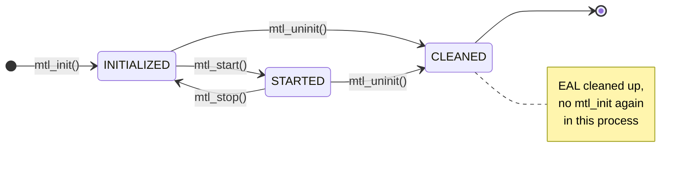
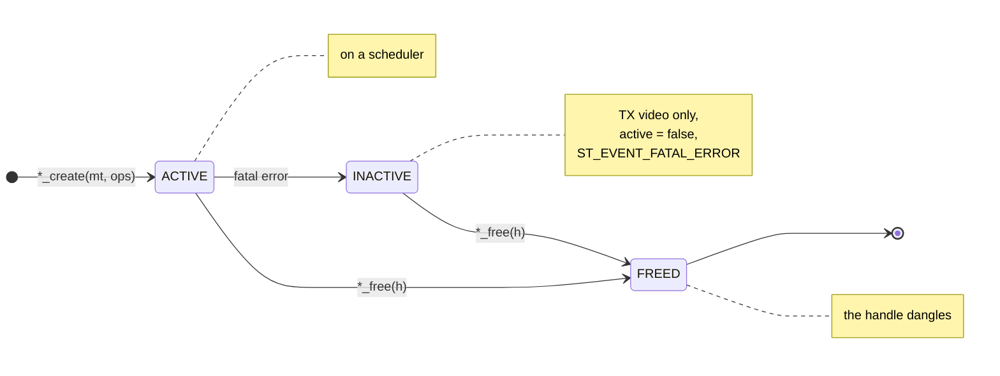
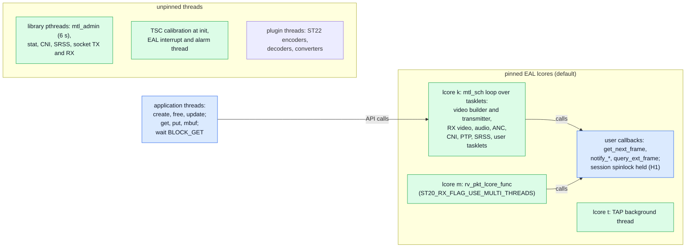
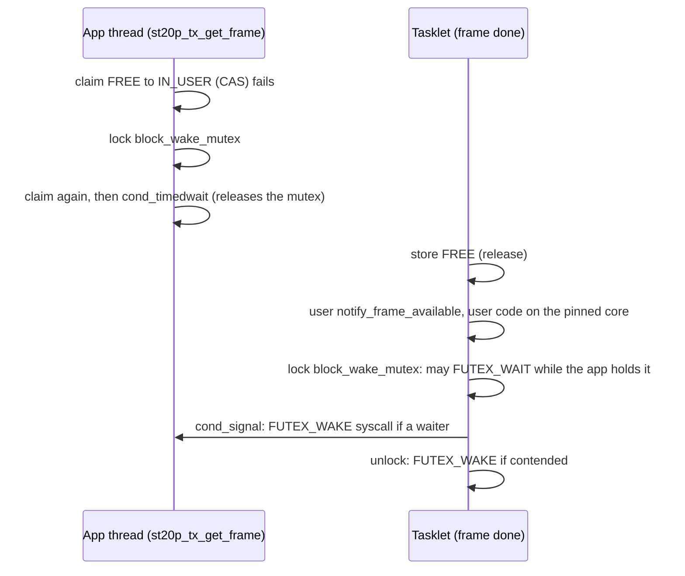
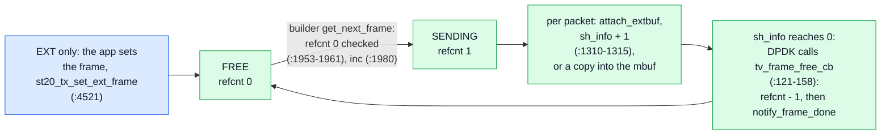
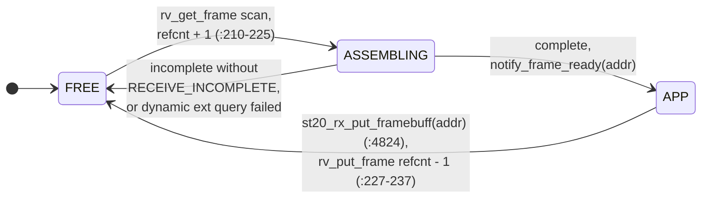
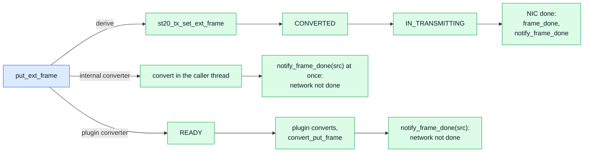

# Legacy internals: today's MTL library and its users

| | |
|---|---|
| Status | Maintained reference of today's library at `main` @ `545a266a`; the code is identical at `149a0ad4`. Facts only: the normative headers are `sketch/include/mtl/experimental/` |
| Reads with | [engine.md](engine.md) |

What the legacy API offers, how `lib/` behaves inside, and what its consumers rely on, each with
its `path:line`. It serves whoever builds the core, the bindings, the API shell or the legacy
wrappers, and the maintainers. How the unified API sits on this code, and every known defect, is
[engine.md](engine.md); this file points there instead of repeating it.

**Start here.** Find your job:

| Job | Sections |
|---|---|
| an MS1 task (the implementing session) | pr1610.md §2: your task's row of pr1610.md §3, then pr1610.md §5 |
| a binding over an engine | §5.1–§5.3, §6.1–§6.2, §7.2–§7.3 |
| a legacy wrapper or a shim | §2, §3, §11.4 |
| pod or operator facts | §4.2, §9 |
| a consumer port (RxTxApp, KahawaiTest, the plugins) | §11 |
| updating a live session; what a frame gap reads as | §4.4; §6.3 |
| today's pacing, timestamps and RTP | §7 |
| stats, events and logging | §8 |
| errors, ABI and build | §10 |

## 1. How to read this

**Baseline.** Every `path:line` is at `main` @ `545a266a`. `lib/`, `include/`, `app/`,
`ecosystem/`, `manager/`, `plugins/`, `python/`, `rust/` and `tests/` are unchanged at `149a0ad4`
(`git diff --stat 545a266a 149a0ad4` is empty), so the lines read the same there. Paths without a
directory are under `lib/src/`; session files are in `lib/src/st2110/`, pipeline files in
`lib/src/st2110/pipeline/`.

**Labels.** **[verified]**: read in code at the cited line. **[inferred]**: follows from verified
code plus DPDK, glibc or kernel behaviour, not executed. **[unknown]**: not established.
**[re-read]**: re-read on 2026-10-02. A section's label applies to every row that carries none.

**Elsewhere** (not repeated here):

| Topic | Where |
|---|---|
| hazards H1–H10 (callbacks on tasklets under the spinlock, stats self-deadlock, BLOCK_GET futex, recovery on the transmitter, auto-detect allocation, update under the spinlock, hot-path user hooks, callback identity, admin scan, `USE_MULTI_THREADS` race); execution-context rules; thread mode and sleep; mempools and application threads; backends and what they grant | [engine.md §1](engine.md) |
| per-function "today → change" tables for st20p TX/RX, the TX builder, the transmitter, RX reassembly, scheduler, admin, device and PTP; linesize and chain build; placement and quota; pacing ways and every downgrade; instance lifecycle | engine.md §2 |
| completing contexts and `sh_info`; `mtl_dma_map`, backing detection, the memseg budget, RX DMA thresholds, PA mode | core.md §4.3, engine.md §2.16 |
| stalled queues, no TX queue stop, today's uninit order; recovery triggers | engine.md §4, §5 |
| defects SF-01…SF-88, SP-01…SP-10, SC-01…SC-08, DD-01…DD-21, H-K-1…H-K-28, RTP-level defects | engine.md §7 |
| pod hazards with evidence; MtlManager trust, MtlManager in pods, AF_XDP rate in pods | [deployment.md §4.16](deployment.md), §1.6, §4.12, §4.13 |
| legacy timing surface → unified | [timing.md §14](timing.md) |
| per-consumer port notes and call-site counts; the ABI summary | [migration.md §9](migration.md); [abi.md](abi.md) |

## 2. The public surface today

13 installed headers (`include/meson.build:4-6`, `:11`), counted with `gcc -fsyntax-only
-aux-info` and regular expressions over the flag definitions **[verified]**.

### 2.1 Inventory

**459 function declarations** and **about 201 flag bits** in 22 flag namespaces. About 105
functions are colour converters; the other ~354 form 17 session families that re-express about
12 concepts with different names, struct shapes, bit positions and semantics. No family has a
per-session start or stop: a session is live from `*_create` to `*_free`.

| Family | Header | Fn (tx / rx) | Frame exchange | Callbacks (tx / rx) | Stats | Flags (tx / rx) |
|---|---|---|---|---|---|---|
| core `mtl_*` | `mtl_api.h` | 70 | — (memory: `mtl_hp_*`, `mtl_dma_*`, `mtl_udma_*`) | 3 in init params (`ptp_get_time_fn`, `ptp_sync_notify`, `stat_dump_cb_fn`) + 2 log hooks | `mtl_get_port_stats`, `mtl_get_fix/var_info` | 39 + 2 port |
| `st_*`/`st10_*` | `st_api.h` | 12 | — | — | `st_get_var_info` | — |
| st20 | `st20_api.h` | 13 / 15 (+6 helpers) | TX `get_next_frame(idx)` + `notify_frame_done(idx)`; RX `notify_frame_ready(ptr)` + `put_framebuff(ptr)`; RTP `get/put_mbuf`; slice callbacks | 6 / 7 | get/reset | 12 / 13 |
| st22 | `st20_api.h` | 7 / 10 | as st20 | 5 / 3 | **none** | 9 / 7 |
| st30 | `st30_api.h` | 8 / 9 (+6) | index TX / pointer RX / mbuf | 4 / 3 | yes | 8 / 7 |
| st40 | `st40_api.h` | 8 / 9 (+10 RFC 8331 helpers) | index TX / pointer RX / mbuf; ST 2110-41 fast metadata is a flag of these sessions, **RX RTP only** (`include/st40_api.h:82-102`, `:151-158`) | 4 / 2 | yes | 9 / 4 |
| st20p | `st_pipeline_api.h` | 16 / 16 | `get_frame`/`put_frame`/`put_frame_abort`, `put_ext_frame`, `notify_ext_frame_free` | 4 / 4 | yes | 15 / 17 |
| st22p | `st_pipeline_api.h` | 11 / 12 | get/put/abort, `put_ext_frame` | 4 / 3 | **none** | 12 / 9 |
| st30p | `st30_pipeline_api.h` | 12 / 11 | get/put/abort (`st30_frame`) | 3 / 1 | yes | 7 / 5 |
| st40p | `st40_pipeline_api.h` | 13 / 13 | get/put/abort (`st40_frame_info`) | 3 / 1 | yes | 11 / 5 |
| plugins | `st_pipeline_api.h` | 19 | `st22_encoder/decoder_get/put_frame`, `st20_converter_get/put_frame` | 3 per device | — | 1 + `*_RESP_FLAG_BLOCK_GET` |
| frame helpers | `st_pipeline_api.h` | 32 | `st_frame_create/free/create_by_malloc` | — | — | 3 `ST_FRAME_FLAG_*` |
| convert | `st_convert_api.h` + `st_convert_internal.h` | 47 + 58 | — | — | — | — |
| sch | `mtl_sch_api.h` | 6 | user tasklets | 3 (`start`, `stop`, `handler`) | — | — |
| lcore shm | `mtl_lcore_shm_api.h` | 2 | — | — | print / clean | — |
| st20rc (experimental) | `experimental/st20_combined_api.h` | 6 | `notify_frame_ready` + `st20rc_rx_put_frame` | 0 / 2 | **none** | 0 / 5 |

Per header: `mtl_api.h` 70, `st_api.h` 12, `st20_api.h` 51, `st30_api.h` 23, `st40_api.h` 27,
`st_pipeline_api.h` 106, `st30_pipeline_api.h` 24, `st40_pipeline_api.h` 27, `st_convert_api.h` 47,
`st_convert_internal.h` 58, `mtl_sch_api.h` 6, `mtl_lcore_shm_api.h` 2, `st20_combined_api.h` 6.

Online update of a session: §4.4. At runtime the core changes only the log level
(`mtl_set_log_level`) and scheduler sleep (`mtl_sch_enable_sleep`), lcore shm only
`mtl_lcore_shm_clean`.

**Getter symmetry** (families st20, st22, st30, st40, st20p, st22p, st30p, st40p):

| Getter | Coverage |
|---|---|
| session stats | all but st22 and st22p |
| `*_get_sch_idx` | st20, st22, st20p only |
| `*_get_queue_meta` (RX) | all but st30p |
| `*_pcapng_dump` (RX) | st20, st22, st20p, st22p |
| framebuffer address | TX: `get_framebuffer` (st20, st30, st40) or `get_fb_addr` (st22, pipelines; st40p adds `get_udw_buff_addr`); RX: st22, st20p, st22p, st40p only |
| ext frames | st20 (`set_ext_frame`; RX `ext_frames` + `query_ext_frame`), st20p (`put_ext_frame`; RX both), st22p (`put_ext_frame` / `query_ext_frame`); none for audio, ANC and fast metadata |
| `notify_event` | st20, st22, st20p, st22p |
| `notify_frame_late` (TX) | all; undocumented on st40 (`include/st40_api.h:476`) |

### 2.2 One concept, many shapes

**Four frame-exchange models:**

| Model | Where | App → lib | Lib → app | Frame named by | Thread |
|---|---|---|---|---|---|
| A pull by callback | st20/22/30/40 TX sessions | `get_next_frame(priv, &idx, meta)` | `notify_frame_done(priv, idx, meta)` | `uint16_t` index | tasklet |
| B push by callback + put | st20/22/30/40 RX sessions, st20rc | `st*_rx_put_framebuff(h, frame)` | `notify_frame_ready(priv, frame, meta)`; `< 0` = library reclaims | `void*` address | tasklet |
| C get/put | pipelines, plugins | `get_frame` → fill → `put_frame` / `put_frame_abort` | `notify_frame_available(priv)` (no arguments) + TX `notify_frame_done(priv, frame)` | `st_frame*` / `st30_frame*` / `st40_frame_info*` | app thread + tasklet |
| D mbuf get/put | every `*_TYPE_RTP_LEVEL` | TX `get_mbuf(h, &usrptr)` / `put_mbuf(h, mbuf, len)` | RX `notify_rtp_ready(priv)`, then the app polls `get_mbuf` | `rte_mbuf*` as `void*` | app + tasklet |

- TX names frames by index, RX by pointer (`include/st20_api.h:1186`, `:1545`, `:2261`).
- TX `get_next_frame` meta is in/out: the library pre-fills `epoch`/`timestamp`, the app may
  overwrite `tfmt`/`timestamp` (`st_tx_video_session.c:833-836`); the header does not say which.
- `notify_frame_available` carries no handle, so an app with several sessions per `priv` re-polls
  all of them (`include/st_pipeline_api.h:928`).
- **11 per-frame metadata structs** (4 TX session, 4 RX session, 3 pipeline) re-declare
  `tfmt`/`timestamp`/`rtp_timestamp`, mostly `epoch`, `pkts_total`, `pkts_recv[]`, `status`, in
  different orders. Receive time is `timestamp_first_pkt` (st20/st30/st40 RX), `receive_timestamp`
  (pipelines), absent from `st22_rx_frame_meta`.

**Blocking.** Every pipeline has `*_FLAG_BLOCK_GET` at bit 15, `*_wake_block()` and
`*_set_block_timeout(h, ns)`, default 1 s (`st20_pipeline_tx.c:1143` **[re-read]**); plugins have
the same trio through `resp_flag` (`include/st_pipeline_api.h:659-673`). Blocking is a create-time
flag and the timeout is session state; a NULL return means "no frame", "timeout", "not ready",
"ended by `*_wake_block()`" and "destroying" alike (`st20_pipeline_tx.c:765-831` **[verified]**).
Session layers have no blocking at all.

**External memory:**

| Variant | Struct | Planes | Binding | Release |
|---|---|---|---|---|
| st20 TX session | `st20_ext_frame` (`include/st20_api.h:1105-1114`) | 1 | `st20_tx_set_ext_frame(h, idx, ext)` per index | `notify_frame_done(idx)` |
| st20 RX session | `st20_ext_frame` | 1 | static `ops.ext_frames` or dynamic `query_ext_frame` | `st20_rx_put_framebuff` |
| st20p/st22p TX | `st_ext_frame` (`include/st_pipeline_api.h:248-259`) | 4 | `put_ext_frame(h, frame, ext)` | `notify_frame_done`; st20p only: `EXT_FRAME_MANUAL_RELEASE` + `st20p_tx_notify_ext_frame_free` |
| st20p/st22p RX | `st_ext_frame` | 4 | st20p static or query; st22p query only | `put_frame` |
| st30/st40 | — | — | none at any layer | — |

Two structs with different field names (`buf_addr/buf_iova/buf_len` against
`addr[]/iova[]/linesize[]/size`); the static array's length is implied by `framebuff_cnt`; the app
gets IOVAs itself through `mtl_dma_map` (`doc/design.md:528`).

**Timing flags, bit positions** (– = not offered):

| Concept | st20 | st22 | st30 | st40 | st20p | st22p | st30p | st40p |
|---|---|---|---|---|---|---|---|---|
| USER_PACING | 3 | 3 | 3 | 3 | 3 | 3 | 3 | 3 |
| USER_TIMESTAMP | 4 | 4 | 4 | 4 | 4 | 4 | **–** | 4 |
| EXACT_USER_PACING | 8 | – | – | 7 | 8 | – | – | 9 |
| RTP_TIMESTAMP_EPOCH | 9 | – | – | – | 9 | – | – | – |
| DROP_WHEN_LATE | n/a | n/a | n/a | n/a | 12 | 12 | 16 | 7 |
| EXT_FRAME (TX) | 2 | – | – | – | 2 | 8 | – | – |
| FORCE_NUMA (TX) | 11 | 8 | 8 | – | 11 | 9 | 8 | 8 (rejected) |
| ENABLE_RTCP (TX) | 7 | 6 | 6 | 5 | 7 | 6 | – | 5 |
| BLOCK_GET | n/a | n/a | n/a | n/a | 15 | 15 | 15 | 15 |

Semantics drift too: USER_PACING honours only TAI, MEDIA_CLK silently falls back to epoch pacing
(`include/st20_api.h:51-55`); USER_TIMESTAMP unwraps MEDIA_CLK for video and ANC
(`include/st20_api.h:58-70`), applies to the first packet only on ST30 (`include/st30_api.h:59-64`),
and ST40P says "MEDIA_CLK is used" (`include/st40_pipeline_api.h:96-99`), contradicting ST40
(`include/st40_api.h:50-56`).
`rtp_timestamp_delta_us` exists for st20, st20p, st30, st30p only.

**Status, events, stats, ports, errors:**

- One `st_frame_status` {COMPLETE, RECONSTRUCTED, CORRUPTED, DROPPED} for TX done and RX receive
  (`include/st_api.h:78-92`); TX session `notify_frame_done` carries no status.
- `st_event` = {VSYNC, RECOVERY_ERROR, FATAL_ERROR} (`include/st_api.h:208-220`), video sessions
  only; RECOVERY and FATAL raised only by TX video (`st_tx_video_session.c:4250-4351`
  **[re-read]**); audio recovers queues (`st_tx_audio_session.c:2717-2748`) but `st30_tx_ops` has no
  `notify_event`. No event for link, PTP, ARP, IGMP, source or format change (except ST20
  auto-detect).
- Stats: `struct stNN_{tx,rx}_user_stats { common; family fields }` + get and reset; the common
  struct documents which layer fills which field (`include/st_api.h:340-457`) but claims ST22P
  fills pipeline counters while no ST22/ST22P getter exists.
- Ports: sessions inline `dip_addr[2][4]`, `port[2][64]`, `num_port`, `udp_port[2]`,
  `udp_src_port[2]`, `tx_dst_mac[2][6]`, `payload_type`, `ssrc`; pipelines factor these into
  `st_tx_port`/`st_rx_port` (`include/st_pipeline_api.h:844-885`) but keep `tx_dst_mac` outside.
  Ports are named by string matching `mtl_init_params.port[]` (`include/st20_api.h:1136`); the
  session-port setters take the wrong enum (`st_rxp_para_ip_set(…, enum mtl_port …)`,
  `include/st_pipeline_api.h:2406`, `:2416`); `st_tx_dest_info` can change IP and UDP port but
  not MAC, source port or SSRC (`include/st_api.h:148-153`).
- Errors: create returns NULL and sets no `errno`; size getters return `size_t` 0 on error, count
  getters `int`, `st20_rx_put_mbuf` returns `void`; TX `notify_frame_done`'s return is ignored
  (`st_tx_video_session.c:101-107`).

### 2.3 Flaws of the surface

| # | Flaw | Evidence |
|---|---|---|
| 1 | no ABI versioning: no `soversion`, version script or `-fvisibility=hidden` (§10) | `lib/meson.build:161-169` |
| 2 | caller-allocated structs with no `size`; `st20_rx_user_stats` already re-laid-out | `include/st20_api.h:1801-1828` |
| 3 | arrays sized by compile-time constants: `MTL_PORT_MAX` (8) sizes eight arrays of `mtl_init_params`, `MTL_SESSION_PORT_MAX` (2), `ST40_MAX_META` (20), `ST_MAX_PLANES` (4) (E11, E12) | `include/mtl_api.h:575-734`, `include/st40_api.h:381-391` |
| 4 | enums as struct members; `mtl_pmd_type` says "not change the enum value any more" | `include/mtl_api.h:229-231` |
| 5 | library-private `priv` in public structs (`st_frame`, `st30_frame`, `st40_frame_info`, plugin metas) | `include/st_pipeline_api.h:315-316` |
| 6 | `st_convert_internal.h` (58 functions, `*_simd_dma` with `mtl_udma_handle`) installed and included by `st_convert_api.h:13` (coverage.md CUT-4) | `include/meson.build:4` |
| 7 | `mtl_api.h:27` includes the generated `mtl_build_config.h`; no runtime header/library check | `meson.build:38-52` |
| 8 | debug fields in production structs: `port_packet_loss[]`, `st40_tx_ops.test`, `*_SIMULATE_PKT_LOSS`, `sim_loss_rate` | `include/mtl_api.h:578`, `include/st40_api.h:448-451` |
| 9 | callbacks run on the tasklet with a one-sentence contract; st20p explicitly allows `st20p_tx_notify_ext_frame_free` from inside `notify_frame_done` (H1) | `include/st20_api.h:1183-1184`; `st20_pipeline_tx.c:267-268` |
| 11 | `ptp_get_time_fn` becomes the time source used by pacing, with no latency or thread rule (H7) | `include/mtl_api.h:663-668`; `mt_main.h:1446`, `:1945-1946` |
| 14 | RX `query_ext_frame` requires `RECEIVE_INCOMPLETE_FRAME` (engine.md §2.4) | `st_rx_video_session.c:4419-4423` |
| 15 | two-phase release only on st20p TX; `notify_ext_frame_free` a silent no-op without the flag or with a converter | `include/st_pipeline_api.h:1863-1865` |
| 16 | the get/put threading rule ("one application thread per session and direction") lives only in `doc/design.md:357-371` | `include/st_pipeline_api.h:1797-1822` |
| 17 | `user_meta` pointer lifetime unspecified **[unknown]** | `include/st20_api.h:443-449` |
| 19 | unknown flag bits never rejected; the only mask checks are EXACT-needs-USER_PACING | `st_tx_video_session.c:4062`, `st_tx_ancillary_session.c:2262` |
| 20 | `MTL_FLAG_BIND_NUMA` never read while `MTL_FLAG_NOT_BIND_NUMA` is (`mt_main.c:614`); `MTL_FLAG_CNI_THREAD` silently wins over `CNI_TASKLET` (`mt_cni.c:567-572`); the `TX_VIDEO_MIGRATE` doc described RX (DD-13a), fixed on main, `65a0b610f` | `include/mtl_api.h:345-350` |
| 21 | `*_DROP_WHEN_LATE` is ignored without USER_PACING and a TAI timestamp, with no error; it drops frames more than one period in the past. The headers said "when MTL reports late" until `65a0b610f` (DD-15) | `st20_pipeline_tx.c:126-141`; `include/st_pipeline_api.h:464-472` |
| 22 | reserved fields: `st20_rx_ops.pacing`/`.packing`, `ST22_PACK_SLICE` "not support now", `sample_size`/`sample_num`, `tx/rx_sessions_cnt_max` | `include/st20_api.h:1510-1513`, `:386-387`; `include/st30_api.h:476-481`; `include/mtl_api.h:746-761` |
| 25 | `epoch` never defined: frame periods for video, packet times for audio | `st_tx_audio_session.c:264-268` |
| 27 | TX clock implicit; sessions on port R still pace on P (timing.md §2.4) | `st_tx_audio_session.c:266` |
| 28 | `update_destination/source` mid-frame semantics undocumented: TX switches at the next burst after the update, mid-frame; RX breaks before it makes, on every leg (§4.4) **[verified at HEAD]** | `st_tx_video_session.c:2699`, `:3867-3874`; `st_rx_video_session.c:4064-4107` |
| 29 | media concepts in the core header (`st21_tx_pacing_way`, `tx_audio_sessions_max_per_sch`, `pkt_udp_suggest_max_size`, `nb_rx_hdr_split_queues`); pacing per instance | `include/mtl_api.h:318-335`, `:682-706` |
| 30 | magic sizes: video framebuffers 2–8 (`include/st20_api.h:24`); ANC meta 20, excess truncated with a `warn()` on the data path (`st_rx_ancillary_session.c:205-207`); `MTL_PKT_MAX_RTP_BYTES` = 1460 − 8 − 100 (`include/mtl_api.h:89`); `failed_cause[64]`; `MTL_PCAP_FILE_MAX_LEN 32`; `ST30_TX_FIFO_DEFAULT_TIME_MS 10` (E11, E12, PE7) | as cited |

Further flaws are defect rows of engine.md §7 with the same evidence: the BLOCK_GET mutex on
the tasklet (#10, SF-15, also `st30_pipeline_tx.c:29-40`); `mtl_ptp_read_time` (#12, SF-29), used by
`st30_frame_is_late`/`st40_frame_is_late` while `st_frame_is_late` uses `_raw`
(`include/st30_pipeline_api.h:376`, `include/st40_pipeline_api.h:411`,
`include/st_pipeline_api.h:2474`); ST22 invalid codestream done (#13, SF-11); `st30p_tx_create` and
the RX FORCE_NUMA bit (#18, SF-01); ST40P FORCE_NUMA (#23, DD-16); `st_frame.timestamp` TAI ns on TX
and media clock on RX (#24, SF-28; `st_tx_video_session.c:1998`, `st_rx_video_session.c:883`);
`rl_offset_ns` units (#26, DD-13b), and `st30_get_packet_time` returns `double` ns with "<0 error",
`st10_vsync_meta.frame_time` is `double` ns (`include/st30_api.h:746-754`, `include/st_api.h:196-203`);
`ST_PLUGIN_MAGIC` and the `_END` count (#31–32, SF-26, SF-27); copy-paste docs (#33, DD-13d…f);
st20p/st22p fire both `notify_frame_done(DROPPED)` and `notify_frame_late` while the st30p/st40p
headers say only one (#34, DD-14, `include/st_pipeline_api.h:934-937`). Fixed on main since: SF-01
(`de84da6d6`), SF-27 (`d47739cfd`), DD-13b, DD-13d…f and DD-14 (`65a0b610f`).

### 2.4 Can a live-stream application know what happened?

Mostly not: the per-question answer is §8.2.

### 2.5 What is good and must not be lost

Pipeline get/put (a 4-call loop with conversion, lifecycle, blocking, `put_frame_abort`,
`doc/design.md:338-346`); the ext-frame concept (multi-plane `st_ext_frame`, RX `query_ext_frame`,
st20p two-phase release); USER_PACING and USER_TIMESTAMP as separate knobs, EXACT against
VRX-aligned, the MEDIA_CLK unwrap contract (`include/st_api.h:555-583`); rich RX integrity
metadata (per-port `pkts_recv[]`, reconstructed against corrupted, st40 sequence gaps, first/last
packet TAI, `st20_rx_tp_meta`); documented stats semantics (pre/post redundancy, reorder against
duplicate, `stat_pkts_unrecovered <= stat_lost_packets`, `include/st_api.h:262-457`); online
source and destination update (`doc/design.md:552-569`); the RTP-level escape hatch (ST 2022-6,
custom payloads, `doc/design.md:326-330`); extension points (codec and convert plugins with
capability masks, app tasklets, lcore borrowing, user DMA); the handle type guard
(`st20_pipeline_tx.c:325`); slice mode. [coverage.md](coverage.md) has the row per capability.

## 3. Modes, media and backends

**[verified]** unless marked.

### 3.1 Surfaces and who uses them

4 media families × 2 directions × up to 3 units of work (frame, slice, RTP packet) × 2 layers
(session, pipeline), plus the experimental `st20rc`: 8 session and 8 pipeline create functions,
each with its own ops struct and flag namespace. Consumer use (grep of create, get and put call
sites): FFmpeg st20p/st22p/st30p; GStreamer st20p/st30p/st40p; OBS st20p; Python st20p/st22p (and
st20); Rust st20, st20p, st22p, st30p. Session layers (fast metadata too) are used only by
`app/sample/`, `tests/tools/RxTxApp/`, KahawaiTest and the MXL POC: the pipeline shape is what
integrators depend on **[inferred]**. Removed but not cleaned: the user-space UDP stack
(`2b182cd87`); its `MTL_TRANSPORT_UDP` and `MTL_FLAG_UDP_LCORE` stay public (DD-17).

### 3.2 Per media

- **ST 2110-20** (units: FRAME, SLICE, RTP (`include/st20_api.h:347-360`)). SLICE adds TX
  `query_frame_lines_ready` and RX `slice_lines` + `notify_slice_ready`; RX SLICE needs
  `RECEIVE_INCOMPLETE_FRAME` (`st_rx_video_session.c:4453-4456`). RTP: the app builds RTP header
  and payload in an mbuf from `st20_tx_get_mbuf`; the library adds L2–L4 and paces from
  `rtp_frame_total_pkts`/`rtp_pkt_size`; RTP RX still deduplicates 2022-7 through the slot bitmap.
  Formats: YUV 4:2:2/4:2:0/4:4:4 and RGB at 8–16 bit, plus two non-RFC 4175 "as is" formats
  `ST20_FMT_YUV_422_PLANAR10LE` and `ST20_FMT_V210`. Packing BPM/GPM/GPM_SL; RX ignores `packing`;
  header split needs BPM. `enum st21_pacing` NARROW/WIDE/LINEAR per session (LINEAR has no code path;
  WIDE sets VRX to 80 % of the TR_OFFSET packets and disables warm-up,
  `st_tx_video_session.c:612-618`). Interlace is field-as-frame: `height` full frame, `fps` fields per
  second, the library alternates `second_field` (`doc/design.md:483-501`). TX extras: `linesize`,
  `start_vrx`, `pad_interval`, `rtp_timestamp_delta_us`, `tx_hang_detect_ms`, per-frame `user_meta` ≤
  `MTL_PKT_MAX_RTP_BYTES`. RX extras: `rx_burst_size`, `ext_frames[]`, `query_ext_frame`,
  `uframe_size` + `uframe_pg_callback`, `notify_detected`, `mcast_sip_addr`, SSRC/PT filters (0 =
  off), GPU fields.
- **ST 2110-22** (units: FRAME (one codestream, `framebuff_max_size`, real size in
  `codestream_size`), RTP). Only `ST22_PACK_CODESTREAM` (`st_tx_video_session.c:4213-4214`); boxes on
  by default, ST22P forces DISABLE_BOXES for codecs other than JPEG-XS (`st22_pipeline_tx.c:553-555`);
  frame mode never chains (`st_tx_video_session.c:3432-3434`) and always paces TSC (engine.md
  §2.9); runs on the ST20 engines with an `st22_info`; no session stats, session ext frames, timing
  parser, DMA or auto-detect; `query_ext_frame` only in `st22p_rx_ops`; RTP mode needs exactly
  `rtp_frame_total_pkts` packets per frame.
- **ST 2110-30/-31** (units: FRAME (any buffer that is a whole number of packets,
  `st_tx_audio_session.c:2168-2174`), RTP). PCM8/16/24, AM824; 48/96/44.1 kHz; ptime 1 ms, 125 µs, 250
  µs, 333 µs, 4 ms, and ST31 "80 µs" (83.33 µs since `7cbe505d5`, `include/st30_api.h:161`), 1.09 ms,
  0.14 ms, 0.09 ms. Per-session `pacing_way` AUTO/RL/TSC (`enum st30_tx_pacing_way`,
  `include/st30_api.h:180-189`) with `rl_accuracy_ns`, `rl_offset_ns`; RL implies a dedicated
  queue. Default TX is one shared queue per manager unless RL or `DEDICATE_QUEUE`
  (`st_tx_audio_session.c:2121-2123`); `st_tx_sessions_queue_cnt()` (`include/st_api.h:635`) counts
  all audio sessions as one TX queue. `fifo_size` (default 10 ms) between builder and pacer. No
  `notify_event`, no ext frame, no EXACT. RX `RECEIVE_INCOMPLETE_FRAME` (what the gaps read:
  §6.3); timing parser META through `notify_timing_parser_result` every 200 ms.
- **ST 2110-40** (units: FRAME (≤ `ST40_MAX_META` = 20 ANC packets + UDW buffer,
  `include/st40_api.h:381`), RTP). Frame-level RX exists (transport-owned pool, 64-bit session-merged
  sequence bitmap) and is what st40p uses (`st40_pipeline_rx.c:177`); interlace auto-detected from the
  RTP F bits unless `ST40_RX_FLAG_DISABLE_AUTO_DETECT` (`include/st40_api.h:150`);
  `ST40_TX_FLAG_SPLIT_ANC_BY_PKT` (one ANC per packet, large payloads split, marker on the field's
  last packet; `include/st40_api.h:81`);
  EXACT exists (`:75`); debug `st40_tx_test_config` embedded in public ops, active only with
  `MTL_SIMULATE_PACKET_DROPS` (debug builds, `:106-130`); no session FORCE_NUMA, no `notify_event`, no
  incomplete flag (corrupted frames always delivered with status).
- **ST 2110-41** (a mode of the ST40 sessions, `ST40_TX_FLAG_FAST_METADATA` and
  `ST40_RX_FLAG_FAST_METADATA`, `include/st40_api.h:82-102`, `:151-158`, since `88d47ac83`; units:
  TX FRAME (one data item of at most 1436 bytes, one packet) or RTP; RX **RTP only**, frame level
  refused, `st_rx_ancillary_session.c:1507-1508`). TX FRAME stamps `fmd_dit` (22 bits, checked)
  and `fmd_k_bit` (`st_tx_ancillary_session.c:575-578`, `:2268-2290`); RX has no DIT/K filter and
  hands the packet up in network order; interlace and the F bits are ignored both ways
  (`st_tx_ancillary_session.c:817`, `st_rx_ancillary_session.c:1007-1008`); not with
  `SPLIT_ANC_BY_PKT`; no pipeline mode.
- **ST 2022-6** (units: —). Only through RTP passthrough (`doc/design.md:328`); blocked by the
  1352-B packet limit (engine.md §7.4 #1).
- **st20rc** (units: FRAME, two ports). Merges two ST20 RX sessions; used by one sample and RxTxApp.

Header split is BPM only (`include/st20_api.h:219-226`), else `stat_pkts_not_bpm`
(`st_rx_video_session.c:2485`). RTP-level RX deduplicates in `rv_handle_rtp_pkt`
(`st_rx_video_session.c:1970`); ST22 RX state is `s->st22_info` on the ST20 engine (`:2636-2651`).

### 3.3 Feature × media matrix

Session columns st20, st22, st30, st40, then pipelines st20p, st22p, st30p, st40p. ST 2110-41 fast
metadata is a mode of the st40 sessions; §3.2 lists how it differs.
Y supported, N absent, P partial, noop = defined but never read.

| TX feature | st20 | st22 | st30 | st40 | st20p | st22p | st30p | st40p |
|---|---|---|---|---|---|---|---|---|
| slice unit / RTP unit | Y / Y | N / Y | N / Y | N / Y | N / N | N / N | N / N | N / N |
| zero-copy TX (chain) | P (multi-seg NIC) | N | P | P | P (derive) | N | P | P |
| ext frame | Y | N | N | N | Y (+ MANUAL_RELEASE) | Y | N | N |
| EXACT / USER_TIMESTAMP | Y / Y | N / Y | N / Y | Y / Y | Y / Y | N / Y | N / **N** | Y / Y |
| RTP_TIMESTAMP_EPOCH / `rtp_timestamp_delta_us` | Y / Y | N / N | N / Y | N / N | Y / Y | N / N | N / Y | N / N |
| `notify_event` / `notify_frame_late` / DROP_WHEN_LATE | Y / Y / N | Y / Y / N | N / Y / N | N / Y / N | Y / Y / Y | Y / Y (0 on its own drop path, `st22_pipeline_tx.c:183`; transport lateness forwarded since `62c5ca4d6`, SF-02) / Y | N / Y / Y | N / Y / Y |
| RTCP retransmit | Y | Y | noop | noop | Y | Y | N | noop |
| per-session pacing engine | N (port) | N (forced TSC) | Y | N | N | N | Y | N |
| DEDICATE_QUEUE | always | always | Y | Y | — | — | Y | Y |
| FORCE_NUMA | Y | Y | Y | N | Y | Y | Y | P |
| DISABLE_BULK / STATIC_PAD_P / `user_meta` / linesize | Y / Y / Y / Y | Y / N / N / N | N | N | Y / Y / Y / Y | Y / N / N / N | N | N |
| queue-hang recovery event | Y (DPDK PMD only) | Y | **[unknown]** | **[unknown]** | Y | Y | N | N |
| session stats | Y | **N** | Y | Y | Y | **N** | Y | Y |
| interlaced | Y | Y | — | Y | Y | Y | — | Y |
| split ANC by packet | — | — | — | Y | — | — | — | Y |
| test mutation config | N | N | N | Y (debug build) | N | N | N | Y |
| st21 profile | Y | Y | — | — | Y (`transport_pacing`) | forced NARROW | — | — |
| pacing params / sch idx | Y / Y | N / Y | N | N | Y / Y | N | N | N |

Chain or copy is decided per media at create: video `st_tx_video_session.c:3431-3439`, audio
`st_tx_audio_session.c:2146`, ANC and fast metadata `st_tx_ancillary_session.c:1802`. Every family
has 2022-7, USER_PACING, USER_P/R_MAC and `update_destination`. The RTCP flags of ST30/40 are read
nowhere in `lib/` except st40p forwarding them (DD-18); `doc/rtcp.md` lists only st20, st22, st22p
(+st20p). Today's "RTCP" is MTL's NACK retransmission: RTCP APP-style packets with PT 204
(`MT_RTCP_PTYPE_NACK`) named "IMTL" (`mt_rtcp.c:393-396`); the TX session opens an RX flow on
`st20_dst_port[i] + 1` to receive them (`st_tx_video_session.c:1055-1059`).

| RX feature | st20 | st22 | st30 | st40 | st20p | st22p | st30p | st40p |
|---|---|---|---|---|---|---|---|---|
| frame / slice / RTP unit | Y / Y / Y | Y / N / Y | Y / N / Y | Y / N / Y | Y / N / N | Y / N / N | Y / N / N | Y / N / N |
| 2022-7 merge | packet bitmap | Y | timestamp dedup | sequence bitmap | Y | Y | Y | Y |
| incomplete delivery | flag | flag | flag (gaps: §6.3) | always, with status | flag | flag | flag | always |
| ext frames dedicated / dynamic | Y / Y | N | N | N | Y / Y | N / Y | N | N |
| per-pgroup callback | Y | N | N | N | `PKT_CONVERT` (3 formats) | N | N | N |
| auto-detect | w/h/fps/packing/interlace, not format | N | N | interlace, default on | Y | N | N | Y |
| timing parser | STAT/META | N | STAT/META (200 ms) | N | Y | N | **N** | N |
| DMA / header split / 2 RX threads / GPU frames | Y / Y / Y / P | N | N | N | Y / Y / Y / Y | N | N | N |
| VSYNC / RTCP NACK | Y / Y | Y / Y | N / noop | N / noop | Y / Y | Y / Y | N / N | N / noop |
| SIMULATE_PKT_LOSS / FORCE_NUMA / DISABLE_MIGRATE | Y / Y / Y | Y / Y / N | Y / Y / N | N | Y / Y / Y | Y / Y / N | Y / Y / N | N / N ("NOT SUPPORTED") / N |
| `get_queue_meta` / pcapng / stats / `rx_burst_size` | Y / Y / Y / Y | Y / Y / **N** / N | Y / N / Y / N | Y / N / Y / N | Y / Y / Y / Y | Y / Y / **N** / N | **N** / N / Y / N | Y / N / Y / N |

All have DATA_PATH_ONLY, SSRC/PT/SSM filters and `update_source`. Constraints:
`query_ext_frame` needs INCOMPLETE (`st_rx_video_session.c:4419-4423`); header split one port
(`:4425-4430`) and `-ENOTSUP` without the patched DPDK (`:3165-3172`); DMA skipped with `uframe`,
header split or GPU framebuffers (`:2675-2679`); 2-thread RX above 40 Gb/s or by flag, refused for
slice and two ports (`:2747-2773`).

### 3.4 Pipeline-layer features

| Feature | st20p | st22p | st30p | st40p |
|---|---|---|---|---|
| transport type | FRAME only (`st20_pipeline_tx.c:462`) | FRAME (`st22_pipeline_tx.c:542`) | FRAME (`st30_pipeline_tx.c:303`) | FRAME (`st40_pipeline_rx.c:177`) |
| app formats | `enum st_frame_fmt` | raw ↔ codestream | PCM | UDW + meta |
| SIMD conversion | in the app thread inside `put_frame`/`get_frame` (`st20_pipeline_tx.c:877-878`, `st20_pipeline_rx.c:843-890`) | — | — | — |
| plugin conversion | preferred, internal fallback (`st20_pipeline_tx.c:619-653`) | codec plugins: JPEG-XS, H264/H265 (CBR), `quality`, `codec_thread_cnt`, `codestream_size` | — | — |
| derive (no conversion) | app format = transport format (`st20_pipeline_tx.c:1132`, `st20_pipeline_rx.c:1074`) | app format = codestream (`st22_pipeline_tx.c:1026-1028`) | implicit | implicit |
| ext frame | derive → transport zero copy; else conversion source only (`st20_pipeline_tx.c:467-468`) | TX encoder source, RX decoder destination | — | — |
| `st22p` profile | — | forced NARROW (`st22_pipeline_tx.c:535`) | — | — |

Pipeline flag bits do not match session bits (`ENABLE_RTCP` is bit 2 in `ST20_RX_FLAG_*`, bit 4 in
`ST20P_RX_FLAG_*`, where bit 2 is `EXT_FRAME`), so every pipeline translates flags one by one
(`st20_pipeline_rx.c:510-548`; about 150 lines per pipeline **[inferred]**). Plugins are `.so`
files loaded at `mtl_init` from JSON (`KAHAWAI_CFG_PATH`, `doc/plugin.md`), at most
`ST_MAX_DL_PLUGINS` = 8 (`st_header.h:57`), or registered in process; matched by
`input_fmt_caps`/`output_fmt_caps` and `ST_PLUGIN_DEVICE_*` (CPU/GPU/FPGA/AUTO). In-tree:
`plugins/sample` (a JPEG-XS/H264-CBR stand-in and a converter) and `plugins/st22_avcodec`.

### 3.5 Backends beyond engine.md §1.7

| Backend (prefix) | `enum mtl_pmd_type` | Status | Facts |
|---|---|---|---|
| DPDK AF_XDP (`dpdk_af_xdp:`) | 19 | experimental | pacing **[unknown]**; mbuf pool reuse for zero copy (`st_tx_video_session.c:3399-3403`); overlaps native AF_XDP; the code knows only `dpdk_af_xdp:` (`mt_util.c:962` **[re-read]**); `doc/experimental/af_xdp.md:54` said `af_xdp:` until `17b793074` (DD-10) |
| DPDK AF_PACKET (`dpdk_af_packet:`) | 20 | experimental | TSC; "testing only, very slow" (KB §7) |
| native AF_XDP | 4 | production | optional build (`lib/meson.build:28-34`); `CAP_NET_RAW`; zero-copy XSK with a copy fallback (`dev/mt_af_xdp.c:422-446`); MtlManager brokers the XSK map, queues and flows (`mt_instance.h:15-24`) |
| kernel socket | 17 | experimental | RX buffer sizing needs `CAP_NET_ADMIN` or `rmem_max`; no flow steering (`MT_DRV_F_RX_NO_FLOW`); TSC pacing only **[inferred]** from `dev_if_select_pacing` (`dev/mt_dev.c:1486`); without a socket thread ring the TX `sendto` runs on the tasklet (`datapath/mt_dp_socket.c:79-80`, `:136`, `:153`) |

Driver flags `MT_DRV_F_*` are defined at `mt_main.h:651-669`. CNI (ARP, IGMP, PTP inside MTL) runs on
DPDK PMD and DPDK AF_PACKET; native AF_XDP, kernel socket and DPDK AF_XDP set `MT_DRV_F_NO_CNI` and
leave it to the kernel (`dev/mt_dev.c:81`, `:97`, `:105`). Cross-cutting facts:
`MTL_FLAG_SHARED_RX_QUEUE` dispatches in software after the flow rule (`datapath/mt_queue.c:75-79`);
shared RSS is auto-enabled (L3_L4) for `MT_FLOW_NONE` drivers (`dev/mt_dev.c:2359-2362`); the IGMP
join is skipped under DATA_PATH_ONLY (`st_rx_video_session.c:3218`); `mtl_dma_map`/`unmap` refuse
non-VA IOVA and `mtl_udma_create` refuses PA (`mt_main.c:840`, `:901`, `:1144` **[re-read]**); DMA
engines (`dma_dev_port[]`) serve ST20 RX only, with a silent CPU fallback; a VF has no HW timesync
(about 1 µs, `doc/design.md:279-296`); no DSCP, TTL fixed at 64, no VLAN, IPv4 only, MTU ≤ 1500
(`include/mtl_api.h:79-89`); global `MTL_FLAG_RANDOM_SRC_PORT`/`MULTI_SRC_PORT` change per-session
behaviour (`st_tx_video_session.c:3390-3395`); migration is video only; DPDK secondary processes are
impossible (`--in-memory`, DD-02); Windows has no MtlManager, kernel socket or AF_XDP
(`mt_instance.c:7`, `datapath/mt_dp_socket.c:24`, `lib/meson.build:125`).

Session management: create before or after `mtl_start` (`doc/design.md:66-103`); what an update
cannot change: §4.4; TX SSRC 0 = default (deterministic, SF-52), RX 0
disables the check; per-session NUMA override (not ST40) plus `MTL_PORT_FLAG_FORCE_NUMA`;
scheduler introspection (`*_get_sch_idx`) for video only.

### 3.6 Easily forgotten modes

1. Slice TX/RX (ST20 session only; needs incomplete delivery; not with 2-thread RX).
2. RTP-level app-built packets, every family; the only route to ST 2022-6.
3. RX `uframe_pg_callback`: app code converts in the tasklet as packets land; disables DMA.
4. st20p `PKT_CONVERT`, the pipeline form of 3, three output formats.
5. Derive pipelines; st22p derive is codestream frame mode with get/put.
6. Ext frames in both TX flavours, with st20p two-phase release (`include/st_pipeline_api.h:1875`).
7. Split forward: a TX ext frame at an offset inside another session's RX frame with a `linesize`
   (4K → four 1080p tiles, `app/sample/fwd/rx_st20_tx_st20_split_fwd.c:127-131`).
8. RX dedicated against dynamic ext frames.
9. GPU VRAM RX frames (st20p; DMA off; build-time `gpu_direct`, `doc/gpu.md:44-53`).
10. DATA_PATH_ONLY: the app installs flows and joins groups; it dereferenced a NULL flow on
    non-socket backends (SP-02, fixed on main, `8afeaa6fc`).
11. EXACT against nearest-slot USER_PACING against normal; ST30 USER_PACING re-anchors the grid.
12. RTP_TIMESTAMP_EPOCH and `rtp_timestamp_delta_us`.
13. Pacing knobs per session: DISABLE_BULK, TSC_NARROW, STATIC_PAD_P, `start_vrx`, `pad_interval`.
14. 2-thread RX, an implicit extra busy lcore.
15. Header split (one port, BPM, patched DPDK; unbuildable on the 26.07 pin, SF-33).
16. Field-as-frame interlace; RTP-level apps that never set `ST20_SECOND_FIELD` send at half rate
    (`doc/design.md:494-500`).
17. ST40 split by packet and interlace auto-detect.
18. ST30 `BUILD_PACING`, `fifo_size`, RL warm-up knobs.
19. ST22P codec threads and the plugins' `resp_flag` BLOCK_GET.
20. Callback-driven sessions against polled pipelines.
21. Non-RFC 4175 transport formats (`ST20_FMT_YUV_422_PLANAR10LE`, `ST20_FMT_V210`, `*CUSTOM8`).
22. Debug knobs in public ops (`SIMULATE_PKT_LOSS`, `st40_tx_test_config`,
    `MTL_FLAG_REDUNDANT_SIMULATE_PACKET_LOSS` + `port_packet_loss[]`).
23. The SysV lcore manager (no MtlManager), which `doc/design.md:51` already advises against (§4.2).

The unified home of each mode is the "Easily forgotten modes" table of
[coverage.md §6](coverage.md#6-st-2110-20-by-milestone); where it and a coverage.md U-row disagree,
the U-row is right.

### 3.7 Documentation drift, with evidence

The fix rows are engine.md §7.2 (DD). Rows #1, #5–#10, #12–#14 (DD-05, DD-16, DD-10, DD-02,
DD-13a, DD-17, CUT-4, DD-04, DD-06, DD-07) have their full evidence in the DD row; the others add to
it. Every DD row is fixed on main except DD-16 (in part) and DD-19…DD-21; engine.md §7.2 gives the
commit of each. Lines at `545a266a`.

| # | Drift | Evidence | Row |
|---|---|---|---|
| 2 | "ST40 RX: RTP passthrough is the only supported" | fixed on main, `17b793074`: `doc/design.md:623-624` now names the frame-level ST40 RX (transport-owned pool, 64-bit merged sequence bitmap) that st40p uses (`st40_pipeline_rx.c:177`) | DD-08 |
| 3 | `st40p_rx_ops.rtp_ring_size` documented mandatory, power of two | fixed on main, `65a0b610f`: `include/st40_pipeline_api.h:241-242` now says "Unused"; read by no pipeline file since `d74cd1e0` | DD-16 |
| 4 | ST30/40 `*_FLAG_ENABLE_RTCP` have no consumer | the only readers are st40p forwarding them (`st40_pipeline_tx.c:328`, `st40_pipeline_rx.c:184`); `doc/rtcp.md:36` rightly lists only st20, st22, st22p (+st20p); the headers say "Currently ignored" since `65a0b610f` (`include/st30_api.h:76-80`) | DD-18 |
| 11 | KB names `stat_frame_late` (absent) and video `stat_epoch_mismatch` (never written, SF-25); `stat_epoch_drop` documented as "epoch mismatch events" | the KB part fixed on main, `df27e6f28` (KB `:409`, `:476`); the header still says it: `include/st_api.h:346`, `:354` | DD-03 |
| 15 | design §8.2: RTP reflects the wire time, with an RL "latency compensation" | fixed on main, `17b793074`: `doc/design.md:681-686` now says the RTP timestamp is the scheduled first-packet time; the only such term is `−VRX·TRS` in the start time, and RTP follows the start time (`st_tx_video_session.c:732-747`, §7.4) | DD-09 |
| 16 | stats guide: TX late drop "post-send"; every counter "thread-safe"; audio overflow counter | fixed on main, `17b793074`: no post-send drop (`doc/stats_guide.md:312-313`; the drop is in `next_frame`, `st20_pipeline_tx.c:196`); overlays and packet-lcore counters named unlocked (`:14-19`, SF-22); the audio counter, never written by ST30 or ST40 RX (SF-25), gone | DD-11 |
| 17 | "C99 only in `lib/`" | 13 files under `lib/src` use `_Atomic` (14 with `<stdatomic.h>`); meson sets no `c_std`, so the compiler default (gnu17) applies; fixed on main, `df27e6f28` (KB `:115` now says C99 plus C11 atomics) | DD-12 |

### 3.8 RTP level today

**[verified]** unless marked. TX: = `st_tx_video_session.c`, RX: = `st_rx_video_session.c`.
Defects with their fixes are engine.md §7.4; the unified packet units are contract.md §13.

- **Anchors.** `ST20_TYPE_RTP_LEVEL` `include/st20_api.h:356`, `ST22_TYPE_RTP_LEVEL` `:374-375`,
  `ST30_TYPE_RTP_LEVEL` `include/st30_api.h:173`, `ST40_TYPE_RTP_LEVEL` `include/st40_api.h:165`
  (the only RX unit of fast metadata, `:151-158`). TX ops `rtp_ring_size`, `rtp_frame_total_pkts`,
  `rtp_pkt_size`, `notify_rtp_done` `include/st20_api.h:1258-1278` (ST22 `:1381-1402`, ST30
  `include/st30_api.h:457-464`, ST40 `include/st40_api.h:486-493`); RX ops
  `include/st20_api.h:1613-1620` (ST22 `:1718-1725`, ST30 `include/st30_api.h:552-559`, ST40
  `include/st40_api.h:596-603`); `st20_tx_get_mbuf` `include/st20_api.h:1933`, `put_mbuf` `:1949`,
  `st20_rx_get_mbuf` `:2278`, `put_mbuf` `:2289`.
- **TX get/put.** `get_mbuf` returns the mbuf as `void*`, `usrptr` = the RTP header: the mbuf start
  in chain mode, +42 B (Eth + IPv4 + UDP) without chain (TX:4673-4681; audio
  `st_tx_audio_session.c:2987-3001`). `put_mbuf(len)` checks `0 < len <= MTL_PKT_MAX_RTP_BYTES`
  (`mt_util.h:19-24`) and does `rte_ring_sp_enqueue` (TX:4723-4733); the ring is single-producer
  (TX:3029), undocumented. `tv_ops_check` rejects ring size 0, `rtp_frame_total_pkts` 0, a bad
  `rtp_pkt_size`, NULL `notify_rtp_done` (TX:4107-4124); a ring size that is not a power of two
  fails later in `rte_ring_create` (TX:3030-3033).
- **TX pacing by packet count.** `st20_total_pkts = rtp_frame_total_pkts`,
  `st20_pkt_size = rtp_pkt_size + 42` (TX:3200-3206), so `trs = frame_time × reactive / total_pkts`
  (TX:536) and the RL rate is `pkt_size × total_pkts × fps` (TX:84-91); every packet is NORMAL in
  pad training (TX:414-416); ST22 forces `vrx = 0` (TX:598-602). RTP-level ST20/ST22 always use
  default pacing.
- **TX frame boundary** = the application's `tmstamp` changes (TX:1409, chain :1483); the marker is
  ignored; then the packet index resets, the field bit is read from the RFC 4175 `row_number` and
  `tv_sync_pacing(impl, s, 0, second_field)` runs (TX:1410-1427). The sample bumps `tmstamp` per
  frame only for that (`app/sample/low_level/tx_rtp_video_sample.c:61-67`).
- **TX header fields.** The RTP timestamp is overwritten from epoch/PTP unless
  `ST20_TX_FLAG_USER_TIMESTAMP` (TX:1428-1440); sequence, marker, PT and SSRC are never written and
  `ops.ssrc`/`ops.payload_type` are not applied (TX:1385-1457), so the sample's SSRC is stale mbuf
  bytes. L2–L4: no-chain copies 42 B over the head and fixes lengths and checksum (TX:1400-1455);
  chain prepends a 42 B header mbuf (TX:1522-1527). 2022-7: chain shares the application segment by
  `rte_mbuf_refcnt_update` (TX:1537-1573), no-chain deep-copies (TX:1070-1103).
- **TX completion.** `notify_rtp_done` fires once per dequeued bulk (≤ 4 packets) before build or
  send (TX:2278), though `include/st20_api.h:1273-1278` says "when lib finish the sending". A count
  mismatch is undetected: more packets run past the frame window, fewer can leave tail packets in
  the ring until the next frame (bulk dequeue needs `bulk` items, TX:2259-2266, **[inferred]**).
  `st22_tx_create` maps onto an ST20 RTP session with `YUV_422_10BIT` (TX:4992-5013), no codestream
  logic.
- **RX get/put.** `get_mbuf` returns the whole mbuf with `usrptr = data + 42`, `len = data_len − 42`
  (RX:4902-4905; audio `st_rx_audio_session.c:1809-1812`); ANC, fast metadata included, takes `len`
  from the UDP length capped at `data_len − 42`, so Ethernet padding is not counted
  (`st_rx_ancillary_session.c:1737-1743`, `88d47ac83`); `put_mbuf` is `rte_pktmbuf_free`
  (RX:4913). `notify_rtp_ready` runs per packet on the tasklet (RX:2075, ANC
  `st_rx_ancillary_session.c:694`; `include/st40_api.h:598-602` "only non-block method"). Rust
  bindgen and Python SWIG wrap `st20_api.h` whole (`rust/imtl-sys/wrapper.h`, `python/swig/pymtl.i`),
  so `*_get_mbuf` is reachable, unused by the safe layers.
- **ST20/22 RX.** PT and SSRC filters with drop counters (RX:1983-1998); two timestamp slots
  (`ST_VIDEO_RX_REC_NUM_OFO` = 2), an unknown timestamp evicts the next slot and clears its bitmap
  (RX:1342-1368), no past-timestamp guard; 2022-7 dedup by a per-slot bitmap on `seq − seq_base`
  (32-bit extended for ST20, 16-bit for ST22, RX:2008-2031); the first packet sets the base, so an
  earlier one arriving later drops as `stat_pkts_idx_oo_bitmap` (RX:2021-2025); the bitmap is sized
  from width × height × format, not a packet count (RX:3494-3497); no reorder, arrival order
  (RX:2035-2044); ring overflow drops and counts `stat_pkts_rtp_ring_full` (RX:2067-2071). Inert in
  RTP mode: header split (RX:3459), DMA (RX:2676-2679), 2-thread RX (RX:2747-2757), auto-detect
  (RX:3555-3556); the timing parser is allocated but never fed (RX:3536-3545). No per-frame event.
- **ST30.** The RTP tasklet (`st_tx_audio_session.c:943-1086`) syncs pacing at cursor 0 and resets
  after every packet (`:991`, `:1070`): one packet per ptime slot; USER_PACING ignored. The
  timestamp: a change of the application's raw value, then the epoch value is stamped (`:556-567`,
  `:605-618`), so applications must change it every packet. `framebuff_size` is not required, yet
  attach divides by it (`:2170`, `:2237`, UB **[inferred]**). RX dedup by timestamp (strictly newer
  passes, `st_rx_audio_session.c:584-604`); ring full counts as `stat_slot_get_frame_fail`
  (`st_rx_audio_session.c:620-624`).
- **ST40.** RX has a frame level (`st_rx_ancillary_session.c:380-423`) used by st40p
  (`st40_pipeline_rx.c:175-180`, commit `d74cd1e0`). TX gates before it syncs
  (`st_tx_ancillary_session.c:1293-1306` against `:832`, `:897`; frame mode `:1088` then `:1104`).
  Byte order: chain swaps RFC 8331 every packet (`:902`), no-chain only at a new interlaced frame
  (`:819-821`); RX converts to host order (`st_rx_ancillary_session.c:436`). RX dedup by timestamp
  or sequence, 64-bit bitmaps (`:550-588`).
- **ST40 fast metadata** (`88d47ac83`). The same TX tasklet and RX handler as ST40. TX frame mode
  stamps DIT, K-bit and length of its one data item (`st_tx_ancillary_session.c:575-578`); RTP mode
  stamps nothing but the RTP timestamp, with no byte swap and `second_field` always false (`:817`,
  `:884`, `:902`); RX does not swap the header chunk, unlike RFC 8331
  (`st_rx_ancillary_session.c:436`).

In-tree users of the RTP level:

| Consumer | Use | Why not frames |
|---|---|---|
| `app/sample/low_level/tx_rtp_video_sample.c`, `rx_rtp_video_sample.c` | a reference RFC 4175 packetiser (1080p hard-coded, 4320 × 1200 B) and a marker-counting receiver | the APIs own sample (`doc/design.md:332-336`) |
| RxTxApp `"type": "rtp"` for video, audio, ANC, fast metadata (`tests/tools/RxTxApp/src/parse_json.c:566`, `:842`, `:1292`, `:1243-1247`) | pcap replay (`legacy/tx_video_app.c:270-345`), an ST22 pcap through an ST20 RTP session (`script/loop_json/st22p_pcap.json`); application-side RFC 4175, RFC 8331 and ST41 (de)packetisers | replay; application packing; fast metadata RX is RTP only |
| gtest `tests/integration_tests/st20/`, `st22_test.cpp`, `st30_test.cpp`, `st40_test.cpp` | pacing and fps checks, digests; out-of-order injection (`st20_digest.cpp:567`, `:635`, `:695`), truncated frames (`st20_meta.cpp:256`) | fault injection |
| unit harnesses `tests/unit/session/st20_harness.c:533-545`, `st20_tx_harness.c`, `st40_harness.c:121-123` | feed RTP into RX, run the RTP tasklet | test seams |
| acceptance | no fast metadata case: `88d47ac83` removed `tests/single/st41/`, `30ce608b4` its successor `single/st40/`; the engine can still emit a fast metadata ANC session (`tests/acceptance/mtl_engine/rxtxapp.py:1035-1044`) | fast metadata RX has no frame level |
| FFmpeg, GStreamer, OBS, MXL, `plugins/`, `manager/`, `ld_preload/`, Rust, Python | none (except the dead st40p `rtp-ring-size` property, #3 of §3.7) | — |

Nothing in the tree implements ST 2022-6; the docs only name it as the reason the mode exists
(`doc/design.md:334`).

## 4. Instance, process and session lifecycle

**[verified]** unless marked. The start/stop, EAL and uninit facts the core builds on are
engine.md §2.10 and §4; the pod hazards deployment.md §4.16.

### 4.1 Instance

An `mtl_handle` has two live states, as the picture shows: INITIALIZED (ports up, schedulers
stopped) and STARTED (schedulers running). `mtl_uninit()` ends the process's use of DPDK for good.
The unified calls that replace these are [migration.md §2](migration.md#2-call-map-per-legacy-family).

| Call | Transition | What it does |
|---|---|---|
| `mtl_init()` | none → INITIALIZED | ports started; admin, PTP, CNI, ARP up. With `MTL_FLAG_DEV_AUTO_START_STOP` it also calls start |
| `mtl_start()` | INITIALIZED → STARTED | schedulers run tasklets |
| `mtl_stop()` | STARTED → INITIALIZED | schedulers stop; ports stay up. A no-op with `MTL_FLAG_DEV_AUTO_START_STOP` |
| `mtl_uninit()` | either → CLEANED | stop → free → `rte_eal_cleanup()`; no `mtl_init` again in this process |
| `mtl_abort()` | none | an atomic store only |

| Fact | Evidence |
|---|---|
| `mtl_init` returns NULL on every failure; the reason is only logged | `mt_main.c:377-626` |
| start and stop are idempotent (`mt_started()` checks); stop → start again works because `sch_start` re-creates the lcore or thread **[inferred]**; a later scheduler starts if the instance is started | `mt_main.c:342-375`; `mt_sch.c:1169-1177` |
| `mtl_abort` sets `instance_aborted` only; read by the ARP, kernel-socket ARP and PTP-stable waits; it wakes no `get_frame` sleeper and stops no tasklet | `mt_main.c:747-757`; `mt_arp.c:182`, `mt_socket.c:330`, `mt_ptp.c:1651` **[re-read]** |
| `mtl_init` writes into the caller's params (`port_params[i].flags \|= …`) and then copies `sizeof(*p)` of them (SF-30) | `mt_main.c:404`, `:486` **[re-read]** |
| `mtl_start/stop/uninit` check NULL (`-EINVAL`) and type (`-EIO`); `mtl_get_lcore`, `mtl_put_lcore`, `mtl_bind_to_lcore`, `mtl_abort` do not (SF-31) | `mt_main.c:700`, `:712`, `:723`, `:747` **[re-read]** |
| `instance_in_reset` is only ever set to 0 (SF-19) | `mt_main.c:534` |

### 4.2 EAL, threads, files and privileges

| Item | Evidence |
|---|---|
| EAL argv always has `--file-prefix MT_DPDK --match-allocations --in-memory`; no `--socket-mem`, `--huge-dir`, `--no-telemetry`, `--legacy-mem`; memory grows on demand | `dev/mt_dev.c:336-345`, `:320-497`; `mt_mem.h:11` |
| `--in-memory` sets `no_shconf` and `unlink_before_mapping`; without a hugetlbfs mount it allocates hugepages anonymously | DPDK `eal_common_options.c:2236-2240`; `eal_hugepage_info.c:502-510` |
| `--iova-mode` only when the user sets it | `dev/mt_dev.c:453-461` |
| EAL runs on a temporary pthread, joined at once, so the caller is not pinned | `dev/mt_dev.c:302-307`, `:505-519` |
| a runtime directory is still attempted; a telemetry socket `dpdk_telemetry.v2` is created there with `atexit(unlink_sockets)`; a stale one is unlinked by the next process, a live one makes it take a `:N` suffix | DPDK `eal_common_options.c:2414-2420`; `telemetry.c:610-652`, `:500-545` |
| DPDK swaps the SIGBUS handler during page allocation; growth past the pod's hugetlb limit becomes an allocation failure **[inferred]**; DPDK sizes from the node-wide counts | DPDK `eal_memalloc.c:84-120` |
| any `mtl_init` failure after EAL init can only be retried by restarting the process | `dev/mt_dev.c:500-503` |
| `KAHAWAI_CFG_PATH` or `kahawai.json` in the CWD is parsed and may `dlopen` plugins; no other `getenv` in `lib/src` | `mt_config.c:52-61`, `:9-30`; `st_plugin.c:879` |
| `/proc/<pid>/comm`, `/proc/stat`; for kernel ports `/proc/net/route`, `/sys/class/net/<if>/device/numa_node`; AF_XDP reads `device/driver` and writes `queues/tx-N/tx_maxrate` | `mt_util.c:1034`, `:1064`; `mt_socket.c:87`, `:176`; `dev/mt_af_xdp.c:255`, `:90-101`, `:277-292` |
| `mt_run_cmd` (`popen`) exists, nothing calls it; no `system()` | `mt_util.c:807-829` |
| `geteuid() == 0` sets `impl->privileged` | `mt_main.c:476-481` |
| needs: `/dev/vfio/*` with `RLIMIT_MEMLOCK`/`IPC_LOCK` (PMD); `CAP_SYS_ADMIN` for pagemap in PA mode **[inferred]**; `CAP_SYS_TIME` for phc2sys | `docker/docker-compose*.yml`; `mt_ptp.c:198-203` |
| needs: `CAP_NET_ADMIN` + `/dev/vhost-net` for virtio_user; `CAP_NET_RAW`, `CAP_BPF`, host network for AF_XDP; a writable `/sys` for `tx_maxrate`; root for MtlManager | `dev/mt_dev.c:1633`, `:2536`; `dev/mt_af_xdp.c:436`; `manager/README.md:80-86` |

**Threads and affinity.** EAL workers (`dpdk-workerN`, `mt_sch.c:276-283`) are pinned by EAL; the
thread-mode scheduler (`:284-285`), TSC calibration (1 s, `mt_main.c:109-121`, `:200`), admin
(6 s, `mt_admin.c:379-388`), stat (`mt_stat.c:164`), CNI (`mt_cni.c:397-415`) and kernel-socket TX
and RX (`datapath/mt_dp_socket.c:293`, `:632`) inherit the `mtl_init` caller's affinity (pinning
sites: engine.md §1.5). `mtl_init` calls `numa_bind()` on the caller's thread with more than one
node unless `MTL_FLAG_NOT_BIND_PROCESS_NUMA` (`mt_main.c:448-461`, SF-62), after EAL init (`:407`);
scheduler threads switch to `MPOL_LOCAL` while they run (`mt_sch.c:126-151`). `numa_bind()`
rewrites the caller's CPU affinity to the NIC node's CPUs (the kernel intersects it with the
cpuset), so it can widen an affinity the application had narrowed, and sets `MPOL_BIND` for that
thread and every thread it creates later **[inferred]**; EAL lcores are unaffected because EAL init
runs first. DPDK's interrupt, alarm and telemetry threads use DPDK's control cpuset **[inferred]**;
the inherited-affinity threads may land on the CPU of a busy-polling lcore **[inferred]**.
`mtl_bind_to_lcore` already pins with the EAL's per-lcore cpuset (`rte_lcore_cpuset`,
`mt_main.c:735-741`); with load balancing disabled (as with `isolcpus`, `doc/isolation.md`),
unpinned `TASKLET_THREAD` schedulers can stack on one CPU (EK7).

**Lcore choice.** With no `lcores`, EAL takes the calling thread's affinity, so the pod's cpuset is
respected (DPDK `eal_common_options.c:2155-2161`); with `lcores`, MTL builds
`-l "<main_lcore>,<lcores>"`, `main_lcore` defaulting to 0 (`dev/mt_dev.c:416-441`,
`include/mtl_api.h:738`); a worker CPU outside the cpuset is `rte_panic`, a main CPU outside it
fails init (DPDK `eal.c:878-881`, `:838-843`); `--remap-lcore-ids` is always passed on DPDK ≥ 25.11
(`dev/mt_dev.c:443-446`), so lcore IDs are 0…N−1, not CPUs; the scheduler walk skips the main
lcore (`mt_sch.c:699-789`), so one pod CPU hosts only the exited EAL init thread and control
threads **[inferred]**; NUMA fallback only with the "across NUMA" flag (`:778-783`). Both
allocators (the manager's `std::bitset<128>`, `manager/mtl_lcore.hpp:11-55`; the shm table,
`mt_sch.c:742-758`) key by lcore ID: false exhaustion under one manager, double booking across
IDs, IDs ≥ 128 refused (`manager/mtl_lcore.hpp:38`) **[inferred]**.

**The SysV lcore table** (no MtlManager): lockfile `/tmp/kahawai_lcore.lock` opened `O_RDONLY |
O_CREAT, 0444` (0666 until `04138ad2c`), then read-only (`mt_platform.h:57`, `mt_sch.c:503-523`);
`flock(LOCK_EX)` without timeout (`:515`); key `ftok("/dev/null", 21)`, `shmget(0666 | IPC_CREAT)`
(`:548-554`); cleared when the attacher is alone (`shm_nattch == 1`, `:575-578`), `IPC_RMID` at
`nattch == 0` (`:585-612`); an entry is reclaimed only when hostname and user match and
`kill(pid, 0) != 0` (`:683-697`); `mtl_lcore_shm_clean(PID_AUTO_CHECK)` counts dead entries but
never clears them and takes no lock (`:1292-1317`, `:1351-1375`); without the manager `mtl_init`
fails if the lockfile cannot be opened (`:975-978`, `:644-670`); sharing across containers needs
`ipc: host` and bind-mounting the lockfile and `/dev/null` (`docker/README.md:121-134`). Namespaces: PIDs are namespace-local, so a live
sibling's lcores are stolen and a restarted container (PID 1 again) never frees its stale entries;
the hostname check blocks cleanup under `hostIPC`; the username is "unknow" without a passwd entry
(`mt_util.c:1016-1031`); `ftok` keys differ per container unless `/dev/null` is bind-mounted; the
lockfile is per rootfs. `kill(pid, 0) != 0` also treats `EPERM` as dead (`mt_sch.c:690`, `:1309`);
PIDs come from `getpid()` (`mt_util.c:1016`), the hostname check is `mt_sch.c:688`, and a UID inside
a user namespace is local. pid, uid and hostname also go to MtlManager (`mt_instance.c:212-217`) but
only for logging; the manager's liveness test is the socket close (`manager/mtl_manager.cpp:222-231`),
which works across namespaces. On SIGKILL the flock goes with the fd; the SysV segment and the
process's `active` entries stay until the IPC namespace dies (pod deletion). A same-pod restart of a
single MTL process works (the new process is the only attacher) **[inferred]**. Fix: EK6.

**Time to ready:**

| Phase | Worst case | Evidence |
|---|---|---|
| EAL init, vfio probe, VF reset | seconds **[inferred]** | — |
| PF timesync start | 100 × 10 ms = 1 s | `dev/mt_dev.c:882-923` |
| link wait, strict | 300 × 100 ms = **30 s**, then failure (the code exits on the first failed round, DD-21) | `dev/mt_dev.c:845-880`, `:2085-2094`; `dev/mt_dev.h:14-25` |
| link wait, `ALLOW_DOWN` | 3 s | `dev/mt_dev.h:37-38` |
| DHCP | 49 × 100 ms ≈ 5 s, then `-ETIME` | `mt_dhcp.c:549-564` |
| TSC calibration | 1 s, joined in `mtl_start` | `mt_main.c:109-121`, `:351` |
| unicast ARP per TX session (RX with RTCP) | `arp_timeout_s`, 60 s | `mt_main.c:573-576`; `mt_arp.c:171-203` |
| first RL TX video session | PTP stable up to **180 s** plus pad training | `st_tx_video_session.c:391-393` |

**Health today.** `loop_cnt` is a local of `sch_tasklet_func` (`mt_sch.c:160`, `:213`);
`avg_ns_per_loop` is updated every 2 s only while the loop runs (`:209-214`), so a stuck loop keeps
its last value; `stat_time` per scheduler and tasklet exists only with
`MTL_FLAG_TASKLET_TIME_MEASURE` or USDT (`:118-122`, `:201-224`) and is read and reset by the stat
thread without a lock (`:460-482`); scheduler `stopped`/`started` atomics (`mt_sch.c:237`, `:293`)
give lifecycle only; `mtl_get_var_info` gives counts (`mt_main.c:1019-1035`); rising port counters
(`mtl_get_port_stats`, `dev/mt_dev.c:2717-2736`, under `stats_lock`, `:181-215`) show a moving data
path, at a PF mailbox round trip per call on iavf; per-session stats exist only as the log dump.
Nothing tells "scheduler N has not looped for X ms" (EK11).

### 4.3 Sessions

A legacy session has one live state, as the picture shows: from create to free it sits on a
scheduler, and its tasklet runs if and only if the instance is STARTED (§4.1). The only other state
is the fatal one, which TX video alone has.

- No public per-session start or stop: only create, free, update, `wake_block`,
  `set_block_timeout`, `put_frame_abort`. The tasklet runs while the instance runs; pause is
  `mtl_stop()` for the whole instance. Today `mtl_uninit` with live sessions may self-deadlock
  (SP-01, the table below).
- Create is serialised by the scheduler's manager mutex (`st_tx_video_session.c:4483-4510`); the
  tasklet reaches a session with `rte_spinlock_trylock` (`st_tx_video_session.h:31`); free removes it
  under that spinlock (`tv_mgr_detach`, `st_tx_video_session.c:3816-3834`), so no tasklet callback
  starts after `*_free` returns **[inferred]**.
- Callbacks can fire **during** free, on the freeing thread (`tv_uinit_hw` → pad flush →
  `tv_frame_free_cb`, core.md §4.3), so the app must tolerate `notify_frame_done` from inside its
  own `free`. `*_free` from inside a callback deadlocks: the callback holds the spinlock
  `tv_mgr_detach` takes **[inferred]**. Neither is documented.
- `*_create` copies the ops by value with the library's `sizeof` (`s->ops = *ops`,
  `st_tx_video_session.c:3405`; `ctx->ops = *ops`, `st20_pipeline_tx.c:1154`).
- **Handle guard** (`mt_handle_guard.h`, landed in `b8b6cf51e`), used by all 8 pipeline types and
  every session family: `lc_destroying` + `lc_refcnt` per handle; every entry acquires or returns
  (`mt_handle_acquire`, `:75-98`, `-EIO` for a wrong type or a dying handle); `*_free` CASes
  `destroying` 0 → 1, the loser gets `-EBUSY` (`:111-119`), calls `wake_on_destroy`, spins in
  `mt_handle_drain` (`:129-130`, unbounded) and tears down. It protects concurrent callers, not
  calls after free: it reads `type` and `destroying` through the raw pointer, a NULL handle
  segfaults, and some entries read `ctx->idx` before the guard (`st20_pipeline_tx.c:767`, guard at
  `:771`) **[verified]**. Blocking sleepers hold their reference across `pthread_cond_timedwait` and
  are all woken by `wake_on_destroy`, a broadcast since `be5087525`, `23c524700` (`:1135`, `:1207`).
  Void entry points (`*_rx_put_mbuf`) use `MT_HANDLE_GUARD_VOID` (`mt_handle_guard.h:149-155`). It
  is the first C11 in `lib/` (DD-12).

| Free or stop situation | Behaviour |
|---|---|
| `st20p_tx_free` with frames IN_TRANSMITTING | `tx_st20p_framebuffs_flush` (`st20_pipeline_tx.c:730-761`, called at `:1213`) sleeps 50 ms per transmitting frame and polls other states up to 100 × 10 ms per frame; skipped if the instance is not started |
| `*_free` while app threads block in `get_frame` | all woken through `wake_on_destroy` (a broadcast since `be5087525`, `23c524700`), return NULL; on TX a frame claimed during the wake goes back to FREE (`st20_pipeline_tx.c:789-808`), on RX it is returned (`st20_pipeline_rx.c:866-883`) |
| `*_wake_block()` without free | ends a blocked `get_frame` (NULL, or a frame ready by then). TX counts calls, so one with no get blocked is a no-op (`st20_pipeline_tx.c:787-793`, `:1362-1376`; SF-16 fixed on main, `0d05bbd40`); RX sets a token only a waiting get clears, so one posted while no get waits ends the next empty get at once (`st20_pipeline_rx.c:29-35`, `:866-876`; `02c58850e`) |
| `mtl_stop()` with pipelines active | tasklets stop; a blocked `get_frame` times out with NULL and no reason **[inferred]** |
| `st20p_rx_free` with frames IN_USER | buffers freed; the app's `st_frame*` dangles, unchecked **[inferred]** (`st20_pipeline_rx.c:1137`) |
| `mtl_uninit` with live sessions | self-deadlock in TX video and in TX and RX audio and ANC: `*_mgr_uinit` holds the session spinlock, `*_mgr_detach` takes it again (RX audio `st_rx_audio_session.c:1462` → `:1466` → `:1425`; RX ANC alike) **[re-read]**; RX video does not re-lock; the leaked `s_impl` is never freed (SP-01) |
| TX pad flush on stop | 2 × burst × 1 ms per queue (`dev/mt_dev.c:1860-1877`), bounded but additive with the st20p frame flush (H-K-15) |
| `st20_tx_free` during migration | reads `s_impl->sch` unlocked (`st_tx_video_session.c:4824`) while admin rewrites it (SP-04) |
| migration (`MTL_FLAG_TX/RX_VIDEO_MIGRATE`) at any time | moves a session to another lcore, so a legacy callback silently changes thread; undocumented |

Today `st20p_tx_free` drains by sleep-polling (up to about 1 s per frame) while `st20_tx_free`
aborts.

### 4.4 Updating a live session today

Today's update paths, gathered from §2.1, §2.3, §3.5, §5.3 and §8.2. The unified update is
[contract.md §4.7](contract.md#47-update) and [core.md §5](core.md#5-commands-and-acknowledgements);
how the engines take it is [engine.md §2.17](engine.md#217-updates-on-a-running-session-today).

- **What exists.** Online update exists in every session and pipeline family
  (`*_tx_update_destination`, `*_rx_update_source`, st20 to st40 and st20p to st40p; st20 TX also
  `st20_tx_set_ext_frame`), none in st20rc.
- **What it cannot change.** An update cannot change the NIC port, `num_port`, SSRC or PT.
- **Blocking.** `st20_tx_update_destination` blocks up to `arp_timeout_ms` (60 s) **holding S**, the
  session spinlock (`st_tx_video_session.c:943` → `mt_arp.c:191`); `st20_rx_update_source` does flow,
  queue and IGMP work holding S and allocates (RTCP). Both are SF-14 (§5.3).
- **Mid-frame.** No header states when an update takes effect (flaw 28 of §2.3). TX switches at
  the next burst after `update_destination` releases the session lock, so mid-frame
  (`st_tx_video_session.c:2699`, `:3867-3874`); RX removes every leg's flow rule and leaves its
  groups before it installs the new ones (`st_rx_video_session.c:4064-4107`), so it breaks before
  it makes **[verified at HEAD]**. The unified update switches at a unit boundary (core.md §5).
- **After an auto-detect failure.** Recovery needs `update_source` or a re-create **[inferred]**
  (§8.2).

## 5. Scheduler, tasklets and threads

**[verified]** unless marked. The hazards H1–H10 are engine.md §1.1; quota, placement, sleep and
migration engine.md §2.8. Three further hazards have no engine.md row: pcap file I/O on the tasklet
(debug only, §5.5); blocking spinlocks in tasklet start hooks (`st_tx_audio_session.c:429`, §5.3);
samples that teach mutex + condvar in callbacks (§5.5). A fourth, the builder `pending` overwrite
(sleep mode only, SF-08), is fixed on main, `fb13bf68a` (§5.4).

### 5.1 Execution contexts today

The picture shows where code runs today: application threads call in, the pinned lcores run the
tasklets and, from them (or from the RX video packet lcore), the user callbacks with the session
spinlock held (H1, §5.2); the library's
own pthreads and the plugin threads run beside them. The table after it lists every context with
its evidence; what changes is [engine.md §1](engine.md#1-the-pinned-core-rules).

| ID | Context | Created at | Pinned | Notes |
|---|---|---|---|---|
| T-LC | scheduler on an EAL lcore (default) | `rte_eal_remote_launch`, `mt_sch.c:283` | yes | lcore from the manager or the shm table (`mt_sch.c:699-789`) |
| T-PT | scheduler as a plain pthread (`MTL_FLAG_TASKLET_THREAD`) | `mt_sch.c:285` | no, inherited **[inferred]** | not EAL-registered: no mempool cache (SF-49) |
| X-LC | RX video packet lcore, TAP lcore | `st_rx_video_session.c:2611-2621`, `mt_tap.c:903-911` | yes | the packet lcore runs `rv_handle_frame_pkt` and fires user callbacks (`st_rx_video_session.c:2574-2583`) |
| ADM | admin, every 6 s | `mt_admin.c:379-388` | no | CPU busy and migration under blocking session spinlocks |
| STAT | stat thread (else the alarm thread) | `mt_stat.c:63-97` | no | runs `stat_dump_cb_fn` |
| CNI-TH | CNI thread (`MTL_FLAG_CNI_THREAD`, or auto with PTP off) | `mt_cni.c:391-420`, `:565-580` | no | else a tasklet on `main_sch` |
| SRSS | shared-RSS thread, also a tasklet | `datapath/mt_shared_rss.c:141-167`, `:495` | no | — |
| SOCK | kernel-socket TX/RX threads | `datapath/mt_dp_socket.c:293`, `:632` | no | frees mbufs after `sendto` (`:205`) |
| INT | EAL interrupt/alarm thread | every `rte_eal_alarm_set` | no | PTP delay-req and monitor, ARP, IGMP, DHCP, admin/stat/sleep wakers |
| PLG | plugin threads | e.g. `plugins/sample/st22_plugin_sample.c:82` | plugin's choice | call `st22_encoder_get_frame`/`put_frame` |
| APP | application threads | app | app's choice | the only context the API documents |

Pipelines create no threads (`lib/src/st2110/pipeline/` has no `pthread_create`). Conversion runs
inline in the app thread (`st20_pipeline_tx.c:878`, `st20_pipeline_rx.c:890`), on plugin threads,
or per packet on the tasklet (`PKT_CONVERT`, `st20_pipeline_rx.c:537`).

### 5.2 Which context runs which callback

All session-layer callbacks run on the session's tasklet **with the session spinlock held**
(`try_get` at `st_tx_video_session.c:2699`, `st_video_transmitter.c:674`,
`st_rx_video_session.c:3644`; audio `st_tx_audio_session.c:1638`, RX audio
`st_rx_audio_session.c:830`, ANC (fast metadata too) TX `st_tx_ancillary_session.c:1404`, RX
`st_rx_ancillary_session.c:788`). Call sites: ST20/22 TX `get_next_frame`
(`st_tx_video_session.c:1939`, `:2461`, every iteration while idle), `query_frame_lines_ready`
(`:2038`), `notify_frame_late` (`:700`), `notify_rtp_done` (`:2278`), VSYNC (`:327`),
RECOVERY/FATAL (`:4259-4348` via `st_video_transmitter.c:681`); `notify_frame_done` wherever the
last chain mbuf is freed (core.md §4.3). ST20 RX `notify_frame_ready`
(`st_rx_video_session.c:725-732` ← `:857`, on the packet lcore with `USE_MULTI_THREADS`),
`notify_slice_ready` (`:1120`), `query_ext_frame` (`:1300`), `uframe_pg_callback` per packet
(`:1892`, `:1899`), `notify_detected` then `rv_init_sw` (`:2908`, `:2944`), VSYNC (`:3616`),
`notify_rtp_ready` (`:2075`); ST22 RX `notify_frame_ready` (`:749` ← `:1002`). The
`notify_frame_done` chain is `tv_notify_meta_done` (`st_tx_video_session.c:93-114`) ←
`tv_notify_frame_done` (`:116-119`) or `tv_frame_free_cb` (`:121`), which since `8c9d48f3e`
releases the frame before the callback and passes it a copy of the meta (`:139-155`). Other media,
each on its own tasklet:

| Session | Call sites |
|---|---|
| ST30 TX | `get_next_frame` `st_tx_audio_session.c:765`, `notify_frame_done` `:924`, `notify_frame_late` `:318`, `notify_rtp_done` `:1020`; audio recovery entry `st_audio_transmitter.c:58` |
| ST30 RX | `notify_frame_ready` `st_rx_audio_session.c:358`, `notify_rtp_ready` `:628`, `notify_timing_parser_result` `:320` |
| ST40 TX | `get_next_frame` `st_tx_ancillary_session.c:1018`, `notify_frame_done` `:1227` and `:109` (abort), `notify_frame_late` `:406`, `notify_rtp_done` `:1319` |
| ST40 RX | `notify_frame_ready` `st_rx_ancillary_session.c:288`, `notify_rtp_ready` `:694` |
| ST40 fast metadata | the ST40 call sites above (`88d47ac83`) |
| st20rc | `notify_frame_ready` `st2110/experimental/st20_redundant_combined_rx.c:40`, `notify_event` `:109` (RX tasklet through the inner sessions **[inferred]**) |

Pipeline and instance callbacks:

| Callback | Contexts |
|---|---|
| st20p TX `notify_frame_available` | builder tasklet (`st20_pipeline_tx.c:177`, `:224`), transmitter or builder (`:295`), plugin converter thread (`:381`), app thread (`:1071`, `:1190`) |
| st20p TX `notify_frame_done` | tasklet (`:164`, `:288`), plugin thread (`:392`), app thread in `put_ext_frame` (`:1008`): **four contexts for one callback** |
| st20p RX `notify_frame_available` / `query_ext_frame` / `notify_detected` | RX tasklet (`st20_pipeline_rx.c:279`, `:294`, `:210`, `:319`, `:393`), plugin thread (`:458`); `rx_st20p_notify_detected` also logs and allocates on the tasklet (`:379`) |
| st22p TX / RX | tasklet (`st22_pipeline_tx.c:188`, `:233`, `:288`; `st22_pipeline_rx.c:196`, `:213`, `:146`), encoder thread (`st22_pipeline_tx.c:434`), decoder thread (`st22_pipeline_rx.c:341`) |
| st22p TX `notify_frame_done` / `notify_frame_late` / `notify_event` | also tasklet: `st22_pipeline_tx.c:179`, `:286`, `:183`, `:298` (transport lateness, forwarded since `62c5ca4d6`), `:305` |
| st30p, st40p | tasklet: st30p TX available / done / late `st30_pipeline_tx.c:149`, `:181`, `:246`, `:140`, `:241`, `:255`, RX `st30_pipeline_rx.c:127`; st40p TX `st40_pipeline_tx.c:152`, `:183`, `:252`, `:143`, `:247`, `:261`, RX `st40_pipeline_rx.c:146`; a create without BLOCK_GET calls available once on the app thread (st30p `:739`, RX `:552`; st40p `:744`, RX `:602`) |
| plugin `st_plugin_get_meta_fn` / `create_fn` / `free_fn` | app thread at `st_plugin_register` / `mtl_uninit` **[inferred]** |
| plugin `create_session`/`free_session` | app thread inside `st2*p_*_create`/`_free`, under the plugin manager mutex (`st_plugin.c:86-108`, `:184-206`, `:285-307`) |
| encoder `notify_frame_available` | app thread (`st22_pipeline_tx.c:64-80`); decoder: RX tasklet (`st22_pipeline_rx.c:49-64`); converter: TX app thread, RX tasklet (`st_plugin.c:269`) |
| `ptp_get_time_fn` | every pacing and epoch computation on tasklets (`dev/mt_dev.c:1681-1686`) |
| `ptp_sync_notify` | CNI/PTP tasklet or CNI thread (`mt_ptp.c:759` ← `:1097`), EAL alarm thread (`:828`) |
| `stat_dump_cb_fn` | stat thread or alarm thread (`mt_stat.c:58`, `:89-95`) |
| log printer and formatter | any thread that logs, tasklets included; the default formatter calls `localtime_r` (`mt_log.c:9-16`) |
| user tasklet `start`/`stop` | the scheduler thread, **or the caller's thread** on runtime register (`mt_sch.c:952`) and unregister (`:904`) |

`notify_frame_late` carries no "runs on the tasklet" note though it does.

### 5.3 Locks and blocking per public call

| Primitive | Taken by tasklets | Taken by app-facing calls |
|---|---|---|
| session spinlock `mgr->mutex[idx]` (not recursive) | `try_get` everywhere; blocking `get` in audio recovery (`st_tx_audio_session.c:2741`) and `tasklet_start` hooks (`:429`, ANC `st_tx_ancillary_session.c:512`) | TX (`st_tx_video_session.c`) stats get/reset `:4782`, `:4800`, update `:3867`, free `:3821`; RX (`st_rx_video_session.c`) stats `:4754`, `:4772`, update `:4115` |
| `sch->mutex`, `sch->*_mgr_mutex` (pthread) | never | register/unregister, create/free, migrate |
| pipeline `block_wake_mutex` + cond | **yes**, a signal on every frame event with BLOCK_GET (`st20_pipeline_tx.c:41-46`; `st20_pipeline_rx.c:42-47`); the `*_block_wake` broadcast of destroy and RX `wake_block` (`st20_pipeline_tx.c:29-34`, `st20_pipeline_rx.c:29-35`) | `get_frame` holds it while re-claiming and in `cond_timedwait` (`st20_pipeline_tx.c:782-798`) |
| `sch->sleep_wake_mutex` + cond | the idle scheduler itself (`mt_sch.c:87-93`) | alarm thread signals (`:50-59`) |
| TSQ `tx_mutex`, SRSS list lock | blocking spin inside tasklets (`datapath/mt_shared_queue.c:642`; `mt_shared_rss.c:22-24`, `:66-71`); `mt_tsq_done_cleanup` takes the pthread `tsq_lock` instead (`datapath/mt_shared_queue.c:394-396`, `:625-633`) | add/remove at create/free **[inferred]** |
| stat list lock | never | register/unregister; the stat thread trylocks (`mt_stat.c:20-35`) |
| handle guard `lc_refcnt` | never | a SEQ_CST RMW on every public call; free spins in `mt_handle_drain` |

| Call | Blocks? | Notes |
|---|---|---|
| `st*_create`, `st*p_create` | yes: lcore IPC or `flock`, ARP wait, TSC wait | takes S only to publish; allocates hugepages, rings, mempools, flows |
| `st*_free`, `st*p_free` | yes: guard drain, unregister wait (1 ms sleeps up to 1 s), queue flush | blocking S (`tv_mgr_detach`) |
| `st20_tx_update_destination`, `st20_rx_update_source` | yes, holding S (§4.4) | SF-14 |
| stats get/reset | short spin; self-deadlock from a callback | H2 |
| `st20_tx_get_framebuffer`, `set_ext_frame` | no (refcnt read) | often called from inside `get_next_frame` |
| `st20_tx_get_mbuf`/`put_mbuf` | no | `rte_ring_sp_enqueue`: **single producer** (`st_tx_video_session.c:4727`) |
| `st20_rx_get_mbuf`/`put_mbuf` | no | `rte_ring_sc_dequeue`: **single consumer** (`st_rx_video_session.c:4893`) |
| `st2*p_get_frame` / `put_frame` | `cond_timedwait` with BLOCK_GET (default 1 s, `st20p_tx_set_block_timeout`, `st20_pipeline_tx.c:1383`); put may convert inline (CPU only) | |
| `mtl_sch_create/start/stop/free` | yes; `sch_stop` sleeps 10 ms in a loop (`mt_sch.c:315`) | |
| `mtl_sch_register_tasklet` | no; calls `start` on the caller's thread | |
| `mtl_sch_unregister_tasklet` | yes; from a tasklet on the same scheduler 1 ms × 1000, then fails (SF-32) | |
| `mtl_get_lcore`, `mtl_bind_to_lcore`, `mtl_put_lcore` | IPC or `flock` | |
| `mtl_ptp_read_time` | joins the TSC thread at first use | SF-29 |

S = the session spinlock.

**The BLOCK_GET wake** (H3 detail): every frame event on a BLOCK_GET session does lock, signal,
unlock on the pinned core whether or not anyone waits; glibc `pthread_cond_signal` makes no
syscall without waiters, with one it issues `FUTEX_WAKE` (about 1–3 µs and an IPI)
**[inferred]**; the app holds `block_wake_mutex` across its claim scan
(`st20_pipeline_tx.c:783-798`), so a preempted app thread puts the pinned core to sleep in
`FUTEX_WAIT` (priority inversion). Lost wake-ups do not happen: the notify signals under the mutex
and the waiter claims again under it before every wait, up to one deadline, on TX and, since
`1a89339c4` and `aace501eb`, on RX; `block_wake_pending` is left to `wake_block` and destroy
(`st20_pipeline_rx.c:32`, `:866-876`). Destroy broadcasts instead (`mt_handle_guard.h:38-46`,
`be5087525`). The picture shows the st20p TX case (`st20_pipeline_tx.c:41-46`, `:782-798`): the
tasklet's lock step is where the pinned core can sleep.

The core replaces this with the event word and `mt_wake()`
([core.md §6](core.md#6-waking-summary)): no lock and no condition variable on the
tasklet.

### 5.4 Scheduler details beyond engine.md

- Handler returns are summed from `MTL_TASKLET_ALL_DONE` (0), `HAS_PENDING` is 1
  (`mtl_sch_api.h:28-30`); negative returns are not filtered, so `−1 + 1 = 0` could put a busy
  scheduler to sleep **[inferred]** (whether any handler returns < 0: **[unknown]**). The video
  builder overwrote `pending` per session (SF-08) until `fb13bf68a`; it sums now
  (`st_tx_video_session.c:2694-2715`).
- `max_tasklet_idx` (volatile) and `tasklet[i]` are read without barriers; register publishes the
  slot after filling `ops` (`mt_sch.c:942-949`): safe on x86 TSO, would need a release store
  elsewhere **[inferred]**.
- Unregister while running: `request_exit` → the scheduler sets `ack_exit` and NULLs the slot
  (`:193-197`) → the caller polls 1 ms up to 1 s, then calls `ops.stop` on its own thread; the
  flags are plain `bool` (`mt_main.h:476-477`). The header said unregister was allowed only before
  start until `65a0b610f` (DD-13e); the code allows both (`include/mtl_sch_api.h:130-142`).
- Sleep: `allow_sleep = MTL_FLAG_TASKLET_SLEEP` at init (`mt_sch.c:995`), toggled by
  `mtl_sch_enable_sleep` (`mt_main.c:1058`); length `min(advice_sleep_us)`, default 1 ms, or the
  forced `mtl_sch_set_sleep_us` (`mt_sch.c:62-79`); below `sch_zero_sleep_threshold_us` (200) it is
  `rte_delay_us_sleep(0)` = `nanosleep` (`mt_main.h:1790-1795`); the alarm path allocates and arms a
  timerfd **[inferred]**, acceptable because only an idle scheduler takes it.
- Quota is added and freed under `sch->mutex` (`mt_sch.c:1052-1074`, `:409-427`); a new scheduler
  slot comes from `sch_request` (`:333`); one manager per media and direction per scheduler
  (`mt_main.h:524-554`). Scheduler stop uses `rte_atomic32` `request_stop`/`stopped`; the tasklet
  exit handshake is plain `bool`. The lcore walk is NUMA-filtered unless `MTL_FLAG_NOT_BIND_NUMA`
  and falls back across nodes only with `MTL_FLAG_ALLOW_ACROSS_NUMA_CORE` (`mt_sch.c:779-784`).
  Migration finds its target with `mt_sch_get_by_socket`, which keeps the socket (`:1135`), so
  per-session memory needs no re-homing on migration today.
- The limits a controller runs into today: 18 schedulers per instance (`MT_MAX_SCH_NUM`, `mt_main.h:49`); 60 video TX and 60 video RX sessions per scheduler (`ST_SCH_MAX_TX_VIDEO_SESSIONS`, `st_header.h:32-33`);
  a data quota per scheduler (`instance.sched_quota_mbs`, default 12 × the 1080p59.94 4:2:2 10-bit bandwidth, `ST_QUOTA_TX1080P_PER_SCH`, `st_header.h:22`; `mt_sch_add_quota`, `mt_sch.c:1052`); TX and RX queue counts fixed when the port is configured; the rate-limited queues of each port. Today a create that finds no scheduler fails with an `err` log only ("no free sch", `mt_sch.c:376`, `:1155`).
- Audio quota is `limit / rx_audio_sessions_max_per_sch` (`st_rx_audio_session.c:1646`); a manager
  per media and direction registers one tasklet over its sessions; schedulers grow lazily and are
  freed when `ref_cnt` reaches 0 (`mt_sch_put`, `mt_sch.c:1076-1121`); APP schedulers are never
  started by `mtl_start` (`:1193`).
- Lcore arbitration with MtlManager: `mt_sch_get_lcore` walks EAL lcores and asks the manager for
  each over the UNIX socket (`mt_instance.c:46-56`, `mt_sch.c:710-729`); the manager keeps a
  `std::bitset<128>` under a mutex and frees an instance's lcores on disconnect
  (`manager/mtl_lcore.hpp:11-52`, `manager/mtl_instance.hpp:68`). Without it, the SysV table (§4.2;
  `doc/shm_lcore.md` calls it outdated). Both are control-plane only.
- User schedulers (`mtl_sch_create`) take a free APP slot on port P's socket (`mt_sch.c:1378-1401`);
  user tasklets can in practice live only there (no public accessor for library schedulers)
  **[inferred]**; the only contract is "non-block" (`mtl_sch_api.h:42-61`), measured only with
  `MTL_FLAG_TASKLET_TIME_MEASURE` (`mt_sch.c:118-122`, `:201-207`).
- After a migration every later callback runs on another thread and CPU; per-session
  single-producer structures survive only because migration runs under S **[inferred]**.

### 5.5 Hand-offs between app and library

| Hand-off | Mechanism | Hazard |
|---|---|---|
| TX frame, app → lib | `get_next_frame` pull + `st_frame_trans.refcnt` | user code polled at loop rate on the tasklet |
| TX done, lib → app | extbuf `free_cb` → `notify_frame_done` | fires wherever the mbuf is freed |
| TX RTP | SP/SC `packet_ring` (`st_tx_video_session.c:3029`, `:4727`) | a second app thread corrupts it **[inferred]** |
| RX RTP | SP/SC `rtps_ring` (`st_rx_video_session.c:543`, `:4893`) + `notify_rtp_ready` | one consumer only |
| RX frame | `notify_frame_ready` + `st20_rx_put_framebuff` (atomic decrement) | — |
| pipeline frames | `_Atomic uint32_t stat` + CAS (`st20_pipeline_tx.c:86-100`, `:212-217`) | one app thread per direction (`doc/design.md:361-377`) |
| pipeline wake | mutex + cond from the tasklet | not lock-free (§5.3) |
| audio/ANC mgr → transmitter | `RING_F_MP_HTS_ENQ \| RING_F_SC_DEQ` (`st_tx_audio_session.c:1703`) | HTS: a preempted producer stalls the others; producers are tasklets |
| handle lifetime | Dekker pair, SEQ_CST (`mt_handle_guard.h:48-131`) | one RMW per call next to tasklet-read fields |
| stats | copied under S (video) or relaxed atomics (pipelines) | H2 |
| mbufs from app threads | default MP/MC ring mempool (`mt_util.c:544`) | engine.md §1.6 |

The shipped samples teach `pthread_mutex_lock` + `pthread_cond_signal` inside tasklet callbacks
(`app/sample/fwd/rx_st20p_tx_st20p_downsample_fwd.c:29-30`,
`ext_frame/rx_st20_pipeline_dyn_ext_frame_sample.c:33-34`). pcap dump writes files from the tasklet
(`st_rx_video_session.c:3000`) and a USDT-triggered pcap opens one there (`:3082`). Other control
work on tasklets: PTP `rte_eal_alarm_set` (`mt_ptp.c:928`, `:968`, `:1023`).

**False sharing and second writers.** `lc_refcnt` shares a line with `impl`, `idx`, `type` in
`struct st20p_tx_ctx` (`st20_pipeline_tx.h:35-42`); app-written `stat_get_frame_try` sits next to
tasklet-written `stat_drop_frame` (`st20_pipeline_tx.c:147`), which the app also writes (`:929`), a
data race; framebuffer `stat` words are not cache-aligned (`st20_pipeline_tx.h:22-33`). Today's
session stats have more writers than the tasklet: the stat thread copies and resets tasklet counters
in `tv_stat_collect` (`st_tx_video_session.c:3575-3619`, via `tx_video_session_get_timeout`
`:3964`); `reset_session_stats` `memset`s them from the application thread (`:4800-4803`);
`stat_max_notify_frame_us` is written by whatever context runs the free callback (`:110-111`); the
admin thread takes the blocking session spinlock of every video session each cycle regardless of
the migrate flag (`mt_admin.c:30`, `:40`, called from `:338`; engine.md H9). A seqlock over
"single-owner" counters would therefore have two writers (engine.md §1.8; EK11 stops the
stat-thread reset). NUMA: schedulers are bound to the NIC socket (`mt_sch.c:1135`, `:779-784`), app
threads are not; the `MPOL_LOCAL` change (`189e1e91`, `mt_sch.c:124-151`) shows NUMA balancing
already disturbs scheduler memory.

## 6. Memory, buffers and DMA

**[verified]** unless marked. `mtl_dma_map`, the memseg budget, RX DMA thresholds and PA page
tables are engine.md §2.16.

There is no memory object today: library `rte_zmalloc` frames, raw `{addr, iova, len}` triples
the library trusts, and a global map table filled by `mtl_dma_map()` that nothing on the data path
consults. External memory exists only for ST20 and ST22 video.

| Primitive | Implementation | Alignment | IOVA |
|---|---|---|---|
| `mt_rte_zmalloc_socket` | `rte_zmalloc_socket(…, RTE_CACHE_LINE_SIZE, socket)` (`mt_mem.h:38-39`) | 64 B | `rte_malloc_virt2iova` |
| `mtl_hp_malloc/zmalloc` | the same on `mt_socket_id(impl, port)` (`mt_main.c:764-796`) | 64 B | `mtl_hp_virt2iova` (`:803-806`, start only) |
| `mtl_dma_mem_alloc` | libc `iova_size + page_size`, page-aligned, then `mtl_dma_map` (`mt_main.c:929-971`) | page | invented |
| `mtl_dma_map` | map table + `rte_extmem_register(vaddr, size, NULL, 0, page_size)` + `rte_dev_dma_map(port P)` (`mt_main.c:819-879`) | 4 KiB `sysconf` page, not the hugepage size (`:582-584`, `:830-838`) | invented from `0x10000`; a non-DPDK primary port returns it with no mapping (`:858-860`); the extmem memseg has no IOVA table **[inferred]** |
| GPU `gpu_allocate_shared_buffer` | `zeMemAllocShared(…, 16, …)` (`gpu_direct/gpu.c:213`) | 16 B | none (0) |

`mtl_dma_map` in steps: page-align check (`mt_main.c:830-838`); reject any IOVA mode but VA
(`:840-843`); `mt_map_add` (`mt_dma.c:14-69`) under a pthread mutex: overlap check, then
`iova = max(highest existing iova_end, 0x10000)` (a bump allocator, never reused);
`rte_extmem_register` (`mt_main.c:862`); `rte_dev_dma_map` on port P with the comment "only map for
MTL_PORT_P now" (`:864-865`). `mtl_dma_unmap` unmaps port P and unregisters the extmem
(`mt_main.c:881-927`) and needs the exact `(vaddr, size, iova)` (`mt_dma.c:87`); `mt_map_uinit`
frees leftovers with a warning and does not unmap them (`mt_dma.c:111-126`). GPU allocation is
`gpu_direct/gpu.c:201-219`.

### 6.1 Modes and when MTL stops touching memory

| Path | Allocator, checks | MTL stops touching | Signal |
|---|---|---|---|
| ST20 TX internal | `mt_rte_zmalloc_socket(st20_fb_size)` (`st_tx_video_session.c:262`) | chain: last chain mbuf freed after NIC completion (`:121-158`); no chain: last packet copied (`:2147-2151`) | `notify_frame_done(idx)` from the free context |
| ST20 TX ext (`set_ext_frame`) | `buf_len`, `addr`, `iova` non-0/BAD, slot `refcnt` 0 (`:4539-4576`, a quick read); in-transport check only warns (`:4558-4562`) | as above; `addr/iova` cleared before the callback, during which `st20_tx_get_framebuffer` returns `done_addr` (`:145-149`, `:4617`; `8c9d48f3`) | re-arm with `set_ext_frame` per use |
| ST20 TX RTP | MTL mempool; `len` only | the driver frees the mbuf | none |
| ST22 TX | codestream frames, boxes pre-copied (`:269-279`); no ext mode | after the copy (`tx_no_chain` forced, `:3431-3434`) | `notify_frame_done` |
| ST20 RX internal | `mt_rte_zmalloc_socket` (`st_rx_video_session.c:483`; gaps: §6.3) | on `st20_rx_put_framebuff(addr)` (`:4824-4847`) | `notify_frame_ready` hands ownership (`:955`, `:994`); release looks the frame up by `addr` (`:4824`) |
| ST20 RX RTP (`st20_rx_get_mbuf`) | MTL RX mempool, no checks | on `st20_rx_put_mbuf` | `notify_rtp_ready` |
| ST22 RX internal | as ST20 RX internal; **no ext mode** (`st22_rx_ops` has no ext fields, `include/st20_api.h:1633-1701`) | on `st22_rx_put_framebuff` | `notify_frame_ready` |
| ST20 RX dedicated `ext_frames[]` | `addr` non-NULL, `iova` non-0 even for CPU copy, `buf_len` at least the frame size (`:444-461`; SF-17 fixed on main, `7aa23c45`) | as above | as above |
| ST20 RX `query_ext_frame` | needs INCOMPLETE (`:4419-4424`), else an incomplete frame is `rv_put_frame`'d silently (`:993-997`) and buffer and `opaque` never come back **[inferred]**; checks `buf_len ≥ fb_size`, `addr`, with DMA `iova` (`:1306-1320`, `7aa23c45`); a failure does `refcnt--`, frees the slot, drops the packet (`:1286-1325`) | as above | `meta->opaque` carries the app ID (`:1324`) |
| ST20 RX header split | one port only (`:4425-4430`); one per-port pool, MTL or `ext_frames[port]` reinterpreted as per-port pools (`:250-318`), `buf_len ≥ mbufs_total × BPM + 4096` (`:292`) | the NIC writes payload in place | as above |
| ST20 RX GPU | `zeMemAllocShared` (`:473-479`), build-time only, `iova` 0 (`:491-495`) | CPU copy into USM | as above |
| ST30 TX/RX | internal only (`st_tx_audio_session.c:105`; `st_rx_audio_session.c:143`) | after the copy into mbufs (`:496`, `:530`, `:915-930`); RX at put (`st_rx_audio_session.c:1771`) | callbacks |
| ST40 TX, fast metadata mode included | the library allocates the frame struct; UDW `data` is any app pointer, never validated (`include/st40_api.h:386-391`); in fast metadata mode `data/data_size` is one data item, and an oversized one goes back unsent through `notify_frame_done` (`include/st40_api.h:86-89`) | after the build (`st_tx_ancillary_session.c:1226-1232`) | `notify_frame_done` |
| ST40 RX (fast metadata mode: RTP level only, `include/st40_api.h:153-158`) | per-slot `udw_buf` (`st_rx_ancillary_session.c:928`) or RTP ring (`:663`) | put | callbacks |
| st20p TX internal / ext | `st20_pipeline_tx.c:583`; ext: derive passes `addr[0]/iova[0]/size` (`:967-979`), convert runs `st_frame_sanity_check` (`st_fmt.c:615-660`) | derive: transport done; plugin: after conversion (`:388-393`); internal converter: inside `put_ext_frame` (`:1001-1009`) | `notify_frame_done`; MANUAL_RELEASE parks the slot |
| st20p RX | `st20_pipeline_rx.c:703`; ext derive maps `addr[0]/iova[0]/size`, **drops `opaque`** (`:584-588`) | at `put_frame` | dropped frames never reported |
| st22p TX/RX | ext only on the raw side (`st22_pipeline_tx.c:966`, `st22_pipeline_rx.c:162`) | TX holds the source until the encoded frame's transport done (`st22_pipeline_tx.c:268-286`) | callbacks |
| st30p / st40p | the transport frame is the pipeline frame (st40p TX has its own UDW buffer, `st40_pipeline_tx.c:395`); no ext | after the copy | callbacks |

**TX video frame** (`struct st_frame_trans`, `st_header.h:125-155`: `addr`, `iova`, PA page
table, atomic `refcnt` "0 means free", flags `RTE_MALLOC | EXT | GPU_MALLOC`, one `sh_info`, and
the `done_addr` and done meta that `notify_frame_done` gets after the release, `8c9d48f3`):
build states `WAIT_FRAME → SENDING_PKTS → WAIT_FRAME` (`st_tx_video_session.c:1929-1983`,
`:2139-2143`); `sh_info` starts at 0 (`:254`) and is incremented per attached packet (`:1315`,
`:1726`), with no builder-held reference, so the free callback fires whenever it touches 0
(whether that can happen mid-frame in a slice-mode stall: **[unknown]**, MF7); port R packets
share the P chain mbuf (`rte_mbuf_refcnt_update(pkt_chain, 1)`, `:1370-1374`), so the callback
waits for both NICs. The first picture follows one TX frame through its `refcnt` and `sh_info`.

With no chain, `tv_frame_free_cb` is called directly after the last packet is built (`:2147-2151`).
Recovery and stop force `tv_notify_frame_done`, `refcnt--` and `sh_info = 0` (`:4314-4319`), the
double-completion window SF-39 and the zeroed count SF-41 of
[core.md §4.3](core.md#43-every-completing-context).

**RX video frame**: `rv_get_frame` scans and increments (`:210-225`); completion waits for
`mt_dma_empty()` (`:1542-1566`, `:1949-1952`); what a recycled frame's gaps read: §6.3. The
second picture shows the RX frame's states (`st_rx_video_session.c` lines).

A negative `notify_frame_ready` return puts a complete frame back (`:953-960`); on an incomplete
frame the return is ignored (`:994`). The dynamic ext-frame query is at `:1286`.

**Pipeline states**: st20p TX FREE, READY, IN_CONVERTING, CONVERTED, DROPPED, IN_USER,
IN_TRANSMITTING (`st20_pipeline_tx.h:11-20`); IN_TRANSMITTING → FREE, or → IN_USER with
`MANUAL_RELEASE` until `notify_ext_frame_free` (`st20_pipeline_tx.c:252-292`); st20p RX FREE, READY,
IN_CONVERTING, CONVERTED, IN_USER (`st20_pipeline_rx.h:11-18`; PKT_CONVERT moves FREE →
IN_CONVERTING with a plain store); st22p TX FREE, IN_USER, READY, IN_ENCODING, ENCODED, DROPPED,
IN_TRANSMITTING, with no IN_CONVERTING or CONVERTED (`st22_pipeline_tx.h:11-20`); st22p RX adds
IN_DECODING, DECODED (`st22_pipeline_rx.h:11-18`); st30p/st40p TX FREE, IN_USER, READY, DROPPED,
IN_TRANSMITTING (`st30_pipeline_tx.h:16-23`, `st40_pipeline_tx.h:20-27`); st30p/st40p RX FREE, READY,
IN_USER (`st30_pipeline_rx.h:11-16`, `st40_pipeline_rx.h:15-20`). All are `_Atomic` with CAS claims,
no mutex; the pipeline sets slot state before the callback (`st20_pipeline_tx.c:266-278`). st20p TX
ext "done" points: derive → after NIC completion (reusable); internal converter →
`notify_frame_done(src)` at once in the caller (network not done); plugin converter → after
`convert_put_frame` (network not done); the header claims tasklet-only for `notify_frame_done`
(`include/st_pipeline_api.h:931-932`). The picture shows the three `put_ext_frame` paths; the
pipeline states map onto the seven slot states of [core.md §3.1](core.md#31-the-slot-table).

In the two converter paths the source frame is reusable before the network is done with the
converted one; the unified result is the transport outcome on every path.

**Gaps a binding must handle.** No retained memory object; unmapping memory still in flight is
undetected. The callback runs after `refcnt--` and the clear (SF-05 fixed on main, `8c9d48f3`), but
recovery and stop still notify before them (`st_tx_video_session.c:4314-4319`). Done is
path-dependent and runs in three contexts (core.md §4.3). Zero copy downgrades to copy silently
(§6.2). Completion is lazy, about `nb_tx_desc` packets later, hence the two-frames-beyond-the-ring
rule of `tv_pkts_capable_chain` (`st_tx_video_session.c:2902-2907`). The RX ext-frame checks of
SF-17 are on main (`7aa23c45`). No ext memory for ST30/40. RX loses ownership (SF-18, SF-45, MF4):
besides the silent recycle and the ignored `notify_frame_ready` return on incomplete frames
(`st_rx_video_session.c:994`), a dynamic ext buffer is stranded when the pipeline sanity check fails
after a successful `query_ext_frame`, and frames the transport drops before delivery are never
reported, so a buffer handed out by query gets no terminal result. What gaps read in a recycled
frame: §6.3. The DMA lender teardown does not drain (SP-06; the tasklet's only DMA wait at teardown
is `mt_dma_empty`, `st_rx_video_session.c:3069`). `mtl_dma_map` maps port P only (SF-07, MF2). GPU
"direct" is a misnomer. Pipeline memory bugs are SP-07a…d; SP-07a and SP-07d are fixed on main,
SP-07c in part (engine.md §7).

**Further facts:**

| Fact | Where |
|---|---|
| imported buffers bind to `st_frame_trans` without engine changes when one plane spans a contiguous VA, the IOVA is valid on every device and `span ≥ st20_fb_size` (EXT slots are rebindable per frame) | `st_tx_video_session.c:4588-4589`, `st_rx_video_session.c:1321-1323` |
| transport engines take one contiguous plane with a fixed `ops->linesize`; multi-plane formats are reached only through conversion, where per-plane buffers are fine because converters use `addr[p]`/`linesize[p]` (quick read) | `st_rx_video_session.c:3471-3476`; `st_convert.c:48-62` |
| alignment: page for mapping, 64 B for internal frames; in PA mode a DMA-offload payload must not cross a page | §6 table; engine.md §2.16 |
| ST30/40 (fast metadata included) are copy-only by construction; RTCP retransmits come from mbufs, so done after packetisation is safe **[inferred]** | §6.1 |
| kernel socket and AF_XDP import succeed without mapping (they copy) | §6.2 |
| stride-aware direct TX exists today through `st20_tx_ops.linesize` (D-54) | engine.md §2.2, "Linesize and chain build today" |
| interlaced frames are halved (unit = field) | `st_fmt.c:611` |
| user meta is its own RTP packet; the 1332 B limit comes from the packet size | `st_tx_video_session.c:4356-4415`; `:288-289`, `include/mtl_api.h:89`, `mt_main.c:550` |
| defaults: RX burst size, audio FIFO, audio queue selection | `st_rx_video_session.c:3512-3517`; `include/st30_api.h:128`, `st_tx_audio_session.c:1930-1933`; `st_tx_audio_session.c:2077-2123` |
| scheduler limits: session limit, "no free sch" | `mt_sch.c:376`, `:1155` |
| manager: init only warns (`mt_instance.c:201`); the `err` log is in `mtl_is_manager_alive` (`:266`, block `:255-273`); shm fallback when the manager is absent | `mt_instance.c`; `mt_sch.c:730-738` |

### 6.2 Copies

| Path | Copy |
|---|---|
| TX video, chain, VA | none (extbuf, `st_tx_video_session.c:1310-1316`) |
| TX video, a packet crossing line padding (`linesize > bytes_in_line`) | CPU copy into `mbuf_mempool_copy_chain` (`:1292-1305`) |
| TX video, PA, a payload crossing a hugepage | CPU copy into chain room (`:1306-1309`, room `= st20_pkt_len`, `:2940-2942`) |
| TX video no-chain (`MTL_FLAG_TX_NO_CHAIN`, no `TX_OFFLOAD_MULTI_SEGS`, or the descriptor heuristic) | whole frame (`:3431-3439`, `:2879-2913`; an info log, `:3440-3442`) |
| TX ST22, ST30/40 | always |
| TX native AF_XDP | every segment into UMEM, original freed at once (`dev/mt_af_xdp.c:555-597`, `stat_tx_copy`) |
| TX kernel socket | single segment only (`nb_segs > 1` rejected, `datapath/mt_dp_socket.c:36-38`); `sendto` copies |
| RX video | CPU `rv_frame_memcpy` (`st_rx_video_session.c:1905-1930`, `:2324`, `:2521`), which with `enable_rx_video_nt_store` (on by default) and no pkt lcore streams whole cache lines with non-temporal stores, fenced before the frame is handed over (`:1628-1660`, `:863-866`; `1147e8b3`); DMA above 1024 B; header split none, or a copy on mismatch (`:2502-2518`, `stat_pkts_copy_hdr_split`) |
| RX kernel socket | `recvfrom` into an mbuf, then into the frame: two copies (`mt_dp_socket.c:560`) |
| st20p/st22p conversion | SIMD in the app thread or a plugin thread (`st20_pipeline_tx.c:1001`, `st_plugin.c:269-275`); no public "derive" query |
| st20p RX PKT_CONVERT | per packet on the tasklet (`st20_pipeline_rx.c:132-166`) |
| RX GPU "direct" | the default CPU copy into USM |

Other copy sites: ST22 TX codestream `st_tx_video_session.c:1639`; kernel-socket TX
`datapath/mt_dp_socket.c:79`, `:136`, `:153`, `:171`. Visible to the application only as aggregates:
`stat_pkts_dma` (`include/st20_api.h:1764`), `stat_pkts_copy_hdr_split` (`:1771`), AF_XDP
`stat_tx_copy`; the no-chain choice only as an info log; every other copy is invisible. The app
cannot tell, per session or per frame, which path was chosen; the choice is made at create and is
irreversible.

**IOVA use by path:** TX chain extbuf `iova + offset` or the PA page table
(`tv_frame_get_offset_iova`, `st_tx_video_session.c:160-175`); TX copy paths none; RX CPU copy
none, though dedicated ext frames still require one (`st_rx_video_session.c:451`); RX DMA
`iova + offset` (`rv_frame_get_offset_iova`, `:337-353`, `:1914`); header split pool base
`frames_iova + idx × BPM` (`:593-594`); pipeline internal planes `iova[p] = iova[p−1] +
linesize × h`, assuming contiguity (`st_fmt.c:1283-1297`), wrong in PA mode for multi-hugepage
frames; plugins get `iova` 0 (`st20_pipeline_tx.c:502`, `st20_pipeline_rx.c:234`, quick read).
The invented IOVA range is checked only against other user maps, not DPDK's IOVA = VA hugepage
space **[inferred]**; no NUMA check on a mapped region; ext frames are never checked to lie inside
a mapped region (`st_tx_video_session.c:4552`, `st_rx_video_session.c:451`); unmapping memory still
in a descriptor succeeds (an IOMMU fault, possibly an E810 MDD event and VF reset **[inferred]**).
A driver with its own `dma_map` op (mlx5) or a device outside the default VFIO container would
stay unmapped **[inferred]**.

**Header split** is fenced by `ST_HAS_DPDK_HDR_SPLIT` (`st_rx_video_session.c:559`,
`dev/mt_dev.c:1223`, `:1775`, `:1994`, `mt_main.h:335`), defined only by
`patches/dpdk/<ver>/hdr_split/0001-*.patch` (for example `patches/dpdk/26.03/hdr_split/…patch:211`);
the pinned 26.07 has no such directory (`script/check_dpdk_patches.sh:35`: applied by "other
flows"), SF-33. An ice mbuf-alloc callback points each RX mbuf at `frames + idx × ST_VIDEO_BPM_SIZE`
in one contiguous pool (`st_rx_video_session.c:561-607`), the frame address comes from the first
payload (`:1283-1285`): one port, BPM, a fixed 1:1 packet-to-slot layout, a pool of `frames_cnt ×
mbufs_per_frame + (mbufs_per_frame − 1)` slots, so frames are not independent buffers. **GPU
direct** is a Level Zero helper (`gpu_direct/gpu.c`, optional, `lib/meson.build:21-23`); the only
hook is `ST20P_RX_FLAG_USE_GPU_DIRECT_FRAMEBUFFERS` (`include/st20_api.h:1625-1626`,
`st20_pipeline_rx.c:551-554`); frames are USM *shared* memory written by the CPU, freed in
`st_frame_trans_uinit` (`mt_util.c:900-905`); no NIC or DMA targets device memory, no TX path; DMA
offload is skipped for GPU frames, which the CPU copies (`st_rx_video_session.c:2676-2680`; SP-05
fixed on main, `20028d26`). **DMA-BUF, CUDA, gpudev**: none (a search over `lib include gpu_direct
app ecosystem plugins` finds only FFmpeg's vendored `compat/cuda`).
### 6.3 What a frame gap reads as today

What a lost packet leaves in a delivered frame, gathered from §3.2, §3.3 and §6.1. The unified rule
is [contract.md §9.8](contract.md#98-rx-placement).

- **ST 2110-30.** RX `RECEIVE_INCOMPLETE_FRAME` reads missing packets as silence (§3.2; the
  "incomplete delivery" row of §3.3).
- **ST 2110-20 RX, internal frames.** `mt_rte_zmalloc_socket` zeroes a frame once, at allocation
  (`st_rx_video_session.c:483`).
- **Recycled RX video frames.** Recycled frames keep the previous bytes in gaps: they are not
  re-zeroed (§6.1).

## 7. Pacing, timestamps and lateness

**[verified]** unless marked. Downgrades are engine.md §2.9; the legacy timing surface and its
unified mapping timing.md §14; the standards rules timing.md.

### 7.1 Pacing mechanisms

| Way | Mechanism | Facts |
|---|---|---|
| RL | NIC TM shaper per queue at `tv_rl_bps()`; software times packet 0 (TSC wait + warm-up pads) and adds trained pads | `net_ice` PF, `net_iavf` VF (`dev/mt_dev.c:29-49`), AF_XDP on ice via `tx_maxrate` (`dev/mt_af_xdp.c:277-291`); packet-0 alignment is a TSC poll and warm-up can miss (`st_video_transmitter.c:121-139`) |
| TSC | the transmitter releases a bulk of 4 when `mbuf.tsc <= now` | scheduler poll jitter 10–100 µs (KB); the bulk takes 3 packets of VRX budget (`st_tx_video_session.c:595`) |
| TSC_NARROW | TSC with bulk 1 (`:591-593`) | numbers **[unknown]** |
| BE | packet 0 waits for TSC, the rest at line rate (`st_video_transmitter.c:377`, `:440`) | frame start only, not ST 2110-21 |
| PTP | like TSC but polls `mt_get_ptp_time()` (PHC MMIO on a PF) (`st_video_transmitter.c:561-650`) | costlier per read **[inferred]** |
| TSN | per-packet launch time in the descriptor dynfield; E830 PF (TxPP), igc queue 0 | a past launch time is not checked (`st_video_transmitter.c:531-538`); NIC behaviour then **[unknown]** |
| ST30 TSC | per-packet `tsc_time_cursor`, released to a dedicated queue or the shared audio transmitter ring (`st_tx_audio_session.c:1094-1175`) | default |
| ST30 RL | RL shapes ~4× the packet rate with 3 pads per packet, a sync point every 10 ms, `rl_accuracy_ns` 40 µs, `rl_offset_ns` (`:1314-1329`, `:1494-1559`); `ST30_TX_FLAG_BUILD_PACING` also waits in the builder (`:823-838`) | between sync points packets follow the shaper, not per-packet times **[inferred]**; ptime ≥ 2 ms: TSC (`:2085`) |
| ST40, fast metadata mode included | TSC only, the builder waits until `tsc_time_cursor` (`st_tx_ancillary_session.c:1102-1116`) | multi-packet ANC units spread `frame_time / total_pkts` (`:1193`); fast metadata sends one packet per frame (`:1049-1050`) |

Exposed tuning knobs that leak implementation: `start_vrx`, `pad_interval`,
`ENABLE_STATIC_PAD_P`, `DISABLE_BULK`. ST22: `vrx = 0`, `warm_pkts = 0`, `trs` recomputed per
codestream (`st_tx_video_session.c:598-602`, `:767-775`; "not sure the pacing for st22, none
now"). The 1 s horizon also applies to PTP pacing in the transmitter
(`st_video_transmitter.c:630-647`).

### 7.2 Clocks and timestamp fields

| Clock | Source | Notes |
|---|---|---|
| "PTP"/"TAI" = `mt_get_ptp_time(impl, port)` | default `ptp_from_real_time` = **`CLOCK_REALTIME` (UTC)** (`dev/mt_dev.c:1675-1679`, `:2370-2371`); `MTL_FLAG_PTP_ENABLE`: the PHC once the master is initialised (`mt_ptp.c:1062-1067`, SF-21) | called TAI everywhere (`mt_main.h:1859-1864`) |
| the same, other sources | `ptp_get_time_fn` on every read; `MTL_FLAG_PTP_SOURCE_TSC`: TSC + a `CLOCK_REALTIME` base from init (`dev/mt_dev.c:1688-1692`, `:2678-2679`) | `doc/design.md` §5.4.3 documents the 37 s UTC/TAI issue only for user functions |
| TSC ns `mt_get_tsc()` | `rte_get_tsc_cycles()` scaled in `double` (`mt_main.h:1838-1843`) | TAI→TSC taken once per frame (`st_tx_video_session.c:754-759`) |
| `mtl_ptp_read_time()` | `ptp_usync + tsc_delta` if the last real read is < 10 ms old (`mt_main.c:1098-1121`) | always port P; SF-29 |
| `mtl_ptp_read_time_raw()` | direct read of P (`mt_main.c:1123-1133`) | — |
| RX HW timestamp | `mbuf_hw_time_stamp()`, PHC-corrected (`mt_ptp.c:1623-1633`); else `mtl_ptp_read_time()` at processing time on port P whatever the RX port (`:1635-1641`) | includes burst and poll latency |

With built-in PTP every `mt_get_ptp_time` on a tasklet dispatches (`mt_main.h:1945-1947`) to
`ptp_from_eth` → `rte_eth_timesync_read_time` (`mt_ptp.c:393-402`, `:104-116`), a PMD register read
per call, possibly a virtchnl round trip to the PF on an iavf VF **[inferred]**. Tasklet callers:
late checks and pacing at `st20_pipeline_tx.c:135`, `st_tx_video_session.c:632`, `:712`, `:1814`,
`st_video_transmitter.c:573`, `:628`. `st10_get_tai(MEDIA_CLK, …)` returns zero-based ns, not "since
the TAI epoch" (`include/st_api.h:584-602`). Today's "no value" sentinels (the unified rule:
[contract.md R5](contract.md#r5-times)):

| Sentinel | Stands for | Evidence |
|---|---|---|
| 0 | "no timestamp", "unset epoch", "no RX timestamp" and "no target" | `st_tx_video_session.c:671`, `:1796`, `st_rx_timing_parser.c:20`, `st_tx_audio_session.c:991` |

| TX input | Pre-filled by the library | Consumed |
|---|---|---|
| ST20 `st20_tx_frame_meta.{tfmt, timestamp}`, set **inside** `get_next_frame` | `tfmt = TAI`, `timestamp = tai(cur_epochs + 1)`, `epoch` (`st_tx_video_session.c:819-837`) | USER_PACING: TAI only (MEDIA_CLK → err log, stat, default pacing, `:1804-1808`); USER_TIMESTAMP: both |
| ST20P/ST22P `st_frame` at `put_frame` | — | forwarded only with USER_PACING or USER_TIMESTAMP (`st20_pipeline_tx.c:233-236`) |
| ST20 RTP level: the header's `tmstamp` | — | kept only with USER_TIMESTAMP (`st_tx_video_session.c:1427-1444`) |
| ST30 `st30_tx_frame_meta` | `tai(packet epoch cur + 1)` (`st_tx_audio_session.c:401-414`) | packet 0 of the buffer only |
| ST30P `st30_frame` | — | forwarded only with USER_PACING; no USER_TIMESTAMP flag (`st30_pipeline_tx.c:199-203`, `:292`) |
| ST40 / ST40P | `tai(cur + 1)` | ST40P forwards only with USER_PACING (`st40_pipeline_tx.c:201-204`) although USER_TIMESTAMP is mapped (`:319-320`) |
| `ops.rtp_timestamp_delta_us` (`int32` µs) | — | RTP only, never TX; negative values work by modular wrap (`st_tx_video_session.c:783`) |

TX done overwrites the app's `timestamp` with the TAI the RTP came from
(`st_tx_video_session.c:1998-2004`, `st_tx_audio_session.c:812-819`,
`st_tx_ancillary_session.c:1089-1093`); ST30 `rtp_timestamp` is the **last** packet's
(`st_tx_audio_session.c:819`, test `st30_tx/pacing_test.cpp:159-161`); `epoch` counts frames, fields
or (ST30) packets; done fires at lazy NIC free (chain), after build (no chain, ST30,
`st_tx_video_session.c:2146-2151`, `st_tx_audio_session.c:915-934`), never on the wire; no API
exposes the scheduled time of packet 0. RX: `timestamp`/`rtp_timestamp` raw 32-bit RTP with
`tfmt = MEDIA_CLK` (`st_rx_video_session.c:883-908`); `timestamp_first_pkt` = the TAI of the packet
that created the slot, any port (`:1328-1329`); `timestamp_last_pkt` = `mtl_ptp_read_time()` at
notify (`:892`); `fpt` in `double` (`:887-891`); pipelines' `receive_timestamp` =
`timestamp_first_pkt` (`st20_pipeline_rx.c:241-242`, `st30_pipeline_rx.c:118`,
`st40_pipeline_rx.c:136`); ST30 RX buffers are opened by whichever packet comes first, unrelated to
TX buffers (`st_rx_audio_session.c:283-288`, `:480-500`); the timing parser gives `fpt`, `latency`,
`rtp_offset`, `rtp_ts_delta`, `vrx`, `cinst`, `ipt` (`st_rx_timing_parser.c:13-69`).

| Case | ST20 USER_PACING | ST20 EXACT | ST30 USER_PACING | ST40, fast metadata included |
|---|---|---|---|---|
| `timestamp == 0` | default pacing, silent (`st_tx_video_session.c:1796-1802`) | default + stat + **err log per frame** | default, silent (`st_tx_audio_session.c:248`) | as ST20 |
| MEDIA_CLK | default + stat + err per frame | same | same (`:250-255`) | same |
| in the past | snapped epoch; start passed → sent at once; stat only if the epoch is behind now's (`st_tx_video_session.c:662-669`, `:748-752`) | **silent fallback to default pacing** + stat (`:1813-1822`) | ASAP, `stat_epoch_mismatch`, `notify_frame_late` (`st_tx_audio_session.c:314-321`) | USER as ST20; EXACT falls back (`st_tx_ancillary_session.c:334-340`) |
| > now + 1 s | stat only, honoured; the transmitter logs `err` and sends at once (`st_video_transmitter.c:444-461`, `:311-336`) | fallback | clamped to now + 1 s (`st_tx_audio_session.c:304-309`) | builder `err` + send (`st_tx_ancillary_session.c:1102-1115`) |
| two frames, one epoch | both get it: same RTP, back to back (SP-10) | — | — | as ST20 |
| below the RL warm-up lead | n/a | fallback to default pacing + `stat_error_user_timestamp` | n/a | not checked |

So ST20 EXACT falls back when `req < now`, `req > now + 1 s` or `req` is inside the RL warm-up lead.
These err logs run per frame on the tasklet (`st_tx_video_session.c:1799`, `:1806`;
`st_tx_audio_session.c:251`; `st_tx_ancillary_session.c:321`, `:328`).

### 7.3 How TX picks the epoch

The decision is made when the builder pulls the frame (`get_next_frame`), not at submit, and it
is final. `calc_frame_count_since_epoch()` (`st_tx_video_session.c:654-707`), `now_epoch =
floor(now / T)`, `next = cur_epochs + 1`:

| At pick-up | Epoch | Counters | Wire |
|---|---|---|---|
| USER_PACING `required_tai` | `round(required / T)` | `stat_error_user_timestamp` if behind now's epoch or > 1 s ahead | §7.2 |
| `now_epoch <= next`, onward ≤ 1 s | `next` | — | if `start_next < now`: sent at once, counted nowhere (`:748-749`) |
| onward > 1 s (`max_onward_epochs`) | `now_epoch` | `stat_epoch_onward += onward` | resync |
| `now_epoch > next` | `now_epoch` | `stat_epoch_drop += now_epoch − next`, `notify_frame_late(skipped)` | RTP jumps; immediate if the start passed |
| interlaced, parity ≠ `second_field`, not EXACT | `epoch + 1` | — | waits one field (`:726-730`, `7058bed0`) |

The picture draws one frame period of epoch N at 1080p59.94 (gapped, 4320 packets, TSC pacing
with the default bulk 4, so VRX = 6; `tv_init_pacing`, `st_tx_video_session.c:511-628`). The axis
is in milliseconds after the epoch boundary N·T; T is the field period if interlaced. Packet 0's
target is `start_N` (`transmission_start_time`, `:63-70`, the `tsc_time_cursor`), not N·T. Near
the end of the period the builder already picks frame N+1.

```mermaid
gantt
    title Epoch N at 1080p59.94, ms after N·T
    dateFormat x
    axisFormat %S.%L
    section Grid
    epoch boundary N·T            :milestone, 0, 0ms
    frame period T = 16.683 ms    :t, 0, 16683
    next boundary (N+1)·T         :milestone, 16683, 0ms
    section Wire
    TR_OFFSET − VRX·TRS = 0.615 ms :w, 0, 615
    start_N packet 0               :milestone, 615, 0ms
    active, 4320 × TRS = 16.016 ms :a, 615, 16631
    idle 0.052 ms                  :i, 16631, 16683
    section RTP
    EPOCH flag round(90k × N·T)    :milestone, 0, 0ms
    default round_tick(start_N)    :milestone, 615, 0ms
    section Builder
    get_next_frame picks N+1       :milestone, 14733, 0ms
    ring, ≤ 512 packets = 1.898 ms :r, 14733, 16631
```

| Term | Formula (code) | 1080p59.94 |
|---|---|---|
| T | `frame_time = 10⁹ × den / mul` ns (`:516`) | 16 683.333 µs |
| epoch boundary | N·T (`tai_from_frame_count`, `:50-58`, `nextafterl`) | 0 |
| TR_OFFSET | `T × 43 / 1125` for height ≥ 1080, else `T × 28 / 750`; interlaced `T × 22 / 1125 × 2` (480: 20/525, 576: 26/625) (`:523-535`) | 637.665 µs |
| TRS | `T × (1080 / 1125) / total_pkts` (`:536`) | 3.7074 µs |
| VRX | `st21_vrx_narrow` = max(8, total_pkts / (27000 × T)) = 9, minus bulk − 1 for TSC (6), minus 4 for RL (5), unchanged for TSC_NARROW (9) (`:583-595`, `:3383`) | 6 (TSC) |
| start_N | N·T + TR_OFFSET − VRX·TRS (`:63-70`) | 615.42 µs (RL 619.1, TSC_NARROW 604.3) |
| active | total_pkts × TRS = `T × 1080 / 1125` | 16 016.0 µs, to 16 631.4 µs |
| idle | (N+1)·T − start_N − active | 51.9 µs |
| RTP, default | `round_tick(start_N)`, not N·T: the start is rounded to the media clock (`st_tai_round_to_media_clk_ns`, `:746`) and the RTP is taken from it (`:807-814`) | N·T + 615.4 µs |
| RTP, `ST20_TX_FLAG_RTP_TIMESTAMP_EPOCH` | `round(90k × N·T)` (`:807-809`) | N·T |
| builder decides N+1 | at `get_next_frame()`, about `ring_count` (≤ 512 packets, `ST_TX_VIDEO_SESSIONS_RING_SIZE`, `:3426-3430`) × TRS before frame N's last packet leaves | ≈ 14 733 µs, 1.898 ms before the end of active |

So "late" is measured at the epoch boundary: a frame picked in `(start_N, (N+1)·T)` leaves up to a
frame late with no counter, in epoch N at once (RTP continuity over ST 2110-21 conformance).
`stat_epoch_troffset_mismatch` has no writer and video never writes `stat_epoch_mismatch` (SF-25);
`stat_exceed_frame_time` counts builds that ended after packet 0's target (`:2152-2159`), a builder
symptom. TSC sends a late frame at line rate until caught up; RL keeps the spacing and shifts it
**[inferred]**. Per media: ST30 decides **per packet**, ≤ 10 ms late keeps continuity
(`stat_epoch_late`), > 10 ms jumps (`stat_epoch_drop`), with `notify_frame_late(late_ns / pkt_time)`
per packet (`st_tx_audio_session.c:287-326`); pipeline DROP_WHEN_LATE (with USER_PACING) drops when
`now ≥ ts + T` (`st20_pipeline_tx.c:117-181`, `st30_pipeline_tx.c:103-152`); ST40 adds
`start < now` → `stat_epoch_mismatch`, fast metadata mode included.

| Layer | Late output |
|---|---|
| ST20/ST22 default | `stat_epoch_drop`, `notify_frame_late(epochs_skipped)` |
| ST20 USER_PACING | `stat_error_user_timestamp` only |
| st20p/st30p/st40p DROP_WHEN_LATE | slot back to FREE, `notify_frame_done(status = DROPPED)`, `notify_frame_late(0)`, `stat_frames_dropped`; ST30P drops when `now ≥ ts + buffer period` |
| ST30 USER_PACING | decided at packet 0 of the buffer, then chained; > 1 s clamped |
| ST40, fast metadata included | `stat_epoch_drop`, `notify_frame_late(epochs_skipped)` (`st_tx_ancillary_session.c:403-407`); `stat_epoch_mismatch` when the start passed (`:443`) |

### 7.4 RTP derivation

All paths compute ticks from an absolute TAI value and truncate to 32 bits: no cumulative drift.
`st10_tai_to_media_clk()` rounds to nearest, ties down (`st_fmt.c:943-954`, `:986-993`), pinned by
`tests/unit/session/st20_tx/rtp_timestamp_rounding_test.cpp`; ST 2110-10 §7.6.1 says floor (E2).

| Mode | RTP |
|---|---|
| ST20 default | `round(90k · round_tick(N·T + TR_OFFSET − VRX·TRS))`, the scheduled time of packet 0 (`st_tx_video_session.c:732-747`, `:807-814`) |
| ST20 `RTP_TIMESTAMP_EPOCH` | `round(90k · nextafterl(N·T))` (`:807-809`, `:51-59`) |
| ST20 USER_TIMESTAMP | `round(90k · (user_tai + delta))`; MEDIA_CLK unwrapped against `ptp_time_cursor`, re-quantised (`:786-802`) |
| ST20 EXACT without USER_TIMESTAMP | `round(90k · required_tai)`: RTP moves with TX (`:732-733`, `:810`) |
| ST20 USER_PACING without USER_TIMESTAMP | the snapped TX start; the app's time is lost for RTP |
| ST30 default | `round(fs · nextafterl(E · T_pkt))`, exact `E · spp` for integer-sample ptimes (`st_tx_audio_session.c:231-234`, `:376-397`) |
| ST30 user modes | from the sample cursor since commit `442847c0` (#1713): per-packet RTP continues from the cursor (`st_tx_audio_session.c:803-808`); the delta computation at `:334-354` is dead (SF-10) |
| ST40 default | `round(90k · round_tick(N·T))`, no TR_OFFSET (`st_tx_ancillary_session.c:429-441`, `:464-481`) |
| ST40 fast metadata | the ST40 default rule, the same session code; the st41 third rule `trunc(E · frame_time_sampling)` went with the st41 session (`88d47ac83`) |

Default ST20 RTP leads floor(N·T·90k) by +54.4…+55.7 ticks at 1080p59.94, for the VRX values of §7.3
(the number's home: [timing.md §14.1](timing.md#141-today--unified)). A simulation of these formulas
over 2 × 10⁶ frames at 2026 TAI **[inferred]** gives the rest: the frame cadence is 1501/1502 ticks
at 59.94 and 3753/3754 at 23.976; the EPOCH flag differs from ST 2110-10 floor by +1 on every second
59.94 frame and on 50 % of 23.976 frames; at 1080i59.94 the second field gets +1502 where a separate
floor gives +1501. The simulation ran with `vrx = 4` and 4320 packets, a VRX value no mode of §7.3
uses; with it the leads were +56…+57 ticks at 59.94, +56 at 60, +67 at 50 and +140…+141 at 23.976
**[inferred]**. So default ST20 and ST40 RTP of one frame differ, against ST 2110-40. `frame_time`
in `double` gives about 10² ns of absolute epoch error at today's TAI, harmless except at tie points
(hence `nextafterl`). `doc/design.md` §8.2 now says no latency compensation is applied to the RTP
(DD-09 fixed on main, `17b79307`); RL's only compensation is the `−VRX·TRS` in the start time.

**Audio.** `samples_per_pkt` from `(ptime, sampling)` (`st_fmt.c:1152`), `T_pkt` from the ptime
(`:1093-1127`); `T_pkt` is `double`, non-integer for 333 µs, 80 µs (4 samples at 48 kHz, 83.3 µs
since `7cbe505d`), 1.09 ms, 0.14 ms, 0.09 ms; a buffer is `framebuff_size / pkt_len` packets and the
epoch is the packet index since TAI 0 (`st_tx_audio_session.c:223-229`); `sync_pacing` runs per
packet (`:899`): packet 0 takes the buffer's `meta.timestamp`, packet n > 0 takes `ptp_time_cursor`
(`:803-809`); with USER_PACING each buffer re-anchors to its own timestamp and packets chain at
`ts + n·T_pkt`, truncated per step (≤ 1 ns per packet, reset per buffer **[inferred]**); default
mode is one grid from TAI 0 with a 10 ms keep-continuity window and a 1 s onward window
(`:213-214`); the builder runs at most `fifo_size` ahead (`:1930-1934`); one 59.94 video frame is
800.8 samples at 48 kHz, so fixed buffers cannot be "one frame of audio". One video grid start
`T0 = N·1001/60000 s` is a fractional audio tick, so the first sample needs a floor or round rule
(timing.md §7.2, §8).

**A/V sync recipes today:**

| Recipe | Residual RTP-derived A/V error |
|---|---|
| no flags | up to one video frame (each tasklet's first pull) plus TR_OFFSET on video |
| USER_PACING on all (TAI) | up to T_video/2 + TR_OFFSET (video snaps, audio is exact) |
| USER_TIMESTAMP on all | ≤ 1 tick; TX on each session's own grid |
| USER_TIMESTAMP + USER_PACING (+EXACT) | exact RTP; TX exact under EXACT, snapped otherwise |
| pipelines | ST30P has no USER_TIMESTAMP; ST40P ignores it without USER_PACING |

`tests/unit/session/multi_essence_sync_test.cpp` proves only that the sessions map one
USER_TIMESTAMP to one TAI/RTP; nothing covers pipelines, wire timing or cross-essence TX.

**Latency and buffering.** The TX video stages are in the picture, from `put_frame` to the wire;
the epoch is decided at the builder (§7.3).

Frames leave CONVERTED one per epoch; the
builder pulls k + 1 only when k's last bulk is in the ring, so "evaluation time" is about one ring
depth before k ends, invisible to the app; the onward limit is 1 s; no "expected TX time if I put
now" or queue-depth query. Audio runs up to `fifo_size` ahead, with unpaced queueing in the
shared audio ring **[inferred]**. RX: a frame is delivered at its last packet (≈ TR_OFFSET +
active time after its RTP instant); a frame with a lost tail is delivered only when a newer RTP
evicts its slot; ST30 RX delivers when the buffer fills or a later packet arrives
(`st_rx_audio_session.c:491-519`); the timing parser's `latency` (computed at
`st_rx_timing_parser.c:34`) is the only wire-against-RTP metric, video only.

What an application can measure today. TX: `notify_frame_done` `timestamp` (the TAI basis of RTP)
and `epoch`, with a path-dependent done time; `stat_max_next_frame_us`, `stat_max_notify_frame_us`,
`stat_exceed_frame_time`, `stat_epoch_*`; `ST_EVENT_VSYNC` `{epoch, ptp, frame_time}` per epoch
(`include/st_api.h:196-203`). RX: `receive_timestamp` minus the frame's RTP → TAI = network plus
sender offset, including about 0.6 ms of TR_OFFSET from MTL default senders; a lost-tail frame is
evicted by the next frame's first packet with 1 slot, later with 2 slots (redundant or RTCP)
**[inferred]**, with no timeout flush. The only way to offset TX from media time today is
`timestamp = media + L` with `rtp_timestamp_delta_us = −L` (static, µs).

## 8. Stats, events and logging

**[verified]** unless marked. The new constructions are engine.md §1.8; the registry rules
contract.md §11.

### 8.1 What exists

| Kind | API | Facts |
|---|---|---|
| session stats | `st20/30/40_{tx,rx}_get_session_stats` (`*_user_stats` with `port[P/R]`, `include/st_api.h:247`, `:262`, `:340`, `:393`) | `memcpy` under the session spinlock (`st_tx_video_session.c:4782-4784`, the same in every session file, below); reset `memset`s under it (`:4800-4803`); each read makes the tasklet skip the session once |
| the same, packet lcore | — | `USE_MULTI_THREADS` counters are written without the lock (`st_rx_video_session.c:2573-2584`) |
| pipeline stats | `st20p/st30p/st40p_*_get_session_stats` | the transport copy under the lock, then relaxed loads of pipeline counters (`st20_pipeline_tx.c:1309-1331`): no single snapshot. ST22/ST22p: none |
| port stats | `mtl_get_port_stats`/`reset` (`mtl_port_status`, `include/mtl_api.h:793`) | SF-22 in part: the copy and the reset of the user stats take `stats_lock` since `bbf398a5` (`dev/mt_dev.c:2731-2733`, `:2751-2753`), the admin copies still do not (`:2700`, `:2713`); iavf `tx_err` never accumulated (`:168-169`); the stat and admin threads update the same structs (`:205-208`) |
| counts | `mtl_get_var_info`, `st_get_var_info`, `mtl_get_fix_info` | sch, lcore, DMA, session counts |
| PTP | `mtl_ptp_read_time` / `_raw` | time only: no lock, offset or state getter |
| static | `st20p_tx_get_pacing_params`, `*_get_sch_idx`, `st20p_rx_get_queue_meta`, `st20(p)_rx_timing_parser_critical` (thresholds, not results, `include/st20_api.h:515`), `*_pcapng_dump` | — |
| `notify_event(VSYNC)` | session tasklet each epoch with `*_ENABLE_VSYNC` (`st_tx_video_session.c:320-332`, `st_rx_video_session.c:3607`) | `stat_vsync_mismatch++` when > 1 ms late |
| `notify_event(RECOVERY/FATAL)` | TX video transmitter under the spinlock | NULL payload; audio and ANC (fast metadata included) only count (`st_tx_audio_session.c:2719-2779`); RX none |
| `notify_frame_late` | builder under the lock (`st_tx_video_session.c:699-701`) | three units (below); the pipelines pass the app's `priv` and st22p forwards (SF-02 fixed on main, `52e902b0`, `62c5ca4d`) |
| `notify_timing_parser_result` | ST30 RX tasklet about every 200 ms (`include/st30_api.h:327-334`, `:565`) | dpvr/ipt/tsdf + compliance |
| `ptp_sync_notify` | per accepted DELAY_RESP, port P only (`mt_ptp.c:753-760`), CNI tasklet or thread | `master_utc_offset`, `delta`; no lock state, path delay, GM ID or loss |
| `stat_dump_cb_fn(priv)` | stat thread every `dump_period_s` (10 s) after the internal dump (`mt_stat.c:46-61`) | a bare tick; shares `priv` with `ptp_get_time_fn` (`include/mtl_api.h:623`) |
| log printer | any thread, synchronously (`mt_log.h:24-40`) | process-global (`mtl_set_log_printer`, `mt_log.c:38-45`); no instance, session or module ID, no user `priv`; `MT_LOG` builds a wall-clock prefix (`time` + `localtime_r` + `strftime`) per call (`mt_log.c:6-12`) |
| per-unit RX | `status`, `pkts_total`, `pkts_recv[P/R]` (none per port in ST30 transport meta, `include/st30_api.h:306-325`), `frame_recv_size`/`frame_total_size`, timestamps, ST40 `seq_lost`/`seq_discont`/`port_seq_*` | the `timestamp_last_pkt` doc says "last pkt" since `65a0b610` (`include/st20_api.h:577`; DD-13f) |
| per-unit timing | `tp[P/R]` → `st20_rx_tp_meta` (`include/st20_api.h:475-510`: cinst/vrx/ipt min/max/avg, fpt, latency, rtp_offset, rtp_ts_delta, `compliant`, `failed_cause`) | the pipeline copies `tp` into the frame (`st20_pipeline_rx.c:252-258`); the transport points into slot memory valid only during the callback (`st_rx_video_session.c:868-875`) **[inferred]** |
| USDT (`mt_usdt_provider.d`, `doc/usdt.md`) | `sys` (log_msg, time-measure enables, CNI pcap), `ptp` (t1…t4, result), per media `tx_frame_next/done/drop/get/put`, `rx_frame_available/put`, `rx_no_framebuffer`, `rx_frame_incomplete`, attach-to-enable dumps | indices and RTP only; no probe for lateness, recovery, fatal, PTP state, link, migration or back-pressure; Linux only, a build option |

The other session-stats copy sites: RX video `st_rx_video_session.c:4754`, TX audio
`st_tx_audio_session.c:3066`, RX audio `st_rx_audio_session.c:1858`, ANC
(fast metadata included) `st_tx_ancillary_session.c:2593` and `st_rx_ancillary_session.c:1827`.
`notify_frame_done` is the mbuf ext-buffer free callback (`st_tx_video_session.c:121-158`), so it
fires at NIC TX completion, not at wire time. Lateness units per site: video passes frames skipped
(`st_tx_video_session.c:695-701`), audio packet times (`st_tx_audio_session.c:314-319`, clamping
"late within window" into `stat_epoch_late`, `:293-299`), ANC an epoch delta
(`st_tx_ancillary_session.c:406`), pipelines 0. `notify_detected` fires once on success
(`st_rx_video_session.c:2905-2955`); there is no callback on failure.

**The periodic dump.** The stat thread is woken by an EAL alarm (`mt_stat.c:61-99`, `:143-170`) and
walks registered callbacks under the `stat_mgr` spinlock (`:30-44`): device, PTP, scheduler,
session managers, pipelines, RTCP. Session dumps collect under the session lock with a 10 µs
timeout (`st_header.h:73`, `st_tx_video_session.c:3958-3972`) and log outside it; deltas are
against a private `stat_snapshot` that a user reset also clears (`:4802`). **Log-only facts:** TX
fps, throughput, `cpu_busy_score`, inflight counts, internal build/transmit return codes
(`st_err.h`), frames in transmit, tasklet time, get-next-frame and notify durations
(`st_tx_video_session.c:3624-3763`); the pipeline framebuffer-state histogram (dbg,
`st20_pipeline_tx.c:680-687`) and get/put/drop/convert-fail counts (`:401-419`, `:688-694`); PTP
delta, path delay, sync timeouts, lock (`mt_ptp.c:1490-1545`); scheduler loop ns, sleep ratio,
tasklet timing (`mt_sch.c:450-498`); RTCP NACK/retransmit (32-bit, reset per dump,
`mt_rtcp.c:420-445`); the RX timing-parser aggregate at INFO (`st_rx_timing_parser.c:225-263`);
`stat_untrusted_pkts`; `stat_pkts_pool_empty` (internal, `st_header.h:678`, though
`doc/stats_guide.md:412` points users at it).

**Errors from calls:** create returns NULL and no `errno`/`rte_errno` is set anywhere; `get_frame`
NULL is ambiguous (`st20_pipeline_tx.c:768-799`); every int-returning pipeline call returns `-EIO`
on a stale handle (the size getters return 0), as ST40p RX did (`st40_pipeline_rx.c:640`, `:666`;
SF-23 fixed on main, `bf821e47`); transport getters `-EINVAL`; `mtl_get_log_level()` returns `-EIO`
as an enum (SF-24); `-EIO` also means invalid arguments (`dev/mt_dev.c:2720-2727`).

**Counter semantics.** `stat_epoch_drop` and `stat_epoch_mismatch` share one doc string
(`include/st_api.h:346`, `:354`); `stat_epoch_onward` counts epochs; `stat_pkts_simulate_loss` is a
test hook in the ABI; counters that are never written are SF-25. Coverage holes: no ST22 stats,
events only on ST20/22 TX, no ST30 per-port RX counts, RTCP counters log-only. Races: scheduler
`mt_stat_u64` is written by the scheduler and read and reset by the stat thread (`mt_sch.c:204-224`,
`:462-481`, `mt_util.h:337-342`); pipeline `stat_get_frame_try/succ/put/drop` are plain ints reset
by the stat thread (`st20_pipeline_tx.c:691-694`). `mtl_get_port_stats` calls `rte_eth_stats_get`
from the app thread under `stats_lock`, a PF mailbox round trip on a VF (it fails in alarm context,
`mt_stat.c:152`). Non-dbg logs on tasklets: `st20_pipeline_tx.c:199`, recovery
`st_tx_video_session.c:4257-4344`, `err_once` on detect failure, "st20 detected"
`st_rx_video_session.c:2952-2957`. Counters, gauges and estimates are mixed in one flat list, all
cleared by reset. No consumer in `ecosystem/`, `plugins/`, `python/`, `rust/` or `app/` calls a
stats getter, `notify_event` or `notify_frame_late`; only RxTxApp does.

### 8.2 Questions a live application asks

| Question | Today | Gap |
|---|---|---|
| sent on time? | done status, `stat_frames_sent/dropped`; done `timestamp` = the TAI the RTP came from (`st_tx_video_session.c:1999-2004`) | done fires at mbuf free and carries no actual time; COMPLETE means "not dropped"; no status on session-layer done |
| dropped? | only DROP_WHEN_LATE + USER_PACING + TAI gives `status = DROPPED`; otherwise epochs are skipped silently **[inferred]** | narrow |
| how early or late? | `notify_frame_late(priv, n)`: epochs for video and ANC (`st_tx_video_session.c:699-700`), packet times for audio (`st_tx_audio_session.c:317-318`); `stat_epoch_drop`, `stat_epoch_onward` | no frame identity, three units, no ns margin; early is invisible; pipeline drops pass 0 (`st20_pipeline_tx.c:167`, st30p `:144`, st40p `:147`, st22p `:183`) |
| TX latency budget? | `st20_tx_get_pacing_params` (tr_offset, trs, vrx), st20/st20p only | no "deadline for epoch N" |
| end-to-end latency? | RX `timestamp_first_pkt`/`_last_pkt`, `receive_timestamp` against `rtp_timestamp`; timing parser `latency`/`fpt`; HW time only with `MTL_FLAG_ENABLE_HW_TIMESTAMP` ("PF on E810", `include/mtl_api.h:369-373`) | the application must compute it; absent in `st22_rx_frame_meta`; TX has no actual send time; there is no "time in pipeline" |
| RX complete? | per frame `status`, `pkts_total`, `pkts_recv[]`, st40 `port_seq_lost`; incomplete frames only with `*_RECEIVE_INCOMPLETE_FRAME`, else counted in `stat_frames_incomplete` | loss hidden by default |
| RX dropped because I was slow? | `stat_frames_dropped` only (`include/st_api.h:439-446`) | no event, no gap signal |
| how many queued? | dbg histogram; "frames in trans" log (`st_tx_video_session.c:3603-3609`) | no gauge |
| underrun or slip? | `stat_trans_troffset_mismatch` (`st_video_transmitter.c:122-125`), `stat_exceed_frame_time`, `stat_pkts_dummy` | no wire signal |
| PTP locked? | `ptp_sync_notify`, log | `locked` set after 100 good samples, never cleared (`mt_ptp.c:540-552`, `:1317`); `connected` too; `mt_ptp_is_locked()`/`_is_connected()` unused (`mt_ptp.h:131-136`); nothing with a user time function |
| RX late, reordered, duplicated? | `reordered_packets`, `duplicates_same_port`, `stat_pkts_redundant`, `lost_packets`, timing parser | video reorder is intra-frame; same-port duplicates always 0 for video (`include/st_api.h:298-329`) |
| 2110-21 compliant? | `TIMING_PARSER_META` per frame, `_STAT` log, ST30 callback | trustworthy only with HW timestamps; with SW time, packets inside a burst are discarded as untrusted (`st_rx_video_session.c:1607-1618`), uncounted publicly; the parser forces the detector path (`:3555-3563`); none for ST40 |
| which leg delivered? | `pkts_recv[P/R]`, `port[i].frames`, `frames_partial[i]`, `stat_pkts_unrecovered` | good for video; video per-port `lost_packets` is charged one frame late (`doc/stats_guide.md:105-110`); `stat_pkts_unrecovered` is an estimate `(frame_size − recv) / avg_pkt` (`:331`) |
| link up? | probed only in `mtl_start` (`dev/mt_dev.c:845-880`, `:2086-2099`) | no LSC callback; `MT_IF_STAT_PORT_DOWN` set only at init (`:2099`) |
| CPU-starved? | `stat_exceed_frame_time`, `stat_user_busy`, `stat_vsync_mismatch`, `stat_burst_pkts_max`, `rx_hw_dropped_packets` | busy score, loop ns, sleep ratio log-only; no migration event |
| which copy path? | `stat_pkts_dma`, `stat_pkts_copy_hdr_split`, `stat_pkts_enqueue_fallback`, `stat_pkts_multi_segments_received` | converter choice only logged at create (`st20_pipeline_tx.c:638-656`); TX chain against copy unreported |
| recovery, lost frames, health? | `stat_recoverable_error`, `stat_unrecoverable_error`, TX video events; global `ptp_sync_notify` | in-flight frames become COMPLETE and count as sent (SF-12); nothing for audio, ANC (fast metadata included) or any RX |

Asynchronous conditions: TX queue hang (`tx_burst` returns 0 for > `tx_hang_detect_ms`, 1 s:
`st_video_transmitter.c:33-52`, audio `st_audio_transmitter.c:50-62`); link down and VF reset
(nothing registered); PTP loss (`stat_sync_timeout_err`, `mt_ptp.c:612-619`, WARN in the dump,
pacing continues on a free-running PHC **[inferred]**); RX no signal (`get_frame` waits out the
timeout); format mismatch without auto-detect (`stat_pkts_wrong_{len,pt,ssrc,interlace}_dropped`,
no event); auto-detect failure (one `err_once`, then every packet silently dropped,
`st_rx_video_session.c:2815-2821`, `:3330-3332`; recovery: §4.4); a format change after detection
is not handled **[inferred]**; RX back-pressure (`stat_frames_dropped`, `stat_slot_get_frame_fail`, `stat_pkts_enqueue_fail`, a "sustained Kx"
log; self-healing); NIC drop/nombuf (port stats, per port, not per session, + an ERR log with
xstats); scheduler overload (admin `cpu_busy_score`, `mt_admin.c:16-50`, an optional migration the
app is not told about).

## 9. What a process leaves behind, MtlManager and recovery

**[verified]** unless marked. The hazards with their fixes are deployment.md §4.16 and engine.md
§7.3; recovery triggers are engine.md §5.

**Exit paths.** MTL installs no signal handler, no `atexit` and no watchdog (no `signal(`,
`sigaction` or `atexit` in `lib/src`); DPDK registers one `atexit`, for its telemetry socket. Every
exit other than a completed `mtl_uninit` is a SIGKILL path. The kernel reclaims hugepages (thanks to
`--in-memory`), vfio, XSK sockets, kernel sockets with their memberships, and flocks. What survives:
NIC or PF-driver state (RL shapers until a later init clears them, filters, PHC frequency), network
state (IGMP memberships, neighbour caches), node state (`CLOCK_REALTIME` frequency from phc2sys,
`tx_maxrate`, MtlManager's XDP programs and ethtool rules) and shared IPC (the SysV lcore table).

| DPDK PMD resource | Created | Clean uninit | After SIGKILL |
|---|---|---|---|
| ports, queues, rings | `dev/mt_dev.c:1186-1330` | stop `:805-823`, close `:825-843`; `iavf_dev_close` flushes flows and resets the VF (DPDK `iavf_ethdev.c:3215-3223`) | vfio-pci resets the function on release and next open **[inferred]** |
| mempools | `dev/mt_dev.c:1366-1440`, `:2552-2577` | freed `:2260-2302` | freed with the process |
| rte_flow rules | `mt_flow.c:62`, `:182`, `:205` | destroyed `:285` | on a VF they live in the PF (virtchnl FDIR) until a VF reset **[inferred]** |
| RL/TM hierarchy | `dev/mt_dev.c:566-781` | IAVF: TX queues back to line rate before the stop (`:2184-2187`, `46d4b0c3`); else only port close | VF: in ice `vf->qs_bw` and the HW scheduler until VF reset (`patches/ice_drv/2.6.7/0001-*.patch`, "HW inconsistent until VF reset") or a later TSC init clears them, with DPDK ≥ 26.07.91 (`:1569-1603`, `41d9f31a`); PF: until PMD re-init **[inferred]** |
| multicast MAC filters (incl. `01:00:5e:00:00:01`) | `mt_mcast.c:410-451`, `:484-485` | removed `:537-538` | PF switch filters until VF reset **[inferred]** |
| promiscuous mode (opt-in) | `dev/mt_dev.c:1322-1326` | not disabled | in the PF until reset **[inferred]** |
| IGMP membership (v3 reports every 10 s) | `mt_mcast.c:561-665`, `:342-361`, `mt_mcast.h:14` | session destroy leaves (`mt_mcast.c:735-743`); `mt_mcast_uinit` frees the list without leaves (`mt_mcast.c:527-559`) | the switch keeps forwarding to the VF's MAC, maybe another pod's, about 260 s **[inferred]** |
| ARP cache | in process | gone | peers keep IP → old MAC; no gratuitous ARP at start |
| PHC adjustment (PTP client, PF only) | `mt_ptp.c:358-390`; timesync only for `MT_PORT_PF` (`dev/mt_dev.c:2070-2108`) | not restored | stays in the NIC for every user of that PHC **[inferred]** |
| `CLOCK_REALTIME` (phc2sys opt-in) | `clock_adjtime` `ADJ_SETOFFSET/FREQUENCY/TICK`, `mt_ptp.c:163-240`, `:1308` | not restored | node-wide, persists |
| DMA devices | `mt_dma.c:216-252` | `rte_dma_stop` `:261` | vfio reset; the IOMMU caveat below |
| virtio_user exception path | `dev/mt_dev.c:1617-1672` | stop/close `:2639-2662` | the tap vanishes with its fd **[inferred]** |
| DPDK AF_XDP/AF_PACKET vdevs | `dev/mt_dev.c:361-389` | PMD close | the af_xdp PMD may leave its XDP program **[inferred]** |

`mt_tap.c` is Windows-only (`lib/src/meson.build:25-28`). **Native AF_XDP**: refuses to start
without MtlManager (`dev/mt_af_xdp.c:727-733`), creates sockets with
`XSK_LIBXDP_FLAGS__INHIBIT_PROG_LOAD` (`:417-419`) and receives the XSK map fd over `SCM_RIGHTS`
(`:384-403`, `mt_instance.c:58-112`); ethtool ntuple rules and UDP filters are requested through
MtlManager (`mt_socket.c:353-422`); queues are granted one request per queue
(`dev/mt_af_xdp.c:759-765`) and returned in `xdp_free` (`:237`); UMEM is the RX mempool's hugepages
(`:294-333`), unpinned when the socket closes. **Kernel socket**: UDP sockets per entry with
`SO_BINDTODEVICE`, `SO_REUSEPORT`, `SO_RCVBUFFORCE` falling back to `SO_RCVBUF`
(`datapath/mt_dp_socket.c:217-236`, `:460-517`); groups joined per socket with `IP_ADD_MEMBERSHIP`
or `IP_ADD_SOURCE_MEMBERSHIP` (`mt_socket.c:424-450`), so the kernel leaves them on any exit: the
only backend whose IGMP state is right after SIGKILL; threads joined on free
(`mt_dp_socket.c:396-416`).

**IOMMU modes after SIGKILL:** vfio type1 (VA or PA): pages stay pinned by the container until it
is torn down; release clears bus mastering and resets the function, so DMA lands in pinned pages
or faults **[inferred]**. vfio no-IOMMU (PA): nothing is pinned; the mm and hugepage fds can be
released before the vfio fd while RX rings hold physical addresses, so the NIC can write into
pages reallocated to another pod until some reset **[inferred]** (H-K-1). AF_XDP: UMEM pinned until
unbind. Kernel socket: no device DMA. MTL never checks the mode (no `noiommu`, `rte_vfio` or
`enable_unsafe_noiommu_mode` in `lib/src`; DPDK supports it, `eal_vfio.c:65-94`, `:377-389`); in
PA mode it copies cross-page packets (`st_tx_video_session.c:2941`).

**MtlManager** (beyond deployment.md §1.6): the library's `send`, `recv`, `recvmsg` have no timeout
(`mt_instance.c:17`, `:24`, `:69`, `:91`; the sends pass `MSG_NOSIGNAL` since `d65ecb13`), so a
wedged manager blocks `mtl_init` and every lcore, queue or flow request; `mt_instance_init`'s
failure is ignored (`mt_main.c:484`), so a missing manager silently selects the shm allocator. When
a client dies, `recv == 0` erases its `mtl_instance` (`manager/mtl_manager.cpp:222-231`), whose
destructor returns lcores, queues and ethtool flows (`manager/mtl_instance.hpp:66-89`) but not UDP
filter references, never recorded per client (`:272-287`, `manager/mtl_interface.hpp:114-122`): the
port stays in the BPF filter map. The first client naming an ifindex creates an `mtl_interface`,
whose `clear_flow_rules()` deletes **every** ntuple rule on the interface
(`mtl_interface.hpp:73-91`, `:168-233`), then attaches `mtl.xdp.o` and the libxdp XSK program
(`:412-450`); the last client's departure detaches XDP and clears all rules again (`:93-100`, weak
pointer `:460`); an SKB-mode fallback overwrites `xdp_mode` with NATIVE (`:420-430`). SIGINT and,
since `b1001580`, SIGTERM end the main loop (`mtl_manager.cpp:72-77`, `:204-210`), so a Kubernetes
SIGTERM or `docker stop` runs the client destructors that detach XDP and clear the rules
**[inferred]**; the image has no `STOPSIGNAL` (`manager/Dockerfile:64-67`) and the README stops it
with `docker kill -s SIGINT` (`manager/README.md:94-97`). A restarted manager starts with an empty
lcore bitset and queue map; clients never reconnect (`instance_fd` stays the dead fd,
`mt_main.h:1256-1258`), so it can grant lcores and queues live clients hold, wipe their steering and
build a new XSK map their sockets are not in **[inferred]**. As a DaemonSet the socket must be a
hostPath, the manager needs host network, `/sys/fs/bpf` and privilege, and clients must share its
network namespace because ifindexes are read there (`mtl_interface.hpp:171`, `:238`, `:272`, `:379`,
`:420`; the AF_XDP compose file uses `network_mode: host`); `MAX_CLIENTS = 10` is only the listen
backlog (`mtl_manager.cpp:24`, `:124`). So today the manager is safe only as a per-node host daemon
for host-network processes, not as a multi-tenant DaemonSet (EK5).

**Recovery facts beyond engine.md §5:** on a PTP sync timeout the client extrapolates
(`ptp_sync_expect_result`) and counts `stat_sync_timeout_err` (`mt_ptp.c:598-625`);
`ptp_sync_notify` simply stops firing; only the init path sets `locked = false` (`mt_ptp.c:1317`);
link down at init fails init, or marks the port down with `MTL_FLAG_ALLOW_DOWN_PORTS` and sessions
prune that leg (`dev/mt_dev.c:2046-2083` area, `tv_ops_prune_down_ports`
`st_tx_video_session.c:4025`); runtime link loss on TX looks like a hang and loops through recovery
every hang window, on RX frames simply stop **[inferred]**; an app that dies is seen by the manager
as EOF and its lcores return; a manager restart can double-book lcores **[inferred]**. During TX
video recovery, packets in rings and the NIC are discarded and frames holding references complete
as if sent; the only signal is one `RECOVERY_ERROR` with `args = NULL`, no frame IDs or count. RX has
no recovery path; loss shows as incomplete frames and stats. `FATAL_ERROR` has four emitters and
`RECOVERY_ERROR` one, all in `st_tx_video_session.c` (`:4259`, `:4297`, `:4330`, `:4339`; `:4348`)
**[re-read]**.

## 10. Errors, ABI and build

**[verified]** unless marked. The ABI summary is abi.md §1, the unified library plan
abi.md §2, the binding rules migration.md §8.

**Error model.** 0 is success, negative errno failure. `return -E*` in `lib/src/*.c`: `-EIO` 368,
`-EINVAL` 312, `-ENOMEM` 136, `-EBUSY` 43, `-ENOTSUP` 27, `-EAGAIN` 3, `-ETIMEDOUT` 1, `-ETIME` 1,
`-ENOSPC` 1. `-EIO` is the catch-all: wrong handle type, dying handle, queue failure, "not dpdk",
"no queue" (`mt_handle_guard.h:81-95`; `mt_main.c`). `*_create`, `mtl_init`, `get_frame`,
`get_mbuf`, `get_framebuffer` return NULL with no errno and no out-parameter (only 4 `rte_errno`
reads, no `errno =` in `lib/`); `*_rx_put_mbuf` returns `void` even on a bad handle; there is no
`mtl_strerror`; almost every failure is log-only (create validation, queue exhaustion, PTP
timeouts, manager IPC). Callback returns differ untyped per callback: `get_next_frame < 0` = no
frame, `notify_frame_ready < 0` = the app rejects, `notify_event` ignored
(`st_tx_video_session.c:1939-1945`). Only TX video raises asynchronous errors.

**ABI facts** beyond abi.md §1: `VERSION` = `26.09.0.DEV`; `MTL_VERSION_MAJOR/MINOR/LAST/EXTRA` go
into the generated `mtl_build_config.h` installed under `include/mtl` (`meson.build:5`, `:38-52`);
`MTL_VERSION_NUM(a,b,c) ((a)<<16|(b)<<8|(c))` (`include/mtl_api.h:44-49`); `mtl_version()` includes
`__TIMESTAMP__`, git describe and the compiler (`mt_main.c:993`); no header-against-library check;
Windows generates a `.def` of all exports (`-Wl,--output-def,libmtl.def`,
`lib/meson.build:132-133`); tags `v22.04` … `v25.02`, `v25.12-rc1`, `v26.01`, `v26.09` (on
`maint-26.09`), never paired with ABI notes; since `v26.01` `incomplete_frames_cnt` →
`stat_frames_incomplete` and other stats renames; enum `*_MAX` sentinels (about 30,
`include/mtl_api.h:217-334`, `include/st20_api.h:315-399`); `enum mtl_init_flag` holds
`MTL_BIT64(32..63)` values, outside `int` (a GNU extension before C23; MSVC keeps enums `int`
**[inferred]**, `include/mtl_api.h:338-504`). Flag words used: `MTL_FLAG_*` 39 of 64 (bits 22–31,
37, 49–62 free); `ST20P_TX` 15/32 (max bit 15), `ST20P_RX` 17/32 (max 24), `ST22P_TX` 12, `ST22P_RX`
9, `ST30P_TX` 7, `ST40P_TX` 11, `ST20_RX` 13 (max 23), `ST20_TX` 12, `ST30_RX` 7 (max 17); all
`uint32_t`. `__mtl_deprecated_msg()` marks fields (`tx_sessions_cnt_max`, the `sip_addr` unions,
`sample_size`), suppressed under `__MTL_LIB_BUILD__` and `__MTL_PYTHON_BUILD__`, with no removal
schedule (`include/mtl_api.h:141-147`, `:743-761`; `include/st30_api.h:476`).
`experimental/st20_combined_api.h` is installed with no opt-in macro or symbol tag
(`include/meson.build:10-15`). The only versioned interface is the plugin ABI:
`st_plugin_meta{version, magic}`, V1 only (`include/st_pipeline_api.h:61-82`,
`st_plugin.c:903-917`). The shared library has no `soversion` (`lib/meson.build:161-169`), and none
was added in the 33 commits that touched that file (`git log`, `readelf -d`). `libmtl.so` exports
757 defined dynamic function symbols, 235 of them internal (`mt_*`, `tv_*`, `rv_*`; `nm -D` on a
local build, counted 2026-10-02). So there is no ABI promise: apps rebuild per release and often per
commit, and the unversioned soname hides it from the loader.

**Build and packaging constraints.** Public headers include `<pthread.h>` and expose `pthread_t`
(`mtl_bind_to_lcore`, `include/mtl_api.h:12`, `:1158`); they must stay C++-includable and free of C11
atomics. Headers install under `<prefix>/include/mtl/` and `mtl/experimental/`; pkg-config lists
both `.` and `mtl`, so `<mtl_api.h>` and `<mtl/mtl_api.h>` both resolve (`meson.build:78-86`); the
include guard of `mtl_api.h` sits after the system includes (`:12-21`). Windows: MSYS2/MinGW64 CI
(`.github/workflows/msys2_build.yml`), POSIX shims in `lib/windows/win_posix.[ch]`, static DPDK,
manager IPC `-ENOTSUP` (`mt_instance.c:277-345`); eventfd, `poll` and UNIX sockets need portable
equivalents; `lib/windows/win_posix.h` defines no errno shims, and `ESHUTDOWN` and `ESTALE` do not
exist in the UCRT (why the unified `MTL_E*` codes carry fixed Linux values, abi.md §5).

**Bindings and the unit harness.** SWIG (`python/swig/pymtl.i`) includes six headers wholesale;
`__MTL_PYTHON_BUILD__` hides packed RTP structs and bitfields (`include/st_api.h:94`,
`include/st20_api.h:723`); 2-D arrays need C setters (`mtl_para_port_set`, `mtl_para_sip_set`,
`st_txp_para_port_set`, `include/st_pipeline_api.h:2414`); Python examples use only blocking
pipeline calls (`python/example/st20p_tx.py:82`). bindgen (`rust/imtl-sys/build.rs`, `wrapper.h` of
six headers) surfaces anonymous unions as `__bindgen_anon_1` (`rust/src/imtl/video.rs:743`) and enum
constants as `mtl_init_flag_MTL_FLAG_BIND_NUMA` (`rust/src/imtl/mtl.rs:100`); callbacks are
hand-written trampolines (`video.rs:389-703`); `static inline` helpers need `--wrap-static-fns` and
function-like macros such as `MTL_BIT32(n)` are not evaluated **[inferred]**. Many `static inline`
helpers (`mtl_p_sip_addr`, `mtl_para_pmd_set`) bake layouts into applications. The unit harness
(`-Denable_unit_tests=true`, `tests/unit/UnitTest`) `#include`s production `.c` files so statics are
visible, runs a no-hugepage EAL without NIC or root (`tests/unit/session/st40_harness.c:11-20`,
`tests/unit/README.md`); because it links production `.c` files, their non-static symbols preempt
`libmtl.so`; hidden visibility would not break it **[inferred]**, but internal headers are not
C++-clean (`new` as an identifier), so a new core is tested through C shims.

## 11. Consumers and ecosystem

**[verified]** unless marked (call sites counted with `git grep`; LOC over
`.c/.h/.cpp/.hpp/.rs/.py/.i`). Call-site counts and the port of each consumer are migration.md §9.

### 11.1 How each consumer uses the API

| Consumer | LOC | Layer | Threading | Memory | Timing | Errors, stats |
|---|---|---|---|---|---|---|
| `app/sample/` (33 C + 1 MSVC) | 10,409 | mostly pipeline; sessions in `legacy/`, RTP and slice in `low_level/`, st20rc | BLOCK_GET + `wake_block` (12); callback + condvar (~10) | library; ext, dynamic ext, GPU BAR, DMA in `ext_frame/`, `fwd/`, `dma/` | USER_TIMESTAMP only in merge/split fwd; no USER_PACING anywhere | NULL = timeout; no stats; the pass criterion is `frames > 0` |
| RxTxApp | 16,126 | pipelines; sessions for ANC (fast metadata under a `fast_metadata` key), `legacy/`, `experimental/` | a thread per session: BLOCK_GET for pipeline apps, callback + condvar ring for session apps | library only (no ext frames, #1321) | user pacing and user timestamp through `st_app_user_time()` | `stat_dump_cb_fn` → port and session get/reset |
| FFmpeg (libavdevice) | 3,019 | st20p, st22p, st30p | blocking get in `read_packet`/`write_packet` | copies | RX pts a counter, TX ignores pts | NULL → `AVERROR(EIO)`; no stats |
| GStreamer | 5,893 | st20p, st30p, st40p | blocking get in `create`/chain; st40p RX polls 1 ms | st20p ext frames through conversion; audio, ANC copy | RX PTS raw TAI; `use-pts-for-pacing` | NULL → EOS after retries |
| OBS | 763 | st20p RX (TX `#if TODO_OUTPUT`) | callback + condvar | OBS copies `frame->addr` | `out.timestamp = frame->timestamp` | none |
| MXL POC | 13,779 | `st20_rx` frame level + `query_ext_frame`; st22; st20p | tasklet callbacks → SPSC queue → bridge thread | NIC writes into `mtl_dma_map`ped grains | latency stamp in the payload | local counters |
| Python (SWIG) | 1,701 | st20, st20p, st22p + convert | BLOCK_GET polling (callbacks unusable) | RX ctypes/numpy view, TX copies | none | none |
| Rust (`imtl-rs`) | 2,868 | st20, st20p, st22p, st30p | callbacks mutate a ring from lcore threads; the user thread parks | copies | none | none |
| `plugins/` | 1,343 | plugin ABI | a pthread per session, BLOCK_GET or own condvar | library frames | n/a | none |
| KahawaiTest | 26,560 | nearly all (~306 functions), not st20rc, lcore shm | frame threads + `std::condition_variable` | library, ext, dynamic ext, manual release | user pacing, timestamp, exact | stats in st20p/st30p/st40p and noctx; SHA-256 checks |
| unit tests | 25,871 | internals, some pipeline and FFmpeg `mtl_common` | — | — | — | — |

The RTP level's in-tree users are §3.8. `ld_preload/` has no sources since `2b182cd87` (#1647,
DD-01); `manager/` is an IPC peer (`manager/mtl_mproto.h`), its only public hook
`mtl_is_manager_alive()` (`include/mtl_api.h:1658`).

- **Samples.** The skeleton (parse, OR in `MTL_FLAG_DEV_AUTO_START_STOP`, `mtl_init`, create,
  `while (!ctx.exit) sleep(1)`, stop and join, free, `mtl_uninit`) repeats in about 33 files
  (`app/sample/tx_st20_pipeline_sample.c:145-278`). Wrong namespaces work by coincident bits
  (SC-04): `app/sample/rx_st30_pipeline_sample.c:163` sets `ST30P_TX_FLAG_BLOCK_GET` on RX ops (bit
  15 in both), FFmpeg sets `ST20_RX_FLAG_DMA_OFFLOAD` on `st20p_rx_ops` (`mtl_st20p_rx.c:176`), both
  bit 17 (`include/st20_api.h:212`, `include/st_pipeline_api.h:622`); more than 20 per-type flag bits
  exist. `fwd/rx_st20p_tx_st20p_fwd.c:165` is the only in-tree zero-copy RX→TX (`put_ext_frame` with
  `mtl_hp_virt2iova`), with a frame ring shared with `frame_done` without a lock (`:34-58`) and the
  comment "frame ooo, should not happen" (`:105`); `ext_frame/tx_st20_pipeline_ext_frame_sample.c`
  frees its DMA memory (`:279`) before `st20p_tx_free` (`:295`);
  `rx_st20_pipeline_dyn_ext_frame_sample.c` hands out buffers round-robin without checking whether
  the app still holds them; put returns are ignored everywhere except `tx_st40_pipeline_sample.c:160`
  (SC-07). Samples do heavy work (mmap) in `notify_detected`.
- **RxTxApp.** Legacy rx_audio does memcmp and memcpy inside `notify_frame_ready`
  (`legacy/rx_audio_app.c:202-227`); RX latency is computed in 4 files (rx_st20p `:99-113`, rx_st22p
  `:47-61`, legacy rx_video `:341-355`, experimental rx_st20r `:172-186`); `app_stat` omits
  tx_st22p, st30p io stats, st40p, ANC (fast metadata included), and io stats get per port then
  reset once (#1305); port setup is copied in about 16 files (`tx_st30p_app.c:178-207`),
  `parse_json.c` has a ~30-line block per session type, 15 times (`:2507-3246`).
- **FFmpeg.** Four demuxers (st20p, st22, st22p, st30p) and five muxers (+ `st30p_pcm16`), packet
  based, no AVFrame, hwframe or ext-frame path (`ecosystem/ffmpeg_plugin/7.0/*.patch`); a global
  handle with refcount and mutex (`mtl_common.c:25-28`): `mtl_dev_params_compatible()` memcmps
  `mtl_init_params` except the PTP bits (`:166-181`), a mismatch fails the open with "shared handle
  configuration mismatch" (`:192`), `mtl_uninit` at refcount 0 (`:229-233`); options mirror ops
  fields one to one (`mtl_common.h:86-368`); RX `timeout_s` → `set_block_timeout`, TX has none; no
  `interrupt_callback`; only `addr[0]` is used (planar assumed contiguous); NULL → `AVERROR(EIO)`
  (`mtl_st20p_rx.c:275-277`); RX copies with `av_new_packet` + `mtl_memcpy` + an immediate put
  (`:287-296`), TX at `mtl_st20p_tx.c:196`; RX `pts = frame_counter++` with time base 1/fps
  (`mtl_st20p_rx.c:193`, `:298`), `frame->timestamp` and `rtp_timestamp` ignored; TX fps from
  `avg_frame_rate`; YUV420P works MTL to MTL only.
- **GStreamer.** Six elements; sources implement only `start`, `negotiate`, `create` (no `stop`,
  `unlock`, `query`, `decide_allocation`, `set_live`); sinks replace the pad chain and event
  functions, so no base-sink sync, preroll, QoS or latency applies, and force PLAYING from `start()`
  (`gst_mtl_st20p_tx.c:225`, `:246`); the instance is shared in `libgstmtl_common`
  (`gst_mtl_common.c:12-18`, `:669-771`); SC-05 (`zero_copy` always true: for v210 and I422_10LE
  `st_frame_fmt_to_transport` returns `ST20_FMT_MAX`, `st_fmt.c:899`; condition at
  `gst_mtl_st20p_rx.c:274`); RX `query_ext_frame` allocates a buffer per frame and lets MTL convert
  into it (`gst_mtl_st20p_rx.c:569-611`), leaked if MTL drops the frame (**[inferred]** from
  `st20_pipeline_rx.c:207-231`); TX sets `EXT_FRAME | EXT_FRAME_MANUAL_RELEASE`, does `get_frame` +
  `put_ext_frame` per GstMemory (`gst_mtl_st20p_tx.c:370-375`, `:682`) and unrefs in
  `notify_frame_done` through a parent/child refcount (`gst_mtl_st20p_tx.c:547-597`, `:107-118`):
  zero copy only because the conversion path needs no IOVA; derive passes `iova[0]`
  (`st20_pipeline_tx.c:967-975`) and would need mapped memory; RX gives up after about retry × 1 s
  (`gst_mtl_st20p_rx.c:463-473`); no `wake_block` call (SC-06); st30p TX re-frames
  (`gst_mtl_st30p_tx.c:544`); SF-55. RX sets `GST_BUFFER_PTS = frame->timestamp`
  (`gst_mtl_st20p_rx.c:477`, `:513`) with no base-time or running-time conversion; TX
  `use-pts-for-pacing` writes `GST_BUFFER_PTS(buf) += offset` into the buffer once per GstMemory
  (`gst_mtl_st20p_tx.c:650`, `:718`) and requires the PTS already in TAI
  (`ecosystem/gstreamer_plugin/README.md:157-184`). At `545a266a` no lock is held across the
  blocking get.
- **OBS.** `out.data[i] = frame->addr[0] + plane_offsets[i]` with hard-coded linesizes
  (`mtl-input.c:126-128`); the output is a stub (`mtl-output.c:7`). Whether `put_frame` may be called
  from another thread or out of order today: **[unknown]**.
- **MXL POC.** Grains mapped as one coalesced `mtl_dma_map` region "to avoid exhausting DPDK's
  memseg list" (`poc/src/sender/mxl_bridge.c:213-262`); the key fix calls `st20_rx_put_framebuff`
  right after dequeue while RDMA still reads the grain (`poc/src/sender/mxl_bridge.c:489-499`),
  relying on the undocumented rule that MTL does not touch an ext frame after put; holding slots
  until RDMA completion caused "slot get frame fail"; the app must release a grain claimed in
  `query_ext_frame` itself on an incomplete frame, "otherwise it leaks permanently"
  (`poc/src/sender/mtl_rx.c:25-36`); it needs an MTL patch disabling `--remap-lcore-ids` for
  multi-process use and a hand-tuned `data_quota_mbs_per_sch`
  (`ecosystem/MTL_with_MXL/README.md:258-276`).
- **Python.** No `-threads` or `%thread`, so a blocking `get_frame` holds the GIL **[inferred]**;
  helpers exist only for SWIG (`mtl_para_*_set`, `include/mtl_api.h:880-906`;
  `st_frame_addr_cpuva`, `include/st_pipeline_api.h:2428-2438`).
- **Rust.** SC-01, SC-02; sessions do not borrow `Mtl`; `imtl-sys/examples/no_std.rs` builds
  `mtl_init_params` as a full literal that breaks on every new field.
- **Plugins.** `st_plugin_get_meta`/`create`/`free` by `dlopen`; `create_session` answers
  `resp_flag = BLOCK_GET` and the plugin runs a thread per session doing get → encode → put
  (`plugins/sample/st22_plugin_sample.c:39-116`), with plain `bool stop` and `< 0` checks.
- **KahawaiTest.** Callbacks guard `if (!ctx->handle) return -EIO` 37 times in 11 files because they
  fire before create returns (a data race on a plain `void*`); about 110 sleeps stand in for
  readiness (`tests/integration_tests/st20p_test.cpp:1211` "wait all fb done";
  `st22p_test.cpp:1664-1678` pumps up to 15 s); `*_ops_init()` repeats the port block by hand for
  port R (`tests/integration_tests/st20p_test.cpp:2093-2101`, `:2142-2150`); ~306 functions (70
  colour conversions in `cvt_test.cpp`) across 558 TEST macros.

**Public downstream users** (`gh search code`; `st20p_tx_create` 30 hits; no active forks in the
top 20 of `gh search repos`): [bobistudio-plugin-2110_io](https://github.com/bob-integration/bobistudio-plugin-2110_io)
(a 4,238-line `mtl_rx.c`: st20p, raw `st20_tx`/`st20_rx` in slice mode, st30p, st40p,
`mtl_ptp_read_time_raw`, port stats, TIMING_PARSER_META, RECEIVE_INCOMPLETE_FRAME, PHC; 19 source
patches, below); [directview-led-software-toolkit](https://github.com/OpenVisualCloud/directview-led-software-toolkit)
(vendors FFmpeg's `mtl_dev_get` and adds `mtl_tx_init()` because "DPDK EAL is initialised by the
first `avformat_write_header()` call with only one port", `include/mtl/mtl_tx.h`);
[NUDA9A/ST2110-OBS-PLUGIN](https://github.com/NUDA9A/ST2110-OBS-PLUGIN) (st20p RX with BLOCK_GET,
`wake_block` on stop, per-plane memcpy into shared memory, copies every `st20_rx_user_stats` field,
`apps/st2110_mtl_rx_worker/mtl_video_rx_session.cpp:511-560`);
[CorangesS/GPT_mtl_encode_sdk](https://github.com/CorangesS/GPT_mtl_encode_sdk) (st20p, st30p, raw
st30; polls a ready queue with `sleep_for(1ms)`; synthetic timestamps when `mtl_ptp_read_time`
returns 0, `mtl_sdk/src/mtl_backend_mtl.cpp:118-147`). About ten private repositories (media proxy
and mesh, NMOS integration, a vendor origin service, an LED-wall receiver, validation frameworks)
exist and were not inspected.

### 11.2 Boilerplate every consumer repeats

- callback → condvar → re-poll `get_frame`, mostly without a predicate or an atomic stop flag: ~10
  samples (`tx_st20_pipeline_ext_frame_sample.c:110-146`), MSVC, OBS (`mtl-input.c:86-124`), RxTxApp
  (`rx_st40p_app.c:22-55`), KahawaiTest (`tests/integration_tests/st20p_test.cpp:209-214`), the
  convert plugin, Rust (a `Parker`), CorangesS;
- stop = set a flag, `*_wake_block()`, join: every BLOCK_GET user (RxTxApp `tx_st20p_app.c:176-184`,
  KahawaiTest `tests/integration_tests/st20p_test.cpp:1206-1209`, `st22_plugin_sample.c:101-116`,
  NUDA9A); GStreamer does not and waits;
- NULL = "timeout, retry": all; FFmpeg → EIO, GStreamer → EOS, samples warn and continue;
- the port/IP block, again for port R, optional `USER_P_MAC`: ~30 samples, ~16 RxTxApp files,
  KahawaiTest, FFmpeg `mtl_common.c:251-315`, GStreamer, NUDA9A, CorangesS (#687);
- a refcounted process-wide instance with a "compatible params" check: FFmpeg `mtl_common.c:25-28`,
  `:166-239`; GStreamer; directview-led (#1341);
- format, fps and size tables: FFmpeg AV_PIX_FMT ↔ `st_frame_fmt` ↔ `st20_fmt`; GStreamer; OBS; Rust
  `Fps::to_float` (wrong for 100/119.88/120); bobi `fps_to_rational`; every audio user's
  `st30_calculate_framebuff_size(…, 10 ms)`;
- the TAI of frame n for user pacing: RxTxApp `st_app_user_time()`, GStreamer PTS + offset, bobi
  epoch shift, #1185, #1170;
- RX latency = PTP now − frame timestamp: 4 RxTxApp files, bobi `lat_sum`, CorangesS;
- stats copy and reset: NUDA9A, RxTxApp (#1305, #1157, #1560);
- a callback-before-handle guard: KahawaiTest, OBS `mtl-input.c:89`, fwd samples (`if (!s->ready)`);
- audio re-framing into fixed ptime frames: FFmpeg `mtl_st30p_tx.c:162-216`, GStreamer
  `gst_mtl_st30p_tx.c:494-578`;
- media-file loaders (mmap → `mtl_hp_malloc` → memcpy): 5 samples, 4 RxTxApp files.

### 11.3 Pain points and reports

In-tree: zero copy needs `get_frame` before `put_ext_frame` (the slot must be IN_USER,
`st20_pipeline_tx.c:954-959`), IOVA for passthrough and INCOMPLETE for dynamic RX, so FFmpeg never
did it, RxTxApp has no ext-frame mode and GStreamer uses only the conversion path; heavy work in
callbacks is not prevented; flags are misused across namespaces; the meaning of `timestamp`,
`tfmt`, `epoch`, `rtp_timestamp`, `receive_timestamp` in `struct st_frame`
(`include/st_pipeline_api.h:288-323`) is implicit (GStreamer and OBS treat `timestamp` as capture
time, FFmpeg ignores it; #1204: audio used the last packet's timestamp until fixed); teardown had no
drain before #870, a sample frees DMA memory before the session, GStreamer tears down in `finalize`.

GitHub issues of the repository (`OpenVisualCloud/Media-Transport-Library`) by theme:

| Theme | Issues |
|---|---|
| user pacing and timestamps | #1653 (timing: the largest cluster of external reports), #1211 (RTP offset with USER_PACING; "pass both TAI and RTP"), #1185 (st30 ts rounded to the packet), #1170 ("any timestamp, with discontinuity"), #1208, #1337 (wrong `rtp_timestamp` in frame_done), #1325, #1318 |
| late frames | #1276 (a 100 ms pause → unrecoverable "error user timestamp"), #1424, #1357 (DROP_WHEN_LATE dropped the wrong frame, or never), #1370 (8 sessions not recovering), #1378; users ask for drop, send as soon as possible, or shift |
| blocking | #1678 (`get_frame` returned after about 500 ns instead of 1 s) |
| lock contention on pinned cores | #1622 (UHD performance), #1620 (audio and ANC sessions lose packets when another stream connects or disconnects) |
| ext-frame completion | #1147 (`notify_frame_done` called twice) |
| stats | #1305 (st30p/st40 stats incomplete), #1157 (err_packets with 2022-7), #1560 (video lost_packets stuck) |
| lifecycle | #1341 (open: init after uninit fails; a long-running encoder reconfigured over HTTP), #1139 (stop/start loses signal), #870 (last frames lost at close; asked for "wait until flushed"), #1620 (open: other audio/ANC sessions lose packets on connect/disconnect) |
| redundancy and link | #1222 (open: TX 2022-7 stops on one-leg link loss), #1242, #1321 |
| configuration | #948 (st30p `fifo_size` ignored; stale, see below), #687 (misleading `sip_addr`), #657 (log callback, done), #1239 (open: `mcast_sip_addr` ineffective, SF-70), #1179 (open: `lcores`/`main_lcore` undocumented), #1176 (stale lcore shm) |
| back-pressure | #1517 ("slot get frame fail" was app back-pressure) |

Issue #948 is stale at `545a266a`: st30p forwards `fifo_size` (`st30_pipeline_tx.c:308`), and 0 means
10 ms of packets, at least 2 (`ST30_TX_FIFO_DEFAULT_TIME_MS`, `include/st30_api.h:128`;
`st_tx_audio_session.c:1913-1934`). Most timing, redundancy and stats reports come from three
reporters (cwhite102, DianaEs2, ZeroDawn) of one product team using ext frames, user pacing, user
timestamps and 2022-7 together (#1157), a combination barely exercised in-tree.

**bobi.studio's patches** (`docker/patch_*.py`, read with `gh api` on 2026-09-29; the technical
claims are the author's, **[unknown]**): `patch_epoch_shift.py` (TX starts only at an epoch, so a
frame ready 5 ms after it pays a frame; they add a TROFF shift encoded as a negative
`rtp_timestamp_delta_us` "to avoid a new API field"); `patch_ptp_stable_getter.py`,
`patch_ptp_offset_getter.py`, `patch_ptp_gm_export.py` (no getter for PTP lock, offset or
grandmaster identity and domain, needed for SDP `a=ts-refclk`; TX start blocks in
`mt_ptp_wait_stable` up to 180 s, which the app's watchdog cannot tell from a hang);
`patch_tx_frame_inflight_reclaim.py`, `patch_tx_builder_famine_recovery.py` plus an app watchdog
(bobi's `mtl_rx.c:2445-2470`: a frame abandoned without `notify_frame_done` leaves a slot stuck,
then `get_next_frame` keeps returning `-EBUSY` and output drops to 0 fps);
`patch_rx_resetting_guard.py`, `patch_tx_hang_resetting_guard.py`, `patch_tm_hierarchy.py`,
`patch_ice_tm_move_retry.py` (creating one RL TX session commits the TM hierarchy, which stops the
port and disturbs other sessions, engine.md §2.3; an 8-queue RL limit; #1620);
`patch_afxdp_tx_link_drop.py` (a dead leg freezes the whole 2022-7 session on AF_XDP; #1222);
`patch_st40_afxdp_port.py` (AF_XDP ANC packets carry `mbuf->port = UINT16_MAX` and are all dropped);
`patch_icmp_echo.py`, `patch_igmp_router_alert.py`, `patch_ptp_mcast_flow.py`,
`patch_dev_link_wait.py`, `patch_ptp_adjust_freq.py` (control-plane gaps). The engine also documents
(bobi's `mtl_rx.c:560-600`) that slice mode serves the oldest ready framebuffer, so a fresher one
waits two epochs (`serve_newest`), and that a source-paced producer phase-locks to the
once-per-epoch solicitation, about 27 ms of wait (`publish_lead_us`).

### 11.4 What frameworks need and what a pipeline shim must preserve

Framework constraints: GStreamer streaming threads may block but must be unblockable
(`GstBaseSrc::unlock`); FFmpeg's cancel path is `AVIOInterruptCB`, its non-blocking mode
`AVFMT_FLAG_NONBLOCK`; both hold buffers for many frames, so RX pools must be sized or degrade
predictably (the MXL slot starvation); framework memory is not hugepage, so passthrough needs
IOVA = VA plus mapping (the memseg limit) or an MTL pool for `propose_allocation`/`get_buffer2`.
Both want completion exactly once with the app's `opaque` (on drop and teardown too), documented
per-frame times, a PTP read usable for a GstClock or `start_time_realtime`, a per-frame TX time with a
running-time → TAI helper, a latency query (min = pipeline depth × period + TROFF, max =
`framebuff_cnt` × period), a refcounted default instance or runtime add-port, the supported
conversions, linesize and size before create, and a sample-count audio write and read.

**Shim feasibility** **[inferred]**: the pipeline API over a new core is feasible for the common
path (`get/put` → acquire/submit or release, BLOCK_GET → a timeout, `wake_block` → interrupt, ext
frames → import, `query_ext_frame` → provisioning), but `struct st_frame` must stay binary-identical
because consumers read `addr[]`, `linesize[]`, `timestamp`, `tfmt`, `rtp_timestamp`, `user_meta`,
`tp[]`, `receive_timestamp`, `opaque`, `status`, `second_field` directly, so the shim needs a
per-frame adapter (metadata only); some flags lose meaning (`DISABLE_BULK`, `STATIC_PAD`,
`FORCE_NUMA`). The session layer's tasklet callbacks and RTP/slice modes cannot be shimmed without a
thread hop that changes the latency their users chose them for, so they stay as legacy headers on
the existing code (core.md §1, abi.md §6).
